# Nanai: parar y seguir

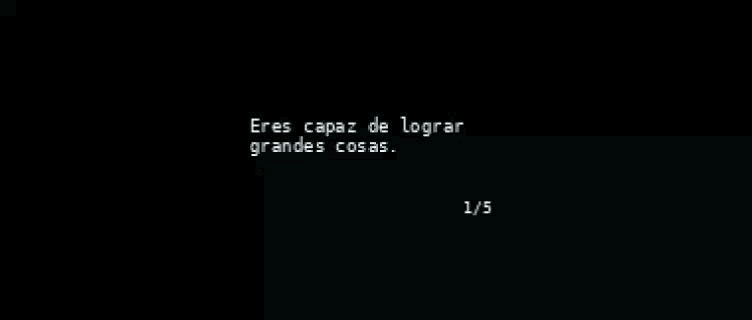

## Nombre del proyecto

**Integrantes:** 
- Magdalena Balart [_(magdalenabalart)_](https://github.com/disenoUDP/dis8645-2026-2-procesos-2/tree/main/02-magdalenabalart)
- Catalina Oyanedel [_(catalinaoyanedel-01)_](https://github.com/disenoUDP/dis8645-2026-2-procesos-2/tree/main/17-catalinaoyanedel-01)
- Yaira Ruiz [_(yairaruiz)_](https://github.com/disenoUDP/dis8645-2026-2-procesos-2/tree/main/26-yairaruiz)
- Marcela Zuñiga [_(marcezm)_](https://github.com/disenoUDP/dis8645-2026-2-procesos-2/tree/main/32-marcezm)

## Concepto
Durante la infancia, los primeros acercamientos a la tecnología muchas veces ocurrían a través de pequeñas máquinas que, con pantallas simples, botones y sonidos electrónicos, construían pequeños universos interactivos. No necesitaban grandes capacidades ni funciones complejas, si no que, bastaba con presionar un botón para descubrir algo nuevo, cambiar una expresión, recibir un mensaje o comenzar un juego.  
Estos dispositivos representaban una primera aproximación al mundo digital, donde el descubrimiento formaba parte de la experiencia y más que herramientas destinadas a resolver problemas, eran objetos que invitaban a imaginar, explorar y jugar.
A partir de esta idea, el proyecto busca recuperar esa experiencia de inmersión tecnológica sencilla buscando reinterpretar el lenguaje proponiendo un pequeño universo de interacción en torno a las emociones, donde cada acción abre una nueva posibilidad de exploración.

## Descripción general
El proyecto consiste en una máquina que tiene como fin ser un acompañamiento emocional, permitiendo explorar distintas formas de interactuar.

La máquina cuenta con tres estados de la pantalla principales:

- Modo 01 – Mensajes: presenta una serie de mensajes motivacionales que se pueden explorar.
- Modo 02 – Emociones: muestra emociones representadas con íconos de caras, las cuales pueden modificarse y elergirse.
- Modo 03 – Juego: presenta un juego en el que un personaje debe saltar obstáculos. Su nivel de dificultad cambia dependiendo de la emoción seleccionada.

### Referentes
Nuestra principal inspiración son los computadores de juguete de los años 2000, los cuales imitaban la apariencia de computadores convencionales, pero adaptaban sus funciones a una interacción más simple y accesible. Estos juguetes ofrecían experiencias de aprendizaje y entretenimiento mediante actividades predeterminadas, personajes digitales y juegos sencillos, utilizando pantallas simples y botones para ofrecer estas experiencias.

Elegimos como principal referente un Digital Desktop PC de la marca KB Learning Toys.


  
<details>
<summary> Funcionamiento Digital Desktop PC </summary>
 
Este computador en su interior se define el funcionamiento a través de tres sistemas: 

**1. La placa base central (PCB) y el chip "Blob"**

- **La PCB (Printed Circuit Board)** es una placa electrónica que conecta y organiza los componentes del computador

- **Chip «Blob» (Chip-on-Board)**

Blob es esa pequeña protuberancia negra, generalmente circular, que aparece sobre algunas placas electrónicas. 

En realidad, no es el chip propiamente tal, sino una capa de resina epoxi que protege un circuito integrado montado directamente sobre la placa. Esta técnica se conoce como Chip-on-Board (COB).

  - Interpretar las pulsaciones de los botones.
  - Ejecutar los juegos o actividades programadas.
  - Controlar los gráficos de la pantalla.
  - Gestionar sonidos y respuestas del juguete.
    
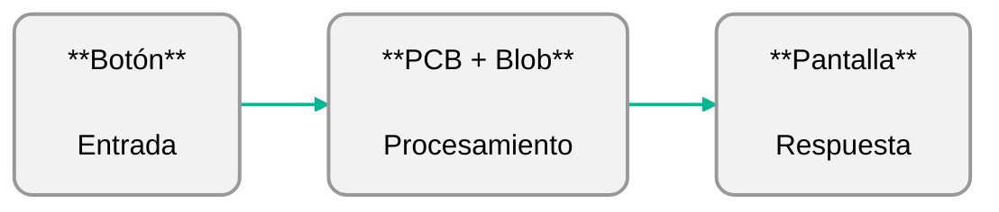

**2. El sistema de pantalla (Monitor)**

- **Pantalla LCD pasiva:** La carcasa de plástico imitaba la forma de un monitor convencional, mientras que la imagen se mostraba en una pequeña pantalla LCD.
- **Cables planos (Ribbon cables)**

**3. Conectividad y Puertos**

El computador utilizaba conexiones eléctricas simples para comunicar sus controles con la placa principal (PCB). En este tipo de juguetes, el teclado podía funcionar mediante una membrana con contactos conductores que detectaban las pulsaciones, mientras que el mouse se conectaba mediante un puerto físico para transmitir señales de movimiento y clic.

Este computador nos parece un referente interesante por la manera en que transforma la tecnología en una experiencia de juego sencilla y cercana. Nos llama la atención cómo, a través de controles físicos y respuestas visuales simples, logra despertar la curiosidad e invitar a la exploración. Queremos rescatar esa forma de interactuar, donde cada acción tiene una respuesta y el usuario aprende mientras juega.

</details>

### Decisiones
A partir de este referente, destacamos sus características como pantallas LCD, los botones físicos, colores vívidos, el teclado, los gráficos de baja resolución y que cuenta con estos tres modos (word games, math games y fun games). Decidimos mantener la estructura del monitor, ocupar el recurso del teclado para tener nuestros botones y perillas separadas de la pantalla, para proponer una experiencia similar a la de este tipo de computador, y tener 3 modos de "juego", reinterpretándolo con nuestro objetivo.

### Materialidad e interfaz
Planeamos realizar la carcasa en impresión 3d, para mantenernos fiel a las formas y materiales de nuestro referente. Mientras que con la interfaz, teníamos como propósito mostrar distintas formas de presentar la información, por lo que en cada modo se utiliza un lenguaje distinto para expresar el contenido: ilustraciones fijas para las emociones, texto para los mensajes y animación para el juego, utilizando como criterio de diseño forzar aún más la estética pixelada, manteniendo formas simples.

#### Interfaz
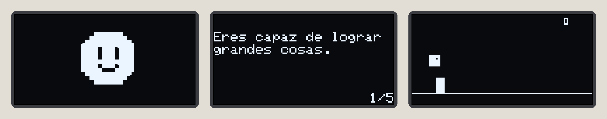

#### Boceto
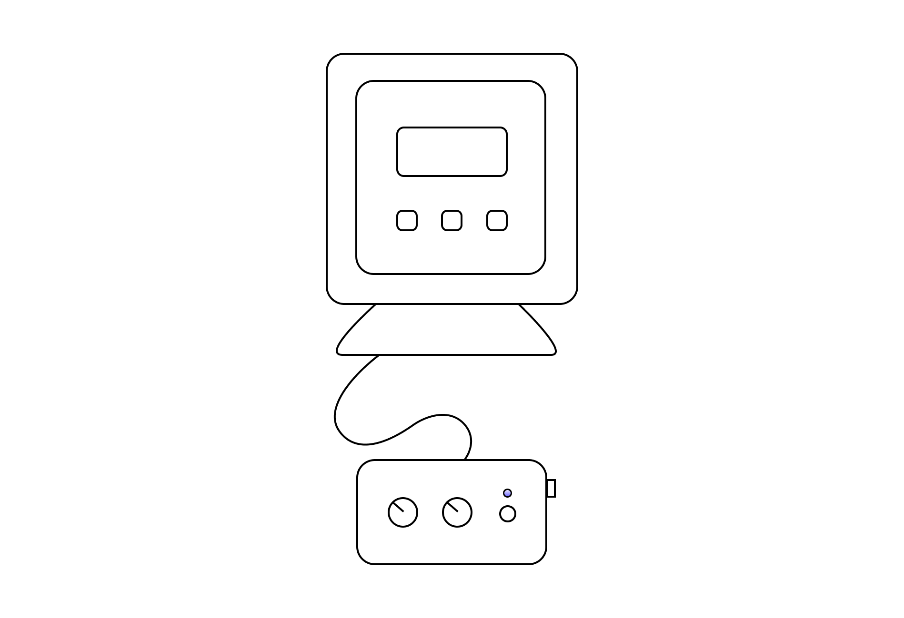

#### Modelado
Monitor:
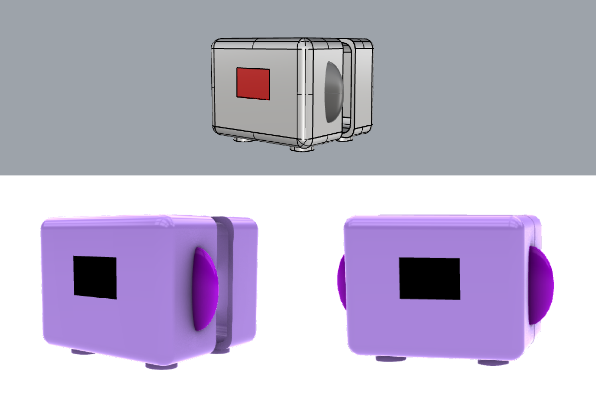

Botonera:
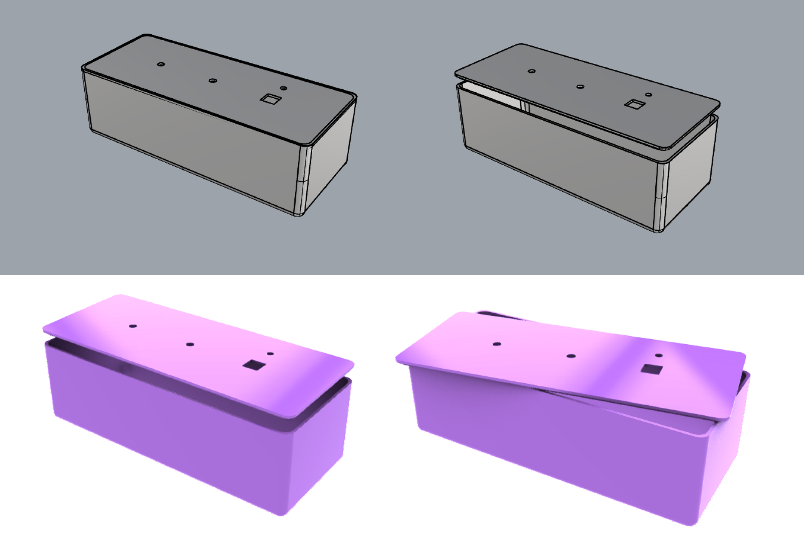

---

## Funcionamiento del sistema

### BOM: Lista de componentes

| **Control / Elemento** | **Componente** | **Especificación** | **Acción** |
|---|---|---|---|
| Botón de encendido/apagado | Botón pulsador | Momentáneo, conectado a GP14 | Alterna entre el estado encendido y apagado de la máquina. |
| Botón de salto | Botón pulsador | Momentáneo, conectado a GP15 | Permite ejecutar el salto del personaje durante el juego. Solo funciona en el modo 03. |
| Perilla de selección de modo | Potenciómetro | Tipo lineal, conectado a GP26. Tres rangos de selección. | Permite cambiar entre los tres modos de pantalla: Emociones, Mensajes y Juego. |
| Perilla de selección emocional | Potenciómetro | Tipo lineal, conectado a GP27. Cuatro rangos de selección. | Permite seleccionar una de las cuatro emociones disponibles. |
| Perilla de selección de mensajes | Potenciómetro | Tipo lineal, conectado a GP27. Cinco rangos de selección. | Permite navegar entre los cincos mensajes disponibles. |
| Luz indicadora | LED + resistencia 330k | LED conectado a GP13, con resistencia limitadora de corriente. | Se enciende al seleccionar el modo 03, indicando que el juego está activo. |
| Pantalla | Pantalla OLED | Controlador SSH1106, resolución 128 × 64 píxeles. | Presenta las expresiones, mensajes y elementos gráficos del juego. |
| Unidad de control | Microcontrolador | Raspberry Pi Pico 2 W, chip RP2350, 150 MHz, 520 KB RAM y 4 MB flash. | Procesa las entradas de los botones y potenciómetros, controla los modos de funcionamiento y gestiona las respuestas visuales de la pantalla y el LED. |


### Esquemático

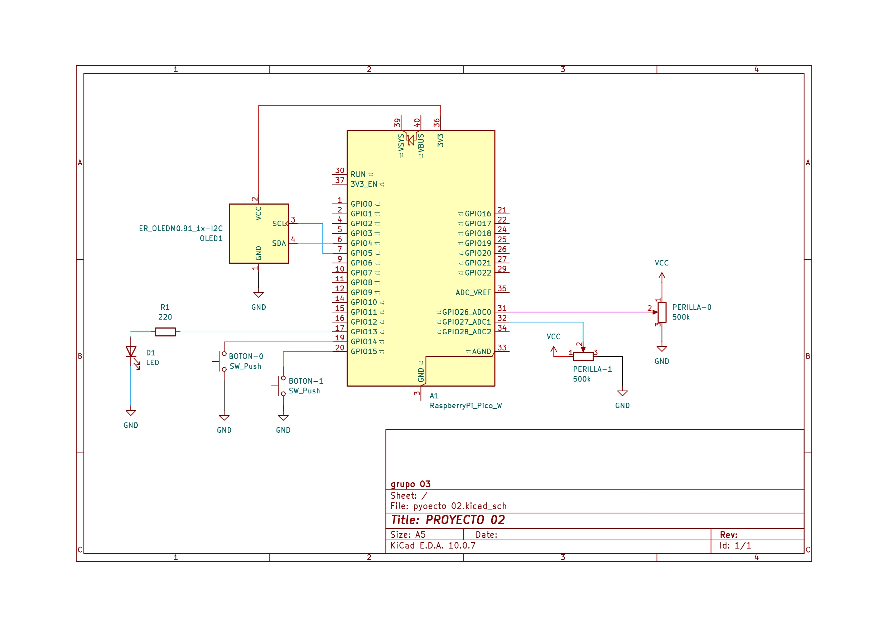

### Diagramas de flujos
Definen la experiencia del usuario y cómo funciona cada componente.

#### Experiencia de uso
Encender el dispositivo: la persona presiona el botón de encendido para iniciar la máquina y activar la pantalla.

1. Encender el dispositivo: presionar botón de encendido para empezar la interacción.
2. Seleccionar un modo: gira la perilla de navegación para recorrer los tres modos disponibles: Mensajes, Emociones y Juego.
3. Explorar los mensajes (Modo 01): gira la perilla de navegación hasta el primer modo. La pantalla muestra mensajes motivacionales breves como afirmaciones y reflexiones. Se exploran los cinco disponibles con la perilla de selección de mensajes.
4. Explorar las emociones (Modo 02): gira la perilla de navegación hasta el segundo modo. Girar la perilla de selección emocional para navegar y seleccionar las cuatro expresiones disponibles.
5. Iniciar el juego (Modo 03): gira la perilla de navegación hasta el tercer modo. La pantalla presenta el juego y se enciende una luz LED que indica que el botón de salto está habilitado. 
6. Interactuar con el juego: presiona el botón de salto para que el personaje esquive los obstáculos. La dificultad del juego varía dependiendo de la emoción seleccionada en el Modo 02. 
7. Cambiar de modo: gira nuevamente la perilla de navegación para acceder a cualquiera de los tres modos. La máquina conserva la última emoción seleccionada para utilizarla en juego. 
8. Apagar el dispositivo: presiona nuevamente el botón de encendido para desactivar la pantalla y finalizar la interacción. 

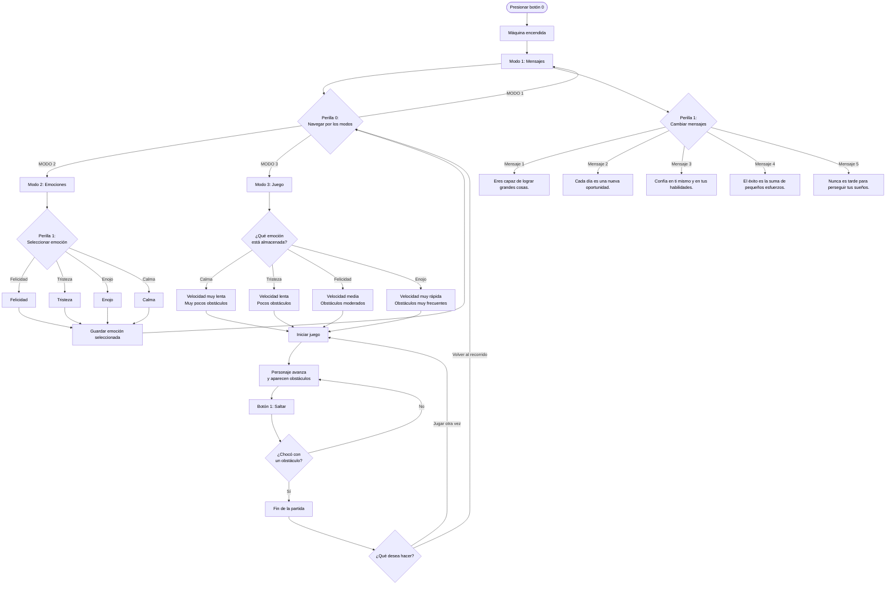

<details>
<summary> Botón 0: en detalle </summary>

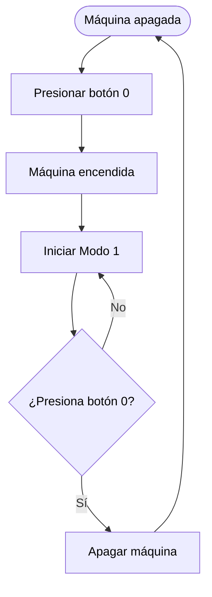
</details>

<details>
<summary> Botón 1: en detalle </summary>
  
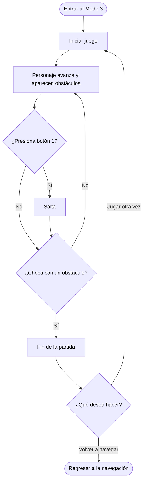
</details>

<details>
<summary> Perilla 0: en detalle </summary>

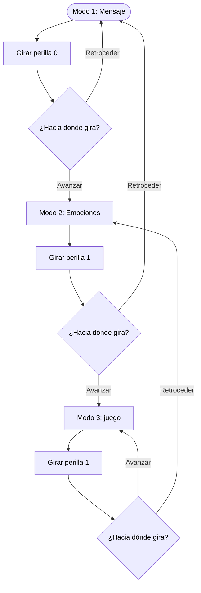
</details>

<details>
<summary> Perilla 1 : en detalle </summary>
  
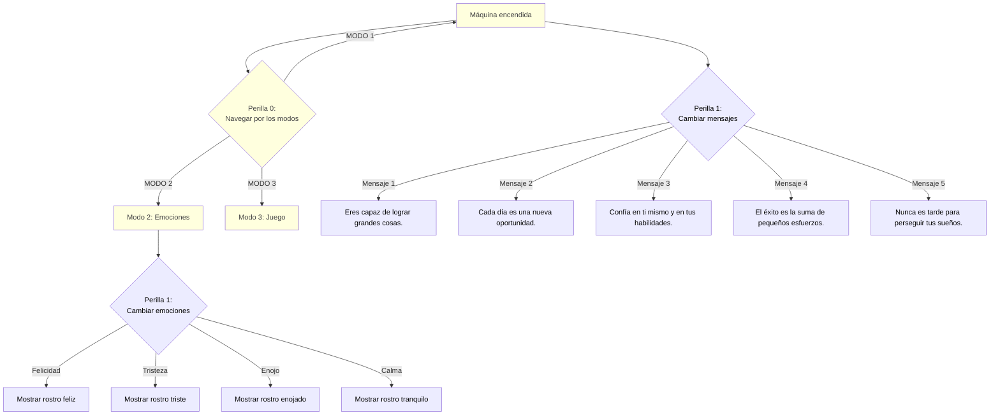

</details>

## Estructura del código

```
codigo/
├── main.cpp
  └── Boton.h              // clases de componentes
  └── Boton.cpp
  └── Perilla.h
  └── Perilla.cpp
  └── Led.h
  └── Led.cpp
  └── Pantalla.h
  └── Pantalla.cpp
  └── Emociones.h         // clases de modos de pantalla
  └── Emociones.cpp
  └── Mensajes.h
  └── Mensajes.cpp
  └── Juego.h
  └── Juego.cpp
  └── Rostros.h          // graficas de emociones

```

### Wokwi 

Utilizamos Wokwi para simular el funcionamiento de la máquina de emociones. Nos permitió probar los botones, las perillas, el LED y la pantalla OLED, tanto individualmente como conectados entre sí. También lo usamos para visualizar los rostros y mensajes en pantalla, comprobar las interacciones entre los componentes y revisar mediante la consola si las acciones realizadas respondían correctamente.  
  
https://wokwi.com/projects/479334243939894273

### Clases escritas por nosotras

#### `Perilla`

Qué hace: representa un potenciómetro, que entrega un valor analógico según cuánto se gire. La clase convierte ese valor en algo que el programa entiende como una opción concreta, como la emoción número 2 o el mensaje número 4. Para eso divide el recorrido en partes iguales y promedia varias lecturas para filtrar el ruido. También tiene un margen de movimiento mínimo (umbral) que hace que la opción solo cambie cuando la perilla realmente se movió. Así no parpadea entre dos opciones cuando está en el límite. En la máquina hay dos: una navega entre las pantallas y otra elige la emoción o el mensaje.

Atributos:
- `int patita`: identifica el pin donde esta conectada
- `int pin`: identifica la entrada análoga
- `int canal`: identifica el canal ADC pines físicos que corresponde a la patita
- `int valor`: guarda el ultimo valor analógico de la perilla entre 0 y 4095
- `int cantidadOpciones`: define cuantas opciones puede seleccionar la perilla
- `int opcionSeleccionada`: guarda la opción seleccionada según el rango del potenciómetro
- `int tipo`: identifica el tipo de perilla (la 0 o la 1)
- `bool movio`: indica si la perilla se movió
-  `int umbral`: // define el cambio mínimo para considerar que la perilla se movió
-  `bool invertir`: permite invertir el sentido de la perilla
  
Métodos:
- `int muestrear()`: realiza varias lecturas
- `int leerValor()`: obtiene y guarda el valor analógico del potenciómetro
- `int posicion(int cantidad)`: convierte el valor analógico en una posición de 0 a cantidad - 1, dividiendo el recorrido en partes iguales
- `void definirOpciones(int numeroOpciones)`: establece cuántas opciones puede seleccionar la perilla y recalcula la opción seleccionada
- `void calcularOpcion()`: convierte el valor analógico en una opción y la guarda en opcionSeleccionada
- `void leer()`: hace una nueva lectura y la compara con el valor anterior; si el cambio supera el umbral, actualiza valor y deja movio en true. Así el ruido no cambia la opción (histéresis)


Constructor:
- Recibe el pin de la perilla, recibe el tipo y cantidad de opciones, permite configurar inversion y umbral. Configura el pin como entrada analógica y hace la primera lectura.

```cpp
  Perilla(int nuevoPin, int nuevoTipo = 0,
          int nuevaCantidadOpciones = 0,
          bool nuevoInvertir = false,
          int nuevoUmbral = 30);
```

Se relaciona con: `main.cpp`, que usa una perilla para navegar entre las 3 pantallas (GP26, 3 opciones) y otra para elegir la emoción o el mensaje (GP27, 4 opciones).

------

#### `Led`

Qué hace: controla una luz que se enciende o se apaga. Su función es avisar al usuario, se prende solo en el modo del juego para indicar que el botón de salto está disponible. Cada vez que la máquina cambia de pantalla, la clase decide si el LED debe quedar prendido o apagado. Aporta una respuesta visual fuera de la pantalla.

Atributos:
- `int patita`: pin donde está conectado el LED
- `bool prendido`: indica si el LED está encendido o apagado

Métodos:
- `void prender()`: enciende el LED
- `void apagar()`: apaga el LED
- `void actualizar(int modoActual)`: enciende el LED si la máquina está en el modo 03 (juego) y lo apaga en cualquier otro modo

Constructor:
- recibe el pin del LED, lo configura como salida y lo deja apagado.

```cpp
  Led(int nuevoPin);
```

Se relaciona con: `main.cpp`, que llama a actualizar(modoActual) en cada vuelta.

------

#### `Pantalla`

Qué hace: maneja la pantalla OLED de 128 x 64 píxeles. Funciona como un lienzo con memoria: primero se dibuja todo ahí (puntos, rectángulos, imágenes y texto) y después se envía completo a la pantalla por I2C, que es el protocolo de comunicación. Además de dibujar rostros, tiene su propia tipografía de píxeles y sabe escribir texto en varias líneas.

Atributos:

- `uint8_t buffer[1024]`: dibujo en memoria, 128 columnas por 8 páginas de 8 píxeles

Métodos:

- `bool iniciar()`: configura el I2C y la pantalla; devuelve false si la pantalla no responde
- `void encender()` y `void apagar()`: prenden y apagan la pantalla
- `void mostrar()`: envía el dibujo propio a la pantalla
- `void enviarBuffer(const uint8_t* datos)`: envía un dibujo cualquiera (lo usa el juego)
- `void limpiar()`: deja todo en negro
- `void pixel(int x, int y, bool encendido)` y `void rect(int x, int y, int w, int h, bool relleno)`: dibujan un píxel o un rectángulo
- `void bitmap(const uint8_t* datos, int ancho, int alto, int x, int y)`: dibuja una imagen de 1 bit por píxel (el formato de `Rostros.h`)
- `void caracter(...)`, `void texto(...)`, `void textoCentrado(...)`: escriben letras de 5 x 8 píxeles
- `int anchoTexto(const char* s, int escala)`: cuántos píxeles de ancho ocupa un texto
- `int textoEnvuelto(int x, int y, const char* s, int columnasMax, int escala)`: escribe un texto en varias líneas sin cortar palabras y devuelve cuántas líneas usó

Se relaciona con: `Mensajes`, `Emociones` y `Juego`, que dibujan con ella, y `main.cpp`, que la crea e inicia.

------

#### `Emociones`

Qué hace: controla lo que pasa en el modo 01, guarda las cuatro emociones (felicidad, tristeza, enojo y calma) y todo lo que va asociado a cada una: su nombre, su rostro y su nivel de dificultad para el juego. Se encarga de dibujar el rostro correspondiente cuando el usuario gira la perilla. Su dato más importante es la emoción elegida, porque conecta dos partes de la máquina: lo que el usuario siente y cómo se juega. Por ejemplo, el enojo da el juego más rápido y la calma el más lento.

Atributos:
- `const char* emociones[4]`: nombres de las emociones (0 felicidad, 1 tristeza, 2 enojo, 3 calma)
- `int dificultades[4]`: nivel de dificultad de 1 a 4 de cada emoción (3, 2, 4 y 1)
- `const uint8_t* rostros[4]`: dibujo de cada emoción, en el mismo orden (vienen de Rostros.h)
- `int indiceActual`: la emoción que se está viendo en pantalla
- `int ultimoDibujado`: la última emoción dibujada (-1 = ninguna). Evita redibujar sin necesidad

Métodos:
- `void entrarEmociones()`: se llama al entrar al modo; fuerza a dibujar de nuevo el rostro
- `void actualizarEmocion(int opcion)`: guarda la opción que viene de la perilla como emoción actual (limitada de 0 a 3)
- `int emocionSeleccionada()`: devuelve el índice de la emoción elegida
- `const char* obtenerNombre(int emocion)`: devuelve el nombre de esa emoción, o "Desconocida" si el índice no existe
- `int obtenerDificultad(int emocion)`: devuelve la dificultad de esa emoción (1 a 4), o 1 si el índice no existe
- `void dibujarEmocion(Pantalla &pantalla)`: dibuja el rostro de la emoción actual, solo si cambió

Se relaciona con: `Pantalla` (para dibujar), `Rostros.h` (los dibujos) y `main.cpp`, que guarda la emoción elegida y le pasa su dificultad al juego.

------

#### `Mensajes`

Qué hace: controla lo que pasa en el modo 02, guarda la lista de mensajes motivacionales y decide cuál se muestra según la perilla. Al dibujar, parte el texto en varias líneas sin cortar palabras, para que quepa en la pantalla, y agrega un contador (por ejemplo 2/5) para que el usuario sepa que hay más por explorar. También se preocupa de no redibujar si el mensaje no cambió, lo que evita parpadeos.

Atributos:

- `const char* mensajes[5]`: los textos de los mensajes (sin tildes ni ñ, porque la fuente de la pantalla solo tiene letras ASCII)
- `int cantidadMensajes`: cuántos mensajes hay (se calcula sola)
- `int mensajeActual`: mensaje que se está mostrando
- `int mensajeDibujado`: último mensaje dibujado (-1 = ninguno). Evita redibujar sin necesidad

Métodos:

- `void entrarMensajes()`: se llama al entrar al modo; vuelve al primer mensaje y fuerza a dibujarlo
- `void seleccionarMensaje(int indice)`: elige el mensaje con el valor de la perilla (limitado al rango válido)
- `void siguienteMensaje()`: avanza al próximo mensaje y vuelve al primero al llegar al final
- `void dibujarMensaje(Pantalla &pantalla)`: dibuja el mensaje actual en varias líneas y el contador, solo si cambió

Se relaciona con: `Pantalla` (para dibujar) y `main.cpp`, que le entrega la posición de la perilla.

------

#### `Juego`

Qué hace: controla lo que pasa en el modo 03, el personaje se queda fijo en pantalla y los obstáculos avanzan hacia él, lo que da la sensación de que corre. La clase calcula en cada instante la posición de todo según el tiempo real que pasó, simula el salto con una fuerza hacia arriba y la gravedad, detecta los choques, y va generando un puntaje en base a los obstaculos superados. La emoción elegida cambia la velocidad y la frecuencia de los obstáculos. Al perder, muestra el puntaje y el botón de salto empieza una partida nueva.

Atributos:

- `uint8_t buffer[1024]`: dibujo del juego en memoria (128 x 64 píxeles, 1 bit por píxel)
- `void (*enviarPantalla)(const uint8_t*)`: función que manda el dibujo a la pantalla real (la asigna el main)
- `float personajeY`: altura del personaje sobre el suelo (0 = en el suelo)
- `float velocidadY`: velocidad vertical del personaje
- `float obstaculoX[8], int obstaculoAlto[8], bool obstaculoVivo[8]`: posición, altura y estado de cada obstáculo (hasta 8 a la vez)
- `int puntuacion`: obstáculos superados
- `bool activo`: true = partida en curso, false = partida terminada
- `int dificultad`: 0 calma, 1 tristeza, 2 felicidad, 3 enojo
- `int velocidadObstaculos`: velocidad de los obstáculos en px/s
- `int frecuenciaObstaculos`: milisegundos aproximados entre un obstáculo y el siguiente
- `atributos internos`: ultimoTiempo, msParaNuevoObstaculo

| Dificultad | Emoción | Velocidad (px/s) | Entre obstáculos (ms) |
| --- | --- | --- | --- |
| 0 | Calma | 50 | 2400 |
| 1 | Tristeza | 65 | 1900 |
| 2 | Felicidad | 85 | 1500 |
| 3 | Enojo | 120 | 1000 |

Métodos:

- `void iniciar()` y `void reiniciar()`: dejan todo en cero y empiezan una partida
- `void configurarDificultad(int nuevaDificultad)`: fija velocidad y frecuencia según la dificultad (0 a 3)
- `void saltar()`: hace saltar al personaje, solo si está en el suelo
- `void actualizar()`: mueve el personaje y los obstáculos según el tiempo transcurrido, crea obstáculos nuevos, suma puntos y revisa si hubo choque
- `bool detectarColision()`: true si el personaje toca un obstáculo
- `void dibujar()`: arma el cuadro completo (suelo, personaje, obstáculos y puntaje) y lo envía a la pantalla
- `void limpiar()`, `void pixel(...)`, `void rect(...)`, `void numero(...)`: herramientas de dibujo en el buffer

Funciones para el main:

- `entrarJuego(int dificultad)`: al entrar al modo 03; configura la dificultad y empieza la partida
- `actualizarJuego(bool botonSaltoPresionado)`: en cada vuelta; salta, o reinicia si la partida ya terminó
- `dibujarJuego()`: en cada vuelta; dibuja el cuadro
- `salirJuego()`: al salir del modo 03 o apagar la máquina

Se relaciona con: `main.cpp` (le entrega el botón y la dificultad) y Pantalla (a través de enviarPantalla). No usa pines propios.

------

#### Metodología, proceso y uso de IA:

La IA se utilizó como apoyo durante la programación y las pruebas del proyecto, principalmente para resolver dudas técnicas, entender errores y buscar soluciones a los problemas que fueron apareciendo. Para trabajar con ella, utilizamos como base lo que ya habíamos definido para la máquina de emociones: qué debía hacer cada componente, cómo debía conectarse y cuáles eran las condiciones para que funcionara dentro del sistema.   
  
**Orientación en programación C++**: apoyo para comprender la estructura de las clase y la relación entre los componentes.  
**Resolución de errores**: identificación de posibles causas de errores de compilación, configuración de CMake y problemas de integración entre clases.  
**Desarrollo de lógica:** apoyo para revisar la lógica de funcionamiento de los botones, la selección de modos, la activación del LED y la interacción entre los componentes.  
**Depuración y pruebas:** orientación para crear pruebas individuales del funcionamiento de cada componente (main.cpp de testeo) y utilizar el monitor serial.

------

### Clases de terceros
Hechas por grupo 04

#### `Boton`

Qué hace: Representa los botones físicos. Filtra el rebote del botón y avisa con eventos qué pasó en cada vuelta del programa (se presionó, se soltó, clic, doble clic o pulsación larga). En nuestro caso, el botón 01 enciende y apaga la máquina y el botón 02 hace saltar al personaje.

Atributos:

- `int patita`: identifica el pin donde esta conectado
- `bool presionado`: indica si el botón está presionado en este momento
- `int duracionPresionado`: milisegundos que lleva presionado
- `bool seAcabaDePresionar`: evento, es true solo en la vuelta del programa en que se presionó
- `bool seAcabaDeSoltar`: evento, es true solo en la vuelta en que se soltó
- `bool clicSimple`: evento, un clic simple
- `bool dobleClic`: evento, dos clics seguidos dentro de la ventana de tiempo
- `bool pulsacionLarga`: evento, el botón se mantuvo presionado más de tiempoLargo
- `bool permitirDoble`: si es false, el clic simple se detecta de inmediato al soltar
- `int tiempoAntirrebote`: milisegundos que debe estar estable la lectura para creerla (20)
- `int tiempoLargo`: milisegundos para considerar una pulsación larga (1000)
- `int ventanaDoble`: tiempo máximo entre dos clics para un doble clic (300 ms)
- `atributos internos`: ultimaLectura, largoDisparado, clics, ultimoCambio, inicioPresion, ultimoSoltado

Métodos:

- void leer(): se llama en cada vuelta del programa. Borra los eventos anteriores, lee el pin, aplica el antirrebote y detecta los eventos nuevos
- void presionar(): registra que el botón se presionó
- void soltar(): registra que el botón se soltó y cuenta el clic

Constructor:
- recibe el pin del botón y si se permite el doble clic. Configura el pin como entrada con pull-up interno (sin presionar lee 1, presionado lee 0).

```cpp
  Boton(int nuevaPatita, bool nuevoPermitirDoble = true);
```

Se relaciona con: `main.cpp`. El botón de encendido (GP14, sin doble clic) usa clicSimple; el botón de salto (GP15) usa seAcabaDePresionar, que se le entrega a `Juego`.

# Resultados
Como resultado logramos hacer funcionar todo en protoboard, y pudimos modelar la carcasa. En cuanto a la impresión de esta, tuvimos un problema que no anticipamos, y fue que el espacio de la botonera quedó demasiado justo, por lo que no pudimos sacar los cables por la salida que teníamos predestinada para conectar esta parte con la de la pantalla.

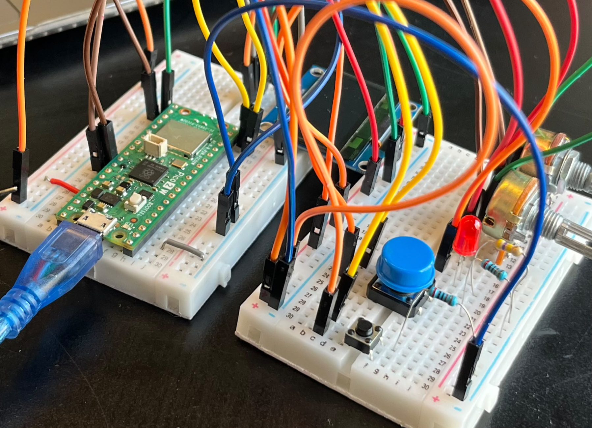
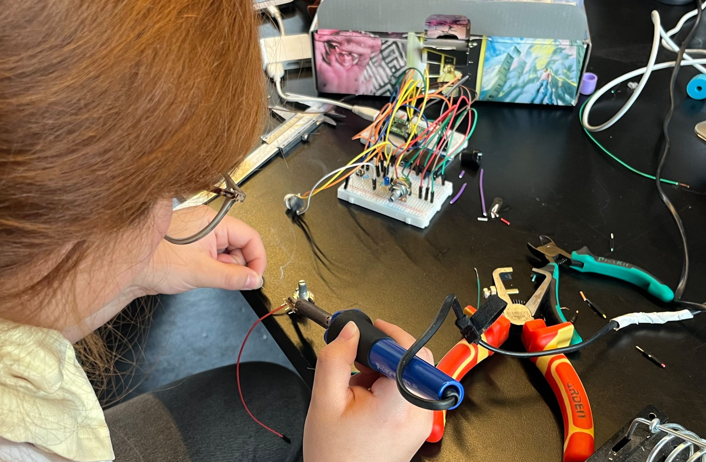
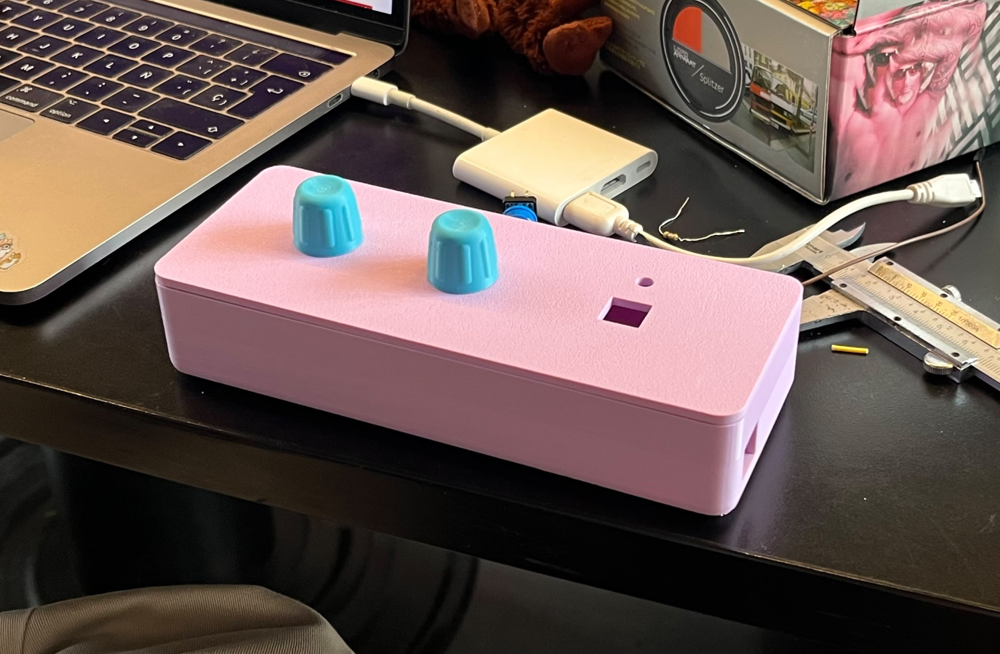
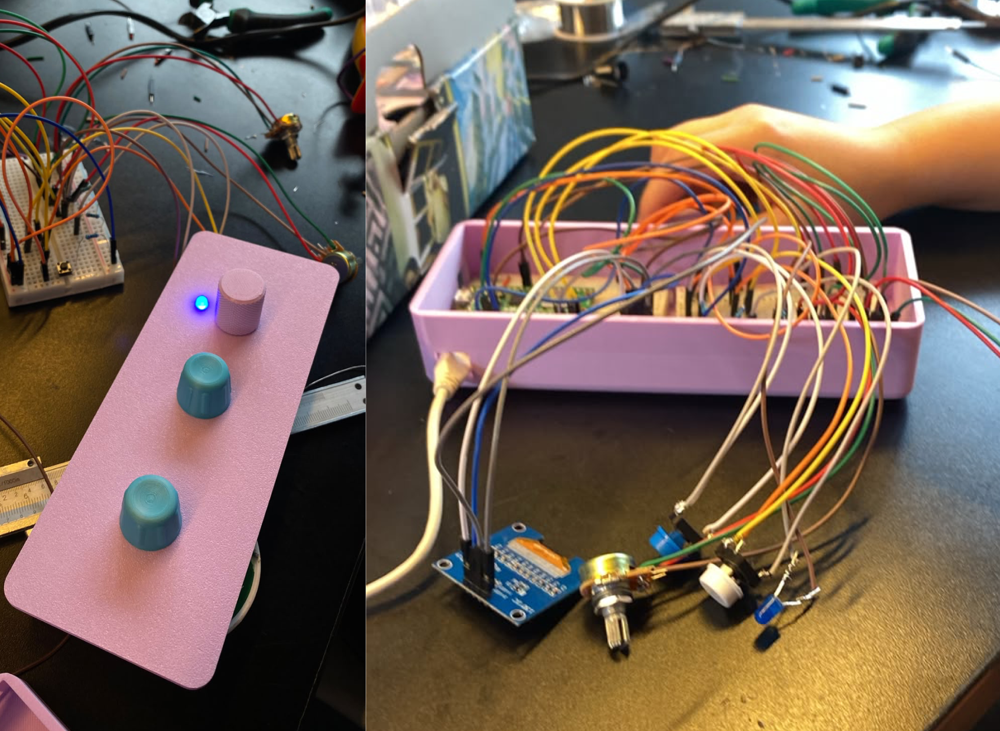
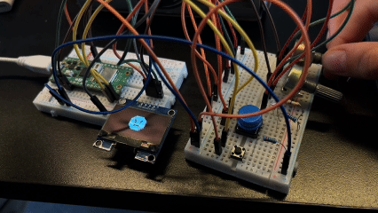

### Aprendizajes

**Habilidades:**
- Entendimos como funcionaba una clase, para qué servía cada archivo de esta (el `.h` es el que indica qué hace y el `.cpp` cómo lo hace), y que luego en el `main.cpp` se establece en qué orden ocurre cada paso.
- A utilizar a la IA como una herramienta con cual tener una constante iteración, siempre revisando y dándonos el tiempo de entender sus resultados.
- Logramos definir un sistema computacional donde cada componente logra una función.
- Pudimos trabajar con bitmaps, texto y realizar un juego animado desde 0.

**Aciertos:**
- Antes de empezar a hacer algo con el código, planificamos muy bien qué queríamos lograr, qué haría cada componente, la estructura que buscábamos del código y qué necesitaba cada clase.
- Organizamos todo constantemente en listas de las cosas que debíamos hacer, ya que era mucha información, para mantenernos informadas y poder dividirnos.
- A partir de una buena comunicación logramos distribuir tareas de manera equitativa, donde todas pudimos poner de nuestra parte en las áreas de nuestro interés y aprender cosas nuevas, siempre explicándonos si la otra no entendía.

**Errores:**
- Nos demoramos en empezar a planificar y trabajar, por lo que el tiempo que tuvimos nos jugó en contra para la carcasa que teníamos planeada.


### Bibliografía:
- kp_mcclard. (s. f.). Vtg KB Learning Toys 90s desktop kids educational toy computer keyboard mouse [Anuncio de venta con fotografías]. eBay. https://www.ebay.es/itm/407262442228
- Nardi, T. (2020, 27 de abril). Teardown: VTech Whiz Kid luggable computer. Hackaday. https://hackaday.com/2020/04/27/teardown-vtech-whiz-kid-luggable-computer/
- Mitchell, R. (2016, 13 de octubre). Retro teardown: TI's Super Speak & Spell. All About Circuits. https://www.allaboutcircuits.com/news/retro-teardown-tis-super-speak-spell/


