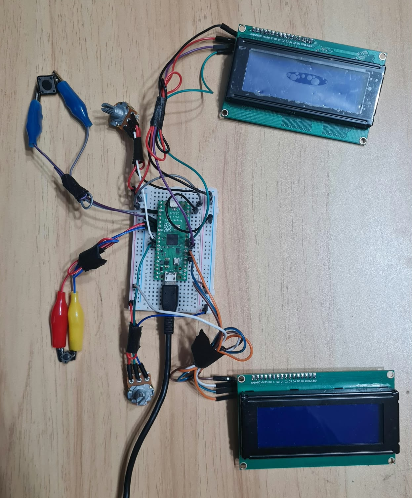
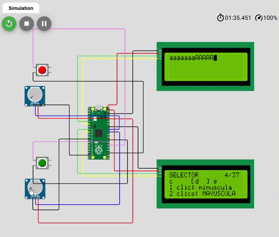
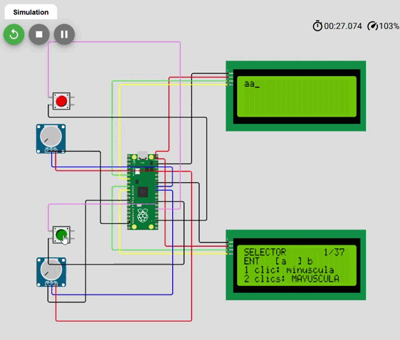
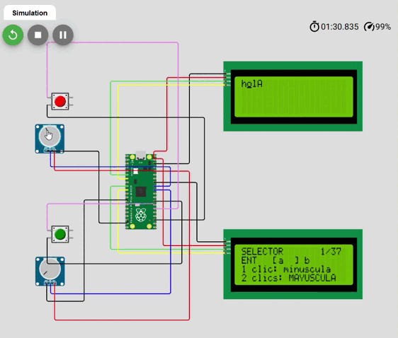
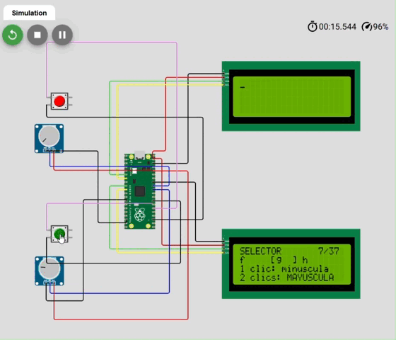
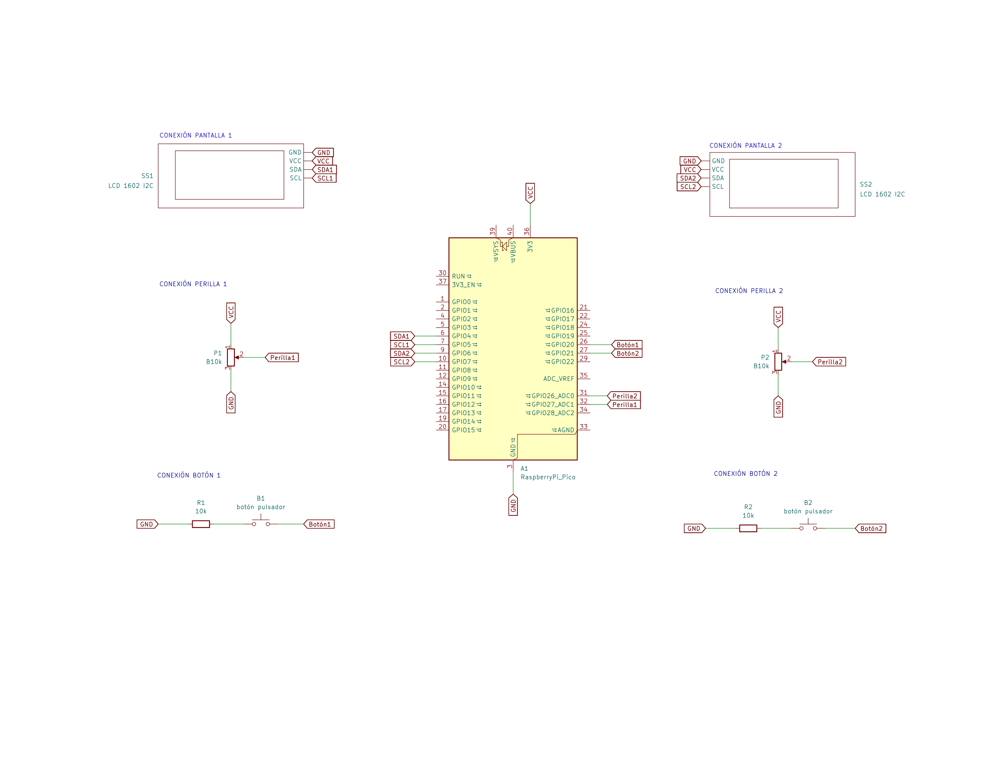
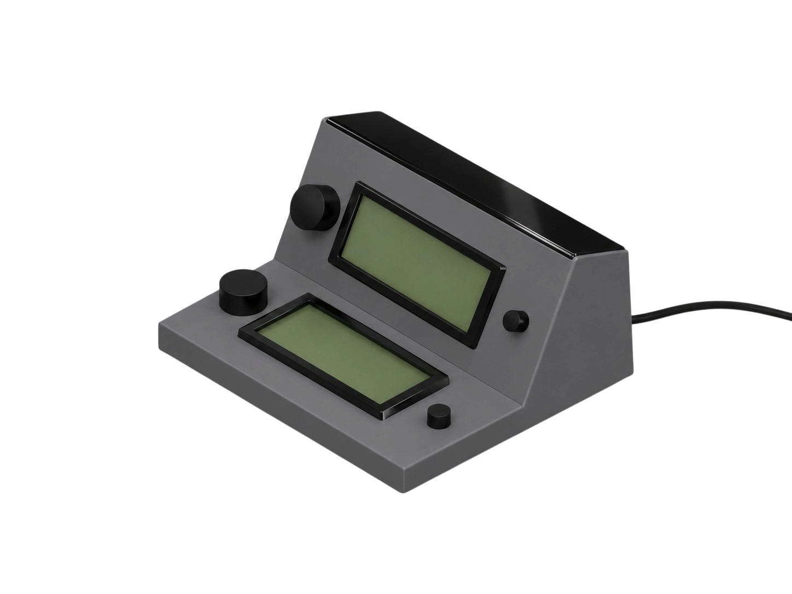

# Proyecto-2 / grupo-04

Fecha de entrega: 2026-11-03

---

## Integrantes

Emilia Contreras / [hazzaily](https://github.com/hazzaily) / Diagrama de flujo, esquemático, documentación, carcasa.

Kristel Ladrón de Guevara / [kristelagj](https://github.com/kristelagj) / Esquemático, registro, documentación.

Monserrat Paredes / [Monserrat-Paredes](https://github.com/Monserrat-Paredes) / Código, documentación.

Katalina Riquelme / [riyakatalinaa](https://github.com/riyakatalinaa) / Diagrama de flujo, documentación.

---

## Importante 

Todas las imágenes y gifs son de nuestra autoría.

Todos los gifs e imágenes se encuentran subidos en la carpeta de "imagenes".

Códigos subidos por fecha en la carpeta "codigos".

Conversaciones con Claude al final del ReadMe.

Visualizar proyecto [Wokwi proyecto-02](https://wokwi.com/projects/478683034244407297)

---

## Referentes

 - **Nokia 9000 (1998):** Contaba con un teclado alfanumérico integrado (qwerty)

 - **Nokia 3310 (2000):** Su teclado es multitap, lo que hace que en una tecla se encuentren varios caracteres que pueden ser seleccionados según la cantidad de veces que se presione el mismo botón.

 - **PS1 (1997):** En ciertos juegos o partidas permitía escribir palabras cortas, como nombres de usuario, esto era a través de las *analog stick* con el cual se pre seleccionaba el carácter y con el botón x se seleccionaba y se imprimía.

## Idea principal

Nuestro proyecto se basará en el texto multitap que tenían los teléfonos Nokia, los cuales cada números contiene 3 letras que debes presionar para que estos aparecieran en la pantalla, también en los joystick de la PS1, que permitían digitar textos cortos para añadir nombres de usuario, entre otras cosas.

Bajo esta idea, queremos generar una máquina en donde en una pantalla se pueden digitar caracteres los cuales tienen variaciones que pueden ser seleccionadas presionando un botón 2 veces (mayúscula o minúscula). Además, queremos añadir como opción caracteres especiales, tab, enter, etc.

Funciona a través de un selector de caracteres (perilla), que nos permite escoger las letras para formar palabras o no y finalmente seleccionarlas con un botón que puede ser presionado 1 o 2 veces.

También podemos editar el texto que imprimimos en una segunda pantalla con una segunda perilla que puede recorrer el texto para añadir un carácter, borrarlo, o borrar todo lo digitado si se mantiene presionado.

---

## Proceso

Comenzamos buscando qué ideas o aparatos funcionaban a partir de los elementos solicitados, como por ejemplo podrían ser las máquinas de casinos (juegos de azar).

Además, como grupo encontramos importante mencionar la situación en la que nos encontramos y que fue ponernos de acuerdo, en gran mayoría, de manera online y coordinar nuestros tiempos a partir de la práctica, ¡pero todo terminó resultando bien!

Nos entregaron ciertos referentes en clase de donde podíamos comenzar a investigar y hacer un cover, pero decimos mencionar, utilizar y hacer un “cover” de algo que incluyera los requerimientos que son las perillas y botones, o sea, tanto cómo se escribía desde los teléfonos nokia 9000, a como se escribía en las consolas como la PS3. Delimitando así estos parámetros: 

Después de decidir que debíamos hacer, comenzamos a definir detalladamente los métodos que deben realizar las pantallas, botones y perillas. 

**PANTALLA 1:** 

 - Pantalla 1: imprime la información que fue previamente seleccionada en la pantalla 1, la cual se puede editar con la perilla 2 y el botón 2.

 - Perilla 1: debe recorrer el texto caracter por caracter de ida y/o de vuelta, permitiéndonos editarlo en cualquier parte del texto (con botones).

 - Botón 1: dependiendo de la cantidad de pulsaciones (solo una pulsación) en la primera pantalla borra sólo un carácter, o (dos pulsaciones) se mantiene pulsado en la segunda pantalla

**PANTALLA 2:**

 - Pantalla 2: proyecta los caracteres: (a, b, c, d, e, f, g, h, i, j,k, l, m, n, o, p, q, r, s, t, u, v, w, x, y, z, tab, enter) y en ella se recorren para seleccionarlos.

 - Perilla 2: debe recorrer los caracteres uno a uno para así poder seleccionar alguno, que el recorrido sea lento y que no se vaya todo de golpe de un extremo al otro. 

 - Botón 2: selecciona el carácter que se selecciona con la perilla 1, si se presiona una vez, la letra se imprime en minúscula, y si se presiona 2 veces se imprime en mayúscula.

**¿Qué hará cada uno de forma individual?:**

Botón 1: borrar información 

Botón 2: presionar opción / presionar dos veces: segunda opción 

Perilla 1: elegir la letra

Perilla 2: recorrer el texto

---

## Clases y código del proyecto

Cada clase está en sus propios archivos: el `.h` dice qué tiene y el `.cpp` dice cómo lo hace.

En clase Boton encontramos:

- **Botón genérico:** lo usan ambos grupos.
- **04:** solo el Grupo 04 (máquina multitap).
- **03:** solo el Grupo 03 (máquina de emociones).

| Clase | Qué es | Qué hace en el proyecto | Archivos |
|---|---|---|---|
| **Botón genérico** (parte común) | Un botón físico, para los dos grupos | Detecta si está apretado, y si fue clic simple, doble, triple o pulsación larga. Se puede cambiar el cableado y los tiempos | `Boton.h`, `Boton.cpp` (carpeta `boton_proyecto02`) |
| **Botón Grupo 04** (multitap) | El botón de nuestro proyecto | Agrega `permitirDoble`: el botón de borrar no espera un segundo clic. Instancias: `botonSelector` (1 clic = minúscula, 2 clics = MAYÚSCULA) y `botonBorrar` (1 clic borra un carácter, mantenerlo borra todo) | Misma clase `Boton` |
| **Botón Grupo 03** (emociones) | El botón de la máquina de emociones | Agrega `pin`, `estado` y `funcion`, y los métodos `esta_presionado()` y `fue_presionado()`. Puede alternar entre encendido y apagado. Instancias: `boton_encendido` y `boton_salto` | Misma clase `Boton` |
| `Perilla` | Un potenciómetro | Dice en qué tramo está la perilla, para elegir un carácter o mover el cursor | `Perilla.h`, `Perilla.cpp` |
| `Pantalla` | Una pantalla LCD 20x4 | Escribe líneas de texto y mueve el cursor | `Pantalla.h`, `Pantalla.cpp` |
| `Selector` | La lista de caracteres | Guarda las 37 opciones (letras, símbolos, TAB y ENTER) y cuál está elegida | `Selector.h`, `Selector.cpp` |
| `Editor` | El texto digitado | Guarda el texto y el cursor, inserta y borra caracteres, y los reparte en 4 filas de 20 | `Editor.h`, `Editor.cpp` |

---

### Qué hace cada archivo

Cada clase vive en sus propios archivos: el `.h` declara, el `.cpp` implementa y el main no es una clase, pero es el programa principal que junta todo y hace que funcione.

| Archivos | Qué contienen |
|---|---|
| `main.cpp` | El programa principal, que conecta todas las clases |
| `Boton.h` · `Boton.cpp` | El botón: clic simple, doble y pulsación larga |
| `Perilla.h` · `Perilla.cpp` | El potenciómetro: lee su posición |
| `Pantalla.h` · `Pantalla.cpp` | El LCD 20x4: escribe en la pantalla |
| `Selector.h` · `Selector.cpp` | La lista de caracteres y el elegido |
| `Editor.h` · `Editor.cpp` | El texto digitado y el cursor |
| `diagram.json` | El cableado de Wokwi |

## Conexiones

| Componente | Pines Raspberry |
|---|---|
| Pantalla de texto (I2C0) | SDA GP4, SCL GP5 |
| Pantalla del selector (I2C1) | SDA GP6, SCL GP7 |
| Potenciómetro selector | SIG GP26 |
| Potenciómetro cursor | SIG GP27 |
| Botón borrar | GP20 (a GND, con pull-up interno) |
| Botón selector | GP21 (a GND, con pull-up interno) |

Foto de las conexiones en físico.

#### *seleccionar*

#### *escribir*

#### *borrar*

#### *buscar*
 

#### *ejemplo*

## Diagramas de flujo

## Esquemáticos

**Bill Of Materials**

| Componente       | Referencia | Qty | Valor        | Precio | Link                                                                                       |
|------------------|------------|-----|--------------|--------|--------------------------------------------------------------------------------------------|
| RaspberryPi_Pico | A1         |   1 |              | $11290 | https://raspberrypi.cl/products/raspberry-pi-pico-w-con-conexion-wifi                      |
| Botón Pulsador   | B1, B2     |   2 |              | $100   | https://afel.cl/products/kit-boton-tactil-6x6x5-interruptor-5-unidades                     |
| Pantalla         | SS1, SS2   |   2 | LCD 1602 I2C | $4633  | https://www.mercadolibre.cl/modulo-lcd-20x4-con-interfaz-2004-para-display/p/MLC2035293542 |
| Perilla          | P1, P2     |   2 | B10k         | $500   | https://afel.cl/products/potenciometro-10k-ohm                                             |
| Resistor         | R1, R2     |   2 | 10k          | $20    | https://afel.cl/products/kit-500-resistencias-1-2w-50-valores                              |

## Carcasa

Intentamos traer la estética de los objetos que seleccionamos para el render de la carcasa hecho en rhino y posteriormente pasado por chatgpt y photoroom.

## Bibliografía

**Información:**

[Wikipedia - Información Multi-Tap](https://en.wikipedia.org/wiki/Multi-tap)

[Wikipedia - Dual Analog Controller](https://en.wikipedia.org/wiki/Dual_Analog_Controller)

[Wikipedia - Dual Analog](https://es.wikipedia.org/wiki/DualAnalog)

**Imágenes:**

[Nokia 9000](https://www.elmundo.es/tecnologia/2026/08/15/6a8014c6e4d4d85a078b458d.html)

[Nokia 3310](https://www.t13.cl/noticia/tendencias/tecnologia/es-cierto-va-regresar-indestructible-nokia-3310-plena-era-smartphones)

[Play Station 1](https://www.fullcompras.cl/Sony-Playstation-PS-One---Consola-de-videojuegos-renovada?srsltid=AYCX9vL8oIILWeRBE8-nlHRv45sFf17SLITUHpGW-0kN0Bel9h7SiZZu)

**Conversor de tablas excel a markdown:** 

[Tables Generator](https://www.tablesgenerator.com/markdown_tables)

## Prompts usados

[Chats con Claude](https://github.com/disenoUDP/dis8645-2026-2-procesos-2/blob/main/00-proyecto-2/grupo-04/codigos/promptproyecto-02.pdf)
