**Realizado por:**  
*Francisca Jesús Palma Cuevas (frannciscapalma)*
&nbsp;&nbsp;&nbsp;&nbsp;&nbsp;&nbsp;&nbsp;&nbsp;&nbsp;&nbsp;&nbsp;&nbsp;&nbsp;&nbsp;&nbsp;&nbsp;
*Nicolás Elías Valdés Greve (nicolasvaldesgreve)*&nbsp;&nbsp;&nbsp;&nbsp;&nbsp;&nbsp;&nbsp;&nbsp;&nbsp;&nbsp;&nbsp;&nbsp;&nbsp;&nbsp;&nbsp;&nbsp;
*Santiago Cifuentes Vélez (santiagocifuvelez)*&nbsp;&nbsp;&nbsp;&nbsp;&nbsp;&nbsp;&nbsp;&nbsp;&nbsp;&nbsp;&nbsp;&nbsp;&nbsp;&nbsp;&nbsp;&nbsp;
*Tomás Antonio Catrileo Curihual (tomascatri)*&nbsp;&nbsp;&nbsp;&nbsp;&nbsp;&nbsp;&nbsp;&nbsp;&nbsp;&nbsp;&nbsp;&nbsp;&nbsp;&nbsp;&nbsp;&nbsp;

 <br>
 
 **Principios de diseño**
- Fuente abierta

 **Entregables:**   
 - *Simulación digital en wokwi*
 - *Prototipo físico tangible de altiro hero*

**Descargables**
- Carcasa [modelos 3d](https://github.com/santiagocifuvelez/dis8645-2026-2-procesos-2/tree/main/00-proyecto-2/grupo-05/modelos-3d)
- Kicad [esquemático](https://github.com/santiagocifuvelez/dis8645-2026-2-procesos-2/tree/main/00-proyecto-2/grupo-05/esquematicos/altiro-hero)

**Indice:**   
- Génesis del proyecto
   - Contexto / investigación / referentes.
- Diagramas de flujo
   - Experiencia de usuario
   - Máquina (altiro hero)
   - Perillas
   - Botones
- Factura de materiales
   - Horas de trabajo
- Pseudocódigo del rol de los componentes
   - Switch
   - Botones
   - Perillas
- Esquemático
- Simulación digital en wokwi
- Construcción tangible de Altiro hero
   - Circuito
   - Carcasa
   - Equipo de trabajo
- Prompt y Cluade
- Agradecimientos 
- Referentes

# Génesis del proyecto

<details>

## Contexto del proyecto:

<details>

Nuestro proyecto consiste en la creación de un dispositivo interactivo de entretenimiento. Elegimos como computador de referencia para el diseño de la carcasa y la interfaz, la **Game Boy Color**, principalmente por la estética de su carcasa y por la forma en que organiza sus controles.


Fue lanzada en 1998 como sucesora de la Game Boy original y trajo una mejora gráfica al poder mostrar juegos en color, algo revolucionario en su momento para las consolas portátiles. Una de las versiones más llamativas que sacaron fue el modelo transparente, permitiendo a los usuarios ver los componentes internos, lo cual era una tendencia estética muy querida a finales de los años 90.

Para definir la dinámica del juego, nos inpiramos en **Guitar Hero** y **DJ Hero**.


Del primero, tomamos su mecánica, en la que el jugador debe presionar el botón correspondiente en el momento justo, siguiendo el ritmo de la canción. Esto nos interesó porque convierte la coordinación entre una secuencia visual y una acción física en el centro de la experiencia. Del segundo rescatamos el movimiento que tiene el jugador a lo largo de la interfaz, deslizandose para coincidir con el patrón del juego.

Es así como nace **Altiro Hero**, una máquina de entretenimiento compuesta por dos botones y dos perillas, en la que el jugador debe seguir un patrón de luces al ritmo de la música.

El dispositivo se enciende con un interruptor ubicado en la parte inferior del costado derecho de la máquina. Su pantalla es una matriz de 8x8 LEDs, que dividimos en cuatro columnas de dos LEDs de ancho cada una. Por estas columnas descienden los rectángulos de luz que conforman el patrón del juego. Bajo la matriz, a la izquierda, se encuentra una perilla, y a la derecha, un botón. Con la perilla, el jugador se desplaza horizontalmente para elegir la columna en la que se posicionará, y con el botón responde al patrón en el momento en que el rectángulo llega a la fila delimitada para el jugador de 1 LED de altura y 8 de ancho que está en la parte inferior de la matriz. Si acierta, la casilla se ilumina de verde; si falla, de rojo. 

El juego cuenta con tres niveles, que se eligen desde el menú con el segundo botón, ubicado en el costado derecho: una pulsación avanza entre nivel 1, 2 y 3, y para seleccionar el nivel deseado se presiona el botón que está debajo de la matriz LED cuando el número del nivel se muestre en la pantalla. Debajo del botón que se encuentra al costado derecho hay una segunda perilla que permite aumentar o disminuir la velocidad de descenso del patrón, lo que ajusta la dificultad a tu gusto. Cada nivel dura un máximo de dos minutos y al superarlo sin cometer ningún error, comienza el siguiente de manera automática, mientras que si cometes un error vuelves al menú de selección de niveles. Una vez completados los tres niveles, el dispositivo regresa al menú inicial.

</details>

## La idea

<details>


    
</details>
</details>


# Diagramas de flujo 
<details> 
 
## Experiencia de usuario

<details> 

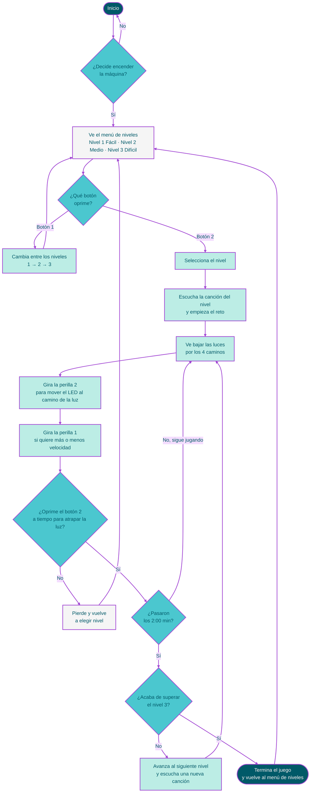
</details>

## Máquina

<details> 

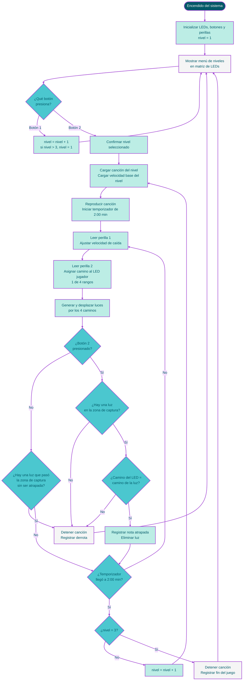
</details>

## Botones 

<details> 
 
 Botón 1:
 ```mermaid
%%{init: {'theme':'base','themeVariables':{'fontFamily':'Arial','lineColor':'#A247D3','primaryTextColor':'#005968'}}}%%
flowchart TD
    A([La máquina revisa<br/>el botón 1]) --> B{"¿La persona<br/>lo presionó?"}
    B -- No --> A
    B -- Sí --> C["Se registra una pulsación<br/>(mantenerlo apretado<br/>no cuenta más veces)"]
    C --> D["El nivel cambia<br/>1 → 2 → 3 → 1"]
    D --> E["La matriz de LEDs<br/>muestra el nuevo nivel"]
    E --> A

    classDef inicio fill:#005968,stroke:#A247D3,stroke-width:2px,color:#F5F5F5;
    classDef decision fill:#4BC7CF,stroke:#A247D3,stroke-width:2px,color:#005968;
    classDef proceso fill:#BCEDE5,stroke:#A247D3,stroke-width:2px,color:#005968;
    classDef aviso fill:#F5F5F5,stroke:#A247D3,stroke-width:2px,color:#005968;

    class A inicio;
    class B decision;
    class C,D proceso;
    class E aviso;

    linkStyle default stroke:#A247D3,stroke-width:2px;
```
 
</details>

<details> 

Botón 2 
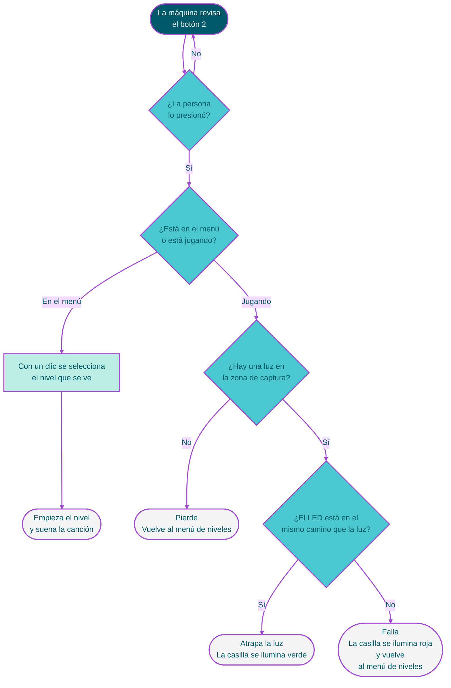
 
</details>

## Perillas 

<details> 
    
Perilla 1 (velocidad)

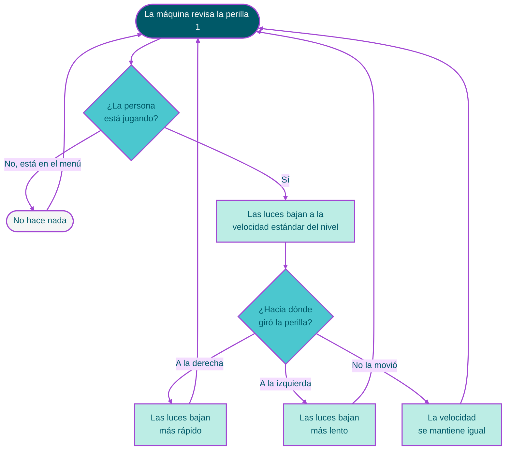

</details>   

<details> 
    
Perilla 2 (mueve el LED)

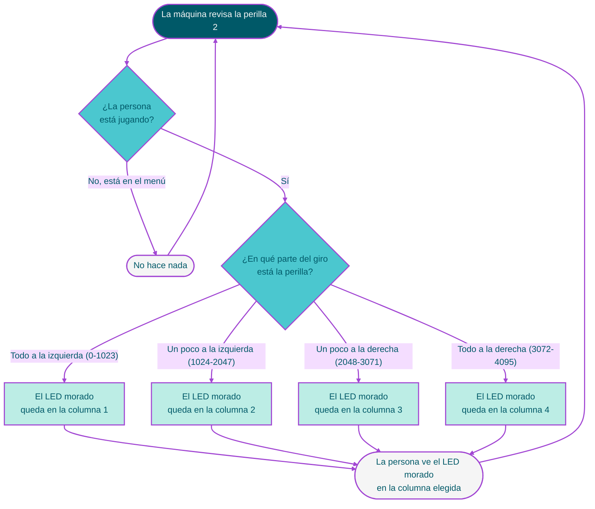
</details>   
    
</details>

# Factura de materiales:

<details> 

 ## Precios
 
<details> 

Nuestro proyecto será un juego de ritmo el cual tendrá los siguientes componentes:

| Componentes | Cantidad | Precio unitario | Link |
| --- | --- | --- | --- |
| Raspberry Pi Pico 2W | 1 | $14.990 | <https://raspberrypi.cl/products/raspberry-pi-pico-2-w-con-headers> |
| Matriz LED RGB 8×8 con WS2812B | 1 | $9.990 | <https://afel.cl/products/matriz-led-rgb-88-con-ws2812b-64-pixeles-direccionables> |
| Parlante 36mm 8Ω | 1 | $2.290 | <https://pinout.cl/producto/parlante-mini-redondo-de-8-ohm> |
| Botón pulsador | 2 | $100 | <https://afel.cl/products/boton-tactil-tapa-12x12x7-3-interruptor> |
| Potenciómetro b100k | 2 | $495 | <https://altronics.cl/potenciometro-lineal-100k-b100k> |
| Palanca switch | 1 | $400 | <https://afel.cl/products/interruptor-mts-102-3-pines> |

---

</details>

## Registro de horas de trabajo

<details> 

# Registro de horas de trabajo

| Fecha | Día | Tiempo trabajado |
|-------|-----|------------------|
| 2026-10-17 | Sáb | 1 h |
| 2026-10-18 | Dom | 0 |
| 2026-10-19 | Lun | 2 h |
| 2026-10-20 | Mar | 4 h |
| 2026-10-21 | Mié | 0 |
| 2026-10-22 | Jue | 2 h |
| 2026-10-23 | Vie | 5 h |
| 2026-10-24 | Sáb | 8 h |
| 2026-10-25 | Dom | 0 |
| 2026-10-26 | Lun | 0 |
| 2026-10-27 | Mar | 12 h |
| 2026-10-28 | Mié | 10 h |
| 2026-10-29 | Jue | 6 h 30 min |
| 2026-10-30 | Vie | 6 h |
| 2026-10-31 | Sáb | 13 h |
| 2026-11-01 | Dom | 5 h 30 min |
| 2026-11-02 | Lun | 11 h |
| **Total** | | **86 h** |

</details>
</details>

# Pseudocódigo del rol de los componentes:

<details>
 
## Switch

```cpp
Switch publico

int patita
bool bascular // aprendimos palabra nueva

switch enciende
switch apaga // (?)
```

- Switch: Encendido y apagado del juego
    - Para apagar la pantalla, posición 0
    - Para encender la pantalla, posición 1
    

## Botones

```cpp
Botón publico (todo público, no olvidar)

bool presionado
int duracionPresionado
int patita

Boton lee
Boton presiona
Boton suelta
```

- Botón 1: Cambio de nivel del juego (nivel 1, 2 y 3)
    - Tres estados posibles: presión 1, presión 2, presión 3. con presion 4 volver a estado 1.
    - En presión 1, selección de nivel de dificutlad 1
    - En presión 2, selección de nivel de dificultad 2
    - En presión 3, selección de nivel de dificultad 3

- Botón 2: Selección del LED posicionado
    - Al presionar el botón en la casilla correcta, se pone el LED en verde
    - Al presionar el botón en la casilla incorrecta, se pone el LED en rojo

## Perillas

```cpp
Perilla pública

int patita
int posicion

void leer
```
    
- Perilla 1: Cambio de velocidad del nivel
    - Resolución de la perilla en raspi es de 0-4095, se usará este espectro para controlar la velocidad en la que caen los rectángulos que debes atrapar en la fila inferior de la pantalla. 0 es la velocidad más lenta mientras que 4095 es la más rápida.
    
- Perilla 2: Recorrido de la posición del led 
    - Resolución de la perilla en raspi es de 0-4095, se delimitará cuatro posiciones posibles para poder moverte con este dentro de la pantalla.
        - Posición 1, rectángulo en extremo inferior derecho
        - Posición 2, rectángulo en mitad derecha inferior
        - Posición 3, rectángulo en mitad izquierda inferior
        - Posición 4, rectángulo en extremo inferior izquierdo.

 </details>

# Esquemático 
    
 <details>
  
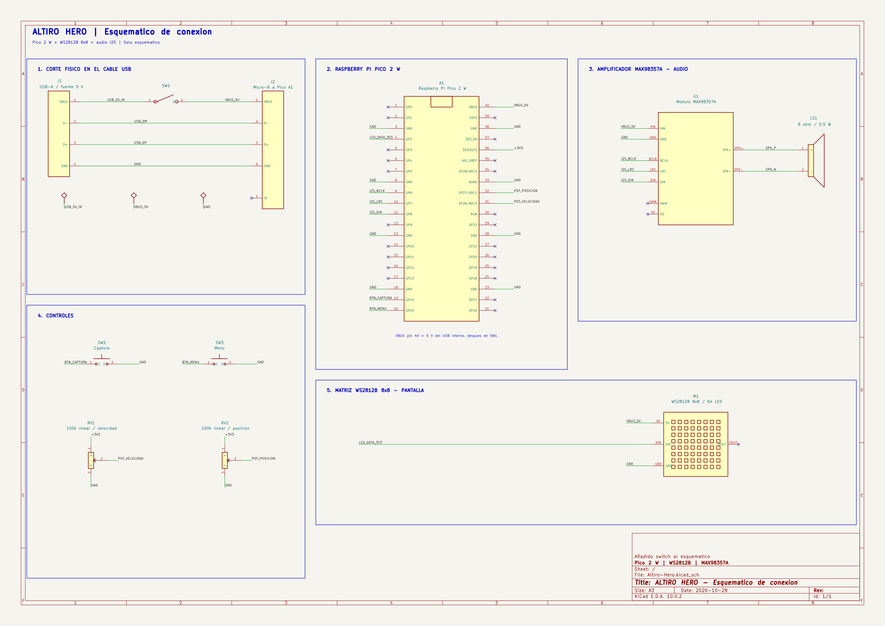

 </details>
 
# Simulación digital en wokwi

<details>

[Prototipo en wokwi](https://wokwi.com/projects/479619611701093377)
 
 </details>

# Construcción tangible de Altiro hero

<details>

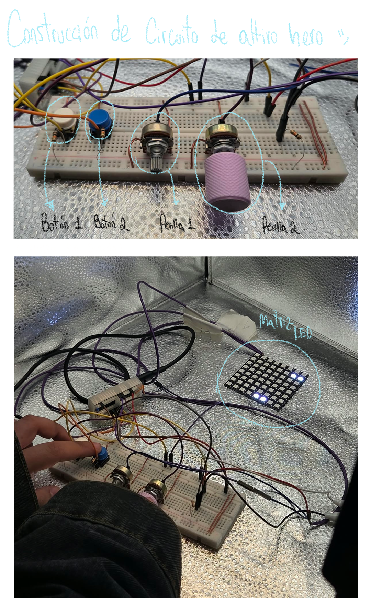
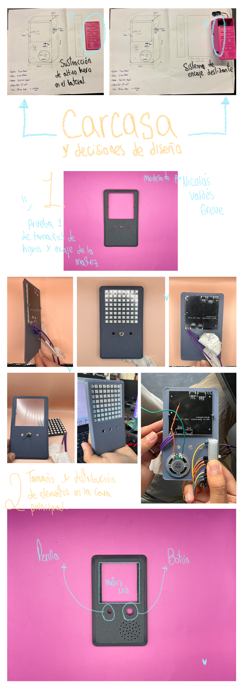
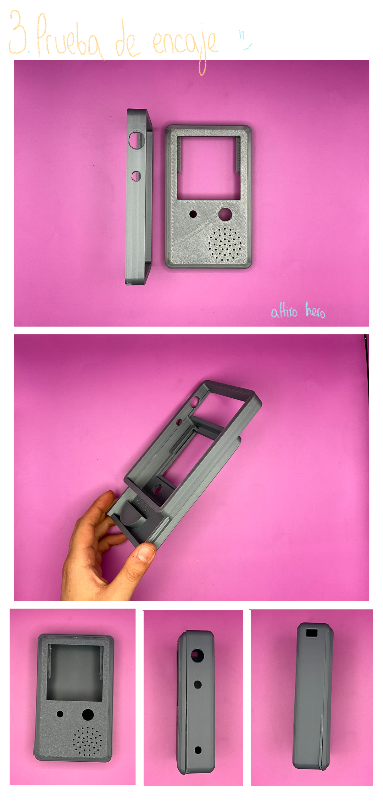
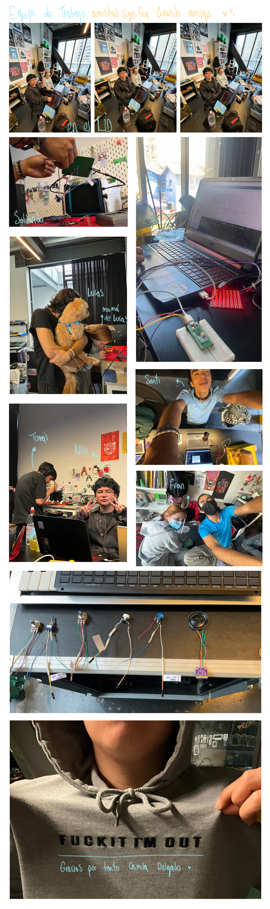
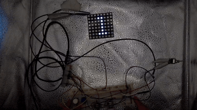
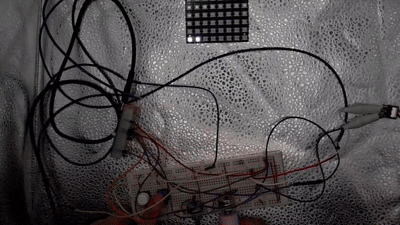   
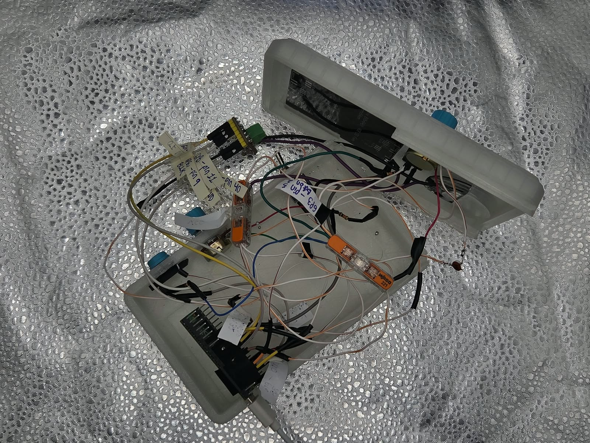
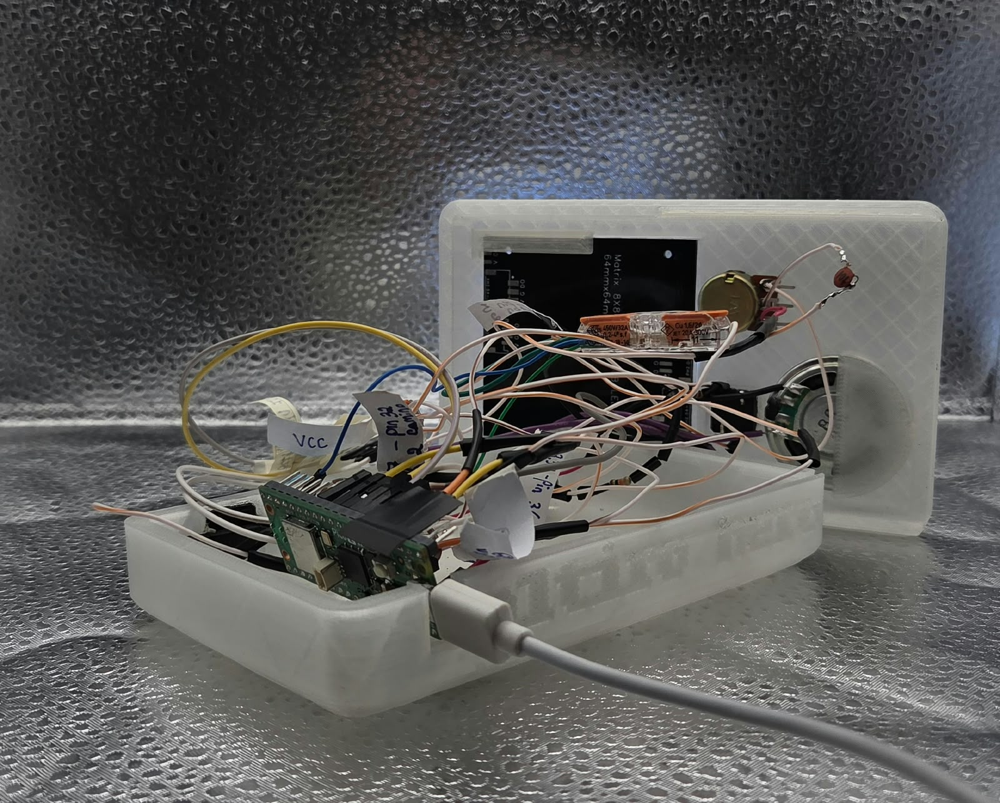
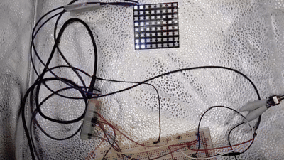

---
    
</details>

# Código oficial 

<details>

[aquí](https://github.com/santiagocifuvelez/dis8645-2026-2-procesos-2/tree/main/00-proyecto-2/grupo-05/codigos/codigo-oficial)

</details>

# Prompt y Cluade

<details>

Todo comenzó con la explicación del proyecto a Claude escrito a manera de prosa para la creación de los diagramas de flujo en código de mermaid para ser puestos en este repositorio.

A partir de este contexto general con el cual se crearon los diagramas de flujo, utilizamos este ejemplo [2026-10-06-clases](https://wokwi.com/projects/477335809803977729) para tomar la estructura y manera de proceso del código en lenguaje c++ que se nos fue enseñada en el taller, y en base a ello, comenzamos junto a Claude, a escribir las clases y luego comenzar a tejer el proyecto. 

Usamos el ingles para encaminar de manera precisa lo que se quería obtener, y el español para narrar el proyecto.

> Diagrama de flujo experiencia de usuario.
Hey claude i’m doing a proyect, with my team and it consists of creating an interactive computational machine that combines analog and digital elements, inspired by various entertainment devices such as the Game Boy, Guitar Hero, and DJ Hero.
This is how (name of our baby, still doesn’t have a name) came to life: a pocket-sized entertainment device equipped with two buttons and two knobs. It works as follows:
The game has four lanes along which lights of different colors continuously descend, similar to Piano Tiles. The player must move between these lanes and match the color of each descending light to continue playing. If they fail to match the correct color in the corresponding lane, they lose. And I want you to help me creating the code for the flowchart for mermaid and github. 
Imma tell u how it works in spanish because is easier for me to explain how it works:

> Se comienza por el inicio (inicio), donde la persona comienza el recorrido por el programa y luego llega a una decisión donde debe decidir si enciende la máquina o no (encender): si escoge no (no), no continua y debe volver al inicio.
Sí escoge sí (sí), debe seleccionar un nivel entre los siguientes para comenzar el juego:
nivel: 1, 2 y 3 (nivel 1: fácil, nivel 2: medio, nivel 3: difícil):

> Comentario:  El nivel se cambia y se selecciona con botón 1; 
> Cambiar: oprimir una vez. 
> Seleccionar; oprimir dos veces.

> y luego de escoger el nivel se inicia el juego dependiendo del cual se haya escogido (inicio del juego), y funciona de esta manera:

> Con el botón 2, se puede mover entre los cuatro caminos para atrapar la luz que va bajando, y con la perilla 2 se cambia el color de la led que se mueve entre los cuatro caminos que es equivalente al color de la luz que va bajando para hacer match. 

> Para aumentar o disminuir la velocidad de bajada de las luces, se utiliza la perilla 1.

> ¿Qué pasa si pierde? le regresa a la selección de niveles para seleccionar uno volver a comenzar.

> ¿Qué pasa si continua sin perder? después de pasar 2:00 min, pasa al siguiente nivel, y así sucede con todos los niveles. Cuando se termina el nivel 3, se termina el juego y vuelve otra vez a la selección de niveles. 

> Funcionamiento de botones y perillas:

> Botones:
> boton 1: 

> * Oprimir una vez: cambiar de nivel, navegar en ese menú.
> * Oprimir dos veces: seleccionar el nivel. 

> boton 2: cambiarse de camino, navegar entre los 4 caminos.

> Perillas: 
> perilla 1: aumenta o disminuye la velocidad de las luces que bajan.
> perilla 2: solo se mueve entre cuatro rangos, los cuales son los cuatro caminos del juego.


> Now that you know how it works, create the flowachart whit code for mermaid flowchart and github.

Luego de esto, se creó el documento `.h` de la clase Perilla siguiendo paso a paso los ejemplos de clase, ejemplo con el cual se encamino la simplificación de atributos y métodos en el código ya que Claude aunque lo había hecho bien, estaba haciendo de más (comparábamos con como era la estructura de los ejemplos de clase y nos percatábamos de ello), y eso hacia que el código fuera más complejo para nuestro entendimiento, así que luego le dimos la instrucción de que tomara como referencia la clase que se creó. 

Después, para que Claude tuviera un mayor contexto, le mencionamos los elementos que estábamos utilizando para que si bien el código funcionara en wokwi, también funcionara en Visual Studio Code para el prototipo físico y tangible.  

> Hey claude, now that u have the context and how is the language of the c++ I'm using, the order or the files, clasess etc..., I want you to the help me creating the code for this work in my microcontroller. I'm using a raspberry pi pico 2 w. 

> Let's go step by step, but I want to make an aclaration, that is that with button 1 we are moving trough the levels, and with button 2 we are selecting  the level.

> The elements we are using are:
> Matriz LED RGB 8×8 con WS2812B. For the ligths, and we are couting 2 files as a one.
> Parlante 36mm 8Ω (for the sound)
> Max98357A (for the sound)
> Botones pulsador
> Potenciómetros b500k
> Protoboard.

Let's write the library, and prototiping it first in wokwi, and then we can do it in visual studio code, for the real life prototyping.
    
Ya para el toque final, le pedimos a ChatGPT que añadiera sonido en los pines asignados usando este prompt, que se perfeccionó gracias a la experimentación de sonido: 

> Integra sonido en mi proyecto para Raspberry Pi Pico 2 W, usa Visual Studio Code. Recuerda poner sonido en todo.

> Primero revisa el código y trabaja directamente en esa carpeta. Conserva la lógica, las animaciones y los controles existentes.

> Usa esta configuración de audio, que ya probé y funcionó:
> - Núcleo Arduino-Pico de Earle Philhower.
> - Biblioteca I2S.h.
> - Frecuencia de muestreo: 16000 Hz.
> - Muestras de 16 bits con signo.
> - Onda cuadrada.
> - Misma muestra en ambos canales mediante audio.write16(muestra, muestra).
> Conexiones del MAX98357A:
> Señal	Pico 2 W
> BCLK	GP6, pin físico 9
> LRC	GP7, pin físico 10
> DIN	GP8, pin físico 11
> VIN	VBUS, pin físico 40, alimentando la Pico por USB
> GND	GND, pin físico 38
> SD	Sin conectar
> GAIN	Sin conectar


> El parlante de 8 Ω y 1 W está conectado entre SPK+ y SPK−.

> Implementa el motor siguiendo este patrón:
> - I2S audio (OUTPUT, 6, 8); LRC utiliza automáticamente GP7.
> - bool core1_separate_stack = true;
> - Inicialización de audio en setup1() con audio.setBitsPerSample(16) y audio.begin(16000).
> - Generación continua de muestras en loop1().
> - Funciones sonido (frecuencia, duración) y silencio().
> - Control de duración con millis(), manteniendo responsive el núcleo principal.
> - Enviar muestras cero cuando no haya una nota activa.
> Deja un único ajuste directo en Volumen.h:
> constexpr int AUDIO_AMPLITUDE{2000};
> El valor 2000 es el del montaje probado. Permite reducirlo con enteros como 1000, 500, 200 o 100; cero significa silencio digital. No controles SD por software.

> Añade efectos a los eventos relevantes del proyecto. Si es un juego, incluye menú, selección, inicio, acierto, fallo, derrota y victoria. Si tiene niveles, crea melodías distintas y sincroniza su ritmo con el avance real del juego.

> Revisa conflictos con GP6, GP7, GP8 y el segundo núcleo antes de integrar. > Indica cualquier cambio de cableado necesario.

> Respalda los archivos que reemplaces, compila para Raspberry Pi Pico 2 W / ARM y deja Run Project configurado para compilar y cargar el archivo actualizado desde esta misma carpeta.

> Al terminar, indica qué cambió, dónde se ajusta la amplitud y qué falta comprobar físicamente.

 
</details>

# Agradecimientos

<details>
 
- Camila Delgado: por su disposición, asesoría y atención para con las impresiones 3d, el equipo, y mantener el LID súper ordenado siempre.
- Camila Ramírez: Porque en medio de una conversación nos ayudo a aterrizar la idea del proyecto, y por regalarnos el Max98357A para el audio de nuestro proyecto.
- Camila Parada: Por prestarnos el filamento de impresión **trans**parente 
- Vania Paredes (sleye) y Caro alegria: Por donarnos filamentos para pruebas.
- Emilia Guerra: por atendernos y tambien ayudarnos a imprimir en las bambu lab. 
- El LID: Por las impresoras 3D, el wifi, los cautines, el espacio, la comodidad, y las herramientas necesarias para la creación tangible de nuestro proyecto.

</details>

# Bibliografía

<details>

+ <https://youtu.be/n0YoaTSh_bI>, Datos sobre la Game Boy Color.
+ <https://es.wikipedia.org/wiki/Game_Boy_Color>, foto e información sobre Game Boy Color.
+ <https://co.ebay.com/b/Nintendo-Game-Boy-Color-Clear-Region-Free-Video-Game-Consoles/139971/bn_109360105>, foto de referencia Gameboy Color.
+ <https://www.nintendo.com/es-es/Hardware/La-historia-de-Nintendo/Game-Boy-Color/Game-Boy-Color-627137.html>, historia de la Game Boy Color.
+ <https://es.wikipedia.org/wiki/Guitar_Hero>, información del juego Guitar Hero.
+ <https://www.imdb.com/es/title/tt1571399/>, información del juego Dj Hero.
    
</details>
