# proyecto-02

## TRAZO

### Integrantes

- Isidora Díaz [@isiidoraadiiaz](https://github.com/isiidoraadiiaz)
- Natalia Gutiérrez [@blosssom-n](https://github.com/blosssom-n)
- Carlo Martínez [@zaaaiko](https://github.com/zaaaiko)
- Natalia Pilar [@sz-mada](https://github.com/sz-mada)

## 01. ¿Qué es TRAZO?

TRAZO es una máquina de dibujo digital que funciona mediante dos perillas. La idea es poder crear dibujos sobre una pantalla, pero en lugar de utilizar un mouse o un lápiz digital, los trazos se forman a partir del movimiento de estos controles.

Para desarrollarlo utilizamos una Raspberry Pi Pico, dos potenciómetros, dos botones y una pantalla OLED de 128 × 64 píxeles.

Cada potenciómetro controla un eje diferente: uno permite mover el cursor horizontalmente (X) y el otro verticalmente (Y).

Además, incorporamos dos estados: **MOVER**, que permite desplazarnos sin dejar marcas, y **DIBUJAR**, que conecta las posiciones del cursor para crear líneas. Un segundo botón permite borrar el dibujo y comenzar nuevamente.

Lo que nos interesa es experimentar con una forma distinta de dibujar, donde debemos coordinar dos movimientos independientes para construir una imagen.

## 02. Investigación y referente: MacPaint (1984)

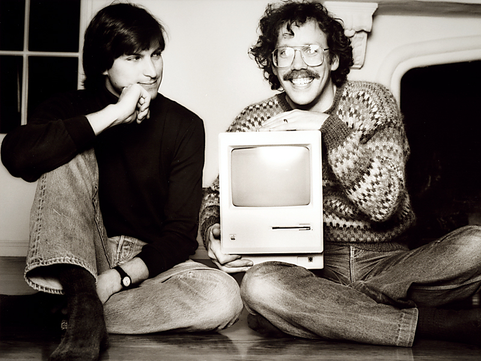

Nuestra investigación comenzó explorando cómo los dispositivos digitales transforman movimientos físicos en representaciones gráficas.

Dentro de esta búsqueda encontramos **MacPaint**, un programa desarrollado por Bill Atkinson y lanzado por Apple en 1984 junto al primer Macintosh.

MacPaint permitía dibujar mediante un mouse, utilizando herramientas como lápices, pinceles, borradores y figuras geométricas. Su lenguaje visual estaba basado en píxeles y representaciones en blanco y negro.

También utilizaba QuickDraw, un sistema gráfico que permitía representar elementos visuales en pantalla.

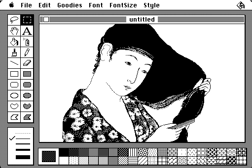

Lo que más nos interesó fue comprender cómo el movimiento del mouse podía convertirse en una línea digital.

De este referente rescatamos:

- **El movimiento convertido en dibujo:** una acción física que genera una representación gráfica.
- **La simplicidad:** controles y herramientas fáciles de comprender.
- **La experimentación:** dibujar, equivocarse, borrar y volver a comenzar.
- **La respuesta visual:** observar el resultado mientras interactuamos.

En TRAZO reinterpretamos estos principios reemplazando el mouse por dos potenciómetros.

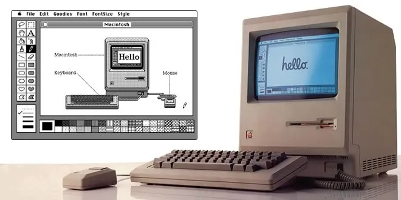

## 03. ¿Cómo llevamos la idea a TRAZO?

Para transformar el movimiento de las perillas en dibujo, utilizamos los valores analógicos de dos potenciómetros.

Al girarlos, cambia el voltaje que recibe la Raspberry Pi Pico. El programa interpreta estos valores y los convierte en coordenadas dentro de la pantalla.

El funcionamiento se organiza en cuatro etapas:

1. **Entrada:** movimiento de las perillas y pulsaciones de botones.
2. **Lectura:** la Raspberry Pi Pico recibe los valores.
3. **Procesamiento:** el código calcula coordenadas y determina qué acción realizar.
4. **Salida:** la pantalla representa el cursor, los trazos y el estado.

La diferencia principal con MacPaint es que el movimiento no depende de una sola herramienta, sino de la coordinación de dos ejes independientes.

## 04. Componentes y circuito

| Componente | Función |
|---|---|
| Raspberry Pi Pico | Procesar las entradas y ejecutar el programa. |
| Dos potenciómetros | Controlar los ejes X e Y. |
| Pantalla OLED SSD1306 | Mostrar cursor, líneas y estado. |
| Botón TRAZO | Alternar MOVER y DIBUJAR. |
| Botón BORRAR | Limpiar el dibujo. |
| Dos resistencias de 10 kΩ | Mantener cada botón en 0 mientras no está apretado (pull-down externa). |

**Conexiones utilizadas:**

- Perilla X: GP26.
- Perilla Y: GP27.
- Botón TRAZO: GP14.
- Botón BORRAR: GP15.
- OLED: SDA GP4 y SCL GP5.
- Alimentación: la OLED y los potenciómetros se conectan a 3V3 y GND.
- Cada botón une 3V3 con su pin, y una resistencia de 10 kΩ conecta ese pin a GND. Con el botón suelto el pin lee 0 y apretado lee 1, que es lo que pide la clase `BotonGrupo1`.

### Esquemático

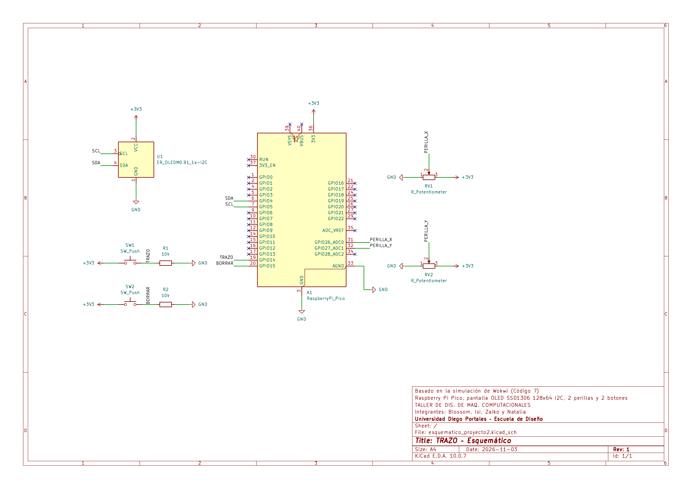

El esquemático está hecho en KiCad y se basa en la simulación de Wokwi del Código 7. La pantalla se representó con el símbolo de OLED I2C que trae KiCad; en el proyecto usamos la SSD1306 de 128 × 64.

- [Esquemático en PDF](./esquematicos/esquematico-proyecto2.pdf)
- [Archivos de KiCad](./esquematicos/kicad/)

Simulación en Wokwi: https://wokwi.com/projects/479331745306537985

## 05. Investigación de bibliotecas

Durante el proceso investigamos bibliotecas que nos permitieran controlar los componentes electrónicos sin tener que programar todas sus funciones desde cero.

Inicialmente revisamos **Adafruit SSD1306 y Adafruit GFX**, utilizadas para trabajar con pantallas y elementos gráficos.

Sin embargo, nuestro proyecto utiliza C++ con Pico SDK, por lo que necesitábamos herramientas compatibles con ese entorno.

Finalmente trabajamos con:

| Biblioteca o módulo | Función |
|---|---|
| `pico/stdlib.h` | Funciones generales del programa. |
| `hardware/adc.h` | Lectura de los potenciómetros. |
| `hardware/i2c.h` | Comunicación con la OLED. |
| `pico-ssd1306` | Control de la pantalla y representación gráfica. |

Cada versión de código que usa la pantalla (Códigos 3 a 7) incluye su propia copia de `pico-ssd1306` (`ssd1306.c` y `Ssd1306.h`, además de `Font.h` en las versiones que escriben texto), junto con su licencia en `license-pico-ssd1306.txt`. Lo hicimos a propósito: cada versión funciona como una fotografía del avance y se puede abrir y compilar por separado.

Esta investigación nos permitió comprender que las bibliotecas deben seleccionarse según su compatibilidad y las necesidades reales del proyecto.

## 06. Proceso de programación

Desarrollamos TRAZO mediante diferentes versiones para comprender cada parte del funcionamiento antes de integrarlas.

| Código | Fecha | Avance principal |
|---|---|---|
| **1** | 25-10-2026 | Planificamos el funcionamiento mediante comentarios. |
| **2** | 26-10-2026 | Organizamos la estructura inicial del programa. |
| **3** | 26-10-2026 | Incorporamos las perillas y estudiamos un error de conversión ADC. |
| **4** | 26-10-2026 | Corregimos la conversión de valores analógicos. |
| **5** | 30-10-2026 | Integramos los botones recibidos y las funciones de dibujo. |
| **6** | 30-10-2026 | Reorganizamos el programa, volvimos a usar la pantalla completa y trabajamos con la pantalla integrada en `main.cpp`. |
| **7** | 30-10-2026 | Creamos una clase independiente para administrar la pantalla y recuperamos el indicador de estado. |

### Corrección de los Códigos 3 y 4

En el Código 3 introdujimos intencionalmente un error de división entera para estudiar cómo afectaba la conversión de los valores analógicos.

Al dividir antes de multiplicar, se perdía la parte decimal y el cursor no podía representar correctamente las posiciones intermedias.

En el Código 4 corregimos la operación, multiplicando primero y dividiendo después.

Esto nos permitió comprender mejor cómo el orden de las operaciones afecta el resultado del programa.

### Integración del Código 5

En esta versión incorporamos la clase de botones que recibimos de otro grupo.

Con esto pudimos reunir las funciones principales: mover el cursor, activar y desactivar el dibujo y borrar los trazos.

También incorporamos una franja superior para indicar el estado y un sistema de memoria gráfica para conservar los dibujos mientras el cursor se desplaza.

Al armar el circuito descubrimos dos ajustes reales: la clase de botones pide una resistencia pull-down externa en cada botón, y para escribir el estado en la pantalla hacía falta el archivo `Font.h`.

### Cambios del Código 5 al Código 6

Antes de seguir revisamos qué habíamos agregado en el Código 5 que realmente no necesitábamos.

Encontramos que el método `modoBorrar()` se había agregado a `BotonGrupo1` solo para que `main.cpp` funcionara. Como queríamos mantener la clase tal como nos la entregaron, resolvimos ese cambio directamente en `main.cpp`: una pulsación de TRAZO alterna el estado, BORRAR lo devuelve a MOVER y, si se aprietan juntos, gana BORRAR.

También quitamos la franja y la tipografía para volver a aprovechar la pantalla completa, con Y recorriendo de 0 a 63.

### Cambios del Código 6 al Código 7

Uno de los cambios más importantes fue **crear una clase específica para la pantalla: `Pantallita.h` y `Pantallita.cpp`.**

Anteriormente, `main.cpp` contenía tanto las decisiones del programa como gran parte de las instrucciones relacionadas con la pantalla.

Al separar estas responsabilidades, conseguimos organizar mejor el código.

La nueva clase reúne funciones para:

- Inicializar la pantalla.
- Limpiar el dibujo.
- Dibujar líneas.
- Mostrar el cursor y el estado actual.

Así, `main.cpp` queda encargado principalmente de coordinar las entradas, los estados y las acciones.

Este cambio nos ayudó a comprender mejor la programación mediante clases y la importancia de mantener cada responsabilidad separada.

Al terminar el Código 7 nos dimos cuenta de que sí necesitábamos que la pantalla mostrara el estado (MOVER o DIBUJAR), porque faciitaba mucho la experiencia del usuario, sin eso era difícil reconocer en que estado estaba. Recuperamos `Font.h` y las funciones de texto del Código 5 y las incorporamos a `Pantallita`, reservando de nuevo una franja de 8 píxeles arriba. Por eso, en el Código 7, el cursor recorre Y de 0 a 55 y se dibuja desde la fila 8.

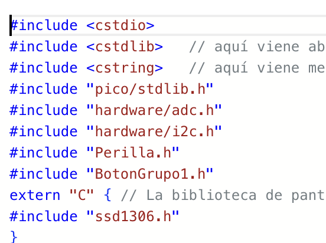 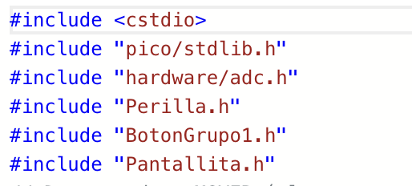

## 07. Intercambio de clases con el Grupo 1

Una parte importante del proyecto fue el intercambio de clases entre grupos.

Nuestro equipo desarrolló una clase para trabajar con perillas, mientras que también recibimos una clase de botones para incorporar a TRAZO.

### Adaptación de nuestra clase Perilla

Inicialmente trabajamos con las clases `Perilla` y `Encoder` por separado.

Sin embargo, al conversar con el **Grupo 1**, nos explicaron que su proyecto necesitaba utilizar un encoder para seleccionar sonidos y un potenciómetro para controlar el volumen.

Además, nos compartieron un [repositorio del profesor](https://github.com/piruetasxyz/Perilla) que nos permitió investigar cómo reunir ambos comportamientos en una sola clase.

A partir de esto desarrollamos una segunda versión de `Perilla`, capaz de trabajar con los dos tipos de controles (`PerillaGrupo7`, en `codigos/clase_2_2026-10-2_perilla`).

En TRAZO seguimos utilizando la parte correspondiente a los potenciómetros, mientras que el Grupo 1 necesitaba también las funciones del encoder.

Este intercambio nos llevó a adaptar una clase a necesidades diferentes de las de nuestro propio proyecto.

En esa misma carpeta dejamos a propósito un archivo llamado `oops`: es una nota donde contamos que, en la versión 2 de la clase, dejamos en el `#include` el nombre anterior del `.h`, y que ya lo corregimos en la carpeta `clases`.

### Clase de botones recibida

También incorporamos `BotonGrupo1.h` y `BotonGrupo1.cpp`, desarrollados por otro grupo.

Esta clase nos permitió detectar las pulsaciones y controlar el rebote de los botones.

La integración fue importante porque tuvimos que comprender código que no habíamos escrito nosotras y adaptarlo a la estructura de TRAZO.

## 08. Diagramas de flujo

Para organizar el funcionamiento desarrollamos dos diagramas: uno que representa la experiencia del usuario y otro que explica las decisiones internas del programa.

### Diagrama de flujo del usuario

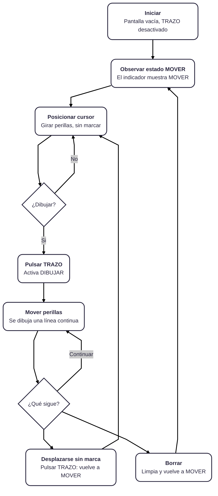

Este diagrama muestra cómo la persona comienza en MOVER, posiciona el cursor, activa DIBUJAR y decide si continuar, desplazarse sin marcar o borrar.

### Diagrama de flujo del programa

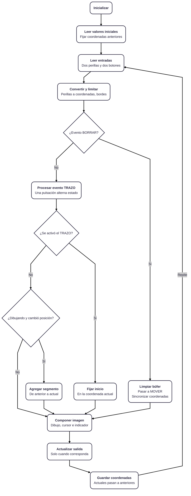

Este segundo diagrama representa las lecturas de los controles, la conversión de coordenadas, las decisiones de los botones y la actualización de pantalla.

Ambos nos ayudaron a ordenar la interacción y comprender la relación entre entradas, procesamiento y salida.

## 09. Simulación y pruebas

Utilizamos Wokwi para representar el circuito y trabajar con los componentes de manera virtual.

Durante el desarrollo revisamos especialmente:

- La lectura independiente de ambas perillas.
- La conversión de los valores analógicos.
- El movimiento del cursor.
- La diferencia entre MOVER y DIBUJAR.
- La conservación de las líneas.
- El funcionamiento de los botones.
- La actualización de la pantalla.

Las pruebas de conversión ADC quedaron registradas en las versiones anteriores. Las pruebas integrales del Código 7 se resumen en esta tabla:

| Prueba | Qué hacemos | Qué debe ocurrir |
|---|---|---|
| Perillas independientes | Girar solo la perilla X y luego solo la Y. | El cursor se mueve solo en horizontal con X y solo en vertical con Y. |
| Bordes | Llevar las dos perillas a sus extremos. | El cursor llega a las esquinas sin salirse de la pantalla ni pisar la franja de estado. |
| MOVER | Girar las perillas sin pulsar TRAZO. | El cursor se desplaza sin dejar marcas y el indicador dice MOVER. |
| DIBUJAR | Pulsar TRAZO y girar las perillas. | Se forma una línea continua desde donde estaba el cursor y el indicador dice DIBUJAR. |
| Conservación | Volver a MOVER y desplazarse. | Las líneas ya dibujadas se mantienen. |
| BORRAR | Pulsar BORRAR. | Se limpia el dibujo y volvemos a MOVER. |
| Pulsación simultánea | Pulsar TRAZO y BORRAR a la vez. | Gana BORRAR. |
| Pulsación larga | Mantener apretado TRAZO. | El estado cambia una sola vez, sin alternar repetidamente. |

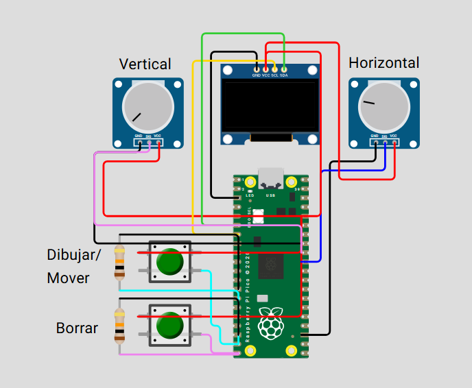

## 10. Diseño de carcasa

Esta etapa corresponde al desarrollo físico de TRAZO.

Hasta ahora hemos trabajado principalmente con la simulación y el funcionamiento electrónico. La carcasa nos permitirá explorar cómo integrar los componentes en un objeto que pueda utilizarse cómodamente.

### 10.1. Investigación de referentes

Para comenzar a diseñar la carcasa de TRAZO, buscamos referentes de dispositivos electrónicos interactivos que tuvieran una distribución sencilla de controles y una forma cómoda de utilizar sobre un escritorio.

Nos interesaron especialmente los computadores compactos de los años 80, los sintetizadores y algunos controladores electrónicos que utilizan perillas como principal forma de interacción.

De estos referentes rescatamos tres características principales:

**Diseño retro tecnológico**

Nos inspiramos en los primeros computadores personales, especialmente en sus formas compactas, superficies redondeadas y combinaciones de colores claros. Queríamos que TRAZO tuviera una apariencia tecnológica, pero que al mismo tiempo se sintiera como un objeto cercano y fácil de utilizar.

**Controles físicos protagonistas**

También observamos dispositivos como sintetizadores y controladores musicales, donde las perillas tienen un papel importante tanto en el funcionamiento como en la apariencia del objeto. Nos interesó utilizar controles grandes, fáciles de identificar y con suficiente separación para manipularlos cómodamente.

**Inclinación y ergonomía**

Otro aspecto que rescatamos fue la inclinación de las superficies de control. Esto permite que la pantalla y los botones queden orientados hacia la persona que utiliza el dispositivo, facilitando su lectura e interacción.

A partir de estas referencias decidimos desarrollar una carcasa compacta, con una superficie superior inclinada, dos perillas principales y dos botones independientes.

### 10.2. Bocetos y propuestas

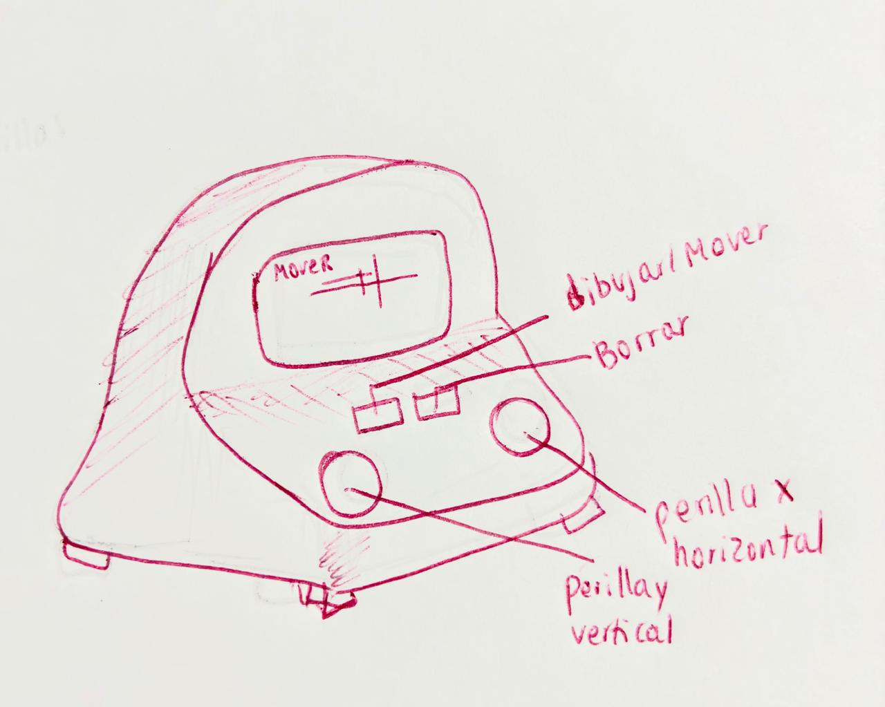 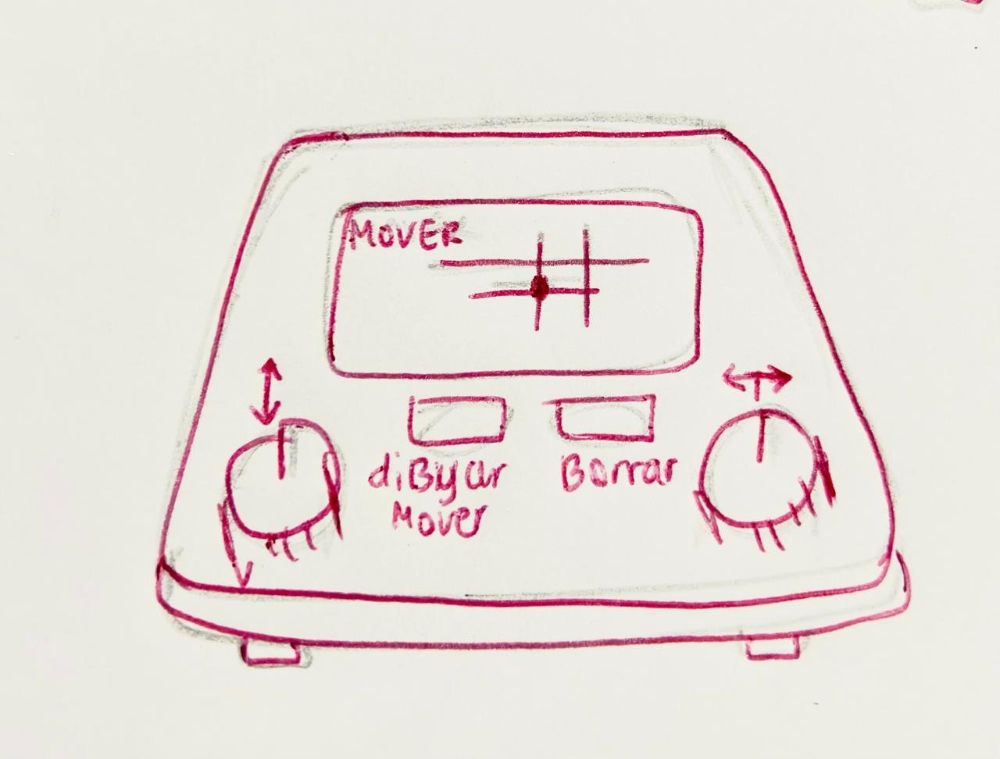

A partir de la investigación comenzamos a explorar distintas formas para la carcasa. Queríamos evitar una caja rectangular tradicional y conseguir una forma que se sintiera más cercana a un pequeño instrumento de escritorio.

La propuesta que seleccionamos tiene una base rectangular con esquinas redondeadas y una estructura inclinada que aumenta su altura hacia la parte posterior.

Esta forma nos permite distribuir los componentes en una misma superficie, manteniendo una separación visual entre ellos.

Distribución de los componentes:

- **Pantalla OLED:** ubicada en la zona superior y ligeramente inclinada hacia la persona que utiliza TRAZO. Es el espacio donde se visualiza el cursor y los dibujos.
- **Perilla X:** ubicada en la zona inferior izquierda. Controla el movimiento horizontal.
- **Perilla Y:** ubicada en la zona inferior derecha. Controla el movimiento vertical.
- **Botón TRAZO:** ubicado entre las dos perillas. Permite alternar entre los modos MOVER y DIBUJAR.
- **Botón BORRAR:** ubicado junto al botón TRAZO. Permite limpiar la pantalla y comenzar un nuevo dibujo.

Decidimos mantener las dos perillas como los elementos principales de la superficie, ya que son los controles que se utilizan constantemente durante la interacción.

Visualmente, propusimos una carcasa color crema con una franja inferior naranja, detalles naranjos alrededor de las perillas y botones diferenciados por color.

### 10.3. Resultado de la carcasa

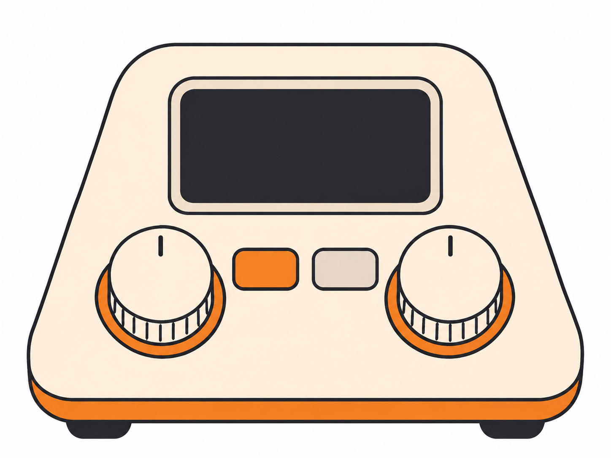

Pensamos la carcasa en PLA, impreso en 3D. Es una propuesta hipotética: en esta etapa no la fabricamos.

## 11. Interfaz, lenguaje y uso

### Cómo se usa TRAZO

Al iniciar, la pantalla aparece vacía y el indicador dice MOVER. Con la perilla X el cursor se desplaza de izquierda a derecha y con la perilla Y de arriba hacia abajo. Mientras estamos en MOVER no queda ninguna marca.

Cuando el cursor está donde queremos empezar, pulsamos TRAZO y el indicador pasa a DIBUJAR: desde ahí, cada giro de las perillas deja una línea continua. Para levantar el lápiz pulsamos TRAZO otra vez, nos desplazamos sin marcar y lo pulsamos de nuevo para seguir dibujando en otro lugar. Si queremos empezar de nuevo, pulsamos BORRAR: se limpia la pantalla y volvemos a MOVER.

El recorrido completo está en el [diagrama de flujo del usuario](#diagrama-de-flujo-del-usuario).

### Nomenclatura

- **Perilla X y Perilla Y:** llevan el nombre del eje que controlan.
- **MOVER y DIBUJAR:** nombran los dos estados con un verbo, para decir qué pasa con el cursor. Se escriben en la franja superior de la pantalla.
- **TRAZO:** es el botón que activa y desactiva el trazo, es decir, el que alterna entre MOVER y DIBUJAR.
- **BORRAR:** limpia el dibujo y devuelve a MOVER.

### Decisiones de usabilidad

- **La perilla marca una posición, no una velocidad:** si las dos perillas están a la mitad, el cursor está en el centro de la pantalla.
- **Cada trazo nuevo parte donde está el cursor:** no se conecta con el trazo anterior.
- **El cursor no se sale de los bordes** ni entra a la franja del estado.
- **Si se pulsan TRAZO y BORRAR a la vez, gana BORRAR.**
- **El dibujo no se guarda:** si se reinicia la máquina, la pantalla vuelve a empezar vacía.
- **Los controles que se usan todo el tiempo son los más grandes:** en la carcasa, las dos perillas son las protagonistas y los botones quedan entre ellas, diferenciados por color.

## 12. Bibliografía

- Computer History Museum. *MacPaint and QuickDraw Source Code*. https://computerhistory.org/blog/macpaint-and-quickdraw-source-code/
- Hertzfeld, A. *MacPaint Evolution*. https://www.folklore.org/MacPaint_Evolution.html
- Raspberry Pi. *Pico SDK*. https://github.com/raspberrypi/pico-sdk
- Wokwi. *SSD1306 OLED*. https://docs.wokwi.com/parts/board-ssd1306
- daschr. *pico-ssd1306*. https://github.com/daschr/pico-ssd1306
- piruetasxyz. *Perilla*. https://github.com/piruetasxyz/Perilla (repositorio del profesor sobre perilla y encoder cumpliendo ambas funciones en una sola clase).
- disenoUDP. *mi-primer-esquematico*. https://github.com/disenoUDP/mi-primer-esquematico (apunte de la sesión 09a, base de nuestro esquemático).
- KiCad EDA. *KiCad 10*. https://www.kicad.org/
- Grupo 1 (Camila Ramírez, Bianka Vilchez y Dayana Pañitrur). *BotonGrupo1*, en [`00-proyecto-2/grupo-01`](../grupo-01/).
- disenoUDP. *dis8645-2026-2-procesos-2*, repositorio del curso (sesión 08a: ejemplo de perilla con potenciómetro). https://github.com/disenoUDP/dis8645-2026-2-procesos-2

## 13. Registro de uso de IA

Durante el desarrollo utilizamos ChatGPT y Claude como apoyo para organizar la estructura del programa, comprender errores, revisar compatibilidad de bibliotecas y documentar el proceso.

Entre los usos registrados se encuentran:

- Código 1: planificación del funcionamiento mediante comentarios.
- Código 2: estructura inicial de Pico SDK.
- Códigos 3 y 4: estudio y corrección de la conversión ADC.
- Intercambio de clases: adaptación de Perilla y Encoder a una sola clase.
- Códigos 5 a 7: apoyo para comprender la integración, reorganización y separación de responsabilidades.

### Códigos 1 a 4 y clases

**Código 1 (25-10-2026): plan en comentarios**

- Qué pedimos (aprox.): primero le explicamos qué es la máquina: TRAZO, un proyecto de dibujo digital con una Raspberry Pi Pico, dos potenciómetros (uno para el eje X y otro para el Y) y una pantalla OLED de 128 x 64, con modos MOVER y DIBUJAR y un botón para borrar. Después le pedimos que nos ayudara a hacer el primer código declarando solamente qué queremos que haga, sin programar todavía.
- Qué nos dio la IA: un archivo solo con comentarios, ordenado en secciones.

**Código 2 (26-10-2026): estructura**

- Qué pedimos (aprox.): a partir de ese plan, la estructura mínima del programa: iniciar el ADC y un ciclo que muestre que el programa sigue activo, sin leer las perillas todavía.
- Qué nos dio la IA: `main.cpp` y `CMakeLists.txt` básicos.

**Códigos 3 y 4 (26-10-2026): perillas X/Y y corrección**

- Contexto: ya habíamos pensado la clase Perilla y cómo se conectaría con el resto. Quedó pendiente integrar la clase Botón, que aún no teníamos; por eso estas versiones solo deberían mover un punto en la pantalla.
- Qué pedimos (aprox.): una clase Perilla basada en el ejemplo de la sesión 08a que lea los dos potenciómetros y mueva un punto en la pantalla OLED.
- Sobre el error de la versión 3: el error de conversión (valor / 4095 antes de multiplicar) lo introdujimos a propósito. Queríamos entender por qué la conversión funciona cuando está bien hecha y qué pasaría si estuviera mal: con la división entera, la posición se queda en 0 salvo cuando la lectura llega al máximo. La versión 3 queda como ejemplo del error y la versión 4 como la corrección.
- Corrección (versión 4): multiplicar primero y luego dividir, con redondeo.

**Clase 1 y 2 (27 y 28-10-2026): Perilla y Encoder**

- Contexto: al comienzo hicimos Perilla y Encoder como dos clases separadas. Al conversarlo con el Grupo 1, que sí necesita un encoder, nos pasaron muy amorosamente <3 el enlace a un repositorio del profesor que muestra cómo unir ambas funciones en una sola clase.
- Qué pedimos (aprox.): adaptar ese ejemplo para que una sola clase Perilla sirva como potenciómetro y como encoder.
- Resultado: la versión de clase_2 junta todo en una clase. Nosotras solo usamos la parte de Perilla porque no necesitamos encoder; el encoder se mantiene en el código porque lo usa el Grupo 1.

### Códigos 5 a 7 (30-10-2026)

Las conversaciones completas están guardadas en [`codigos/ayuditas ia`](./codigos/ayuditas%20ia/).

**Código 5: circuito y botones** (Claude): [1.incorporar_clase_boton](./codigos/ayuditas%20ia/1.incorporar_clase_boton)

- Qué pedimos (aprox.): un resumen del documento del proyecto, ayuda para armar el cableado en Wokwi con los dos botones y las dos perillas, y un código de prueba para comprobar que todo estuviera bien conectado.
- Qué nos dio la IA: dibujos del cableado sobre nuestra captura de Wokwi, la revisión de las conexiones (encontró una perilla con el cable en el pin equivocado), un `main.cpp` de prueba y la indicación de usar una resistencia pull-down externa en cada botón, como pide `BotonGrupo1`.

**Código 6: limpieza** (Claude): [2.codigo_6_limpieza](./codigos/ayuditas%20ia/2.codigo_6_limpieza)

- Qué pedimos (aprox.): revisar el Código 5 y limpiar lo que no necesitábamos: el método `modoBorrar()` de `BotonGrupo1`, la franja y el texto de la pantalla, volviendo a usar Y de 0 a 63. Pedimos no modificar las clases Perilla ni Boton sin avisar.
- Qué nos dio la IA: el cambio de modo resuelto en `main.cpp` sin tocar la clase de botones, la eliminación de `Font.h` y de las funciones de texto, la pantalla completa y una lista de qué partes de la biblioteca usa realmente el proyecto. Nos avisó que no pudo compilar con el Pico SDK real ni probar en Wokwi.

**Código 7: clase Pantallita** (Claude): [3.codigo_7](./codigos/ayuditas%20ia/3.codigo_7)

- Qué pedimos (aprox.): separar la pantalla del `main.cpp` en una clase `Pantallita`, sin cambiar el funcionamiento, sin modificar Perilla ni BotonGrupo1, evitando la segunda inicialización de la pantalla y actualizando el `CMakeLists.txt`.
- Qué nos dio la IA: `Pantallita.h` y `Pantallita.cpp` con cuatro métodos (`iniciar`, `limpiar`, `dibujarLinea` y `mostrar`), un `main.cpp` más corto, el `CMakeLists.txt` actualizado y una comparación entre los Códigos 6 y 7 hecha en simulación en computador. Lo que faltaba probar en Wokwi quedó anotado.

**Código 7: recuperar el texto del estado** (ChatGPT): [4.arreglar_letras](./codigos/ayuditas%20ia/4.arreglar_letras)

- Qué pedimos (aprox.): ayuda para restaurar el texto MOVER/DIBUJAR, porque al limpiar habíamos eliminado también la tipografía y la pantalla sí debía mostrar el estado. Cambiamos a ChatGPT porque se nos acabó el uso gratuito de Claude.
- Qué nos dio la IA: un paso a paso para recuperar `Font.h` y las funciones de texto desde el Código 5, mostrar el estado desde `Pantallita` y pasarle desde `main.cpp` el modo actual, sin tocar Perilla ni BotonGrupo1.
