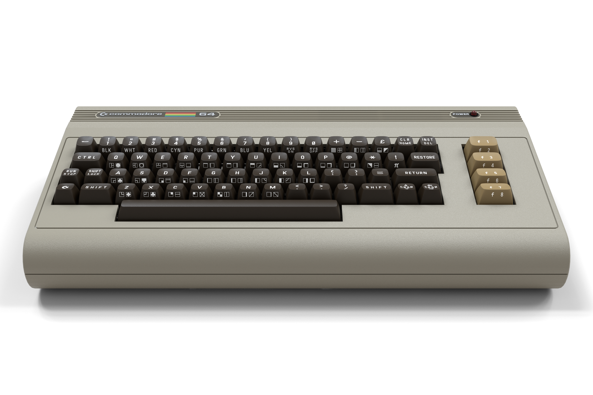
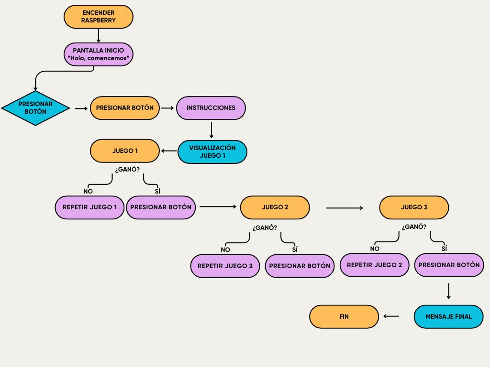
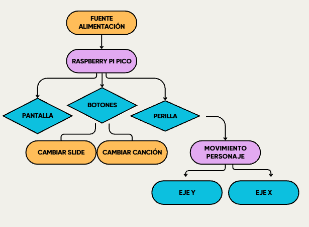
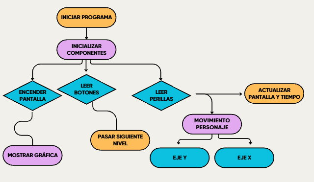
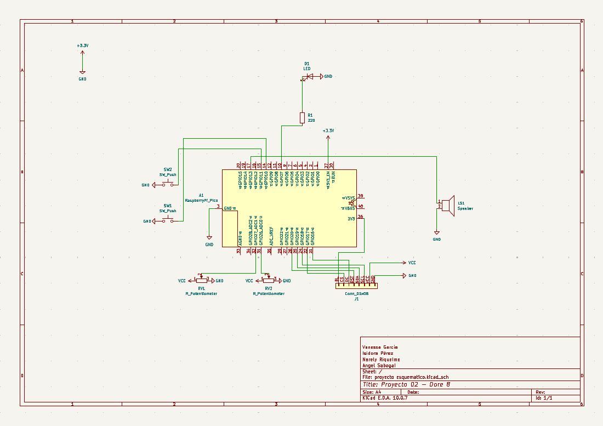
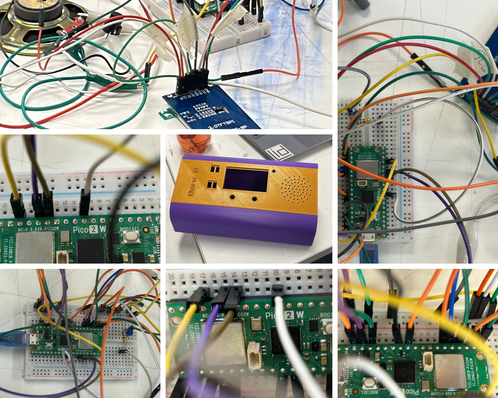
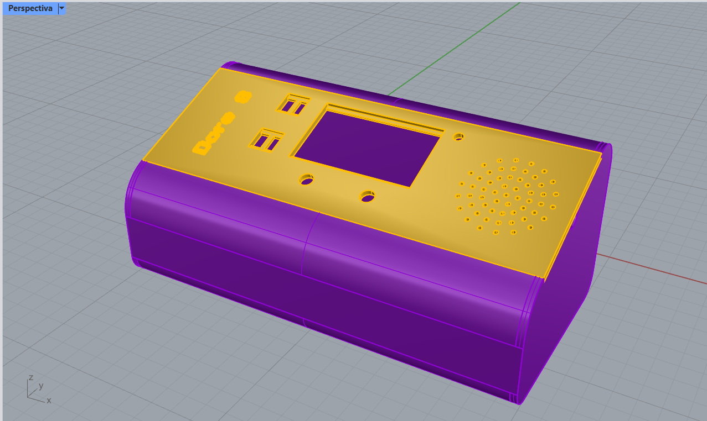

# Proyecto-02


<p align="center">
  
</p>


*Integrantes*

☆ Vanessa García / <https://github.com/vanessagarciaM>

☆ Isidora Pérez / <https://github.com/isipm08>

☆ Narely Riquelme / <https://github.com/Narelyriquelme>

☆ Angel Sabogal / <https://github.com/angel-udp>


## Commodore 64 Ultimate 
El Commodore 64 Ultimate representa el renacimiento de uno de los ordenadores clásicos, siendo una recreación física y fiel de la máquina original. Donde su principal objetivo es ofrecer la misma experiencia nostálgica, recuperando carcasa clásico, pero adaptándola a las necesidades tecnológicas de hoy en día.

Para lograr el parecido a la máquina original, en su interior alberga una placa equipada con un chip AMD Xilinx Artix-7 FPGA, una tecnología que le permite replicar el comportamiento del hardware clásico ciclo a ciclo. Gracias a esto, el equipo alcanza un 99% de compatibilidad con todo el software que se lanzó para el ordenador, al mismo tiempo que incorpora mejoras modernas, como mayor capacidad de memoria y un modo turbo de 48 MHz para optimizar el rendimiento. Finalmente envolviéndose en una carcasa que recupera la estética y esencia clásica del Commodore, integrando interruptores mecánicos Gateron Pro 3.0 de 55 gramos, teclado de 66 teclas y un soporte para macros y tecnología NKRO garantizando escritura fluida.

Este equipo destaca su versatilidad al realizar la conexión entre dos épocas distintas, la evolución de este muestra cómo los computadores pasaron de ser equipos destinados al aprendizaje y al trabajo, a convertirse en herramientas para jugar, crear música, experimentar gráficos, acercando la tecnología y programación a los hogares. Aunque es compatible con cintas de casete, unidades de disco y con televisores de tubo (CRT). Afortunadamente, no todo el mundo está dispuesto a utilizar una consola retro con un monitor CRT (especialmente por el tamaño que ocupa y su elevado peso). Estos usuarios pueden utilizar la salida HDMI a 1080p para conectarlo a monitores y Smart TV actuales (el cable viene incluido junto con el equipo). 

Dentro de su sistema operativo incluye las suite GEOS, como el GEOWrite, que fue uno de los primeros procesadores de texto modernos, con capacidad de edición WYSIWYG, múltiples fuentes y estilos, escribir documentos, dar forma al texto e inserción de imágenes. Ahora, es un entorno de escritura sin conexión, ideal para diarios personales, ensayos y redacción sin distracciones. También el GEOPaint era un editor gráfico para dibujar y pintar, crear ilustraciones digitales, con patrones, rellenos y pinceles. Se utilizó para crear tarjetas de felicitación, diseños de boletines informativos y muchísimos proyectos de arte digital para principiantes. Ahora es una herramienta creativa sin distracciones, perfecta para artistas digitales emergentes. Y el GEOPublish fue una de las primeras herramientas modernas de autoedición, combinar texto e imágenes. Fue responsable de innumerables periódicos escolares, boletines parroquiales, folletos de pequeños negocios y carteles de bandas musicales. Y también el resto de la suite como GEOSpell, GEOPile, GEOCalc, GEOGif, GEOS Deskpack Plus, Fuentes GEOS, GEODemo.



## Descripción del proyecto
**DORE 8** es un videojuego retro inspirado en la estética del Commodore 64. El proyecto cuenta con una factura técnica desarrollada en C++, luego ejecutada en el microcontrolador Raspberry Pi Pico, tras ser prototipado de forma virtual en la plataforma Wokwi. El relato material sostiene los componentes físicos, tales como: dos perillas, dos botones, una pantalla y buzzer, el cual reproduce música retro y efectos de sonido. Buscando evocar los paneles de control de los microcomputadores en los años ochenta, incluyendo lo físico por parte del jugador con la narrativa digital. El juego tiene como objetivo acompañar y ayudar a un estudiante a llegar a la universidad, superando diferentes desafíos, como recorrer un laberinto para alcanzar la micro, esquivar vehículos durante el trayecto y llegar a su sala de clases. 

En el ámbito visual, adoptamos un estilo de pantallas retro, bloques marcados y delimitados, además de una tipografía geométrica estilo "arcade". Los gráficos se construyen mediante figuras geométricas para optimizar el uso de memoria. Nuestro objetivo es combinar la estética de los videojuegos antiguos con una experiencia interactiva sencilla y entretenida.

Los controles parecen intuitivos, pero al momento de jugar se invierte la usabilidad en momentos clave para simular el estrés y la emoción que se genera el camino a la universidad. En cuanto a estructura, nos centramos en Slides, reforzando la narrativa del sistema de etapas.

### ¿Por qué Dore 8?
El nombre de nuestro proyecto nace como una síntesis conceptual y un homenaje directo. Este se extrae de la terminación ```commodore``` y el número 8 hace referencia a la ```era de los 8 bits```, ya que este es el período en donde los videojuegos y la informática estaba dominada por consolas y microcomputadores cuyos procesadores manejaba la información en bloques de 8 bits por ciclo. De esta forma encapsulamos de manera general los gráficos con figuras geométricas, sonido y uso de controles mecánicos. Y además porque somos el grupo 08 jaja.

### Inspiración: La Influencia del Commodore 64
La referencia al Commodore 64 Ultimate se manifiesta en cuatro pilares fundamentales del proyecto:

1. **Estética Gráfica y Lenguaje Visual:** Uso de bloques visuales marcados, bordes delimitados en pantalla y tipografía geométrica estilo monospaciado, emulando el modo de texto y la construcción de sprites característicos de la época de los 8 bits.
2. **Identidad Sonora (Chiptune):** Generación de melodías tipo *chiptune* construidas bajo el espíritu de la síntesis de onda cuadrada, emulando los tonos del legendario chip de sonido MOS 6581 SID del C64.
3. **Mecánica de Control Retro:** La interacción mediante perillas analógicas e interruptores táctiles evoca los paneles de control integrados y los mandos de los microcomputadores clásicos.
4. **Narrativa de Carga por Etapas:** La transición entre pantallas emula la experiencia de los juegos de cassette o disco de los años 80, donde el jugador avanza slide a slide resolviendo desafíos consecutivos para completar una historia.

## Funcionamiento y Dinámica del Juego

La misión principal del juego es ayudar al estudiante a llegar a la universidad, superando correctamente cada uno de los niveles. Como dificultad adicional, el juego activa la inversión de los controles en las perillas.

- **Slide 1 — Inicio e instrucciones:** Pantalla de bienvenida que presenta el título del juego, una explicación general de los controles y el planteamiento del desafío: *«Llega a la universidad»*.

- **Slide 2 — Etapa 1 (El laberinto hacia la micro):** El jugador debe guiar al personaje a través de un laberinto para alcanzar la micro antes de que el temporizador llegue a cero.

- **Slide 3 — Etapa 2 (La micro en el tráfico):** Nivel en el que el jugador debe controlar la micro en una vía multicarril, esquivando el flujo de autos en movimiento.

- **Slide 4 — Etapa 3 (Llegar a la sala):** Nivel final en el que el estudiante debe avanzar hasta ingresar por la puerta de la sala de clases.

- **Slide 5 — Conclusión y reflexión:** Pantalla de cierre que aparece al completar la meta. Muestra el mensaje *«¡Lo lograste!»*, acompañado de una frase reflexiva sobre la resiliencia.

## Controles e interacciones
| Elemento / interacción | Componente | Especificación | Acción |
|---|---|---|---|
| Botón: cambio de escena | Botón pulsador | Momentáneo, 12 × 12 × 7,3 mm | Permite avanzar a la siguiente escena del juego. |
| Botón: selección de música | Botón pulsador | Momentáneo, 12 × 12 × 7,3 mm | Alterna entre dos pistas musicales y el modo silencio. |
| Potenciómetro: movimiento horizontal | Potenciómetro | Tipo B, lineal | Controla el movimiento del personaje hacia la izquierda y derecha. |
| Potenciómetro: movimiento vertical | Potenciómetro | Tipo B, lineal | Controla el movimiento del personaje hacia arriba y abajo. |
| Indicador de tiempo | LED | LED indicador | Advierte que el tiempo de juego está próximo a finalizar. |
| Visualización del juego | Pantalla LCD TFT | 2,0 pulgadas, controlador ST7789, interfaz SPI, resolución 240 × 320 píxeles, 8 pines | Muestra el entorno del juego, los elementos gráficos y el desarrollo de la partida. |

## Pseudocódigo

```INICIO DORE 8```

    Preparar salida de mensajes por USB
    Iniciar ADC
    Habilitar los pines de las dos perillas
    Configurar el LED de advertencia
    Iniciar pantalla ST7789V en orientación horizontal
    Mostrar pantalla 0: "Hola! Comencemos..."

    REPETIR INDEFINIDAMENTE:
        Leer tiempo actual
        Leer botón de música (sin ejecutar acción: no hay audio)
        Leer botón de continuar

        SI el botón continuar registra un clic sencillo:
            SI la pantalla es informativa:
                Ir a la siguiente pantalla
            SI el nivel está superado:
                Ir a la siguiente pantalla
            SI el nivel está fallido:
                Reiniciar el mismo nivel
            SI el nivel sigue en curso:
                Permanecer en el mismo nivel

        SI la pantalla actual corresponde a un desafío en curso:
            Actualizar tiempo, movimiento, colisiones y resultado

        Esperar brevemente antes de repetir

        FIN

**Funciones relacionadas: main(), controlarBotonContinuar(), actualizarNivel()**

```Flujo de pantallas```
```
PANTALLA 0: INICIO
    Clic de continuar -> PANTALLA 1: INSTRUCCIONES

PANTALLA 1: INSTRUCCIONES
    Clic de continuar -> PANTALLA 2: PRESENTACIÓN DEL DESAFÍO

PANTALLA 2: DESAFÍO
    Clic de continuar -> PANTALLA 3: LABERINTO

PANTALLA 3: LABERINTO
    Si llega a la micro -> SUPERADO -> clic -> PANTALLA 4
    Si agota el tiempo -> FALLIDO -> clic -> REINICIAR LABERINTO

PANTALLA 4: CARRETERA
    Si llega a la meta sin chocar -> SUPERADO -> clic -> PANTALLA 5
    Si choca o agota tiempo -> FALLIDO -> clic -> REINICIAR CARRETERA

PANTALLA 5: SALA
    Si llega a la puerta 304 -> SUPERADO -> clic -> PANTALLA 6

PANTALLA 6: VICTORIA
    Clic de continuar -> PANTALLA 7: REFLEXIÓN

PANTALLA 7: REFLEXIÓN
    Clic de continuar -> PANTALLA 0: INICIO
```
**Función relacionada: iniciarSlide() restablece las variables y dibuja la escena antes de jugar**

```Lectura de perillas```
```
FUNCIÓN DIRECCIÓN_DE_PERILLA(GPIO)
    Seleccionar entrada ADC asociada al GPIO
    Leer valor analógico entre 0 y 4095

    SI valor < 1660:
        DEVOLVER -1
    SI valor > 2450:
        DEVOLVER +1
    EN OTRO CASO:
        DEVOLVER 0
FIN FUNCIÓN

En cada actualización de un nivel:

    dx = dirección de perilla horizontal × tamaño del paso
    dy = dirección de perilla vertical × tamaño del paso
```    
**Funciones relacionadas: Perilla::leer(), Perilla::direccion(), actualizarNivel()**

```Laberinto```
```
AL INICIAR LABERINTO:
    Posicionar estudiante en el punto de partida
    Mostrar laberinto y micro
    Iniciar cuenta regresiva desde 20 segundos

MIENTRAS el desafío esté EN CURSO:
    Calcular tiempo restante
    SI quedan 5 segundos o menos: hacer parpadear el LED
    SI el tiempo llega a 0: marcar FALLIDO

    Leer dirección horizontal y vertical
    Probar movimiento píxel a píxel
    SI el siguiente píxel tocaría una pared:
        No avanzar en esa dirección
    EN OTRO CASO:
        Mover al estudiante

    SI la caja del estudiante toca la micro:
        Marcar SUPERADO
        Mostrar mensaje para continuar
FIN
```
**Funciones relacionadas: colisionLaberinto(), interseccion(), cambiarEstado()**

```Carretera```
```
AL INICIAR CARRETERA:
    Colocar micro al lado izquierdo, en el carril central
    Colocar tres automóviles en sus posiciones iniciales
    Mostrar carretera y línea amarilla de meta
    Iniciar cuenta regresiva desde 15 segundos

MIENTRAS el desafío esté EN CURSO:
    Comprobar tiempo restante
    SI quedan 5 segundos o menos: hacer parpadear el LED
    SI tiempo = 0: marcar FALLIDO

    Leer ambas perillas
    Mover la micro con pasos de 9 píxeles
    Mantenerla dentro de los límites de la carretera

    PARA CADA automóvil:
        Desplazar automóvil hacia la izquierda
        SI sale de la pantalla: reaparecer a la derecha
        SI choca con la micro:
            Marcar FALLIDO
            Terminar comprobación del nivel

    SI la micro toca la meta derecha:
        Marcar SUPERADO
        Mostrar mensaje para continuar

    Redibujar micro, automóviles y líneas del camino
FIN
```
**Funciones relacionadas: dibujarMetaCarretera(), dibujarMoviles(), dibujarMovimiento(), interseccion()**

```Sala de clases```
```
AL INICIAR SALA:
    Colocar estudiante en la esquina superior izquierda
    Dibujar el pasillo y la puerta SALA 304
    No iniciar cuenta regresiva

MIENTRAS el desafío esté EN CURSO:
    Leer ambas perillas
    Mover estudiante dentro del área permitida
    SI el estudiante toca la puerta:
        Marcar SUPERADO
        Mostrar mensaje para continuar
FIN
```
**Función relacionada: actualizarNivel()**

```Boton2```
```
AL CREAR Boton2:
    Configurar GPIO como entrada con resistencia pull-up

CADA VUELTA:
    Leer botón (0 = presionado)
    Esperar estabilidad eléctrica (antirrebote)

    SI estado = REPOSO Y comienza una pulsación:
        Guardar tiempo de inicio
        Pasar a PRESIONADO

    SI estado = PRESIONADO Y se suelta:
        SI duró al menos 5 segundos: gesto MUY LARGO
        SI duró al menos 1 segundo: gesto LARGO
        SI duró menos: contar clic y ESPERAR_PRESIÓN

    SI estado = ESPERANDO_PRESIÓN:
        SI hay otro clic dentro del intervalo: seguir contando
        SI se acaba el intervalo:
            1 clic -> PULSADO1VEZ
            2 clics -> PULSADO2VECES
            3 clics -> PULSADO3VECES

AL CONSULTAR leerGesto():

    Entregar el gesto pendiente y limpiarlo
    
En la versión actual: el programa solo ejecuta una acción con PULSADO1VEZ del botón continuar (GP11); el resto de gestos se conserva como posibilidad de ampliación.
```

```Dibujo de pantalla```
```
AL INICIAR PANTALLA:
    Configurar SPI0 (GP18 reloj, GP19 datos)
    Configurar CS, DC y RST
    Reiniciar controlador ST7789V
    Establecer color RGB565
    Elegir orientación horizontal

AL DIBUJAR UNA FIGURA:
    Calcular coordenadas y recortar los límites
    Enviar comandos para seleccionar zona de pantalla
    Enviar píxeles del color mediante bloques pequeños

AL DIBUJAR UNA ESCENA:
    Limpiar fondo
    Dibujar marcos y paredes con líneas y rectángulos
    Dibujar estudiante, micro o autos con figuras geométricas
    Escribir textos usando la fuente retro 5x7
```
**Funciones relacionadas: AdafruitGFX_Pico::begin(), ventana(), fillRect(), drawLine(), fillCircle(), PantallaUI::dibujarSlide()**

## Organización del código: Clases
| Clases/Archivo | Descripción |
|---|---|
| **diagram.json** | Definición de los componentes del circuito y sus conexiones. |
| **Audio.cpp** | Implementación de las funciones encargadas de controlar el sonido del buzzer. |
| **Audio.h** | Declaración de las funciones y estructuras utilizadas para el control del audio. |
| **main.cpp** | Archivo principal encargado de inicializar y coordinar el funcionamiento del proyecto. |
| **AdafruitGFX_Pico.cpp** | Implementación de las funciones gráficas para el manejo de la pantalla. |
| **AdafruitGFX_Pico.h** | Declaración de las funciones y estructuras gráficas utilizadas. |
| **Boton.cpp** | Implementación de las funciones encargadas de gestionar los botones. |
| **Boton.h** | Declaración de las funciones y estructuras utilizadas para controlar los botones. |
| **FuenteRetro.h** | Definición de una tipografía personalizada de estilo retro. |
| **PantallaUI.cpp** | Implementación de las funciones que gestionan la interfaz gráfica, mostrando textos y elementos visuales. |
| **PantallaUI.h** | Declaración de las funciones relacionadas con la interfaz gráfica. |
| **Perilla.cpp** | Implementación de las funciones encargadas de leer y gestionar los valores de los potenciómetros. |
| **Perilla.h** | Declaración de las funciones y estructuras utilizadas para controlar los potenciómetros. |

## Diagramas
### Experiencia usuario
> La experiencia del usuario consiste en interactuar físicamente con el proyecto a través de su carcasa, las perillas y los botones, generando una experiencia de juego dinámica y entretenida. El usuario deberá cumplir distintas misiones, superar desafíos y resolver cada nivel utilizando los controles del dispositivo. Además de la entretención, el juego busca transmitir una reflexión final: aunque el camino para alcanzar una meta pueda presentar dificultades, lo importante es perseverar, seguir intentándolo y confiar en que, con esfuerzo y constancia, es posible llegar hasta el final.

### Flujo del juego

### Hardware

### Software

## Esquemático


### Tabla de materiales
|Componente|Cantidad|Precio|Link|
|---|---|---|---|
|Raspberry Pi Pico|1|$14.990|<https://raspberrypi.cl/products/raspberry-pi-pico-2-w-con-headers>|
|Pantalla LCD TFT |1|$3.554|<https://a.aliexpress.com/_mKfPMoB>|
|Protoboard|1|$1.500|<https://afel.cl/products/mini-protoboard-400-puntos>|
|Botón Táctil|2|$200|<https://afel.cl/products/boton-tactil-tapa-12x12x7-3-interruptor?_pos=1&_sid=cf59c1e34&_ss=r>|
|Cables dupont pack 20|x|$1.000|<https://afel.cl/products/pack-20-cables-de-conexion-macho-macho>|
|Kit 10 Cables Caiman a Dupont Hembra|x|$2.500|<https://afel.cl/products/kit-10-cables-caiman-a-dupont-hembra?_pos=2&_sid=aec538813&_ss=r>|
|Pack 20 Cables de Conexión Macho Hembra|x|$1.000|<https://afel.cl/products/pack-20-cables-de-conexion-macho-hembra?_pos=1&_sid=bff72fae6&_ss=r>
|Potenciómetro B100k|2|$1.000|<https://afel.cl/products/potenciometro-10k-ohm>|
|Cable USB-C|1| $1.800|<https://altronics.cl/cable-usb-tipo-c-datos-alimentacion>|

## Pruebas y error
Durante el desarrollo de DORE 8 fuimos realizando diferentes pruebas en Wokwi para comprobar que los componentes y el código funcionaran correctamente. Al principio comenzamos con un proyecto vacío, donde incorporamos la Raspberry Pi Pico, una pantalla, dos potenciómetros, dos botones, un buzzer y un LED. Realizamos las conexiones manualmente, siguiendo la distribución que queríamos para nuestro prototipo.

Una de las primeras pruebas fue comprobar el funcionamiento del sonido, ya que queríamos que el videojuego tuviera música retro de fondo y efectos sonoros. Para esto trabajamos con una clase llamada Audio, utilizando C++ y Pico SDK, sin Arduino. También probamos las perillas para verificar que permitieran mover un objeto en la pantalla y que los botones respondieran correctamente.

Durante estas pruebas nos encontramos con un error de compilación relacionado con la función stdio_init_all(). Al revisar el problema, identificamos que estaba relacionado con la configuración del entorno de compilación de Wokwi. Modificamos la configuración para utilizar Pico SDK y conseguimos que el programa funcionara.

Después de solucionar este problema, logramos visualizar los primeros gráficos en la pantalla, mover un cuadrado con las perillas y escuchar la música y los efectos del buzzer.

Posteriormente comenzamos a integrar los gráficos del videojuego. Para esto utilizamos como referencia las funciones gráficas de Adafruit, trabajando con figuras geométricas en lugar de imágenes bitmap, con el objetivo de reducir el uso de memoria. Incorporamos los dibujos del estudiante, la micro, los automóviles, el laberinto y las diferentes pantallas.

Otra dificultad que encontramos fue durante la prueba del nivel de la micro. Notamos que el movimiento era demasiado lento y que no resultaba tan claro cómo completar el desafío para avanzar al siguiente. Por eso decidimos modificar el código, reducir el tiempo del nivel de 30 a 15 segundos, aumentar la velocidad y agregar una línea de meta que permitiera identificar el objetivo.

Estas pruebas nos ayudaron a identificar aspectos que debíamos mejorar, tanto en el funcionamiento del código como en la experiencia del jugador. También nos permitieron entender la importancia de probar cada componente por separado antes de integrarlo al videojuego completo.

## Aciertos 
Uno de los principales aciertos durante el desarrollo de DORE 8 fue comenzar probando los componentes de manera individual antes de trabajar en el videojuego completo. Esto nos permitió comprobar que las perillas, los botones, la pantalla, el buzzer y el LED funcionaran correctamente, facilitando la identificación de errores.

Otro acierto fue utilizar C++ con Pico SDK, ya que era uno de los requisitos del proyecto. También decidimos trabajar con clases para mantener el código organizado y poder reutilizar algunas de las desarrolladas anteriormente, como las de las perillas y los botones.

La incorporación del buzzer también fue un avance importante, porque conseguimos reproducir música retro de fondo y efectos de sonido sin detener el movimiento de los elementos en pantalla. Esto nos permitió acercarnos más a la experiencia de los videojuegos antiguos que tomamos como referencia.

En cuanto a los gráficos, consideramos que fue una buena decisión utilizar figuras geométricas inspiradas en las funciones de Adafruit GFX, ya que nos permitió representar los personajes y escenarios sin depender de imágenes bitmap grandes. Además, logramos integrar las ocho pantallas del videojuego, manteniendo una misma línea visual.

Otro aspecto positivo fue establecer que el jugador solamente pudiera avanzar cuando completara cada desafío. Esto permitió que el juego tuviera una secuencia y que cada nivel tuviera un objetivo específico.

También fue importante identificar que algunos elementos necesitaban ajustes, como ocurrió con la velocidad de la micro. Esto nos llevó a mejorar el planteamiento del nivel y hacer más visible la meta.

En general, consideramos que uno de nuestros mayores aciertos fue avanzar de manera progresiva, probando, identificando errores y realizando modificaciones. Gracias a este proceso logramos pasar de un circuito básico en Wokwi a un prototipo de videojuego que integra gráficos, controles, música y diferentes desafíos.

## Proceso


## Carcasa 
La carcasa la realizamos en impresión 3D, realizando bocetos previos, quisimos enfocarnos en la forma del commodore, en donde, de acuerdo a nuestro juego y objetivo del proyecto 02, adaptamos los botones y perillas para que se pudiese realizar el juego de manera cómoda.



## Wokwi
[Versión-1](https://wokwi.com/projects/478640058007834625)

[Versión-2](https://wokwi.com/projects/479061199676387329)

[Final](https://wokwi.com/projects/479061199676387329)

## Documentación IA

[PROMPTS](https://github.com/isipm08/dis8645-2026-2-procesos-2/blob/main/00-proyecto-2/grupo-08/codigos/dore8-registro-de-prompts-ia-wokwi-y-fisico.pdf)

## Bibliografía
https://commodore.net/computer/ 

https://www.commodore.ca/commodore-history/chronological-history-of-commodore-computer/?utm

https://hardzone.es/noticias/perifericos/precio-especificaciones-commodore-64-ultimate/ 

https://www.ign.com/articles/commodore-64-ultimate-review

https://www.wired.com/review/commodore-64-ultimate/
