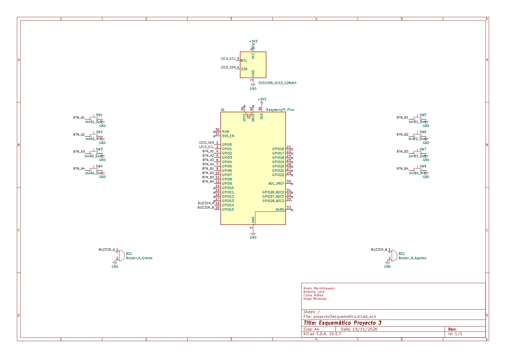

# grupo-02


<h1 align="center">Lenguaje que existe solo cuando nos encontramos</h1>


## Integrantes
+ ***Antonia Loch*** @antoloch
+ ***Anaís Marschhausen*** @anaisbmg
+ ***Carla Nuñez*** @ccarlabelenn
+ ***Hugo Montoya*** @hugomontoya

## Descripción de proyecto

Hoy en día vivimos hiperconectados, pero cada vez tenemos menos momentos de encuentro real, nos estamos olvidando de cómo empezar una charla con un desconocido. Este proyecto busca volver a lo básico, conectar antes de las palabras, a través de los gestos y la escucha. Acá, los botones y los sonidos funcionan como un lenguaje previo al habla, un espacio de prueba donde la máquina no guarda memoria, pero lo que queda es el cambio en las personas.

La propuesta consiste en dos objetos separados, cada uno con un teclado de cuatro botones, que invitan a dos personas a interactuar usando distintos sonidos. Cada uno elige y combina sus propias notas, pero es recién cuando se juntan que logran armar una melodía que nadie podría hacer por su cuenta. Al mezclarse ambos sonidos, el sistema los transforma en vivo en una figura visual única e irrepetible, que es el reflejo exacto de ese encuentro.

La idea es poner el foco en ese primer contacto humano, usando la tecnología solo como una excusa para acercarnos. Es una experiencia que te obliga a colaborar: no se puede completar en soledad y el resultado solo existe si los dos participan. En una época donde todo se graba, se archiva y se sube a las redes, proponemos una pequeña rebeldía, **una tecnología con amnesia**. Al no quedar ningún registro, lo que pasa ahí es totalmente privado y pasajero. Ese instante les pertenece solo a esas dos personas, convirtiendo un momento fugaz en el inicio de un vínculo real.

## Brainstorming

**Sí queremos**

1. Dos personas
2. Acercarse para escucharlo
3. Ambos pueden interactuar
4. Máquina que transmita sonido
5. Interactivo - mandar la señal del sonido
6. Mínimo y máximo 2 personas 
7. 1 Parlante
8. Máquina interactiva que la prioridad es la relación humana momentánea   
9. El sonido se fusiona de a y b 
10. La imagen se fusiona entre a y b
11. Parte a 4 sonidos agudos y parte b 4 sonidos graves  

**No queremos**

1. Alarma de auto
2. Alarma de incendios
3. Despertador
4. Madera
5. Haya memoria
6. Detector de metales
7. Parlante pequeño
8. Radio
9. Máquina de arcade
10. Máquina de pago

## Diagrama de flujo


## Pseudocodigo

**Inicio**

```cpp
disponible parlante
disponible buzzer
disponible laser
disponible botón A1, A2, A3 y A4
//sonidos agudos
disponible botón B1, B2, B3 y B4
//sonidos graves 

//mínimo y máximo de 2 personas
//no existe memoria, no se guarda el sonido

estado = activo
```
**Intervenir**

```cpp
cada persona se ubica frente a un objeto

//las personas deben conversar y decidir juntas qué botones pulsar
//generando una interacción humana, con la máquina como medio

Si solo hay una persona participando
no pasa nada
//así queda claro que la experiencia no se puede completar sola
```
**Pulsar** 

```cpp
Presionar botones de A (a1, a2, a3, a4)
Presionar botones de B (b1, b2, b3, b4)

Si se presiona un botón de a
El sonido agudo predeterminado de ese botón
    
Si se presiona un botón de b
El sonido grave predeterminado de ese botón

//cada botón tiene un sonido predeterminado dentro del rango
//así se genera nuevas características para el sonido en común
```
**Dualidad** 

```cpp
Si A da sonido y B da sonido al mismo tiempo
se fusiona sonido A con sonido B
generando un nuevo sonido 

Se transmite el nuevo sonido al parlante

//ninguna persona podría haber creado este sonido por separado
```

**Perturbar**

```cpp
el parlante reproduce el nuevo sonido
el parlante vibra junto al buzzer

laser detecta la vibración del parlante

//Asi convertimos el sonido en un movimiento físico que se puede ver
```
**Visualizar**

```cpp
La vibración mueve donde se refleja el láser 

Así la luz dibuja en formato de oscilador la figura de las vibraciones

//la figura cambia según el sonido creado de A y B
//Así la figura creada es única y representa el encuentro de las dos personas
//Figura de A y B fusionadas, como también el sonido
```
**Unión**

```cpp
Si las personas dejan de pulsar
se detiene el sonido
se apagar láser
se borrar la figura

//no se guarda nada, lo que ocurrió solo le pertenece a las personas de ese instante
//lo que se deja ir, se va, pero antes se convierte en una relación e interacción nueva
//cada figura es distinta e irrepetible
```

## Esquemático 

## Uso de IA
| Etapa | Prompt Utilizado | Avance / Resultado en el Proyecto |
| :--- | :--- | :--- |
| **1. Prototipo inicial** | *"Quiero hacer una instalación interactiva efímera con Raspberry Pi Pico, una pantalla OLED, dos grupos de 4 botones y dos buzzers para que dos personas generen sonido y visuales juntos en Wokwi."* | Creación del código base en C (Pico SDK) y el circuito en Wokwi con pantalla SSD1306 por I2C, lectura de 8 botones y síntesis sonora independiente por PWM. |
| **2. Arreglo del sonido izquierdo** | *"Mira por qué el buzzer de los botones azules no se escucha en la simulación y dámelo corregido completo."* | Detección de un error de conexión a `GND` en el buzzer izquierdo (`bz1`) dentro de `diagram.json` y entrega de los tres archivos listos para compilar. |
| **3. Figuras de Lissajous reales** | *"Me gustaría que en pantalla se mostraran más como figuras de Lissajous clásicas, te mando una imagen de referencia con las proporciones $n_x:n_y$ y el desfase $k$."* | Cambio de la visualización radial por las ecuaciones paramétricas reales de Lissajous ($x = A\sin(n_x t + \delta)$, $y = B\sin(n_y t)$) usando el algoritmo de Bresenham y ejes individuales cuando actúa una sola persona. |
| **4. Comprensión y paso a físico** | *"Explícame como lo hiciste"* | Desglose bloque por bloque del código (framebuffer I2C, cálculo de PWM, máscaras de bits) junto con la lista de materiales y guía para cargar el archivo `.uf2` en la Pico real. |
| **5. Afinación justa y acoplamiento** | *"¿Se pueden agregar audios propios en Wokwi? Idealmente 8 notas (4 graves y 4 agudas) para que suene armónico y que sus vibraciones provoquen figuras de Lissajous."* | Implementación de una escala en entonación justa basada en Do ($132\text{ Hz}$ a $660\text{ Hz}$) acoplada mediante el cálculo del Máximo Común Divisor (`mcd`) para que la relación entre frecuencias genere exactamente su figura geométrica correspondiente. |
## BOM

| Cantidad | Componente | Descripción |
|---|---|---|
| 1 | Raspberry Pi Pico | Microcontrolador principal |
| 8 | Botones | Teclado |
| 1 | Parlante | Tomar el sonidos |
| 1 | Buzzer | Tomar la vibración |
| 1 | Láser | Emisión de luz láser |
## Alcances 

**Logrables**

+ Tener nuestros propios tonos y sonidos
+ Carcasa del producto
+ Lograr una interacción real

**Desechados**

+ Tinder de sonido, no nos hacía sentido con lo que queríamos transmitir, una propuesta que era desde la especulación y no íbamos a tener un parámetro real de “match”

## Wokwi

<https://wokwi.com/projects/481069718024411137>

## Referentes 

+ Curvas de Lissajous

**Link:** https://es.wikipedia.org/wiki/Curva_de_Lissajous 

Las curvas de Lissajous fueron de los primeros referentes que encontramos porque nos ayudaron a entender cómo dos señales pueden relacionarse para crear una forma nueva. Nos interesó que la figura no depende de una sola frecuencia, sino de la interacción entre ambas. Esto se relaciona directamente con nuestro proyecto, ya que cada persona aporta una parte del resultado y la visualización solo aparece cuando ambas participan.

+ Láser + Espejo + Sonido

**Link: https://youtu.be/C-V1uXeyGmg?si=dsXwtyofgX1jrGiM** 

nos ayudó a visualizar sonido gracias a las vibraciones, explica cómo se puede y el porqué del movimiento en la proyección. Nos ayudó a entender sobre los tonos, frecuencias y hablar de la sobreposición de estas, para que nos entregan figuras ordenadas con un sentido y que la unión tienen un sentido con una exposición 

+ Lissajous Figures - Laser - Piano

**Link:** https://youtu.be/yOYVDm3Ymuk?si=HR7XLBtlrlzw7FyZ  

Este video nos ayudó a entender que diferentes notas e intervalos generan distintas figuras. Nos hizo pensar que podíamos crear nuestros propios sonidos y transformarlos en visualizaciones. 

+ Vector Synthesis

**Link:** https://share.google/iI3kdTm036BZOQZqz 

La síntesis vectorial nos interesó porque trabaja directamente con señales para crear imágenes. Más que el resultado visual, nos llamó la atención la idea de que sonido e imagen pueden nacer de un mismo proceso. 

+ OP-1 Field – Teenage Engineering 

**Link:** https://www.musicchile.cl/sintetizador-op-1-field-teenage-engineering 

Este sintetizador se transformó en un referente importante para el proyecto después de que Aaron nos lo mostrara. Nos pareció increíble porque reúne sonido, interacción física y experimentación en un mismo objeto. 

+ Critter & Guitari (Organelle y EYESY)

**Link:** https://youtu.be/xIxchxVhVI0?si=ctZjDbj2sgfmBtbf 

Nos interesó especialmente cómo trabajan la relación entre sonido e imagen en tiempo real. Ver cómo una señal sonora puede transformarse inmediatamente en una visualización nos ayudó a imaginar cómo se podría representar el encuentro entre dos personas a través de formas que cambian constantemente.

+ Dato Musical Instruments

**Link:** https://dato.mu/ 

Este referente fue importante porque pone el foco en las personas y no en la técnica. Sus instrumentos están pensados para jugar, experimentar y compartir con otros. Esa mirada se acerca mucho a lo que buscamos, ya que el sonido en nuestro proyecto funciona como una excusa para relacionarse, conversar y crear algo junto a otra persona.

+ Mordax DATA

**Link:** https://foundsound.com.au/products/16538?variant=37615298511045 

Mordax DATA nos sirvió para entender distintas formas de visualizar señales electrónicas y sonoras. Nos mostró que detrás de cada sonido existe una información que puede observarse gráficamente. Esto nos ayudó a pensar cómo convertir las señales generadas por los usuarios en figuras visuales que representen su interacción.

+ Norman McLaren – Directed (1951)

**Link:** https://youtu.be/Y2ULu_sni-M?si=k7xZ3ZsbuNGYBudZ 

Nos interesó la manera en que McLaren trabaja con elementos abstractos para generar ritmo, movimiento y comunicación. Nos hizo pensar que no siempre es necesario utilizar palabras para generar una experiencia significativa. En nuestro proyecto ocurre algo parecido: las personas comienzan relacionándose a través del sonido, la acción y la observación antes de llegar a una conversación.

## Bibliografia
+ Bresenham, J. E. (1965). Algorithm for computer control of a digital plotter. IBM Systems Journal, 4(1), 25–30. https://doi.org/10.1147/sj.41.0025
+ Helmholtz, H. L. F. (1895). On the sensations of tone as a physiological basis for the theory of music (A. J. Ellis, Trad.; 3.ª ed.). Longmans, Green, and Co.
+ Lissajous, J. A. (1857). Mémoire sur l'étude optique des mouvements vibratoires [Memoria sobre el estudio óptico de los movimientos vibratorios]. Annales de Chimie et de Physique, 51(3), 147–231.
+ Raspberry Pi Ltd. (2023). RP2040 Datasheet: A microcontroller by Raspberry Pi. https://datasheets.raspberrypi.com/rp2040/rp2040-datasheet.pdf
+ Raspberry Pi Ltd. (2023). Raspberry Pi Pico C/C++ SDK: Libraries and tools for C/C++ development on RP2040 microcontrollers. https://datasheets.raspberrypi.com/pico/raspberry-pi-pico-c-sdk.pdf
+ Solomon Systech Limited. (2008). SSD1306: 128 x 64 Dot Matrix OLED/PLED Segment/Common Driver with Controller (Rev. 1.1). https://cdn-shop.adafruit.com/datasheets/SSD1306.pdf
+ Wokwi. (2024). Wokwi: Online Electronics Simulator (Raspberry Pi Pico & SSD1306 Documentation). https://docs.wokwi.com/
