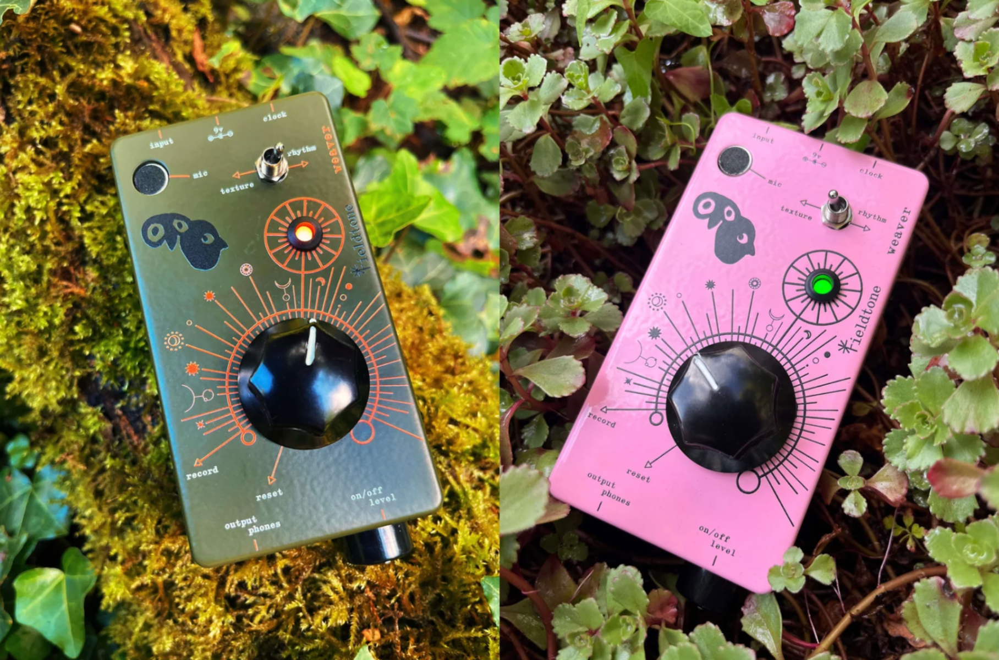
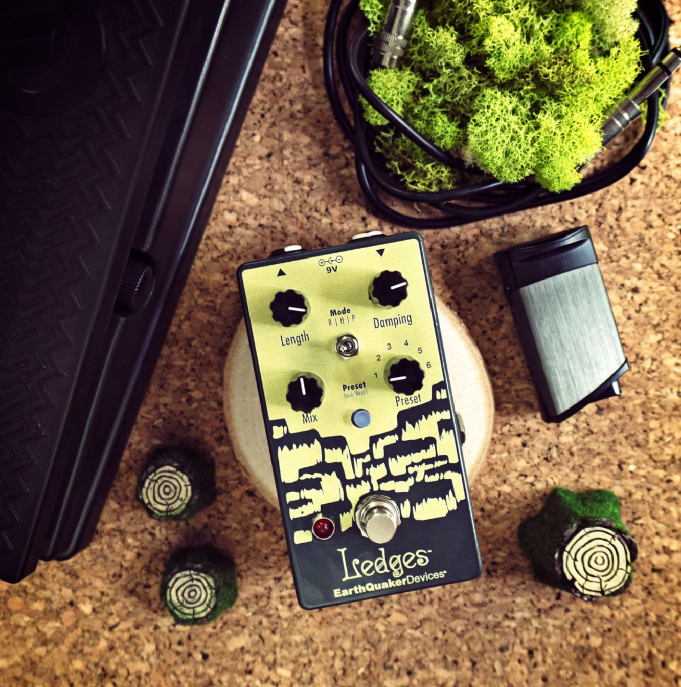
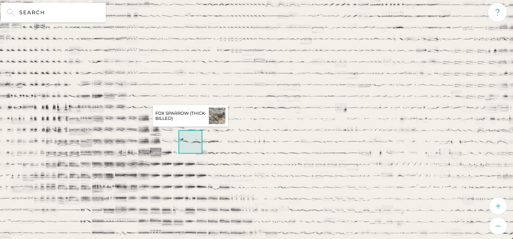
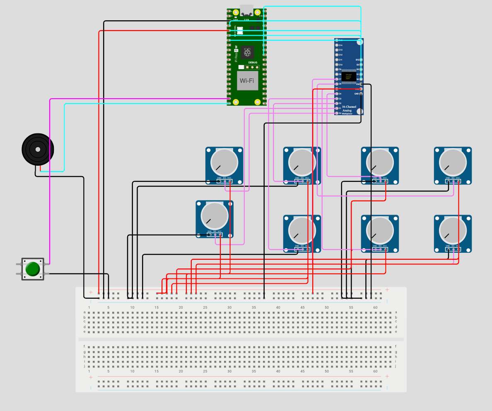

# grupo-03

## Integrantes

- Magdalena Balart [_(magdalenabalart)_](https://github.com/disenoUDP/dis8645-2026-2-procesos-2/tree/main/02-magdalenabalart)
- Catalina Oyanedel [_(catalinaoyanedel-01)_](https://github.com/disenoUDP/dis8645-2026-2-procesos-2/tree/main/17-catalinaoyanedel-01)
- Yaira Ruiz [_(yairaruiz)_](https://github.com/disenoUDP/dis8645-2026-2-procesos-2/tree/main/26-yairaruiz)
- Marcela Zuñiga [_(marcezm)_](https://github.com/disenoUDP/dis8645-2026-2-procesos-2/tree/main/32-marcezm)

# Planteamiento conceptual

## ⁠No se puede cuidar lo que no se conoce
Queriendo trabajar con la educación y la biodiversidad llegamos a esta cita, la cual nos sirvió como un punto de partida para definir el proyecto. Se le atribuye al conservacionista senegalés Baba Dioum, quien la expresó en 1968 durante la reunión trienal de la Asamblea General de la Unión Internacional para la Conservación de la Naturaleza y los Recursos Naturales (UICN), realizada en Nueva Delhi. Su declaración fue: **“Al final, solo conservaremos lo que amamos, solo amaremos lo que entendemos y solo entenderemos lo que nos enseñan”** (Dioum, 1968, como se citó en Gray y Thomson, 2016).

A partir de esto entendemos que no basta solo con educar dando a conocer. Entendemos que conocer no implica, de forma directa, cuidar, y que incluso las especies más conocidas pueden ser las que se encuentran en mayor peligro (Andarríos, 2011c). Por lo que, conocer nombres, características y vocalizaciones no es suficiente y a partir de esto, definimos dos enfoques que se complementan.

El primer enfoque apunta a promover una relación más afectiva con la naturaleza. Gray y Thomson (2016) sostienen que “la educación no solo requiere una mayor conciencia de nuestra realidad ecológica, sino también una mayor curiosidad y apego —e incluso amor, tal vez— por el mundo natural” (p. 241, traducción propia). Buscamos que la máquina sonora cumpla este propósito generando, a través de la escucha, un vínculo sensible con estas especies.

Mientras que el segundo consiste en profundizar en esta información mediante una ficha que acompañe a la máquina y que permita entender a cada especie, más allá de solo su existencia, como parte de un sistema. A pesar de que los ecosistemas pueda adaptarse tras perder especies, su funcionamiento se ve alterado; cada organismo actúa como un bioindicador que revela la salud del entorno del que también somos parte, entregando información sobre los cambios y la salud de su entorno (Andarríos, 2011a). Comprender esto nos permite valorar aún más el papel de cada especie y leer mejor los ecosistemas de los que también somos parte.

## Referentes

`01. ARTISTAS Y OBRAS`
### Carlos Cabezas

Carlos Cabezas es un músico, productor y artista sonoro chileno con más de 40 años de trayectoria. Su trabajo destaca por la experimentación electrónica, el autodidactismo y el cruce entre la música, las artes visuales, el cine y el teatro. Sobre su recorrido artístico, Arteaga (2025) señala: “Desde los días fundacionales de Electrodomésticos, pasando por su carrera solista, proyectos como La Banda del Dolor, Cordillera y sus incursiones en el bolero y la experimentación sonora, su obra se ha transformado en un mapa sonoro que refleja tanto la historia personal del artista como la evolución cultural del país.” (párr. 1)

Como referentes para este proyecto, consideramos una obra de su autoría y otra en la que participó como compositor:

#### Cordillera: álbum realizado en conjunto a Ángelo Pierattini**

Respecto al enfoque conceptual de este disco, Carlos Cabezas explica:

> “Cordillera plantea un paisaje sonoro, por ejemplo, como lo dice el nombre, plantea un espacio, una sensación, un territorio. Y las sensaciones y reflexiones que pueden venir de ahí, de lo que puede ser la experiencia de vida en ese espacio.” (Arteaga, 2025, párr. 12)

Por su parte, Ángelo Pierattini complementa esta visión señalando que el álbum contiene “composiciones muy sensibles, mínimas en su vestidura, mucha atmósfera, una que lograra llevarnos a un espacio tan enigmático como la cordillera” (La Tercera, 2024, párr. 3).

De este álbum rescatamos su propuesta conceptual en torno al paisaje sonoro, ya que nos permite abordar la idea del espacio y las sensaciones propias de los distintos territorios que estamos abordando.

[Escuchar álbum](https://www.youtube.com/watch?v=GS2s04lrvJQ&list=OLAK5uy_kAeUhNzJDxWLnzSldMlwBvJNGEk6lieLc)

#### Blanco

Blanco es una obra de danza contemporánea sobre la vastedad de la naturaleza y la forma en que nos afecta y conecta, cocreada por tres figuras de las artes escénicas: Rodrigo Pérez, Andrés Poirot y Claudia Vicuña. La puesta en escena indaga en la sensación de inmensidad de un paisaje y en el silencio interior que se alcanza al contemplarlo (Centro Cultural Gabriela Mistral, s. f.).

La composición musical estuvo a cargo de Carlos Cabezas, quien construye un ambiente envolvente, cristalino y natural. Según explicó Claudia Vicuña, la obra se concibe como un paisaje en el que los elementos coexisten sin jerarquías, permitiendo que sea el propio espectador quien vincule sus componentes (Radio Universidad de Chile, 2019).

De esta propuesta rescatamos tanto la composición musical, que evoca al entorno natural, como la noción de un paisaje abierto, donde cada cada elemento pueda existir individualmente y que el usuario sea quien le da sentido a lo que escucha.

[Blanco](https://www.youtube.com/watch?v=KTKLvBF6utY)

### Felipe Otondo

Felipe Otondo es ingeniero acústico, con una maestría en Acústica en la Universidad de Aalborg (Dinamarca), y compositor: estudió composición en la Carl Nielsen Academy of Music y realizó un doctorado en composición musical en la Universidad de York. Actualmente dirige el Instituto de Acústica de la Universidad Austral de Chile y, desde 2019, lidera el proyecto Soundlapse, vinculado a un proyecto Fondecyt sobre una herramienta espacio-temporal para aplicaciones creativas y educativas de grabaciones de paisaje sonoro de humedales.

Soundlapse se organiza en tres líneas de investigación: detección de fauna, creación artística y educación ambiental. En la primera, usan inteligencia artificial para detectar de manera fidedigna las aves de Chile y generar un repositorio para escucharlas, que vincula la imagen del ave con su sonido y una breve descripción.

[Repositorio de Aves](https://www.sonidosdeaves.cl)

----

`02. CARCASA E INTERFAZ`
### Fieldtone – Weaver Handheld

Weaver Handheld es un instrumento electrónico portátil desarrollado por Fieldtone, una marca británica dedicada a la creación de dispositivos de experimentación sonora. El instrumento permite capturar, manipular y transformar sonidos mediante un micrófono incorporado, controles físicos y una interfaz que facilita la exploración de distintas posibilidades sonoras. Su diseño destaca por una carcasa compacta, una distribución sencilla de sus controles y una estética que integra elementos funcionales y visuales.

Queremos rescatar de este referente la carcasa e interfaz, para realizar gráficas en vinilo o grabado láser. Por ejemplo, con la perilla, utilizando las siluetas de las especies para indicar donde se encuentra el usuario, hacer que la interacción sea más fácil de entender y permita la exploración autónoma.



### Ledges EARTHQUAKER DEVICES

Ledges es un pedal de efectos electrónico desarrollado por la marca estadounidense EarthQuaker Devices. Se trata de un dispositivo de reverberación que permite modificar las características espaciales de un sonido mediante tres modos: Room, Hall y Plate, que generan distintos tipos de resonancia y profundidad. Cuenta con controles físicos mediante perillas para ajustar parámetros como la duración de la reverberación (Length), la intensidad del efecto (Mix) y la atenuación de frecuencias agudas (Damping). Además, incorpora un selector de modos y una perilla para guardar y recuperar hasta seis configuraciones de sonido. 

De esta propuesta rescatamos la organización de su interfaz física y la manera en que distribuye los controles para facilitar la manipulación sonora. Nos interesa especialmente la incorporación de indicadores gráficos alrededor de las perillas y selectores, que permiten comprender visualmente las distintas opciones de configuración. 



----

`03. PROYECTOS DE DISEÑO`

### Bird Sounds (2017)

Bird Sounds es un proyecto interactivo desarrollado por Manny Tan, Kyle McDonald y el equipo de Google Creative Lab, que utiliza inteligencia artificial y aprendizaje automático para organizar y visualizar miles de grabaciones de sonidos de aves. A través de una técnica llamada t-SNE, el sistema identifica similitudes entre los registros sonoros y los representa en un mapa visual, agrupando aquellos que presentan características similares. Para realizar este proceso, el sistema analiza únicamente los audios, sin recibir información previa sobre los nombres o las especies de las aves. 

Rescatamos la posibilidad de transformar una colección de registros sonoros en una experiencia interactiva. Buscamos utilizar los registros sonoros de distintas especies chilenas en peligro de extinción como una forma de acercar al usuario a la biodiversidad. 



--- 

`04. REFERENTES SONOROS`

### PercuSynth – GC Lab Chile

PercuSynth es un instrumento electrónico desarrollado por GC Lab Chile, que combina funciones de caja de ritmos, controlador MIDI y sintetizador polifónico. Su diseño permite experimentar con la creación y manipulación de sonidos mediante controles físicos y componentes electrónicos, explorando distintas posibilidades de composición sonora.

De este referente rescatamos las posibilidades de experimentación rítmica y creación de composiciones a partir de sonidos. Nos interesa explorar cómo estas herramientas pueden utilizarse para complementar los registros bioacústicos de las especies de nuestro proyecto, incorporando elementos rítmicos y sonoros que permitan enriquecer la experiencia de escucha.

[Escuchar sintetizador](https://youtube.com/shorts/DbD2s_9ED9s)

### Proto-Synth V2.0 – GC Lab Chile

Proto-Synth V2.0 es un instrumento electrónico experimental desarrollado por GC Lab Chile, orientado a la exploración y creación de sonidos mediante síntesis digital. A través de sus controles físicos, permite modificar y experimentar con diferentes parámetros sonoros, generando texturas y composiciones electrónicas.

De este referente rescatamos la experimentación con la síntesis y la manipulación de sonidos para construir ambientes y paisajes sonoros. Nos interesa explorar cómo complementar los registros originales de las especies con recursos de síntesis sonora, creando atmósferas que evoquen sus hábitats y permitan generar una experiencia de escucha más envolvente.

[Escuchar sintetizador](https://youtube.com/shorts/6owidjx-n7g)

### 4300 km – Grabaciones de campo de artistas chilenos (2017)

4300 km es una compilación sonora publicada en 2017 por Tsonami Records, sello dedicado al paisaje sonoro, la música experimental y el arte sonoro. El álbum reúne trabajos de trece artistas chilenos que utilizan grabaciones de campo realizadas en distintos territorios del país, desde el desierto de Atacama hasta la Patagonia. Entre sus registros se encuentran sonidos de humedales, ambientes naturales, agua y distintos espacios del territorio nacional. La compilación busca presentar una radiografía del paisajismo sonoro en Chile a través de grabaciones que documentan las características acústicas de cada lugar.

Rescatamos el uso de grabaciones de campo como una herramienta para registrar y dar a conocer los sonidos de los distintos territorios. Nos interesa especialmente cómo estos registros permiten acercarnos a los ambientes naturales a través de la escucha.

[4300 km: Grabaciones de campo de artistas chilenos](https://tsonamirecords.bandcamp.com/album/4300-km-grabaciones-de-campo-de-artistas-chilenos)

# Ecos en extinción

## Desarrollo conceptual
Este proyecto busca acercar y educar sobre la biodiversidad de las especies amenazadas o en peligro de extinción que habitan nuestro territorio chileno, a través de una máquina sonora que da visibilidad y amplifica sus voces y su existencia. Como consecuencia, apela desde la escucha, generar un vínculo sensible a la memoria de estas especies que muchas veces pasan desapercibidas, invitando a reconocer su presencia y reflexionar sobre la fragilidad de su existencia.

La máquina se organiza en cuatro categorías: mamíferos, aves, anfibios e insectos. Cada categoría contiene tres especies, una por cada zona del país (norte, centro y sur). 

La máquina permite escuchar, silenciar y superponer los sonidos de los distintos animales mediante perillas, generando composiciones sonoras que surgen de la combinación de sus voces. Así, el instrumento funciona tanto como un pequeño archivo de biodiversidad sonora como una herramienta de exploración y composición de un imaginario de paisaje sonoro.

### Selección de especies, justificación, características y audio

A partir del siguiente prompt, le pedimos a Gemini y Claude que nos diera un listado de posibles especies, y así fuimos seleccionando según qué audio encontrábamos disponible en los recursos sonoros de biodiversidad que seleccionamos.

- Museo Bioacústico (https://museobioacustico.org)
- iNaturalist (https://www.inaturalist.org)
- ONG Ranita de Darwin – Cantos de Anfibios (https://www.ranitadedarwin.org/cantos)
- Xeno-canto (xeno-canto.org)

> “Necesito seleccionar especies de fauna nativa o endémica de Chile que estén clasificadas en estado de amenaza (En Peligro Crítico, En Peligro o Vulnerable según el MMA de Chile) para un proyecto de divulgación sobre biodiversidad. Dame 5 opciones de especies para cada cruce entre las siguientes categorías y zonas del país:
>
> Mamíferos: Norte / Centro / Sur
>
> Aves: Norte / Centro / Sur
> 
> Anfibios: Norte / Centro / Sur
> 
> Insectos: Norte / Centro / Sur
> 
> Criterios de selección y formato: prioriza especies que emitan sonidos, cantos o vocalizaciones reconocibles (especialmente en aves, anfibios e insectos). Indica para cada especie: nombre común, nombre científico, origen (endémica o nativa), categoría de conservación exacta, una breve referencia de su hábitat, de su vocalización y cómo actúa como bio indicador."

#### Mamíferos

| Zona | Nombre común | Nombre científico | Origen | Estado MMA | Hábitat, vocalización, rol bioindicador | Audio |
| :--- | :--- | :--- | :--- | :--- | :--- | :--- |
| Norte | Ballena Azul | *Balaenoptera musculus* | Nativa | CR | Aguas oceánicas y zonas de surgencia costera (Chañaral); emite pulsos de muy baja frecuencia (infrasonidos). Indica productividad marina (krill) y baja contaminación acústica submarina. | [Escuchar](https://museobioacustico.org/especie/83e7b118-57f7-4e1b-81a4-0e19717e31dc) |
| Centro | Zorro culpeo | *Lycalopex culpaeus* | Nativa | VU (Zona Central) | Matorral y bosque esclerófilo; se comunica con aullidos y ladridos profundos. Indica equilibrio en las poblaciones de roedores nativos. | [Escuchar](https://xeno-canto.org/species/Lycalopex-culpaeus) |
| Sur | Zorro chilote | *Lycalopex fulvipes* | Endémica | EN | Bosque húmedo del sur. Indica bosques conservados | [Escuchar](https://xeno-canto.org/species/Lycalopex-fulvipes) |

#### Aves

| Zona | Nombre común | Nombre científico | Origen | Estado MMA | Hábitat, vocalización, rol bioindicador | Audio |
| :--- | :--- | :--- | :--- | :--- | :--- | :--- |
| Norte | Gaviotín chico | *Sternula lorata* | Nativa | EN | Playas arenosas y dunas costeras; emite llamadas estridentes y nasales en vuelo. Indica playas libres de tránsito vehicular, perros y perturbación humana. | [Escuchar](https://xeno-canto.org/species/Sternula-lorata) |
| Centro | Hued-hued Castaño | *Pteroptochos castaneus* | Nativa | VU | Sotobosque húmedo y denso de bosques caducifolios y esclerófilos de transición de la Zona Centro-Sur (desde O'Higgins hasta el Biobío); emite un canto territorial profundo y resonante. Indica cobertura vegetal continua, quebradas húmedas con abundante hojarasca y baja fragmentación del bosque nativo. | [Escuchar](https://museobioacustico.org/especie/edc219c6-fa79-4b8f-8f5a-58077907969e) |
| Sur | Fardela Blanca | *Ardenna creatopus* | Nativa | EN | Aguas pelágicas e islas (nidifica en Isla Mocha y Juan Fernández); emite llamadas nocturnas nasales en colonias. Indica productividad marina y ausencia de depredadores introducidos o contaminación lumínica en sus islas. | [Escuchar](https://museobioacustico.org/especie/3c863387-d180-4f8e-922b-ffcdb0a98d79) |


#### Anfibios

| Zona | Nombre común | Nombre científico | Origen | Estado MMA | Hábitat, vocalización, rol bioindicador | Audio |
| :--- | :--- | :--- | :--- | :--- | :--- | :--- |
| Norte | Sapo de Atacama | *Rhinella atacamensis* | Endémica | VU | Oasis, aguadas y quebradas costeras (desde Antofagasta a Coquimbo); emite un trino grave y continuo. Indica calidad del agua y conservación de humedales en zonas áridas. | [Escuchar](https://soundcloud.com/anfibios-de-chile/rhinella-arunco) |
| Centro | Sapito de cuatro ojos | *Pleurodema thaul* | Nativa | VU (poblaciones norte-centro) | Estero, charcos temporales y humedales desde Antofagasta hacia el sur; canto melódico y aflautado (*"pui-pui"*) fácil de hallar en archivos de audio. Indica disponibilidad de agua estacional y micro humedales sanos. | [Escuchar](https://xeno-canto.org/species/Pleurodema-thaul) |
| Sur | Ranita de Darwin | *Rhinoderma darwinii* | Nativa | EN | Requiere bosques templados lluviosos maduros y de alta humedad, por lo que su presencia funciona como un "termómetro" biológico (especie centinela) que certifica la buena salud y madurez del bosque nativo. | [Escuchar](https://www.ranitadedarwin.org/cantos) |

#### Insectos

| | Nombre común | Nombre científico | Origen | Estado MMA | Hábitat, vocalización, rol bioindicador | Audio |
|---|---|---|---|---|---|---|
| Norte | Moscardón o Abejorro nativo | *Bombus dahlbomii* | Nativa | EN | Llega hasta Coquimbo en su límite norte; zumbido grave y muy fácil de encontrar grabado. Indica estado de polinizadores nativos frente a especies invasoras (*B. terrestris*). | [Escuchar](https://www.youtube.com/watch?v=9bTr3HQUSP4)|
| Centro | Madre de la culebra | *Acanthinodera cumingii* | Endémica | VU | Bosque esclerófilo y caducifolio; emite un chillido estridente por estridulación al ser perturbada y un zumbido pesado al volar. Indica bosques con árboles maduros y madera en descomposición. | [Escuchar](https://www.inaturalist.org/observations/66860221) |
| Sur | Abeja Negra | *Centris nigerrima* | Nativa | VU | Bosques templados y matorrales (hasta Los Lagos); emite un zumbido grave al polinizar por vibración. Indica salud de la flora nativa, suelos sin compactar para nidificar y baja presión de especies invasoras. | [Escuchar](https://museobioacustico.org/especie/2c219b00-b16d-4a85-bee8-a56df40cd652) |

### Funcionamiento
La máquina tendrá cuatro potenciómetros, uno por cada categoría: mamíferos, aves, insectos y anfibios. Cada uno tendrá la posibilidad de seleccionar uno de tres especies mediante rangos predefinidos. Cada uno de estos potenciómetros estará acompañado de otro potenciómetro que controlará la probabilidad de aparición del sonido. Cada vez que una especie suene, su velocidad, duración y volumen variarán aleatoriamente.

Un noveno potenciómetro controlará el tempo general, definiendo cada cuánto se evalúan estas probabilidades. Además, habrá un botón de encendido y apagado que emitirá un sonido para indicar el estado de la máquina.

### Diseño carcasa

**Boceto de la máquina:**


**Render hecho con Chat GPT:**

Prompt:

> "Genera un render realista del diseño que adjunto, respetando su distribución y proporciones. Los materiales y elementos deben interpretarse de la siguiente manera: las superficies de color café claro corresponden a madera clara; las piezas burdeos, a filamento de impresión 3D; y las perillas verdes, también a filamento 3D. Los pequeños puntos burdeos corresponden a potenciómetros de menor tamaño, destinados a controlar el volumen de cada especie. Las líneas grabadas en la superficie representan las siluetas de distintas especies. En la parte superior se encuentran los orificios de salida del sonido. El botón ubicado en la esquina superior izquierda corresponde al encendido y apagado del dispositivo, mientras que en la zona inferior izquierda se incorpora una pequeña leyenda explicativa. Es importante mantener la estética, la distribución de los controles y la estructura del diseño original, sin agregar elementos que no estén contemplados."


### Experiencia de usuario

**1.⁠ ⁠Encendido:** la persona presiona el botón ubicado en la esquina superior.

**2.⁠ ⁠Lectura de controles:** la máquina lee la posición de las cuatro perillas de selección de especies, las cuatro perillas de probabilidad y la perilla de tempo. Carga las especies indicadas por cada control.

**3.⁠ ⁠Inicio en silencio:** el paisaje sonoro comienza en silencio, con las cuatro categorías en probabilidad mínima.

**4.⁠ ⁠Activar una especie:** la persona aumenta la probabilidad de una categoría mediante su perilla correspondiente. Esto incrementa las posibilidades de que el sonido de esa especie aparezca en el paisaje sonoro.

**5.⁠ ⁠Cambiar de especie:** al girar una perilla de selección, el canal cambia a otra especie de su categoría. La nueva especie mantiene la probabilidad configurada para ese canal.

**6.⁠ ⁠Ajustar la probabilidad:** cada una de las cuatro perillas permite modificar la probabilidad de aparición de los sonidos de su categoría. De esta manera, la persona puede generar paisajes sonoros con distintas frecuencias de aparición, presencias y ausencias.

**7.⁠ ⁠Ajustar el tempo:** mediante la novena perilla, la persona modifica el tempo general de la composición, afectando el ritmo de aparición o reproducción de los sonidos.

**8.⁠ ⁠Componer:** la persona combina las distintas probabilidades y modifica el tempo general, creando diferentes paisajes sonoros mediante la presencia, ausencia y frecuencia de aparición de cada especie.

**9.⁠ ⁠Apagado:** al presionar nuevamente el botón, se detienen todos los canales de audio y la máquina queda en reposo.

```mermaid
---
config:
  theme: default
---
flowchart TB
    A(["INICIO"]) --> B["Presionar botón de encendido"]
    B --> C["Reproducir sonido de inicio"]
    C --> D["Leer los 9 potenciómetros"]
    D --> E["Cargar las 4 especies seleccionadas"]
    E --> F["Iniciar paisaje sonoro en silencio"]
    F --> G{"¿Qué control utiliza la persona?"}
    G -- Selección de especie --> H["Cambiar especie de la categoría"]
    H --> I["Cargar nuevo registro sonoro"]
    I --> J["Conservar probabilidad configurada"]
    G -- Probabilidad --> K["Modificar probabilidad de aparición"]
    K --> L{"¿Probabilidad en cero?"}
    L -- Sí --> M["No reproducir sonidos de esa categoría"]
    L -- No --> N["Actualizar frecuencia de aparición"]
    G -- Tempo general --> O["Modificar tempo de la composición"]
    O --> P["Actualizar ritmo de reproducción o aparición"]
    J --> Q["Actualizar paisaje sonoro"]
    M --> Q
    N --> Q
    P --> Q
    Q --> R{"¿Presiona botón de apagado?"}
    R -- No --> G
    R -- Sí --> S["Detener reproducción de audio"]
    S --> T["Silenciar todos los canales"]
    T --> U(["MÁQUINA EN REPOSO"])

    style A fill:#FFF9C4
    style B fill:#C8E6C9
    style C fill:#C8E6C9
    style D fill:#C8E6C9
    style E fill:#C8E6C9
    style F fill:#C8E6C9
    style G fill:#E1BEE7
    style H fill:#C8E6C9
    style I fill:#C8E6C9
    style J fill:#C8E6C9
    style K fill:#C8E6C9
    style L fill:#E1BEE7
    style M fill:#C8E6C9
    style N fill:#C8E6C9
    style O fill:#C8E6C9
    style P fill:#C8E6C9
    style Q fill:#C8E6C9
    style R fill:#E1BEE7
    style S fill:#C8E6C9
    style T fill:#C8E6C9
    style U fill:#FFF9C4
  ```

## Desarrollo técnico

### BOM

| Componente | Especificación | Cantidad | Precio (CLP) | Dónde comprar |
|---|---|---:|---:|---|
| Multiplexor I2C | Módulo Multiplexor CD74HC4067 (16 canales) | 1 | $2.000 | [Afel](https://afel.cl/products/modulo-multiplexor-cd74hc4067?_pos=1&_sid=10698f577&_ss=r) |
| Parlante | 8 Ω – 1 W | 1 | $3.290 | [Mechatronic Store](https://www.mechatronicstore.cl/altavoz-8-ohm-1w/) |
| Amplificador | MAX98357A – I2S Class-D Mono Amplifier | 1 | $1.114 | [AliExpress](https://es.aliexpress.com/item/1005007629020891.html?invitationCode=NmNJM3JLWWZZS1FMUFFMQmtCMGZzc1ViQXIxOG1yRmxHY3ZrcTc2TzFsU2VQemFTZUJrNWVWT0s1MU1hdTAyWg&srcSns=sns_Copy&spreadType=socialShare&social_params=22243417448&bizType=ProductDetail&spreadCode=NmNJM3JLWWZZS1FMUFFMQmtCMGZzc1ViQXIxOG1yRmxHY3ZrcTc2TzFsU2VQemFTZUJrNWVWT0s1MU1hdTAyWg&aff_fcid=b2fb14cd2e1c4e359da75f150cac31ce-1795048981407-09999-_mOqQo0f&tt=MG&aff_fsk=_mOqQo0f&aff_platform=default&sk=_mOqQo0f&aff_trace_key=b2fb14cd2e1c4e359da75f150cac31ce-1795048981407-09999-_mOqQo0f&shareId=22243417448&businessType=ProductDetail&platform=AE&terminal_id=a4e6610a1d834a91a02e63493c836ef4&afSmartRedirect=y) |
| Potenciómetro | B100K – 100 kΩ | 8 | $500 | [Afel](https://afel.cl/products/potenciometro-100k-ohm?_pos=7&_sid=9e0d7b4a3&_ss=r) |
| Cable Dupont | Emisor-receptor (pack 20 u.) | 1 pack | $1.000 | [Afel](https://afel.cl/products/pack-20-cables-de-conexion-macho-hembra?_pos=10&_sid=aaf1449e0&_ss=r) |
| Cable Dupont | Receptor-receptor (pack 20 u.) | 1 pack | $1.000 | [Afel](https://afel.cl/products/pack-20-cables-de-conexion-hembra-hembra?_pos=9&_sid=aaf1449e0&_ss=r) |
| Cable Dupont | Emisor-emisor (pack 20 u.) | 1 pack | $1.000 | [Afel](https://afel.cl/products/pack-20-cables-de-conexion-macho-macho?_pos=8&_sid=3f3b26861&_ss=r) |
| Botón | Táctil 12 × 12 × 7,3 mm | 1 | $100 | [Afel](https://afel.cl/products/boton-tactil-tapa-12x12x7-3-interruptor?_pos=1&_sid=699a10ff2&_ss=r) |
| Módulo micro SD | Lector de tarjeta micro SD | 1 | $2.500 | [Afel](https://afel.cl/products/lector-micro-sd?variant=45125228363928&country=CL&currency=CLP&utm_medium=product_sync&utm_source=google&utm_content=sag_organic&utm_campaign=sag_organic&utm_term=&utm_campaign=@+Smart+Shopping&utm_source=adwords&utm_medium=ppc&hsa_acc=1808722794&hsa_cam=18405560573&hsa_grp=&hsa_ad=&hsa_src=x&hsa_tgt=&hsa_kw=&hsa_mt=&hsa_net=adwords&hsa_ver=3&gad_source=1&gad_campaignid=17613659948&gbraid=0AAAAADBMsFTN_gh9R6uq0a2pF9xf_kgnV&gclid=Cj0KCQiAtvXXBhC2ARIsAJc8SUSguyj6IVfNbUJedOtDKN_4iNUrlwUZ9uejr6jYonCG1e7MDeGT9PIaAifsEALw_wcB) |
| Raspberry Pi Pico 2 W | Microcontrolador RP2350 – Wi-Fi / Bluetooth | 1 | $16.990 | [Mechatronic Store](https://www.mechatronicstore.cl/raspberry-pi-pico-2-w-raspberry-pi-rp2350-chip/?srsltid=AYCX9vLHVZO-tqr38lJI7R4GWZtZJnGg0Fjlj3rPMl8QFogm7r1N2Y4Z) |

### Pseudocódigo

```cpp
// ============ DATOS ============

categorias = [mamiferos, aves, anfibios, insectos]
especiesPorCategoria = 3

// Un audio corto por especie (el llamado, que se reproduce una vez)
audios[categoria][especie] = "mamiferos/huemul", "aves/...", etc.
sonidoEncendido = "sistema/encendido"
sonidoApagado = "sistema/apagado"

// Estado general
maquinaEncendida = falso
tempoActual = 0                  // pasos por minuto
tiempoProximoPaso = 0

// Estado de cada categoría
para cada categoria:
    especieActual[categoria] = ninguna
    densidadActual[categoria] = 0      // de 0 a 100


// ============ PROGRAMA PRINCIPAL ============

inicio:
    quedarEnReposo()

    repetir siempre:
        si botonEncendidoPresionado():
            si maquinaEncendida:
                apagarMaquina()
            sino:
                encenderMaquina()

        si maquinaEncendida:
            revisarTempo()
            para cada categoria en categorias:
                revisarEspecie(categoria)
                revisarDensidad(categoria)

            si tiempoActual() >= tiempoProximoPaso:
                darPaso()
                tiempoProximoPaso = tiempoActual() + duracionDePaso(tempoActual)


// ============ ENCENDIDO Y APAGADO ============

funcion encenderMaquina():
    maquinaEncendida = verdadero
    reproducir(sonidoEncendido)
    esperarFinDelSonido()

    revisarTempo()
    para cada categoria en categorias:
        especieActual[categoria] = ninguna
        revisarEspecie(categoria)          // carga la especie que marca la perilla
        revisarDensidad(categoria)         // lee la densidad que marca la perilla

    tiempoProximoPaso = tiempoActual()

funcion apagarMaquina():
    reproducir(sonidoApagado)
    esperarFinDelSonido()
    maquinaEncendida = falso
    quedarEnReposo()

funcion quedarEnReposo():
    para cada categoria en categorias:
        detenerSonido(categoria)


// ============ PULSO GENERAL ============

funcion darPaso():
    para cada categoria en categorias:
        si densidadActual[categoria] > 0:
            azar = numeroAleatorio(0, 100)
            si azar < densidadActual[categoria]:
                lanzarSonido(categoria)

funcion lanzarSonido(categoria):
    si no estaSonando(categoria):          // evita que la misma voz se pise a sí misma
        reproducir(audios[categoria][especieActual[categoria]])


// ============ CONTROLES ============

funcion revisarTempo():
    posicion = leerPerillaTempo()
    tempoActual = convertirATempo(posicion)          // por ejemplo, de 40 a 200

funcion revisarEspecie(categoria):
    posicion = leerPerillaEspecie(categoria)
    nuevaEspecie = convertirAEspecie(posicion, especiesPorCategoria)

    si nuevaEspecie es distinta de especieActual[categoria]:
        especieActual[categoria] = nuevaEspecie
        detenerSonido(categoria)

funcion revisarDensidad(categoria):
    posicion = leerPerillaDensidad(categoria)
    densidadActual[categoria] = convertirADensidad(posicion)    // de 0 a 100
```
<details>
<summary> Prompt pseudocódigo </summary>
  
> "Necesito un pseudocódigo en camelCase, solo con la lógica (sin pines, ni conexiones) para una maquina sonora. Esta tiene 4 categorías (mamíferos, aves, anfibios e insectos) con 3 especies cada una, y cada especie tiene un audio. Los controles son 4 perillas para elegir la especie de cada categoría, 4 perillas para definir la probabilidad de sonar de cada categoría de menos a más (0 a 100 %), 1 perilla de tempo que acelera o calma el pulso general y 1 botón de encendido y apagado. Al encenderlo suena un efecto que indica que la máquina está activa, y al apagarlo suena otro efecto y queda en reposo. La máquina funciona por pulsos generales, iguales para las 4 categorías, y en cada pulso cada categoría sortea un número al azar: si es menor que su probabilidad, suena la especie elegida; si la probabilidad es 0, la categoría permanece en silencio. Organiza el pseudocódigo en datos, programa principal, encendido y apagado, pulso general y controles, con comentarios breves en las partes importantes."
</details>

### Wokwi
El simulador se trabajó con IA para hacer pruebas de las conexiones que necesitabamos.

Prompt:
> "Para este examen vamos a trabajar con C++. Necesito desarrollar un código de prueba para controlar 8 potenciómetros y un botón de encendido/apagado. Los primeros 4 potenciómetros serán para seleccionar especies. Cada uno tendrá 3 rangos de valores, correspondientes a Especie 01, Especie 02 y Especie 03, dependiendo de cuánto se gire. Los otros 4 potenciómetros controlarán el volumen de cada uno de los selectores, de forma independiente. Además, necesitamos un botón que permita encender y apagar todo el sistema, deteniendo la reproducción de los sonidos cuando esté apagado. La idea es probar primero esta lógica de funcionamiento en C++, utilizando sonidos de prueba y dejando el código preparado para integrar posteriormente los audios definitivos."



https://wokwi.com/projects/480943431055838209


# Bibliografía

- Andarríos. (2011a, 10 de enero). Bioindicadores: escuchando de nuevo a la Naturaleza (1/2). BlogSOStenible. https://blogsostenible.wordpress.com/2011/01/10/bioindicadores-escuchando-de-nuevo-a-la-naturaleza-12/ 
- Andarríos. (2011b, 11 de enero). Bioindicadores: escuchando de nuevo a la Naturaleza (2/2). BlogSOStenible. https://blogsostenible.wordpress.com/2011/01/11/bioindicadores-escuchando-de-nuevo-a-la-naturaleza-22/ 
- Andarríos. (2011c, 25 de febrero). ¿Conocer para proteger? BlogSOStenible. https://blogsostenible.wordpress.com/2011/02/25/%C2%BFconocer-para-proteger/ 
- Gray, T., y Thomson, C. (2016). Transforming environmental awareness of students through the arts and place-based pedagogies. Learning Landscapes, Vol. 9. No. 2, 239-260. https://www.learninglandscapes.ca/index.php/learnland/article/view/Transforming-Environmental-Awareness-of-Students-Through-the-Art/774 

---

- Arteaga, M. (28 de noviembre de 2025). Carlos Cabezas: 40 años en una sola voz. Rockaxis. https://www.rockaxis.com/chile/entrevista/48812/carlos-cabezas-40-anos-en-una-sola-voz/  
- Centro Cultural Gabriela Mistral. (2 de agosto de 2019). Danza: Blanco [Video]. YouTube. http://www.youtube.com/watch?v=KTKLvBF6utY 
- Centro Cultural Gabriela Mistral. (2019). Blanco. https://gam.cl/es/que-hacer-en-gam/danza/blanco-2019/ 
- Centro Cultural Gabriela Mistral. (13 de agosto de 2019). Entrevista a Claudia Vicuña en Radio Universidad de Chile. https://gam.cl/es/sala-de-prensa/prensa/entrevista-claudia-vicuna-en-radio-universidad-de-/ 
- La Tercera. (24 de mayo de 2024). Cordillera, el proyecto de Carlos Cabezas y Ángelo Pierattini, estrena su primer disco. https://www.latercera.com/culto/2024/05/24/cordillera-el-proyecto-de-carlos-cabezas-y-angelo-pierattini-estrena-su-primer-disco/ 
- Bustos Vaccia, V. (2024, 23 de diciembre). Sonidos de biodiversidad en ecosistemas del sur [Entrevista a Felipe Otondo]. Fundación Mar Adentro. https://fundacionmaradentro.cl/articulo/sonidos-de-biodiversidad-en-ecosistemas-del-sur/
- Fieldtone. (s. f.). Weaver – handheld. https://www.fieldtone.uk/products/weaver-forest-green
- EarthQuaker Devices. (s. f.). Ledges: Tri-Dimensional Reverberation Machine. https://www.earthquakerdevices.com/ledges
- McDonald, K., & Tan, M. (2017, mayo). Bird Sounds [Experimento interactivo]. Google Creative Lab. https://experiments.withgoogle.com/ai/bird-sounds/view/
- GC Lab Chile. (s. f.). GC Lab Chile: Crea tecnología con tu propia identidad. https://gclabchile.com/index.html
- Tsonami Records. (2017, 7 de junio). 4300 km: Grabaciones de campo de artistas chilenos [Álbum]. Bandcamp. https://tsonamirecords.bandcamp.com/album/4300-km-grabaciones-de-campo-de-artistas-chilenos


