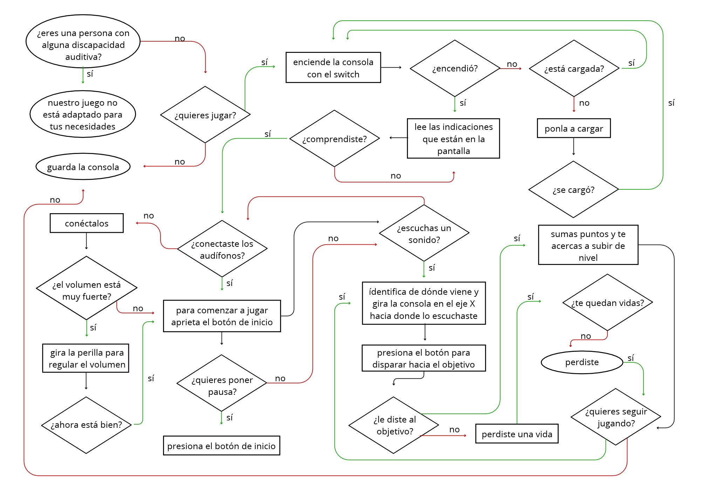
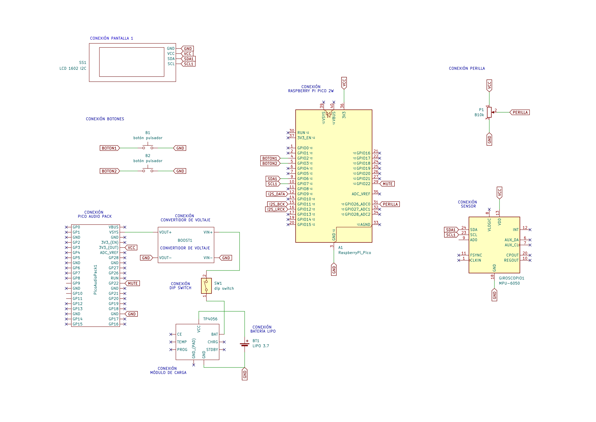
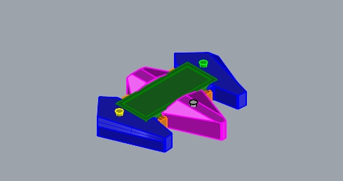
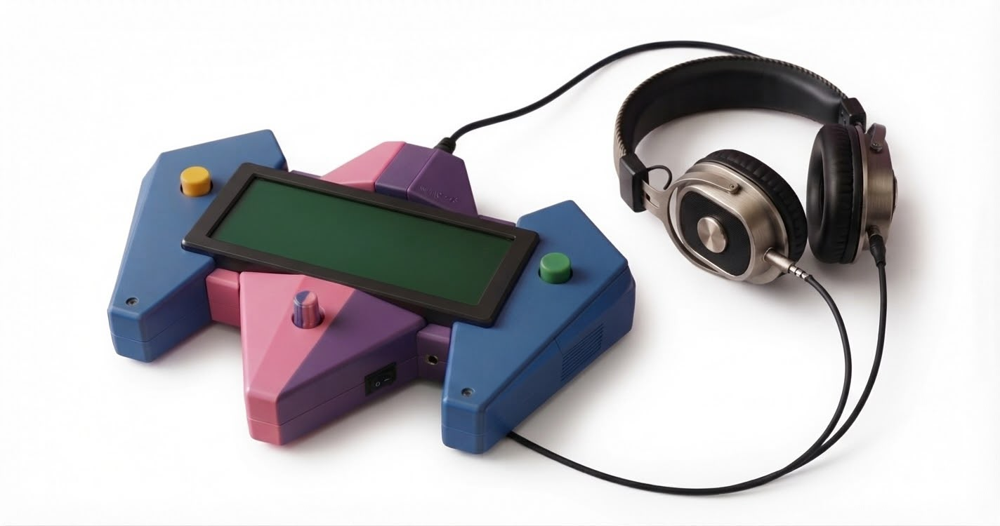
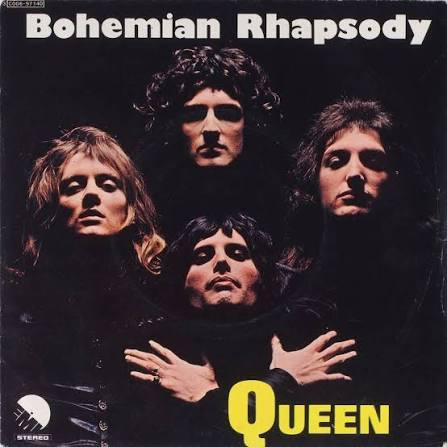
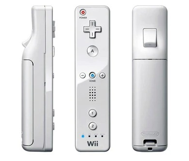

# grupo-04

Fecha de entrega: 2026-11-20

## integrantes

Emilia Contreras / [hazzaily](https://github.com/hazzaily) / Diagrama de flujo, esquemático, documentación.

Kristel Ladrón de Guevara / [kristelagj](https://github.com/kristelagj) / Registro, documentación.

Monserrat Paredes / [Monserrat-Paredes](https://github.com/Monserrat-Paredes) / Código, documentación.

Katalina Riquelme / [riyakatalinaa](https://github.com/riyakatalinaa) / Diagrama de flujo, documentación, carcasa.

---

## Importante 

Todas las imágenes y gifs son de nuestra autoría.

Todos los gifs e imágenes se encuentran subidos en la carpeta de "imagenes".

Códigos subidos por fecha en la carpeta "codigos".

Conversaciones con Claude al final del ReadMe.

Visualizar proyecto: https://wokwi.com/projects/481081755198213121

---

## Idea principal

Nuestro proyecto n°3 se basa en crear un juego donde el jugador debe interactuar con el sistema mediante botones pulsadores y utilizar el sonido como principal medio de comunicación para comprender lo que sucede durante la partida.

El juego consiste en controlar una nave espacial que debe sobrevivir a diferentes ataques enemigos, esquivando obstáculos y eliminando adversarios mediante disparos. A medida que transcurre el tiempo, la dificultad aumenta progresivamente, generando nuevos desafíos que exigen mayor atención y capacidad de reacción. A través de diferentes señales sonoras, el jugador podrá identificar la ubicación de los enemigos, anticipar ataques, reconocer daños en su nave y recibir información sobre su desempeño.

El jugador debe interpretar las señales auditivas para tomar decisiones, desplazarse entre diferentes posiciones y disparar contra los enemigos antes de recibir un ataque.  La partida termina cuando la nave pierde todas sus vidas. El sistema comunicará la información a través de una pantalla, al igual que cuando este inicia o las vidas que tengas. 

Este tipo de juego fue elegido a partir de la simplicidad de juego y la jugabilidad, sobre todo el cómo este puede ser llevado a distintos formatos sin perder esa simplicidad. 

## Proceso

A partir de nuestro proyecto 2, nos interesó seguir trabajando en máquinas que interactúan con el usuario además de minimizar el uso de pantallas reduciendo a 1 o menos. Por ello, nos guiamos por la línea de la audición, que pasa cuando el ser humano solo debe seguir pasos a través de este sentido además del tacto. 

Esto nos llevó a reflexionar sobre las obras de Christine Sun Kim y como ella vive en un mundo donde solo le guía la visión y el tacto, pero no la audición ¿qué pasa si tu no logras ver que hay a tu alrededor pero debes esquivarlo de todas formas para no morir? Es por eso que nació este juego, con el fin de llevar al humano a entender cuando se limita un sentido. 

Es por esto que como grupo nos limitamos al uso de una sola pantalla la cual entrega información relevante para el jugador (ya sea para saber cuando inicia el juego, cuando está en pausa, instrucciones, cuántas vidas tiene, en qué nivel va, y animaciones), mas no lo ayuda a visualizar de dónde viene el sonido, lo que hace el juego más desafiante.

Con respecto al audio, queremos realizar una sensación auditiva tridimensional (3D) con audífonos, simulando la ubicación y distancia reales de los sonidos alrededor del oyente que se llama Binaural.

---

## Registro Wokwi

**Pantalla de inicio**

**Comenzar a jugar**

**Disparo suma puntos**

**Subir de nivel**

**Menos una vida**

**Perdiste**

---

## Clases y código del proyecto

| N.º | Clase | Qué hace |
|:---:|---|---|
| 1 | **Boton** | Lee cuando lo pulsan y avisa una sola vez por pulsación. Se usa para disparo, inicio/pausa/reanudar y el interruptor dip switch (encendido/apagado). |
| 2 | **Perilla** | Lee el potenciómetro con el ADC y entrega el volumen de 0 a 100 %. |
| 3 | **Inclinacion** | Lee el sensor giroscopio: al inclinarlo en el eje X, la nave se mueve hacia ese lado (izquierda o derecha). |
| 4 | **Pantalla** | Maneja la LCD 2004: vidas, nivel, puntos y las animaciones de inicio, level up y game over. |
| 5 | **MotorAudio** | Reproduce los 14 sonidos por el canal izquierdo, derecho o ambos, sin bloquear el juego. En el físico los envía por I2S al Pico Audio Pack. |
| 6 | **Nave** | Guarda el sector, las vidas (máx. 3) y los puntos, y da una vida extra cada 100 puntos. |
| 7 | **Dificultad** | Lleva el tiempo de juego (sin contar la pausa) y el nivel, que sube cada 15 s. |
| 8 | **Amenaza** | Es un enemigo o un obstáculo que aparece, se acerca y llega. Solo el enemigo se puede disparar. |
| 9 | **GestorAmenazas** | Crea amenazas al azar, las actualiza y resuelve el disparo. |
| 10 | **Juego** | Coordina todo con los estados apagado, espera, jugando, pausa y game over. |

---

## Tabla de sonidos (ordenada por frecuencia, de grave a agudo)

Un ser humano con audición sana suele escuchar sonidos en un rango aproximado de 20 Hz a 20.000 Hz (20 kHz).

| Tipo | Frecuencia | N° | Sonido | Significado | Duración | Canal |
|------|-----------:|:--:|--------|-------------|----------|-------|
| Grave | 200 ↔ 300 Hz | 8 | Impacto | Tu nave recibió daño | 4 alternancias de 30 ms | Ambos |
| Grave | 400 → 200 Hz | 11 | Derrota | La partida terminó | 250 ms cada nota | Ambos |
| Grave | 600 → 200 Hz | 7 | Explosión | Enemigo eliminado | 5 pasos de 40 ms | Sector del enemigo |
| Grave | 220 Hz | 4 | Ataque | El enemigo atacó | 400 ms | Sector del enemigo |
| Medio | 300 Hz | 5 | Obstáculo | Asteroide, hay que esquivarlo | 4 pulsos de 60 ms | Sector del obstáculo |
| Medio | 600 → 400 Hz | 13 | Pausa | Partida pausada o reanudada | 100 ms cada nota | Ambos |
| Medio | 440 → 660 → 880 Hz | 1 | Inicio | La partida comenzó | 80 ms cada nota | Ambos |
| Medio | 523 → 659 → 784 → 1047 Hz | 10 | Recompensa | Vida extra o puntos adicionales | 90 ms cada nota | Ambos |
| Medio | 700 Hz | 9 | Última vida | Te queda una sola vida | 3 pitidos, se repite cada 3 s | Ambos |
| Agudo | 880 Hz | 2 | Enemigo presente | Hay un enemigo en ese sector | 120 ms | Sector del enemigo |
| Agudo | 1000 Hz | 12 | Puntaje final | Comunica tu puntaje | 1 pitido por cada 10 puntos | Ambos |
| Agudo | 1200 Hz | 3 | Enemigo se acerca | El enemigo va a atacar pronto | 2 pitidos de 50 ms con 50 ms de pausa | Sector del enemigo |
| Muy agudo | 1500 Hz | 6 | Disparo | Tu nave disparó | 30 ms | Sector de tu nave |

### Qué significa tener más o menos Hz

| Rango | Cómo suena | Uso en el juego |
|-------|------------|-----------------|
| Menos de 250 Hz | Grave, profundo, pesado | Peligro y amenaza: ataque, daño, derrota |
| 250 a 700 Hz | Medio, neutro | Obstáculos, pausa, avisos de estado |
| 700 a 1200 Hz | Agudo, claro | Información: enemigo presente, enemigo se acerca |
| Más de 1200 Hz | Muy agudo, corto | Acciones rápidas: disparo |

- **Más Hz = más agudo**, se asocia con algo pequeño, rápido o informativo.
- **Menos Hz = más grave**, se asocia con algo pesado o peligroso.
- **Sonidos que suben** se sienten positivos (inicio, recompensa). **Sonidos que bajan** se sienten como pérdida o final (explosión, derrota).
- **Pitidos rápidos repetidos** transmiten urgencia.
- **N°:** número de identificación del sonido en el código y la documentación. No cambia cómo suena.
- **Límite del hardware:** los parlantes de 0,5 W casi no reproducen por debajo de ~200 Hz.

---

## Conexiones

Los números entre paréntesis son los pines físicos de la Pico (1 a 40).

| Componente | Pin del componente | Va conectado a |
|---|---|---|
| Botón disparo | Terminal 1 / terminal 2 | GP2 (pin 4) / GND |
| Botón inicio | Terminal 1 / terminal 2 | GP3 (pin 5) / GND |
| Interruptor | Dos terminales | En serie con el positivo, entre TP4056 y boost |
| (Para el interruptor dip switch) | Cable fijo | GP4 (pin 6) a GND |
| Potenciómetro (volumen) | Extremo 1 / centro / extremo 3 | 3V3 (pin 36) / GP26 (pin 31) / AGND (pin 33) |
| sensor giroscopio | VCC / GND | 3V3 (pin 36) / GND |
| sensor giroscopio | SDA / SCL | GP6 (pin 9) / GP7 (pin 10) |
| Conversor (traductor) protege a la pico de los 5v de la pantalla | LV / HV / GND | 3V3 / 5 V del boost / GND |
| Conversor (traductor) | LV1 / LV2 | GP6 / GP7 |
| LCD 2004 | VCC / GND | 5 V del boost / GND |
| LCD 2004 | SDA / SCL | HV1 / HV2 del convertidor |
| Pico Audio Pack (salida y amplificador audio estéreo) | Datos / BCK / LRCK | GP9 (pin 12) / GP10 (pin 14) / GP11 (pin 15) |
| Pico Audio Pack | Mute | GP22 (pin 29), por verificar |
| Pico Audio Pack | 3V3 / GND | 3V3 (pin 36) / GND, alimentación por verificar |
| Audífonos | Jack 3,5 mm | Salida de audífonos del Audio Pack (interruptor de ganancia en bajo) |
| Bateria LiPo | + / − | B+ / B− del TP4056 |
| Módulo cargador | OUT+ / OUT− | Interruptor, luego boost (IN+ / IN−) |
| Regulador de voltaje (Boost) (sube el 3,7 V de la Lipo a 5V para LCD | OUT 5 V) | VSYS (pin 39), LCD y convertidor de nivel |
| Regulador de voltaje (Boost) | GND | GND común de todo |

---

## Diagramas de flujo

---

## Esquemáticos

---

## Bill of Materials (BOM)

| N.º | Componente | Cantidad | Precio (CLP) | Enlace |
|:---:|---|:---:|---:|---|
| 1 | Raspberry Pi Pico W con pines soldados (hacia abajo) | 1 | $11.290 | [Comprar](https://raspberrypi.cl/products/raspberry-pi-pico-w-con-conexion-wifi) |
| 2 | Pico Audio Pack (Pimoroni PIM544) | 1 | $20.000 | [Comprar](https://thepihut.com/products/pico-audio-pack-line-out-and-headphone-amp?srsltid=AYCX9vK1tTY8zKseWunwPfP0f0sHdsMd8y_xIhHtjg09X2NUH4LuyGxf) |
| 3 | Audífonos estéreo con jack 3,5 mm | 1 | - | - |
| 4 | Botones pulsadores | 2 | $500 | [Comprar](https://afel.cl/products/kit-boton-tactil-6x6x5-interruptor-5-unidades) |
| 5 | Interruptor deslizante (dip switch) | 1 | $300 | [Comprar](https://www.mechatronicstore.cl/mini-switch-interruptor-proto-3-pin/?attribute_tamano=5.7x19.8mm&gad_source=1&gad_campaignid=22963321414&gbraid=0AAAAAqH0PVPTVAN6fsocfXnAEohDuLlhg&gclid=Cj0KCQiA2frXBhC_ARIsAPTFcdMu42zb8HK8XkSLshWaRKeFXZTj4N4wuSPT2Hx-EFNbEUKIZeBDWowaAt3vEALw_wcB) |
| 6 | Potenciómetro 10 kΩ | 1 | $500 | [Comprar](https://afel.cl/products/potenciometro-10k-ohm) |
| 7 | Sensor giroscopio MPU6050 (GY-521) | 1 | $4.000 | [Comprar](https://afel.cl/products/sensor-giroscopio-acelerometro-gy-521-mpu6050?variant=45125238915224&country=CL&currency=CLP&utm_medium=product_sync&utm_source=google&utm_content=sag_organic&utm_campaign=sag_organic&utm_term=&utm_campaign=@+Smart+Shopping+2&utm_source=adwords&utm_medium=ppc&hsa_acc=1808722794&hsa_cam=19569174895&hsa_grp=&hsa_ad=&hsa_src=x&hsa_tgt=&hsa_kw=&hsa_mt=&hsa_net=adwords&hsa_ver=3&gad_source=1&gad_campaignid=19560974580&gbraid=0AAAAADBMsFRk1PsXMSeyznFKAyCuN4hvy&gclid=Cj0KCQiA2frXBhC_ARIsAPTFcdPDwm8yk8GtXc9UsI5vPKAeW25GfOHtz_r5iiWCksDefua17uIzdc0aAh9LEALw_wcB) |
| 8 | LCD 2004 (20x4) con módulo I2C | 1 | $7.853 | [Comprar](https://www.mercadolibre.cl/modulo-lcd-20x4-con-interfaz-2004-para-display/p/MLC2035293542) |
| 9 | Conversor de nivel lógico (traductor) I2C 5V a 3.3V | 1 | $2.000 | [Comprar](https://afel.cl/products/conversor-de-nivel-logico-i2c-5v-a-3-3v?srsltid=AYCX9vJUmmicTz9JrkdNi7dlYMKtfUp1EhtzUKM3RpkZJUr4pLrNj4Cg) |
| 10 | Módulo de carga TP4056 | 1 | $1.990 | [Comprar](https://mcielectronics.cl/shop/product/modulo-de-cargador-tipo-c-tp4056-5v-1a-tipo-c-usb-placa-de-proteccion-de-bateria-de-litio/?srsltid=AYCX9vIyVNvNyB02mgALR-N4b41AijCS616Gkl80tmAXan_sYdMf-AiB) |
| 11 | Batería LiPo 3,7 V, 2000 mAh | 1 | $7.990 | [Comprar](https://maxelectronica.cl/fuentes-de-alimentacion/910-bateria-li-po-37v-74wh-2000mah-modelo-103450-con-conector-jst-ph20.html) |
| 12 | Regulador de voltaje (boost) a 5 V, ajustado a 5 V | 1 | $1.490 | [Comprar](https://www.mechatronicstore.cl/convertidor-dc-dc-step-up-mt3608-2a-regulable-boost/?gad_source=1&gad_campaignid=22963321414&gbraid=0AAAAAqH0PVPTVAN6fsocfXnAEohDuLlhg&gclid=Cj0KCQiA2frXBhC_ARIsAPTFcdPPmZqqtpm79VzlI_cAvMVh0R7eOpORpOEZA6IM7ZCAg5Pc-ZisR5waAuDeEALw_wcB) |
| 13 | Protoboard de 830 puntos | 1 | $2.930 | [Comprar](https://altronics.cl/breadboard-830) |
| 14 | Cables Dupont | 1 | $2.000 | [Comprar](https://afel.cl/products/pack-60-cables-de-conexion) |
| 15 | Cable micro-USB de datos | 1 | - | - |
| 16 | Cable USB-C (cargar la batería por el TP4056) | 1 | - | - |
| 17 | Soldador, estaño y cables finos | 1 | - | - |

---

## Carcasa

Nos referenciamos en consolas antiguas porque están más simplificados para el usuario. No son tan complejas de entender como las actuales, ya que sus botones eran específicos y no requerían combinaciones complejas.

---

## Referentes

 1. **Scanner Sombre:** En él exploras una cueva en completa oscuridad usando un escáner LIDAR portátil y un visor de realidad aumentada que iluminan el entorno con nubes de puntos de colores. Este cuenta con un escaneo LIDAR, que dispara puntos que revelan la forma y distancia de los túneles y obstáculos en la oscuridad.

 2. **Echoes of Bats and Men:** Por el término La ecolocalización que en el libro se define como un sistema de orientación y detección por sonido que consiste en emitir ondas sonoras, escuchar su rebote en los objetos y analizar el eco para calcular distancia, tamaño, forma y posición. 

 3. **Oregon trail:** Este juego cuenta con solo texto y así debes jugar seleccionando una opción.

 4. **Atari 2600 - Atari - 1981 Asteroids:** La idea de juego retro y la simplicidad de ellos, como por ejemplo aquí la meta es disparar y eliminar a la mayoría de enemigos posibles. 

 5. **Game Boy Advance:** Simplicidad de estructura mecánica del aparato. Tener los botones justos y necesarios para lograr un objetivo sin demasiada dificultad para comprenderlos.

 6. **Bop It:** Por el uso de sólo audio para realizar una acción; su formato pequeño y transportable.

 7. **Bohemian Rhapsody de Queen y Left and Right de Charlie Puth feat. Jungkook:** Elegimos estos dos referentes por el uso del paneo en ambas melodías, esto se refiere a que parte del audio se escucha como que el audio se moviera de izquierda a derecha o viceversa, que es lo que queremos lograr con el juego.

 8. **Control de Wii:** Utiliza el mismo sensor (giroscopio) que utilizaremos; para los juegos que necesitan detectar la posición del control, como mario kart, club penguin, tenis, entre otros.

 9. **Super mario bros:** Lo utilizamos de referencia para los sonidos al subir de nivel o perder, esto debido a que es bastante reconocible a día de hoy.

 10. **Cover de Look What You Made Me Do de Taylor Swift como audio 3D por Officially3D:** Lo escogimos porque es una representación del audio binaural.

---

## Bibliografía

[Wikipedia - Audio Binaural](https://es.wikipedia.org/wiki/Escucha_binaural)

[Atarimania - Juego Asteroids](https://www.atarimania.com/games/atari-2600-games-asteroids-7379)

[Wikipedia - Bop-It](https://en.wikipedia.org/wiki/Bop_It)

[Wikipedia - Game Boy Advance](https://es.wikipedia.org/wiki/Game_Boy_Advance)

[Wikipedia - Paneo](https://es.wikipedia.org/wiki/Panning)

[Wikipedia - Control Wii](https://es.wikipedia.org/wiki/Wii_Remote)

[YouTube - Cover Look What You Made Do](https://www.youtube.com/watch?v=fLNqEXoZjoA&list=PLVbVZVGxL53zdTQ6NXRoW-yRjW5VjaMDu)

[Brandenburg Labs - Introducción al audio Binaural](https://brandenburg-labs.com/knowledge-hub/introduction-to-binaural-audio-the-science-behind-immersive-sound/)

[Archives org - Echoes of Bat and Men](https://archive.org/details/echoesofbatsmen00grif)

[Wikipedia - Oregon Trail](https://es.wikipedia.org/wiki/Oregon_Trail_(videojuego))

[Steam - Scanner Sombre](://store.steampowered.com/app/475190/Scanner_Sombre/?l=spanish)

---

## Prompts usados

[Chats con Claude](https://github.com/disenoUDP/dis8645-2026-2-procesos-2/tree/main/00-proyecto-3/grupo-04/codigos/proyecto03_prompt.pdf)

