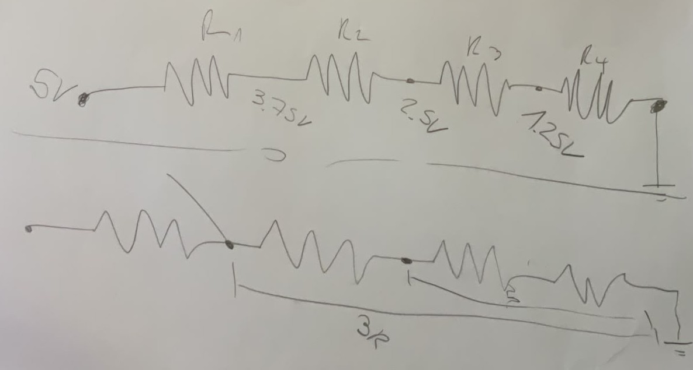
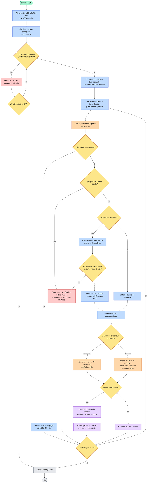
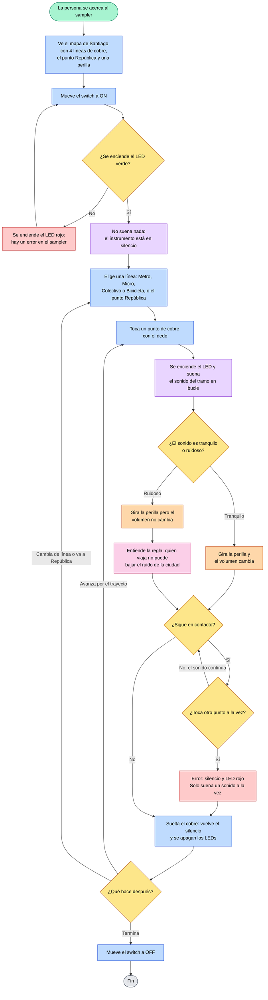
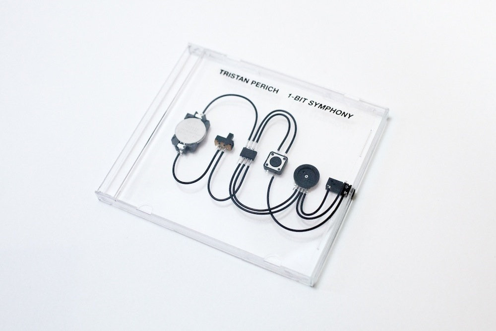
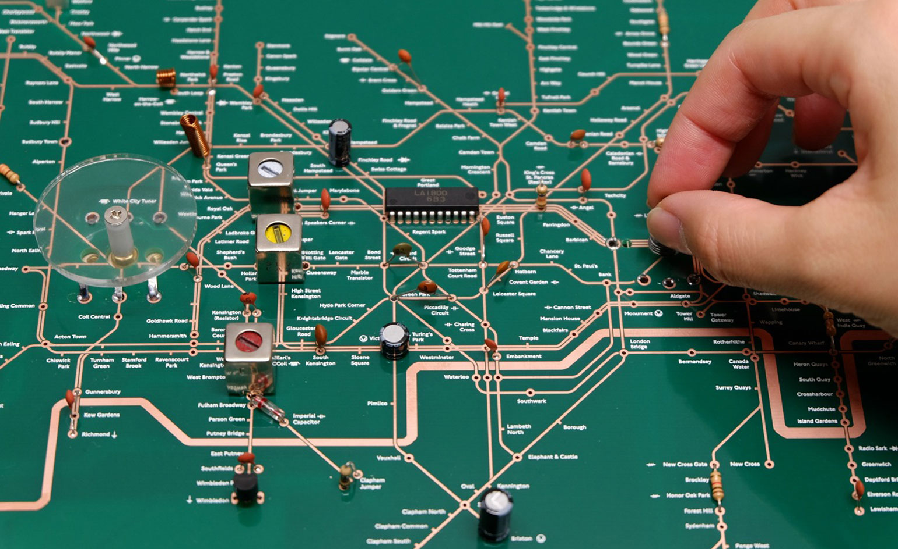

# Te escucho sonar, Santiago

**Realizado por:**  
*Francisca Jesús Palma Cuevas (frannciscapalma)*&nbsp;&nbsp;&nbsp;&nbsp;&nbsp;&nbsp;&nbsp;&nbsp;&nbsp;&nbsp;&nbsp;&nbsp;&nbsp;&nbsp;&nbsp;&nbsp;
*Nicolás Elías Valdés Greve (nicolasvaldesgreve)*&nbsp;&nbsp;&nbsp;&nbsp;&nbsp;&nbsp;&nbsp;&nbsp;&nbsp;&nbsp;&nbsp;&nbsp;&nbsp;&nbsp;&nbsp;&nbsp;
*Santiago Cifuentes Vélez (santiagocifuvelez)*&nbsp;&nbsp;&nbsp;&nbsp;&nbsp;&nbsp;&nbsp;&nbsp;&nbsp;&nbsp;&nbsp;&nbsp;&nbsp;&nbsp;&nbsp;&nbsp;
*Tomás Antonio Catrileo Curihual (tomascatri)*&nbsp;&nbsp;&nbsp;&nbsp;&nbsp;&nbsp;&nbsp;&nbsp;&nbsp;&nbsp;&nbsp;&nbsp;&nbsp;&nbsp;&nbsp;&nbsp;

## Descripción del trabajo

Te escucho sonar Santiago es un sampler físico tangible que permite recorrer acústicamente cuatro trayectos en los medios de transporte más comunes para les estudiantes universitaries (metro, micro, colectivo y bicicleta). Los cuatro parten desde la casa de cada integrante del grupo en la ciudad de Santiago de Chile y llegan al mismo lugar: el barrio universitario, específicamente la Universidad Diego Portales (República). Son cuatro caminos distintos que llegan a un mismo punto.

Este proyecto nace desde la rutina que se crea en torno a los medios de transporte y el trazo que se vuelve hábito en nuestro día a día cuando vamos de un lugar a otro. Tanto así que solemos anticipar sonidos en nuestras cabezas para adelantarnos, como el "se inicia el cierre de puertas" o el chillido del frenazo del metro cuando comienza a detenerse y, en vez de ser incómodo, es la antítesis de la felicidad de saber que es tu turno de ir a casa. Pero esa misma costumbre tiene otra cara: lo que se repite todos los días se vuelve invisible, y terminamos aprendiendo a vivir con ruidos que nunca elegimos. Se vuelve un hábito adquirido, no elegido.

### Justicia acústica

Este proyecto parte del concepto de *justicia acústica* de Brandon LaBelle. Según el autor, "las modulaciones de volúmenes o la intensificación de ciertas reverberaciones o transmisiones contribuyen a quién o qué se escucha y cómo, y de qué manera un oír diferente se convierte en un lugar de expresividad y lucha cultural" (LaBelle, 2021, cap. 1, p. 5, traducción propia). El volumen, entonces, no es neutro: quien puede modularlo decide qué se escucha y cómo. En la ciudad, ese volumen lo deciden otros: el tráfico, la infraestructura, la cantidad de gente y el vehículo en el que viajamos.

Nuestra experiencia de escuchar está mediada por muchos factores que a veces no podemos controlar, por ejemplo:

- **Transportarse en bici:** la persona está expuesta directamente al tráfico, los motores, las bocinas y las conversaciones.
- **Transportarse en auto:** la persona puede cerrar las ventanas y aislarse, de manera literal, del ruido exterior.

En Santiago, además, el ruido no se reparte por igual. Según el Mapa de Ruido del Gran Santiago 2023, el 31% de la población de Cerrillos está expuesta a niveles de ruido nocturno inaceptables, frente al 2% en Padre Hurtado (Ministerio del Medio Ambiente, 2024). Sin embargo, ese mapa mide el ruido del lugar donde vivimos, no el que soportamos mientras nos movemos. Por eso grabamos nuestros propios trayectos.

Desde esa idea, nos hacemos dos preguntas:

1. **Control: ¿quién puede bajar el volumen de lo que escucha?**
Quien viaja en un vagón lleno o en una micro no puede bajar el ruido de la ciudad, mientras que otras personas, en otras condiciones, a veces sí pueden alejarse de él. La desigualdad no está solo en cuánto ruido hay, sino en quién puede escapar de él.

2. **Reconocimiento: ¿qué sonidos se tratan como ruido y cuáles se reconocen como parte de la ciudad?**
Las vendedoras, la cantante de la micro o el "permiso" son sonidos de personas que trabajan o piden paso, y no por eso son ruido.

Aquí definimos qué es un sonido tranquilo y qué es ruido en _Te escucho sonar, Santiago_. Antes, queremos dejar claro que esta distinción es subjetiva y depende de la percepción de cada persona.

- **Ruido:** para el Ministerio del Medio Ambiente (s. f.), es todo sonido que quien lo recibe percibe como una molestia o como algo no deseado o fuera de lugar, por lo que un mismo sonido puede ser música para unas personas y ruido para otras. Aunque la percepción es subjetiva, sobre ciertos niveles sonoros todas las personas declaran molestia (Vivanco Font, 2022). Pero quién decide qué es ruido también es una pregunta política: el propio Ministerio incluye entre las fuentes de ruido a las ferias y los vendedores callejeros.
- **Sonido tranquilo (definición propia):** experiencia sonora percibida como agradable, confortable o no intrusiva por quien escucha, que permite mantener una relación de bienestar con el entorno acústico. No necesariamente es un sonido suave o de bajo volumen, sino uno cuya presencia no se experimenta como una imposición.

Como el instrumento necesita una clasificación fija, la hicimos entre las cuatro personas que grabamos, a partir de cómo vivimos cada sonido. Es una decisión subjetiva y la dejamos a la vista.

Grabar nuestros propios trayectos es una forma de ser escuchades y de dar presencia a sonidos que rara vez se registran o que quizá ya estamos tan acostumbrades a ellos que no los reconocemos más.

Para hacerlo sentir, el instrumento traspasa esa desigualdad al cuerpo de quien lo toca. Cada sonido está clasificado como **tranquilo** o **ruidoso**. Con los sonidos tranquilos, la perilla de volumen funciona y quien toca puede modular lo que escucha. Con los sonidos ruidosos, la perilla no tiene efecto: el volumen es fijo, como lo es para quien viaja todos los días por ese trayecto. Quien visita puede bajar el volumen del sampler, pero quien viaja no puede bajar el sonido de la ciudad. Y todos los trayectos terminan en el mismo punto, República: llegamos al mismo lugar por caminos que suenan muy distinto.

Con esto, el proyecto busca responder: ¿cómo se habita y se experimenta el sonido dependiendo de dónde habitamos y de cómo nos movemos?

## ¿Cómo funciona este sampler?

El instrumento es un mapa abstraído de Santiago de Chile hecho de cobre, con 4 líneas que representan el trayecto de cada integrante (metro, micro, colectivo y bicicleta). Cada línea tiene 5 puntos de contacto, y cada punto tiene un sonido grabado de ese tramo del viaje. Las cuatro líneas llegan a un punto general, **República**, que tiene su propia grabación. En total son 21 sonidos pregrabados, guardados en una tarjeta microSD.

**Todos los sonidos se activan solamente cuando se pone el dedo sobre el cobre.** Si nadie toca el mapa, el instrumento permanece en silencio.

### Paso a paso

1. **Encender.** Al mover el switch a ON, la máquina se prepara y enciende un LED verde si todo funciona bien. El instrumento queda en silencio.
2. **Tocar.** La persona toca con el dedo un punto de una línea de cobre, o el punto República. El dedo actúa como conductor.
3. **Detectar el punto.** Cada línea tiene detrás una *escalera de resistencias* (resistor ladder): varias resistencias iguales conectadas una tras otra. Funciona como una escalera cuyas escalas tienen números distintos. Cada punto de cobre está conectado a un peldaño diferente, y cuando alguien lo toca, la Raspberry Pi Pico 2 W lee ese número con una entrada analógica y sabe qué punto fue. Por ejemplo, el punto 1 entrega un valor bajo y el punto 5 uno alto. 



4. **Reproducir.** La Pico le ordena al módulo DFPlayer Mini qué pista tocar. El DFPlayer lee el audio desde la microSD y lo reproduce por el parlante. Se enciende el LED de la línea tocada.
5. **Mantener, deslizar o soltar.** Mientras el dedo siga en el punto, el sonido se repite en bucle. Si se desliza el dedo a otro punto, el sonido cambia. Al soltar, el sonido se corta y vuelve el silencio.
6. **Volumen.** La Pico lee la posición de la perilla y ajusta el volumen, pero solo de los sonidos tranquilos. Los sonidos ruidosos tienen un volumen fijo.
7. **Error.** Si se tocan dos puntos a la vez, el sonido se detiene y se enciende el LED rojo. Al soltar y volver a tocar un solo punto, el instrumento sigue funcionando normal.

### Reglas del instrumento

- **Un solo sonido a la vez.** El instrumento no mezcla audios.
- **La perilla solo baja los sonidos tranquilos.** Con los ruidosos no tiene efecto, como tampoco puede bajar la ciudad quien viaja en ella.
- **El silencio es el estado de reposo.** Nada suena sin contacto del dedo.

**A manera de resumen:**

1. El instrumento se compone de 4 líneas de cobre que representan el recorrido de cada integrante, con 5 puntos cada una, y un punto general, República.
2. Hay 21 sonidos pregrabados (4 líneas × 5 puntos + República), en coherencia con el transporte escogido.
3. Los sonidos se clasifican en **tranquilos** y **ruidosos**.
4. El dedo toca el cobre y la Raspberry Pi Pico 2 W identifica el punto por su voltaje, gracias a las escaleras de resistencias.
5. El DFPlayer Mini lee la microSD y reproduce el audio por el parlante, un sonido a la vez y en bucle mientras haya contacto.
6. **Perilla = volumen** de los sonidos tranquilos.
7. **Switch = on/off.** Enciende o apaga la máquina.
8. **LEDs de retroalimentación.** Cada línea tiene un LED que se enciende mientras alguien toca uno de sus puntos. Un LED verde indica que todo funciona bien y uno rojo indica un error.

## Características de diseño

1. Alimentación por USB (5 V) y lógica de 3.3 V
2. Fuente abierta
3. Bajo licencia del MIT
4. Lenguaje C++
5. Retroalimentación mediante LEDs
6. Artesanal

## Registro sonoro

Cada integrante grabó su recorrido casa-universidad en un medio de transporte distinto:

1. Metro (Fran): Línea 1 y 5, Maipú - República
2. Micro (Nico): 210 y E07, La Florida - República
3. Colectivo (Tomás): Cerro Navia - República
4. Bicicleta (Santi): San Miguel - República

#### Criterios de grabación

Acordamos qué sonidos grabar. Cada línea tiene 5 sonidos, y el punto general República tiene un sonido común a los cuatro trayectos.

| Sonido    | Metro     | Micro | Colectivo | Bicicleta |
| -------- | --------- | ----- | --------- | --------- |
| Sonido 1 | perro | pájaros | sonidos de las llaves | Reja de la casa al cerrarse para salir |
| Sonido 2 | torniquete | tintineo micro | hola se paga | La cadena de la bicicleta al pedalear |
| Sonido 3 | inicio metro | "permiso"s | radio sonando | La respiración agitada |
| Sonido 4 | vendedores <br> ambulantes | cantante micro <br> (en su defecto, <br> alguien predicando) | direccionales sonando | Tomar agua |
| Sonido 5 | Estación Central | sonido motor micro (ayuda) | se sube un pasajero | Los autos en la avenida |

**Punto general, República** 

#### Clasificación de los sonidos

Clasificación hecha por el grupo (ver la sección de justicia acústica). La columna de decibeles (dBA) es opcional.

| Línea | Punto | Sonido | Clasificación |
| --- | :---: | --- | --- |
| Metro | 1 | perro |tranquilo |
| Metro | 2 | torniquete |tranquilo 
| Metro | 3 | inicio metro |ruidoso |
| Metro | 4 | vendedores ambulantes |tranquilo
| Metro | 5 | Estación Central |ruidoso |
| Micro | 1 | pájaros |tranquilo | 
| Micro | 2 | tintineo micro |tranquilo |
| Micro | 3 | "permiso"s |tranquilo |
| Micro | 4 | cantante micro | | tranquilo |
| Micro | 5 | sonido motor micro |ruidoso |
| Colectivo | 1 | sonidos de las llaves |tranquilo| ruidoso] |
| Colectivo | 2 | hola se paga | 
| Colectivo | 3 | radio sonando |ruidoso| 
| Colectivo | 4 | direccionales sonando | | 
| Colectivo | 5 | se sube un pasajero | | 
| Bicicleta | 1 | reja de la casa |ruidoso |
| Bicicleta | 2 | cadena de la bicicleta | | 
| Bicicleta | 3 | respiración agitada | | 
| Bicicleta | 4 | tomar agua |tranquilo |
| Bicicleta | 5 | autos en la avenida |ruidoso |  |
| General | República | por ver | - | - |

---

## Bill of materials

| Componente | Cantidad | Valor unitario | Link |
| --- | ---: | ---: | --- |
| Raspberry Pi Pico 2 W con pines soldados | 1 | $14.990 | [Raspberry Pi Chile](https://raspberrypi.cl/products/raspberry-pi-pico-2-w-con-headers) |
| Protoboard 830 puntos | 1 | $2.500 | [Afel](https://afel.cl/products/protoboard-mb-102-830-puntos) |
| Interruptor de 3 pines | 1 | $400 | [Afel](https://afel.cl/products/interruptor-mts-102-3-pines) |
| LED de 5 mm: azul, amarillo, naranjo y morado para las líneas, más uno verde de encendido y uno rojo de error | 6 | $100 | [MechatronicStore](https://www.mechatronicstore.cl/led-alto-brillo-5mm-colores/) |
| Pack de 5 resistencias de 470 Ω para los LED | 2 | $500 | [Triacs](https://triacs.cl/lamborghino/953-resistencia-470-ohm-12w-5-unid-.html) |
| Pack de 5 resistencias de 10 kΩ para las escaleras de resistencias (6 por línea, 24 en total) | 5 | $500 | [Triacs](https://triacs.cl/accesorios/1138-resistencia-10k-ohm-12w-5-unid-.html) |
| Pack 10 cables caimán a Dupont | 1 | $2.500 | [Afel](https://afel.cl/products/kit-10-cables-caiman-a-dupont-macho) |
| 1 pack de 5 cables Dupont | 1 | $1.000 | [Afel](https://afel.cl/products/pack-20-cables-de-conexion-macho-macho) |
| Cable USB a Micro USB de datos para alimentar y programar la Pico | 1 | $1.000 | [Afel](https://afel.cl/products/cable-micro-usb-30cm) |
| Parlante de 8 Ω y 1 W | 1 | $3.290 | [MechatronicStore](https://www.mechatronicstore.cl/altavoz-8-ohm-1w/) |
| DFPlayer Mini | 1 | $2.990 | [Afel](https://afel.cl/products/modulo-reproductor-mp3-tf-16p-v3-0) |
| Memoria 16 GB MicroSDHC (FAT32) | 1 | $7.990 | [PC Factory](https://www.pcfactory.cl/producto/57016-maxell-memoria-16gb-microsdhc-90-mb-s-uhs-1-cl10) |
| Potenciómetro A10k | 1 | $890 | [Katode](https://www.katode.cl/potenciometros/178-potenciometro-logaritmico-a.html) |
| Multiplexor analógico 74HC4051 (para leer las 5 entradas de contacto) [por confirmar] | 1 |  |  |
| Cobre (cinta o lámina) para las líneas y el punto República |  |  |  |
| Acrílico para el cuadro de 300 mm x 300 mm | 1 |   |  |
| Madera para la base | 1 |  |  |

---

## Flowchart del sampler



## Flowchart de la experiencia de usuario



## Pseudocódigo

```text
AL MOVER EL INTERRUPTOR A ON
    La máquina prepara el DFPlayer Mini y revisa la tarjeta microSD
    con las 21 grabaciones:
        20 grabaciones táctiles, cinco por cada recorrido
        1 grabación del punto general República

    SI todo funciona
        Enciende el LED verde.
    SI NO
        Enciende el LED rojo y se mantiene en silencio.

    Los LEDs de las líneas quedan apagados y no suena nada.

MIENTRAS LA MÁQUINA ESTÉ ENCENDIDA
    Lee el voltaje de las escaleras de resistencias de las cuatro líneas
    (metro, micro, colectivo y bicicleta) y del punto República.
    Usa los umbrales de voltaje para identificar qué punto se está tocando.
    Lee la posición de la perilla de volumen.

    SI NO HAY NINGÚN PUNTO TOCADO
        Detiene el audio y apaga los LEDs.
        La máquina permanece en silencio.

    SI HAY UN SOLO PUNTO TOCADO
        Si el punto es nuevo, le ordena al DFPlayer reproducir
        la grabación de ese punto desde el inicio.
        Enciende el LED correspondiente y apaga los demás.

        Mientras se mantenga el contacto, la grabación se repite en bucle.
        Si la grabación es tranquila, ajusta su volumen con la perilla.
        Si la grabación es ruidosa, conserva un volumen fijo.

    SI SE DETECTAN DOS O MÁS PUNTOS TOCADOS
        Detiene el audio y enciende el LED rojo.
        Cuando vuelve a quedar un solo punto tocado,
        reproduce su grabación desde el inicio.

    CUANDO SE SUELTA EL PUNTO
        La grabación se corta de inmediato y vuelve el silencio.

AL MOVER EL INTERRUPTOR A OFF
    La máquina detiene el audio y apaga los LEDs.
```

---

## Esqueleto en Wokwi

Prompt usado en Chat gpt sol 6.2:

Crea en Wokwi un codigo de «Te escucho sonar, Santiago» con una Raspberry Pi Pico 2 W. El circuito debe tener 21 puntos de contacto: cinco para Metro, cinco para Micro, cinco para Colectivo, cinco para Bicicleta y un botón común llamado República.

Al presionar un punto, muestra de inmediato su nombre en la consola serial, por ejemplo Metro | Punto 1. Repite el mensaje cada tres segundos mientras siga presionado y detén la repetición al soltarlo. República debe comportarse igual. Si se presionan dos o más puntos, enciende el LED rojo y muestra un aviso de error. Esta versión de prueba funciona en silencio.

Incluye un interruptor de encendido, un LED de estado, un LED de error y un LED por carril. Conecta todos los retornos al mismo pin GND.2 de la Pico. Representa las escaleras de resistencias con un componente personalizado llamado Escaleras.

Organiza el firmware en C++ con Pico SDK. Usa main.cpp como único punto de entrada y separa la lectura de los contactos y el control del panel en sus propios módulos.

https://wokwi.com/projects/481200503805492225

---

## Carcasa

La carcasa de *Te escucho sonar Santiago* fue inspirada por el proyecto **1-Bit Symphony** de Tristan Perich, principalmente por la manera en la que fueron enmarcados los componentes de la obra, la cual está muy alineada a un principio propio como grupo: la transparencia expositiva, para que cualquier persona que tenga la oportunidad de ver este proyecto vea que detrás de lo que se da por hecho existe todo un trabajo pensado por un ser humano, y que incluso se puede dejar su huella intencional en lo que se realice.



La transparencia además nos dio la oportunidad de reforzar nuestro concepto de "escuchar sonar Santiago", revelando en la obra el croquis de la ciudad de Santiago de Chile realizado con cobre, material que hace homenaje al territorio, y en un cuadro a manera de obra museográfica. Es aquí donde comenzamos a integrar diversos materiales, tecnologías e intenciones, para que una artesanía como este proyecto se sienta cercana al usuario y, a la vez, este tenga presente que estas pueden converger para crear un mensaje que se pueda recordar y, sobre todo, que nos lleve a reflexionar, en este caso, sobre el entorno y el sonido.

También, para aterrizar esta idea a un plano material, observamos la obra llamada Tube Map Radio de Yuri Suzuki, la cual es un mapa inspirado en un diagrama satírico creado por Harry Beck, diseñador original del mapa del metro de Londres, que representa las líneas y estaciones como un circuito eléctrico anotado. Los lugares emblemáticos de este mapa están representados mediante componentes relacionados con sus funciones, incluyendo un altavoz donde se encuentra Speaker's Corner y una batería que representa la central eléctrica de Battersea.

Pero eso no es todo: lo más importante de este proyecto es la razón por la que se hizo así, y dice:

Se buscaba hacer visibles los componentes porque "a los consumidores les resulta difícil comprender la complejidad del funcionamiento que se esconde detrás del exterior" de los dispositivos electrónicos actuales. Mediante la creación de una "narrativa que explique cómo funciona la electrónica", se espera incentivar a los usuarios a reparar sus propios dispositivos cuando se averíen.



Los textos anteriormente mencionados se encuentran en [esta página](https://yurisuzuki.com/archive/works/tube-map-radio/).

Te escucho sonar Santiago está dentro de un cuadro de 300 mm x 300 mm, sobre una base de madera autónoma en la cual se encuentran la perilla, el parlante y una pequeña reflexión que refuerza el concepto de la obra.

Materiales utilizados:
- Cobre
- Acrílico
- Madera

## Versiones descartadas

1. **Sensor capacitivo MPR121 (I²C).** Era la primera opción para detectar el tacto. Fue reemplazado por las escaleras de resistencias [explicar el motivo]. Las fuentes que usamos para esa versión fueron la [conexión del sensor](https://docs.sunfounder.com/projects/newton-lab-kit/en/latest/cproject/ar_mpr121.html) y el [tutorial de Adafruit](https://learn.adafruit.com/adafruit-mpr121-12-key-capacitive-touch-sensor-breakout-tutorial?view=all).
2. **Reproducir varios sonidos a la vez (mezcla simultánea).** La descartamos porque es más compleja de lograr. El instrumento reproduce un solo sonido a la vez.
3. **Amplificador MAX98357A con lector microSD.** Lo reemplazamos por el DFPlayer Mini, que ya trae el lector de microSD y el amplificador, y porque comprar el amplificador por internet tardaba mucho en llegar.
4. **Mapa de grafito.** Pensamos usar grafito como parte del mapa, pero teníamos dudas de cómo asignar parámetros o umbrales a un material tan artesanal, por lo que optamos por el cobre.

## Referentes

1. **Stylophone:**
Dispositivo en el cual el usuario interactúa con el instrumento mediante una herramienta conductora. El instrumento tiende al silencio, y solo se permite generar sonidos al hacer contacto con la interfaz del instrumento mediante la herramienta conductora, y deja de sonar cuando se separa de este.

2. **Brandon LaBelle**, *Acoustic Justice* (2021). De su libro rescatamos la frase citada en la sección de justicia acústica (cap. 1, p. [__]; traducción propia), que nos llevó a preguntarnos quién puede modular el volumen de lo que escucha y qué sonidos se reconocen o se tratan como ruido. De ahí nace la regla de la perilla del instrumento: puede bajar los sonidos tranquilos, pero no los ruidosos.

3. **Goldfinger** es un mezclador matricial que tiene un panel dividido en zonas del tamaño de un dedo. ¿Qué quiere decir esto? Que funciona gracias al tacto de la piel, ya que la señal de audio pasa por el cuerpo de quien lo toca. De este instrumento rescatamos la idea de que **"es más fácil orientarse con el oído que con la vista"** (traducción propia), tal cual como lo tenemos pensado para el mapa abstracto de la ciudad de nuestro sampler, que se recorre explorando con el dedo y escuchando. También nos llama la atención su forma de ajuste: moverse lento o rápido, presionar suave o fuerte, ya que le da total libertad al usuario sobre la mezcla de sonidos que puede crear. En cambio, en nuestro sampler lo que buscamos es limitar o controlar el volumen con el uso de la perilla. La perilla solo baja los sonidos tranquilos, y los ruidosos mantienen un volumen fijo, haciendo sentir al usuario que quien viaja no puede bajar el sonido de la ciudad.

4. **Stereo Field** es un sintetizador de feedback que se toca con la piel. Su superficie son placas y, al tocarlas con varios dedos, el sonido cambia según la ubicación y la presión que se ejerce. Como **la conductividad en cada persona es distinta, este instrumento nunca sonará igual**. Nos interesa que el instrumento necesite varios puntos de contacto simultáneos, mientras que en nuestro sampler un solo punto debe estar en contacto para que este suene. También nos llamó la atención lo caótico que puede ser Stereo Field por el ruido generado y lo impredecible de sus sonidos, mientras que en nuestro proyecto los audios son pregrabados.

5. **Strega** es un instrumento semimodular que su autor presenta como un experimento alquímico de audio. Puede generar tonos, crear señales, procesar sonidos externos, etc. Su manual ni siquiera pretende que se entienda por completo, más bien es un instrumento de exploración. De este referente rescatamos la modulación momentánea por contacto, ya que en nuestro sampler el sonido solo existe si el dedo toca el cobre, siendo la exploración por medio del tacto el mayor atractivo de descubrir los sonidos.

6. **Zapper** es un sintetizador que convierte los campos electromagnéticos de aparatos como microondas, fuentes de poder, computadores, etc., en sonido audible. De este referente rescatamos que **el sonido está ahí presente aunque no lo percibamos**, ya sea porque se ha vuelto tan cotidiano o porque estamos atrofiados de tantos estímulos que simplemente los ignoramos. Esto dialoga con nuestro proyecto porque el mapa de ruido mide el lugar donde vivimos, pero no el ruido que soportamos al desplazarnos.

7. **Tocante Bass Bistab** es un sintetizador táctil de onda cuadrada con 24 pads, y cada uno de ellos corresponde a una nota. Los nodos que los rodean permiten alterar el tono y el timbre. De este referente rescatamos la estructura de la interfaz: así como cada pad tiene una nota, nuestro sampler tiene 21 puntos táctiles (20 en las líneas y 1 en República), uno por cada sonido. También rescatamos la idea de **usar sonidos de origen no musical**: sonidos como los torniquetes o la cadena de la bici no son música, pero los convertimos en un instrumento que sale de la escala occidental. Esto lo podemos relacionar con la cita de LaBelle sobre cómo un oír diferente se vuelve un lugar de expresividad.

8. **Drawdio** es un circuito con un lápiz, donde dibujas con grafito sobre papel y tocas la línea con el dedo para hacer sonar lo dibujado. Su propósito es **hacer visibles las conexiones cotidianas entre las personas y su entorno, usando el tacto y haciendo audibles conexiones eléctricas invisibles**. Esto lo relacionamos con nuestro proyecto en que el trazo del grafito funciona como interfaz sonora, al igual que nuestras líneas de cobre. De hecho, en un principio pensábamos usar grafito como parte de nuestro mapa, pero teníamos dudas de cómo íbamos a designar los parámetros o umbrales a algo tan artesanal.

*Referentes en los cuales nos inspiramos para la carcasa:*

9. **1-Bit Symphony** (ver sección Carcasa).
10. **Tube Map Radio** (ver sección Carcasa).
11. **The Exhibit: Paper Circuits** .

## Fuentes

- <https://www.instructables.com/Stylobit-a-Microbit-Powered-Stylophone/> Stylophone DIY (referencia para el contacto con herramienta conductora)
- <https://en.wikipedia.org/wiki/Resistor_ladder> Escalera de resistencias
- <https://www.perlego.com/ereader/4249819> Acoustic Justice, de Brandon LaBelle
- <https://www.musicthing.co.uk/Goldfinger/> Goldfinger
- <https://www.landscape.fm/stereofield> Stereo Field
- <https://www.makenoisemusic.com/synthesizers-and-controllers/strega/> Strega
- <https://www.errorinstruments.com/a-143415858/new-on-error-eurorack-and-more-welcom/zapper-field-inc-mic/#description> Zapper
- <https://patch-point.com/products/tocante-bass-bistab> Tocante Bass Bistab
- <https://drawdio.com/> Drawdio
- <https://ruido.mma.gob.cl/temas/> Ruido ambiental, Ministerio del Medio Ambiente
- <https://ruido.mma.gob.cl/wp-content/uploads/2024/04/Minuta_Mapa_de_Ruido_Gran_Santiago_DRLO_MMA_2024.pdf> Minuta del Mapa de Ruido del Gran Santiago
- <https://obtienearchivo.bcn.cl/obtienearchivo?id=repositorio/10221/33047/1/BCN_Regulacion_ruidos_Chile_Union_Europea_Francia_2022_FINAL.pdf> Regulación de ruido ambiental, Biblioteca del Congreso Nacional
- <https://arts.mit.edu/tristan-perichs-1-bit-symphony> 1-Bit Symphony, de Tristan Perich
- <https://yurisuzuki.com/archive/works/tube-map-radio/> Tube Map Radio, de Yuri Suzuki

## Referencias

Blasser, P. (s. f.). Tocante - Bass Bistab [Descripción de producto]. Patch Point. https://patch-point.com/products/tocante-bass-bistab

Error Instruments. (s. f.). Zapper field inc mic [Descripción de producto]. https://www.errorinstruments.com/a-143415858/new-on-error-eurorack-and-more-welcom/zapper-field-inc-mic/

LaBelle, B. (2021). Acoustic justice: Listening, performativity, and the work of reorientation. Bloomsbury Academic.

Landscape. (s. f.). Stereo Field [Descripción de producto]. https://www.landscape.fm/stereofield

Make Noise. (s. f.). Strega [Descripción de producto]. https://www.makenoisemusic.com/synthesizers-and-controllers/strega/

Ministerio del Medio Ambiente. (s. f.). Ruido ambiental. https://ruido.mma.gob.cl/temas/

Ministerio del Medio Ambiente. (2024). Minuta: Mapa de Ruido del Gran Santiago. https://ruido.mma.gob.cl/wp-content/uploads/2024/04/Minuta_Mapa_de_Ruido_Gran_Santiago_DRLO_MMA_2024.pdf

MIT Arts. (s. f.). Tristan Perich's 1-Bit Symphony. https://arts.mit.edu/tristan-perichs-1-bit-symphony

Silver, J. (2011). Drawdio: A pencil that lets you draw music. https://drawdio.com/

Suzuki, Y. (s. f.). Tube Map Radio. https://yurisuzuki.com/archive/works/tube-map-radio/

Vivanco Font, E. (2022). Regulación de ruido ambiental: Casos de Chile, Unión Europea y Francia. Biblioteca del Congreso Nacional de Chile, Asesoría Técnica Parlamentaria. https://obtienearchivo.bcn.cl/obtienearchivo?id=repositorio/10221/33047/1/BCN_Regulacion_ruidos_Chile_Union_Europea_Francia_2022_FINAL.pdf

Whitwell, T. (2026). 10 things to know about Goldfinger. Music Thing Modular. https://www.musicthing.co.uk/Goldfinger/
