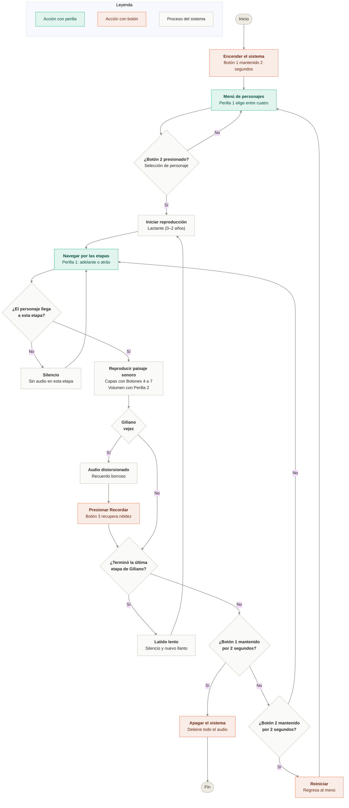
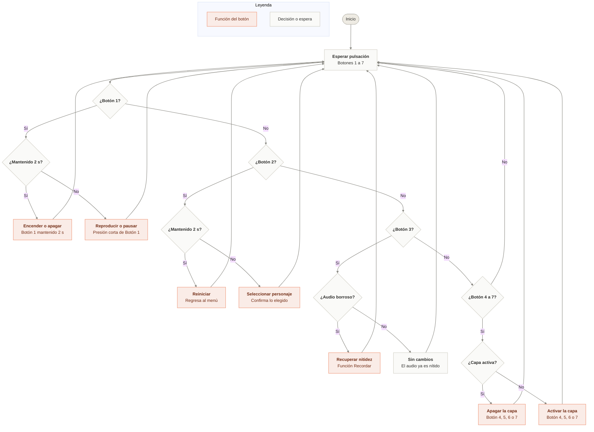
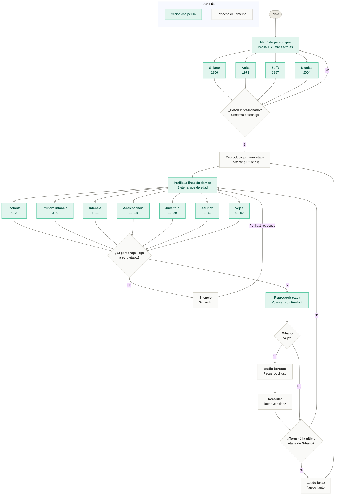
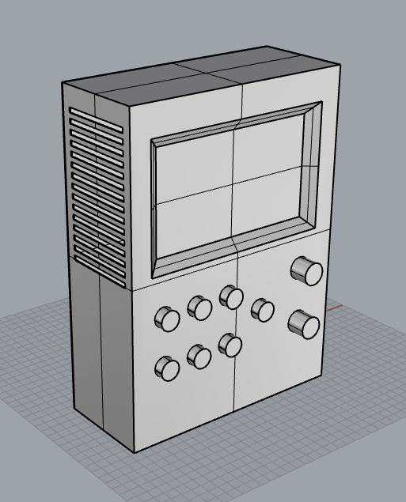

# grupo-06

## integrantes

- Belén Castillo / [bombobby](https://github.com/bombobby) 


- Martina Fernandez / [pumpkinguurl](https://github.com/pumpkinguurl) 

- Maite Villarroel / [maiteev](https://github.com/maiteev) 


- Nacha Zamudio / [nachazamudio](https://github.com/nachazamudio)


# Una vida en sonidos 

## Texto descriptivo del proyecto
“Una vida en sonidos” es una máquina interactiva que recorre, a través del sonido, la vida promedio de una persona chilena, desde el llanto de una guagua hasta el final de la vejez. En un inicio, el usuario escoge un personaje entre cuatro opciones: Giliano, Ana María, Sofía y Nicolás, mientras una pantalla muestra la etapa en la que se encuentra.
El usuario puede avanzar y retroceder por las etapas, y para cada ciclo se presenta un conjunto de botones que activan distintas capas sonoras (el hogar, la calle, la escuela o el trabajo y los hitos del país), de modo que cada persona construye su propia mezcla de recuerdos.

Además, existen situaciones durante la interacción donde el audio se distorsiona, volviendo “borrosos” los recuerdos presentes en la vejez de algunos personajes. El proyecto busca generar una experiencia de nostalgia y reflexión sobre el paso del tiempo, combinando programación, electrónica y diseño sonoro.


## Lista de materiales (BOM)

| # | Componente | Cant. | Precio unitario | Subtotal | Enlace |
|:-:|------------|:-----:|----------------:|---------:|--------|
| 1 | Raspberry Pi Pico 2W | 1 | $14.990 | $14.990 | [raspberrypi.cl](https://raspberrypi.cl/products/raspberry-pi-pico-2-w-con-headers) |
| 2 | Módulo reproductor MP3-TF-16P V3.0 (tipo DFPlayer Mini) | 1 | $2.990 | $2.990 | [afel.cl](https://afel.cl/products/modulo-reproductor-mp3-tf-16p-v3-0) |
| 3 | Tarjeta microSD 2–32 GB  | 1 | $3.500 | $3.500 | [mercadolibre.cl](https://www.mercadolibre.cl/tarjeta-de-memoria-maxell-micro-sd-32gb-clase-10-90mbs/p/MLC19813155) |
| 4 | Mini parlante 3 W | 1 | 3.000 | 3.000 | [afel.cl](https://afel.cl/products/mini-parlante-altavoz-de-3w) |
| 5 | Potenciómetro | 2 | $500 | $1.000 | [afel.cl](https://afel.cl/products/potenciometro-10k-ohm) |
| 6 | Pulsador | 7 | $100 | $600 | [afel.cl](https://afel.cl/products/boton-tactil-tapa-12x12x7-3-interruptor) |
| 7 | Pantalla OLED 2,42" 128×64 SPI (controlador SSD1309) | 1 | $23.000 | $23.000 | [afel.cl](https://afel.cl/products/pantalla-oled-2-42-128x64-spi-controlador-ssd1309) |


## Diagramas de flujo

<details>
<summary><b>Flujo general</b></summary>



</details>

<details>
<summary><b>Flujo de botones</b></summary>



</details>

<details>
<summary><b>Flujo de perillas</b></summary>



</details>

# Descripción total del proyecto

## 1.  Selección de personajes
Los personajes fueron separados según las generaciones descritas en:

Lampert, M. P. (2025). Baby Boomers, Generación X, Millennials y Generación Z: Caracterización generacional en trabajo, familia y tecnología. Biblioteca del Congreso Nacional de Chile, Asesoría Técnica Parlamentaria. [Obtiene Archivo](https://obtienearchivo.bcn.cl/obtienearchivo?id=repositorio%2F10221%2F37179%2F1%2FBCN__caracterizacion__Baby_Boomers__X__Millennials_y___Z__FINAL.pdf)

Giliano (1956)

Anita (1987)

Sofía (2004) 

Nicolás (2013) 


Utilizamos 4 personajes para abarcar las distintas generaciones definidas por la demografía y el marketing conocidas como: “Baby Boomer”, “Millennials”, “Generación Z”, “Generación Alpha”, con la finalidad de alcanzar la nostalgia de más personas y dar a conocer también un poco de la época en la que vivieron estos personajes y sus estilos de vida.


Según esto, los personajes:      
- Giliano. Tiene todas las etapas (1956): hombre nacido en Valparaíso, 70 años, casado, padre de dos hijos. Trabaja como vendedor en la Caleta Portales de Valparaíso. A pesar de su edad, ha decidido no jubilarse, porque trabajar lo mantiene ocupado. Apoya al sector político de derecha. Sus vecinos comentan que en su juventud tuvo aventuras con hombres de la caleta, sin embargo, nunca confirmó ni desmintió su orientación sexual.

- Anita. 6 etapas (1987): Mujer 39 años, vive en Santiago centro. En su juventud participó en la revolución pingüina y continuó su participación política apoyando la izquierda. En esa etapa también fue pokemona y escuchaba reggaeton. Clase media, vive en un departamento pequeño frente al museo de las Bellas Artes. Convive con su mascota, un galgo rescatado, llamado Larry.

- Sofía. 5 etapas (2004): Mujer, 22 años, nacida en Osorno pero se vino a Santiago para estudiar diseño. Tiene 3 hermanos y espera poder ser la primera en entrar a la universidad. Vive en Ñuñoa y trabaja part-time en una cafetería de especialidad en la misma comuna. Se traslada en bicicleta por Santiago. Tiene una gata llamada Kari. Sus papás no creen que pueda sobrevivir al ritmo de la ciudad. Le gustan los boleros y el animé.

- Nicolás. 4 etapas (2013): 13 años. Vive en Maipú con su mamá y su hermana mayor. Solo le preocupa llegar a la casa a jugar play. Le gusta ver youtubers de minecraft, clash royal y fortnite. Tiene un perro, su mamá le dice que lo saque a pasear pero se le olvida por quedarse jugando play. Su mamá le paga para que ordene su pieza. Le gusta el trap argentino. 


## 2.   Perilla Línea de tiempo
- Girar la perilla avanza según rangos por edad definidos como grupo según cambios importantes en la interacción con el mundo.
- La pantalla muestra el rango de edad y el nombre de la etapa en la que se encuentra (primera infancia, infancia, adolescencia, juventud, adultez, vejez)
- El usuario puede ir hacia adelante y hacia atrás, como rebobinar un recuerdo. 
- Dependiendo del personaje, la perilla podrá reproducir audio hasta la última etapa o no.

## 3.  Perilla Volumen
- Sirve para subir y bajar el volumen.

 ## 4. Botones que son capas del recuerdo
 - Cada etapa tiene un paisaje sonoro armado con capas que el usuario activa o apaga:
- Casa: tele de fondo, olla a presión, radio, el “ya po, ven a comer”.
- Calle: micro, el pan amasado, el camión de la basura, el gas, ferias, perros.
- Escuela/trabajo: timbre, patio, recreo, oficina, metro.
- País: hitos colectivos, como un partido de la Roja, un terremoto, un 18 de septiembre, la pandemia.

 ## 5.  Botón Encendido
- Encendido y Apagado del sistema.
- Inicio y Pausa del audio.

 ## 6. Botón Selector
- El botón sirve para seleccionar la preferencia de personaje
- Si durante la interacción con uno de los personajes, el usuario desea cambiarlo, puede mantener presionado este botón y reiniciar la interacción.

 ## 7.  Botón Recordar
- Para Giliano existe una intervención en el audio, el cual representa la nitidez de los recuerdos por el paso de los años, es decir, en la etapa de la vejez es posible que el audio se distorsione, imitando un recuerdo borroso.   
- Para recuperar la “nitidez” de la etapa se puede presionar el botón de “recordar”. 
- Creemos que la memoria se pierde de a poco, sin darnos cuenta se va y  “vuelve” gracias a factores externos que activan los recuerdos “escondidos” en la mente, por eso decidimos tener un botón que influya directamente en el audio para representar esta acción.

 ## 8.  El final (sólo con Giliano)
- Ciclo de la vida: el latido se hace lento, hay un silencio, y vuelve el llanto de guagua (otra vida empieza). Es decir, al finalizar el audio de la última etapa de Giliano, se vuelve al inicio (primer rango de vida), escuchando nuevamente el primer llanto. 

 ## 9.  Rangos etarios
- Los rangos fueron definidos de acuerdo a cuando creíamos que ocurrían los cambios más importantes en la vida de una persona chilena y como era su interacción con el mundo y les demás.

| Etapa | Edad | Qué cambia |
| --- | --- | --- |
| Lactante | 0–2 | Mundo centrado en el cuerpo y la familia |
| Primera infancia | 3–5 | Entrada al jardín; primeros pares |
| Infancia | 6–11 | Colegio; muchos más niños y adultos alrededor |
| Adolescencia | 12–18 | Grupos de pares; círculos más allá de la familia |
| Juventud | 19–29 | Universidad, trabajo, autonomía |
| Adultez | 30–59 | Trabajo estable, familia, hijos |
| Vejez | 60–80 | Jubilación, cuerpo, memoria |

- Según esto, los personajes:
  
Giliano (1956) Tiene todas las etapas

Ana María (1972) 6 etapas, llega a la adultez

Nicole (1987) 6 etapas, llega a la adultez

Sofía (2004) 5 etapas, llega  a la juventud        

# Pseudocódigo

```
//Botón 1: 

//El botón se presiona una sola vez
//Toque corto, cortisimo
//Se inicia o se pausa el audio

//Si se mantiene presionado
//Por >=2sg
//Se prende o se apaga el sistema

//Botón 2 seleccionar, reiniciar

//Se presiona una vez
//Toque corto
//Selecciona personaje
//Inicia reproducción de audio

//Si se mantiene presionado por
//Por >=2 seg
//Se reinicia (vuelve a menú de personajes)

//Botón 3
//En el caso de Giliano
//Si la etapa que se está reproduciendo es vejez
//Y el audio está distorsionado
//Se presiona el botón, toque corto
//Y se recupera la claridad/nitidez del sonido


//Botón 4
//Se presiona una vez
//Se activa la capa de CASA
//Si se presiona de nuevo
//Se desactiva la capa 

//Botón 5
//Se presiona una vez
//Se activa la capa de CALLE
//Si se presiona de nuevo
//Se desactiva la capa 

//Botón 6
//Se presiona una vez
//Se activa la capa de TRABAJO
//Si se presiona de nuevo
//Se desactiva la capa 

//Botón 7
//Se presiona una vez
//Se activa la capa de PAÍS
//Si se presiona de nuevo
//Se desactiva la capa 
```

```
//Perilla 1

//Si se encuentra en MENU- PERSONAJES
//La perilla funciona para cambiar la opción de personajes
//Se dividen los valores de la perilla en cuatro opciones
//De izquierda a derecha en este orden
//Giliano
//Anita
//Sofia
//Nicolás

//Si ya se escogió personaje 
//Y se encuentra reproduciendo las etapas del personaje
//La perilla se usa para navegar 
//Como una línea de tiempo
//Se divide en 7 etapas
//Si el personaje tiene menos etapas
//Se deja de reproducir el audio
//En los ciclos que restan


//Perilla 2

//Volumen 
//Es lo mismo que el volumen de la radio
//Perilla todo a la izquierda -> volumen 0 (silencio)
//Perilla todo a la derecha -> volumen  (máximo)
```

```
//Personajes

//Existen 4 personajes
//Giliano
//Anita
//Sofia
//Nicolás

//Cada uno tendrá su audio 
//Para representar 
//El paso de su vida
//Controlado por una Perilla
```
# Esqueleto en wokwi
https://wokwi.com/projects/481175847766925313

# REFERENTES 

**1- Testimonium:** 
Una instalación sonora inmersiva y multicanal, del artista danés Jacob Kirkegaard, que propone una aproximación a los residuos de la sociedad contemporánea a través de la escucha. La obra permite percibir las vibraciones, pulsaciones y texturas de materiales de desecho que suelen quedar fuera de nuestra atención cotidiana, al tiempo de que plantea preguntas sobre el consumo excesivo y las consecuencias de aquello que tiramos a la basura. 

Que rescatamos: Escuchar lo que normalmente ignoramos.


**2- The Caretaker - Everywhere At The End Of Time**

Proyecto musical que representa las distintas etapas de la demencia o alzheimer (deterioro de la memoria)

Que rescatamos: La degradación por etapas: el mismo material se va deshaciendo de a poco, no de golpe.


https://www.youtube.com/watch?v=wJWksPWDKOc
 
**3- I am sitting in a room Alvin Lucier**

Degradación sonora. 2 grabadoras en una habitación: Una reproduce una voz, el micrófono graba el sonido de la habitación, y la segunda grabadora lo vuelve a grabar en bucle. Con cada ciclo, las frecuencias de la habitación se comen la voz humana hasta convertirla en un zumbido borroso e irreconocible. 

Que rescatamos: El espacio y la repetición como método para degradar.


**4-Sony 19C-70 (1965)**
Fue el primer televisor comercial a color con tecnología Chromatron

Este modelo específicamente, es una pieza exhibida en el Museo de Archivos Históricos de Sony.

Pantalla de 19 pulgadas

Utilizaba una rejilla de alambres verticales y tres cañones de electrones, esto permitía obtener una imagen más brillante y nítida
Su fabricación era muy compleja y costosa, vendió solo 18 mil unidades y esto estuvo a nada de llevar a la compañía a la quiebra.


**5- La fantasmología o Hauntology/Hauntología en general**

Es el concepto de como en el presente aún hay indicios del pasado. El presente está embrujado por el pasado.

Que rescatamos: Sonidos del pasado que vuelven como fantasmas.

**6- SONIDOS DE APIAO:¿como suena nuestra isla?**
 
Documental sonoro de la UC que busca capturar el ecosistema sonoro chilote y generar un archivo patrimonial. 

La isla de Apiao desde los oídos de niños, niñas y adolescentes 

Que rescatamos: Archivo sonoro de un territorio chileno, hecho con niños y niñas de la isla. 


https://open.spotify.com/episode/6S1cDksKuc8zHf0zY7s3zA 

**7- The Forty Part Motet (2001)**

De la artista canadiense Janet Cardiff, es una instalación sonora que deconstruye la monumental obra coral renacentista Spem in alium (1570) de Thomas Tallis mediante 40 altavoces individuales dispuestos en un gran óvalo a la altura del oído humano, cada uno reproduciendo la grabación aislada de un cantante distinto. El verdadero poder del sonido en esta pieza radica en su capacidad para transformar la música en una escultura física y emocional: mientras que en el centro de la sala el espectador percibe la armonía envolvente y celestial de las cuarenta voces unidas, al acercarse a un altavoz específico la masa coral se disuelve en una experiencia profundamente íntima y humana donde se distinguen el timbre único, la respiración y hasta las conversaciones previas de cada intérprete, convirtiendo el desplazamiento del oyente en una mezcla musical personal y catártica.

Que rescatamos: Separar en capas individuales; el público elige a cuál se acerca.


https://www.youtube.com/watch?v=FwVf548Ix8I 

**8- Chase bliss audio Generation Loss MKII**
 
Pedal estéreo de degradación de audio y simulación de cinta magnética Recrea con precisión la coloración tonal, la saturación y las fallas mecánicas de videograbadoras VHS, casetes y dictáfonos envejecidos. 

Que rescatamos: Una referencia técnica concreta de qué suena “viejo”: saturación, vaivén de velocidad y fallas de cinta.


**9- Outerwilds | Signalscope (videojuego)**

Herramienta con la que apuntas y sintonizas frecuencias de audio a la distancia; cuando estás fuera de sintonía o lejos, el sonido se escucha apagado, con eco y distorsionado, y al sintonizarlo se vuelve nítido.
 
Que rescatamos: Apagado y distorsionado cuando estás lejos, nítido cuando sintonizas.


**10- Critter & Guitari Pocket Piano (2010):**

Se vendió desde 2010, con 16 teclas de arce reales, y trae un parlante incorporado de 3 W, referente fomar.

Que rescatamos: Objeto pequeño, de madera, con parlante incorporado de 3 W.


# Carcasa


# Declaraciones IA

<details>
<summary><b>Prompt inicial: Problemas con el lenguaje del código</b></summary>

Nuevamente caímos en el problema de tener el código en lenguaje Arduino-Pico, así que le consultamos a Claude lo siguiente:

> "¿Está en lenguaje Arduino? Porque usaré Raspberry Pi Pico W y, cuando lo abro en Wokwi, sale un archivo base `sketch.ino` que no aparece si usara la Raspberry Pi Pico SDK. ¿A qué se debe eso? ¿Es lenguaje Arduino o se refiere a otra cosa? Tengo entendido que no debo ocupar el esquema Arduino, solo C++ Raspberry Pi Pico. Además, tenías razón con los personajes: están bien los que usaste, la descripción estaba desactualizada."

</details>

<details>
<summary><b>Respuesta de Claude: Arduino vs. Pico SDK</b></summary>

El lenguaje sigue siendo **C++** en ambos casos, pero cambian la API y el sistema de compilación.

*¿Qué es cada cosa?*
- **Arduino:** `sketch.ino` es el archivo principal de ese esquema y se compila como C++. Funciona sobre el núcleo *Arduino-Pico* (Earle Philhower), indicado por `"env": "arduino-community"` en el `diagram.json`. Usa funciones como `pinMode`, `digitalRead`, `analogRead`, `millis` y `Serial`, además de las librerías de Adafruit.
- **Pico SDK:** El archivo principal es `main.cpp` (o `main.c`) y no existe `sketch.ino`. Usa `gpio_init`, `gpio_get`, `adc_read`, `printf` por USB/UART y `CMakeLists.txt` para compilar. Wokwi ofrece ambos esquemas para la Pico W, y por eso muestra archivos distintos según cuál elijas.

*¿Qué se reutiliza y qué cambia al pasar a Pico SDK?*
- **Se mantiene casi igual:** `Config.h`, `Personajes`, `Sistema` y la estructura de clases en `.h`/`.cpp` (solo cambiaría `Serial.print` por `printf`).
- **Se reescribe:**
  - *Botón:* pasa a `gpio_*` y a `time_us_32()` para medir los 2 s.
  - *Perilla:* pasa a `adc_*`.
  - *Audio:* usa `uart_*` para el DFPlayer.
  - *Pantalla:* el SDK no incluye librería OLED, por lo que requiere escribir o integrar un driver SSD1306/SSD1309 sencillo.
- **Se agrega:** `CMakeLists.txt` y los archivos de proyecto que exige Wokwi para el SDK, eliminando la configuración de Arduino en `diagram.json`.

</details>

# Bibliografia 

(https://obtienearchivo.bcn.cl/obtienearchivo?id=repositorio%2F10221%2F37179%2F1%2FBCN__caracterizacion__Baby_Boomers__X__Millennials_y___Z__FINAL.pdf) 
