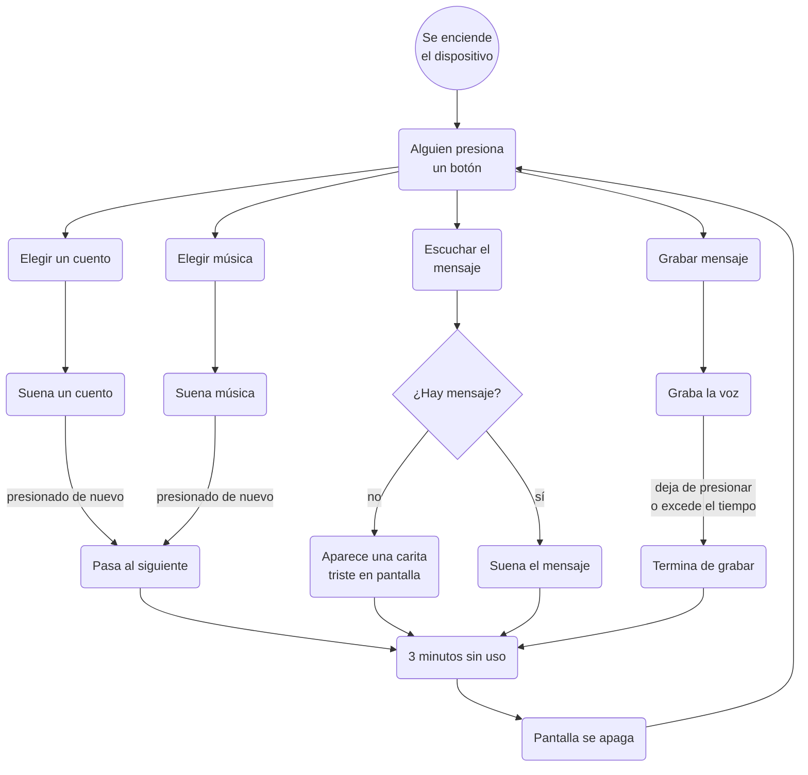
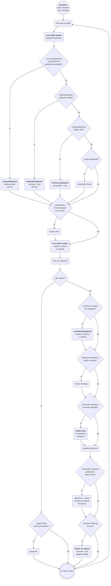

# grupo-07

## proyecto-03

### Integrantes

- Isidora Díaz [@isiidoraadiiaz](https://github.com/isiidoraadiiaz)
- Natalia Gutiérrez [@blosssom-n](https://github.com/blosssom-n)
- Carlo Martínez [@zaaaiko](https://github.com/zaaaiko)
- Natalia Pilar [@sz-mada](https://github.com/sz-mada)

### Dispositivo sonoro para acompañar a infancias

El proyecto consiste en un dispositivo sonoro pensado para acompañar a infancias de 3 a 4 años durante momentos específicos del día, especialmente cuando están en su habitación, descansando o preparándose para dormir. En esta primera versión el dispositivo no será portátil, sino que permanecerá en un lugar fijo, como un velador.

El dispositivo tendrá tres botones físicos principales. Uno permitirá reproducir cuentos, otro permitirá reproducir música y el tercero permitirá escuchar un mensaje grabado por el cuidador. Al presionar uno de los botones se iniciará la reproducción de un audio de esa categoría. En cuentos y música, si se vuelve a presionar el mismo botón, se podrá cambiar al siguiente contenido disponible.

La interfaz no dependerá solamente de que la infancia sepa leer, dado que los contenidos serán sonoros. Cada botón tendrá un personaje o icono asociado a su categoría, y la pantalla podrá reforzar esta relación mostrando qué acción se está realizando. De esta manera, el dispositivo también puede ayudar a relacionar un botón físico con un símbolo y con una respuesta sonora concreta.

En esta entrega probamos la interacción en Wokwi y dejamos la carcasa para más adelante. El profe nos sugirió dejar una sola categoría además del mensaje. Para el examen todavía tenemos que decidir si nos quedamos con cuentos y mensaje. Por ahora mantenemos las tres categorías en la simulación y seguimos con la selección de los audios pendiente.

### Investigación y contexto de uso

#### Contexto e inspiración

Partimos de una pregunta: ¿qué puede tener a mano une infante de 3 a 4 años cuando se siente sole o extraña a alguien que le cuida? La Organización Mundial de la Salud (2025, p. 4) explica que la soledad puede aparecer cuando la conexión que una persona siente queda por debajo de la que desea o necesita. Imaginamos, por ejemplo, a une infante que juega en su pieza una tarde y echa de menos a su papá mientras su abuela le cuida.

También revisamos el abandono infantil. En una guía de UNICEF Chile, Arriagada y Valdebenito (2011, p. 47) lo describen como una forma extrema de negligencia. La investigación sobre negligencia destaca la importancia de contar con personas que respondan de manera estable a las necesidades del infante (Center on the Developing Child at Harvard University, s. f.). Eso nos ayudó a precisar el punto de partida del dispositivo: ya existe un vínculo de cuidado y alguien cercano puede dejarle un mensaje para escuchar mientras juega, descansa o se prepara para dormir.

#### Usuario objetivo y contexto de uso

El público objetivo corresponde a infancias de 3 a 4 años que puedan necesitar acompañamiento durante momentos de soledad, miedo o incertidumbre dentro de su habitación.

El dispositivo estará pensado para utilizarse en un contexto doméstico y fijo. El cuidador podrá dejarlo preparado en el velador y la infancia podrá escoger entre cuentos, música o el mensaje grabado sin tener que utilizar un celular ni navegar por un menú complejo.

No se asumirá que la infancia sabe leer o que comprende una interfaz basada únicamente en texto. Por eso, las categorías se diferenciarán mediante personajes, iconos y respuestas de audio. La pantalla podrá mostrar información de apoyo, pero la acción principal deberá poder entenderse a partir de los botones físicos.

Nos enfocamos en los 3 a 4 años porque en esa etapa ya aparecen habilidades que podemos aprovechar. A los 3 años, muches niñes pueden reconocer qué está pasando en una imagen. A los 4, muches pueden anticipar qué viene en un cuento que ya conocen o inventar situaciones con personajes durante el juego. Como estas habilidades se desarrollan a ritmos distintos, queremos que la interacción se pueda entender a través de señales que se puedan ver, tocar y escuchar.

#### Por qué incluimos una voz familiar

Pensamos en une infante que extraña a su papá o a otra persona que participa en su cuidado cotidiano. Queremos que pueda elegir escuchar un saludo que esa persona le dejó. Nuestra hipótesis es que volver a oír una voz conocida puede darle una sensación de compañía en ese momento.

#### ¿Qué aporta escuchar una voz conocida?

Sesame Workshop (s. f.) propone dejar en cada hogar un retrato de la persona que está en el otro, para que el infante pueda mirarlo cuando la extrañe. Encontramos un ejemplo parecido en sonido: en un caso de acogimiento familiar, el equipo de Easterseals Vermont (2024) grabó a una mamá leyendo un cuento y reprodujo su voz durante el trayecto a la guardería después de las visitas. Eso nos inspiró a darle un botón propio al mensaje, junto a los de cuentos y música. Así, cada infante puede elegir escuchar directamente un saludo, una frase o un pedacito de canción grabado por una persona de confianza.

En nuestro proyecto queda por explorar si la grabación puede dar una sensación de compañía en un momento cotidiano de soledad. Con el primer prototipo queremos comprobar si es fácil dejar, encontrar y reproducir el mensaje.

### Investigación de referentes

#### 01. Yoto Player — La pantalla confirma qué elegimos

**Contexto.** El Yoto Player de cuarta generación es un reproductor infantil que permite elegir audios mediante tarjetas o un control físico. La pantalla muestra imágenes de los títulos al recorrerlos e íconos para identificar capítulos o pistas durante la escucha.

**Qué rescatamos.** Nos interesa que la pantalla confirme lo que la infancia acaba de hacer. Si aprieta el botón de cuentos, queremos que aparezca el mismo símbolo del botón cuando comienza la narración.

*Yoto Newsroom, 2026. Imagen de prensa del Yoto Player 4th Gen y Yoto Mini 4th Gen.* [Yoto Newsroom](https://us.yotoplay.com/press/en-US/270385-yoto-launches-yoto-player-4th-gen-and-yoto-mini-4th-gen-its-biggest-hardware-upgrade-yet/).

#### 02. Toniebox — Una pista antes de escuchar

**Contexto.** La Toniebox reproduce el audio asociado a una figura cuando se coloca sobre el equipo. Por ejemplo, una figura de Pikachu da acceso a historias de Pokémon.

**Qué rescatamos.** La figura da una pista sobre lo que va a sonar antes de que empiece el audio. Queremos trasladar esa idea a los dibujos de los tres botones.

*tonies, s. f. Imagen de producto de Toniebox 2 con figura de Pikachu.* [tonies](https://us.tonies.com/products/pokemon-pikachu-tonie).

#### 03. BIGmack — Un botón para un mensaje

**Contexto.** BIGmack es un dispositivo de apoyo a la comunicación. Al presionar su superficie grande reproduce un único mensaje grabado.

**Qué rescatamos.** El dibujo está justo donde ocurre la acción. Aplicamos esa idea al botón del mensaje, cuyo símbolo estará en la superficie que se aprieta.

*BoundlessAT, s. f. Fotografía de BIGmack, dispositivo de comunicación de un solo mensaje.* [BoundlessAT](https://www.boundlessat.com/Communication/Basic-Communicators/LITTLEmack-BIGmack-Communicators).

#### 04. Lovebox — Dejar un mensaje para más tarde

**Contexto.** Lovebox Photo Messenger es una caja que recibe mensajes, fotos y dibujos enviados desde una aplicación. Cuando llega un mensaje, el corazón exterior gira.

**Qué rescatamos.** Nos interesa que preparar un mensaje y encontrarlo puedan ocurrir en momentos distintos. Alguien cercano puede grabar un saludo antes de salir y la infancia puede volver a escucharlo después.

*Lovebox, s. f. Fotografía de Lovebox Photo Messenger.* [Lovebox](https://en.lovebox.love/products/lovebox-color-photo).

#### 05. Whispering Table — El lugar también forma parte de la escucha

**Contexto.** Whispering Table es una instalación creada por TheGreenEyl para una exposición en el Museo Judío de Berlín en 2009. Las piezas de cerámica cuentan relatos cuando se acercan al oído.

**Qué rescatamos.** La obra sitúa la escucha en un lugar reconocible y la activa con un gesto físico. Eso nos hizo mirar el velador como parte del uso del dispositivo.

*TheGreenEyl, 2009. Fotografía de la instalación Whispering Table.* [TheGreenEyl](https://www.thegreeneyl.com/whispering-table).

#### 06. Under the Same Moon — Qué hace personal a una grabación

**Contexto.** Under the Same Moon es un libro grabable de Hallmark que permite registrar la voz de una persona cercana para que une infante pueda volver a escucharla.

**Qué rescatamos.** Este referente nos ayudó a pensar qué grabar. Puede ser un saludo, una frase que se dicen siempre o parte de una canción, algo que la infancia pueda reconocer como propio de esa persona.

*Hallmark, s. f. Imagen de producto de Under the Same Moon, libro grabable.* [Hallmark](https://www.hallmark.com/baby-and-kids/kids-books/recordable-storybooks/under-the-same-moon-recordable-storybook-1KOB1228.html).

#### 07. Matriz de voz — Mostrar que la máquina está grabando

**Contexto.** Voice Array, de Rafael Lozano-Hemmer, transforma la voz captada por un intercomunicador en destellos de luz. Cada grabación nueva se incorpora a una secuencia de luces.

**Qué rescatamos.** La luz permite ver que la máquina está captando la voz. En nuestro módulo, el LED encendido indicará que la grabación está en curso.

*Rafael Lozano-Hemmer, 2011. Imagen de la instalación Voice Array.* [Atelier Lozano-Hemmer](https://www.lozano-hemmer.com/voice_array.php).

#### 08. I Like Big Buttons — Distinguir grabar de reproducir

**Contexto.** I Like Big Buttons es una grabadora con botones grandes, uno para grabar y otro para reproducir.

**Qué rescatamos.** Grabar y escuchar son acciones distintas y cada una tiene su propio control. La persona cuidadora mantiene apretado el botón para grabar y lo suelta al terminar.

*BrandNewNoise, s. f. Fotografía de I Like Big Buttons, grabadora de botones grandes.* [BrandNewNoise](https://www.brandnewnoise.com/products/i-like-big-buttons).

#### 09. Wall-mounted CD Player — Una acción para empezar a escuchar

**Contexto.** Naoto Fukasawa diseñó este reproductor de CD para MUJI en 1999. Se instala en la pared y usa el cable que cuelga del equipo como interruptor.

**Qué rescatamos.** El uso parte de un gesto concreto sobre el objeto. Para nuestros botones, eso se traduce en que la primera pulsación inicia un audio y la segunda permite pasar al siguiente.

*Cooper Hewitt, Smithsonian Design Museum, s. f. Fotografía del reproductor de CD mural diseñado por Naoto Fukasawa para MUJI en 1999.* [Smithsonian Institution](https://www.si.edu/object/wall-mounted-cd-player%3Achndm_2013-35-1).

#### 10. Playdate — Dibujos legibles en una pantalla pequeña

**Contexto.** Playdate es una consola portátil de Panic con una pantalla reflectante en blanco y negro, botones físicos y una manivela lateral.

**Qué rescatamos.** Nos interesa cómo construye una identidad visual con pocos elementos. Para nuestros íconos queremos probar primero siluetas simples y comprobar que se distingan al tamaño real de la pantalla.

*Panic, s. f. Fotografía de la consola Playdate.* [Panic](https://play.date/).

### Contenido y decisiones de diseño

#### Contenido y alcance inicial

La biblioteca inicial estará compuesta por:

- tres cuentos de una duración máxima de cinco minutos
- cuatro piezas de música infantil de una duración máxima de un minuto
- un mensaje grabado por el cuidador de una duración máxima de un minuto

Para los cuentos, vamos a fijarnos en si se puede seguir la historia solo escuchándola. Nos interesa que se entienda quién es el personaje, qué le pasa, qué hace y cómo termina la historia. Por eso, al revisar cada versión, nos vamos a preguntar si la narración cuenta lo necesario o si para entenderla habría que estar mirando el libro.

Para la música, consideraremos qué se puede reconocer y seguir al escucharla. Si una canción tiene letra, nos vamos a fijar en las palabras del estribillo y en si la acción o la idea principal se entiende. Si es instrumental, nos interesa si hay un ritmo o una melodía que vuelva a aparecer. Una canción puede ser fácil de tararear aunque parte de la letra todavía sea difícil de comprender.

Los cuentos se obtendrán desde bibliotecas de audiolibros o repositorios que permitan su uso gratuito y que tengan una licencia compatible con el proyecto. La música infantil deberá cumplir con la misma condición. Para cada audio se registrará el título, autor o intérprete, fuente y tipo de licencia.

Se desecha la organización de los contenidos según la hora del día. En un principio se consideró separar los cuentos entre día y noche, pero decidimos no continuar con esa idea porque los tres cuentos podrán utilizarse en cualquier contexto y no queremos limitar su reproducción a un horario específico. La biblioteca se organizará por categorías y no por momento del día.

#### Personajes, colores y forma de la máquina

Queremos que cada categoría tenga su propio personaje o icono. Para el diseño distinguimos dos pasos: reconocer el dibujo y entender qué activa el botón. Alguien puede ver un libro y decir «libro», pero la asociación con escuchar un cuento se aprende cuando presiona el botón y empieza a sonar. Por eso queremos mantener la misma relación entre el dibujo del botón, lo que aparece en pantalla y el audio que se activa. Los personajes todavía están por definir.

Tomamos como referencia la pauta del World Wide Web Consortium (2025) de acompañar el color con otras señales visuales. Cada botón tendrá un símbolo propio y una posición fija, además de un color. Para elegir la paleta, revisaremos cuánto se distingue el dibujo sobre el botón y el botón sobre la carcasa, tanto con luz natural como con luz más baja.

En el primer planteamiento habíamos descrito los botones como grandes, rígidos y resistentes a golpes. La nota más reciente propone botones blandos al tacto y resistentes al uso. Queremos distinguirlos por forma, posición y símbolo, y considerar el relieve para reconocerlos al tacto. Queda por definir la materialidad, el tamaño, la separación y la fuerza necesaria para presionarlos sin mover la máquina.

Al elegir la paleta, vamos a mirar qué tan bien se distingue cada control de la carcasa y de los demás botones, sobre todo con la luz que puede haber en la habitación a la hora de dormir. La paleta también va a definir cómo se ve y se siente el objeto, y eso sigue siendo una decisión de diseño.

La carcasa tiene que quedar estable en el velador y proteger la pantalla, el parlante, la tarjeta SD y las conexiones. Los botones estarán integrados a la carcasa. Queremos que los cables y las piezas pequeñas queden fuera del alcance de les niñes durante el uso cotidiano.

### Funcionamiento

#### Funcionamiento principal

El dispositivo permanecerá instalado en un lugar fijo y será utilizado principalmente por la infancia. Tendrá tres botones físicos asociados a cuentos, música y mensajes del cuidador.

Al presionar el botón de cuentos, se reproducirá uno de los tres cuentos disponibles. Una nueva presión sobre el mismo botón cambiará al siguiente cuento. Lo mismo ocurrirá con las piezas de música, que estarán organizadas en una categoría independiente.

Cada botón de cuentos, música y mensaje acepta una pulsación con el filtro de rebote de más de 50 ms y espera al menos 3 segundos desde esa pulsación aceptada para contar otra. Cada botón lleva su propio tiempo. Los toques dentro de la espera se ignoran, no quedan pendientes ni reinician los 3 segundos. Mantener el botón apretado cuenta una sola vez; para aceptar otra pulsación hay que soltar y volver a presionar después de la espera. El primer toque al encender está disponible sin esperar. No usamos doble clic ni pulsaciones largas para pausar o detener. El botón de grabación es otra instancia de la misma clase, con el filtro de rebote y sin la espera extra de 3 segundos.

El tercer botón permite escuchar el único mensaje de la persona cuidadora. Si se vuelve a presionar mientras el mensaje suena, no hace nada: no lo reinicia, pausa ni deja una repetición pendiente. El mensaje continúa hasta terminar, salvo que se elija cuentos o música; en ese caso se interrumpe y cambia a la categoría elegida. Cuando termina, una nueva pulsación válida permite escucharlo otra vez desde el principio. Esto evita que los toques repetidos hagan escuchar solo el comienzo del mensaje. En la versión física, el mensaje queda en la tarjeta SD y solo se reemplaza cuando una grabación nueva se guarda correctamente. Si falla la grabación o el guardado, se conserva el anterior. No se borra después de un día ni por tiempo. En el primer código esto se representa mediante mensajes de simulación.

La pantalla acompañará la interacción mostrando la categoría seleccionada, el contenido que se está reproduciendo y estados como “grabando”, “mensaje guardado” o “error”. La navegación no dependerá de la pantalla, ya que los botones deberán ser comprensibles por sí mismos.

#### Sistema de grabación

La grabación estará destinada al cuidador y no al uso cotidiano de la infancia. El sistema almacenará un solo mensaje a la vez y la función de grabación estará ubicada en un módulo separado del dispositivo principal. Este módulo incluirá el micrófono y el botón para comenzar y terminar la grabación, y se conectará mediante conectores JST.

La persona cuidadora mantiene presionado el botón para grabar y lo suelta para terminar, con un máximo de un minuto. El LED se enciende mientras graba y se apaga al terminar. Si llega al minuto, no empieza otra grabación hasta soltar y volver a presionar. En la versión física, solo se confirma «mensaje guardado» si el archivo se guarda bien; si falla, se muestra el error y se conserva el mensaje anterior. En el Wokwi actual no hay micrófono conectado: por ahora probamos el botón, el tiempo y el LED y representamos la grabación con mensajes, sin confirmar que se captura voz o se guarda un archivo real. Mientras se mantiene presionado el botón, la pantalla muestra «grabando...», el conteo de segundos transcurridos hasta 60 y las indicaciones «puedes grabar máximo 60 segundos» y «suelta el botón para guardar tu mensaje». El conteo usa el tiempo transcurrido de la raspi y se detiene al soltar o llegar al minuto. En el código actual de Wokwi, esta visualización ya está implementada como parte de la simulación. En Wokwi se identifica como simulación, sin confirmar captura de voz ni guardado real.

La separación física del módulo funcionará como una restricción para que la infancia no pueda iniciar una grabación ni eliminar accidentalmente el mensaje del cuidador.

#### Revisión del módulo de grabación

Como el dispositivo ya no será portátil, debemos revisar si el módulo desmontable sigue siendo la forma más cómoda para el cuidador. La persona que graba será más alta que la infancia y podría necesitar acercar el módulo a su posición sin mover todo el dispositivo del velador.

La conexión y la forma del módulo se resuelven al desarrollar la carcasa. En la versión física el sistema debe reconocer si el módulo está unido y permitir grabar solo cuando está conectado. Si se separa durante la grabación, debe cancelarla sin reemplazar el mensaje anterior. Esto sigue siendo un requisito, aunque en esta entrega no hacemos carcasa ni implementamos la detección física del módulo; se mantiene declarado en el código.

### Proceso de código y pruebas

#### Código 1 y 2: declaraciones

El primer código fue muy preliminar. Ordenamos las entradas, salidas y estados que tendría el dispositivo, pero todavía no estaban definidos los pines ni había un programa ejecutable.

En el segundo código tomamos decisiones más concretas: tres cuentos de hasta cinco minutos, cuatro piezas de música de hasta un minuto y un mensaje de la persona cuidadora de hasta un minuto. También definimos que cada categoría tendría su propia posición, que el mensaje se reemplazaría solo si una nueva grabación se guardaba correctamente y que los contenidos podrían escucharse a cualquier hora. Todavía quedaban por resolver los tiempos entre pulsaciones, los botones presionados al mismo tiempo y la forma de detener los audios.

#### Código 3: primera prueba ejecutable

En esta versión empezamos a trabajar en C++ con el Pico SDK y Wokwi. El `main` coordinaba las categorías, los estados y la grabación simulada.

Usamos `BotonGrupo1` para los botones de cuentos, música, mensaje y grabación. Los botones de categorías tenían filtro de rebote y una espera de tres segundos entre pulsaciones aceptadas. El botón de grabación usaba la misma clase, pero sin esa espera adicional.

También incorporamos `Lucecita` para controlar el LED. Al mantener presionado el botón de grabación, el LED se encendía y comenzaba un conteo de hasta un minuto. Al soltar el botón, la grabación terminaba. Todavía no se capturaba voz ni se guardaban archivos: todo se representaba mediante mensajes en el monitor serial.

#### Código 4: pantalla y correcciones

En la cuarta versión integramos la clase `Pantallita`, usando la biblioteca ILI934X. Así el `main` quedó encargado de coordinar y la pantalla de mostrar los estados.

Agregamos una pantalla inicial, símbolos provisorios para cuentos y música, una carita cuando no existe mensaje, un corazón mientras el mensaje está activo y un contador durante la grabación.

También corregimos las pulsaciones simultáneas: si se presionan varios botones de categoría, ninguno ejecuta una acción. Además, el botón del mensaje no lo reinicia mientras está sonando, mientras que cuentos y música sí pueden interrumpirlo.

Finalmente agregamos un reposo por software después de tres minutos sin uso. La pantalla se apaga, pero la placa sigue encendida. La primera pulsación solo despierta el dispositivo y hay que volver a presionar para realizar una acción.

La entrega compiló en Wokwi y pudimos probar la pantalla, los símbolos, el LED, el contador de grabación y el bloqueo de pulsaciones simultáneas. Todavía falta implementar el audio real, el micrófono, la tarjeta SD y la detección física del módulo de grabación.

#### Diagrama de flujo de usuario

#### Diagrama de flujo técnico

### Materiales y simulación

#### Lista de materiales (BOM)

| Componente | Cantidad | Precio unitario | Proveedor |
| --- | ---: | ---: | --- |
| Raspberry Pi Pico 2 W | 1 | $0 | Universidad |
| Pantalla TFT LCD Touch 3,5" SPI 480x320 | 1 | $14.000 | Afel |
| Mini parlante 3 W / 4 Ω | 1 | $3.000 | Afel |
| Amplificador PAM8403 2x3 W | 1 | $1.000 | Afel |
| Botón táctil con tapa 12x12x7,3 mm | 5 | $100 | Afel |
| Módulo micrófono amplificador MAX4466 | 1 | $2.990 | Afel |
| Lector Micro SD SPI | 1 | $2.500 | Afel |
| Tarjeta microSD 4 GB | 1 | por definir | no hay en afeel |
| Pack de 60 cables de conexión Dupont | 1 | $2.500 | Afel |
| Kit de conectores JST XH2.54 | 1 | $6.000 | Afel |
| LED | 2 | 0 | PROPIOS |
| Cable USB | 1 | 0 | PROPIO |
| **Total sin la tarjeta microSD** | | **$32.490** | |

- eliminamos la batería y el power bank porque el dispositivo ya no será portátil y permanecerá instalado en un lugar fijo.
- La pantalla elegida incluye función touch, pero para el proyecto la vamos a usar como pantalla de visualización. De los 5 pulsadores del BOM, 4 son para uso y 1 es repuesto por precaución; de los 2 LED, 1 indica grabación y 1 es repuesto.

#### Circuito

(https://wokwi.com/projects/481143276644147201).

En el circuito se ven la Pico 2 W, la pantalla ILI9341, cuatro pulsadores, el LED de grabación, el lector microSD, el modelo del PAM8403 y un buzzer que representa el parlante. El código usa GP2 para cuentos, GP3 para música, GP4 para mensaje, GP5 para grabar y GP6 para el LED. GP0 y GP1 se usan para el monitor serial UART0.

#### Bibliotecas, clases y créditos

| Recurso | Función en el proyecto | Crédito o archivo |
| --- | --- | --- |
| [Pico SDK](https://github.com/raspberrypi/pico-sdk) | Base del programa en C++, lectura del tiempo y comunicación serial. | Raspberry Pi. El programa incluye `pico/stdlib.h` y el proyecto contiene `CMakeLists.txt`. |
| ILI934X | Control de la pantalla ILI9341 del simulador. | [Darren Horrocks](https://www.darrenhorrocks.co.uk/native-pico-sdk-ili9341-ili9342-for-raspberry-pi-pico/). `ili934x.h`, `ili934x.cpp` y `LICENSE-ILI934X.txt` (BSD de 3 cláusulas). |
| FreeMono y `gfxfont.h` | Fuentes y estructuras de fuente usadas para los textos. | `FreeMono12pt7b.h`, `FreeMono18pt7b.h`, `FreeMono24pt7b.h`. |
| `BotonGrupo1` | Lectura de los pulsadores, filtro de rebote y espera por botón. | Camila Ramírez, Bianka Vilchez y Dayana Pañitrur, Grupo 1 del Proyecto 2. |
| `Lucecita` | Enciende y apaga el LED de grabación. | Material docente de la sesión 08a. |
| `Pantallita` | Dibuja las vistas del dispositivo. `main.cpp` coordina las categorías y los estados. | `Pantallita.h` y `Pantallita.cpp`. |
| `pam8403.chip.c` y `pam8403.chip.json` | Modelo del amplificador representado en el circuito. | Archivos del proyecto en Wokwi. |

### Referencias

#### Investigación de contexto

- Arriagada, P., & Valdebenito, L. (2011). Para reconstruir la vida de los niños y niñas: Guía para apoyar intervenciones psicosociales en emergencias y desastres. UNICEF. https://www.unicef.org/chile/media/1666/file
- Center on the Developing Child at Harvard University. (s. f.). A guide to neglect. https://developingchild.harvard.edu/resource-guides/guide-neglect/
- Easterseals Vermont. (2024, 31 de mayo). A sound that soothes. https://eastersealsvt.org/news-and-stories/a-sound-that-soothes/
- Organización Mundial de la Salud. (2025). De la soledad a la conexión social: El camino hacia sociedades más saludables [Resumen del informe de la Comisión de la OMS sobre Conexión Social]. https://www.who.int/es/publications/m/item/from-loneliness-to-social-connection-summary
- Sesame Workshop. (s. f.). Cuando los niños extrañan al otro padre. https://sesameworkshop.org/resources/cuando-los-ninos-extranan-al-otro-padre/
- World Wide Web Consortium. (2025, 16 de septiembre). Understanding SC 1.4.1: Use of color (Level A). https://www.w3.org/WAI/WCAG22/Understanding/use-of-color

#### Referentes de diseño

- AbleNet. (s. f.). BIGmack. https://www.ablenetinc.com/bigmack/
- BrandNewNoise. (s. f.). I like big buttons. https://www.brandnewnoise.com/products/i-like-big-buttons
- Cooper Hewitt, Smithsonian Design Museum. (s. f.). Wall-mounted CD player [Ficha de colección]. Smithsonian Institution. https://www.si.edu/object/wall-mountedcdplayer%3Achndm_2013-35-1
- Hallmark. (s. f.). Recordable storybooks. https://www.hallmark.com/baby-and-kids/kids-books/recordable-storybooks/
- Lovebox. (s. f.). Lovebox Photo Messenger. https://en.lovebox.love/products/lovebox-color-photo
- Lozano-Hemmer, R. (2011). Voice array (Subsculpture 13) [Instalación interactiva]. Atelier Lozano-Hemmer. https://www.lozano-hemmer.com/voice_array.php
- Panic. (s. f.). Playdate. https://play.date/
- TheGreenEyl. (s. f.). Whispering table (Tischgeflüster). https://www.thegreeneyl.com/whispering-table
- tonies. (s. f.). Pokémon: Pikachu Tonie. https://us.tonies.com/products/pokemon-pikachu-tonie
- Upchurch, R. (2019, 26 de marzo). Instructions for how it works – BrandNewNoise by Richard Upchurch. BrandNewNoise. https://www.brandnewnoise.com/blogs/news/instructions-for-how-it-works-brandnewnoise-by-richard-upchurch
- Yoto. (s. f.). Yoto Player 4th Gen. https://us.yotoplay.com/players/yoto-player-4
