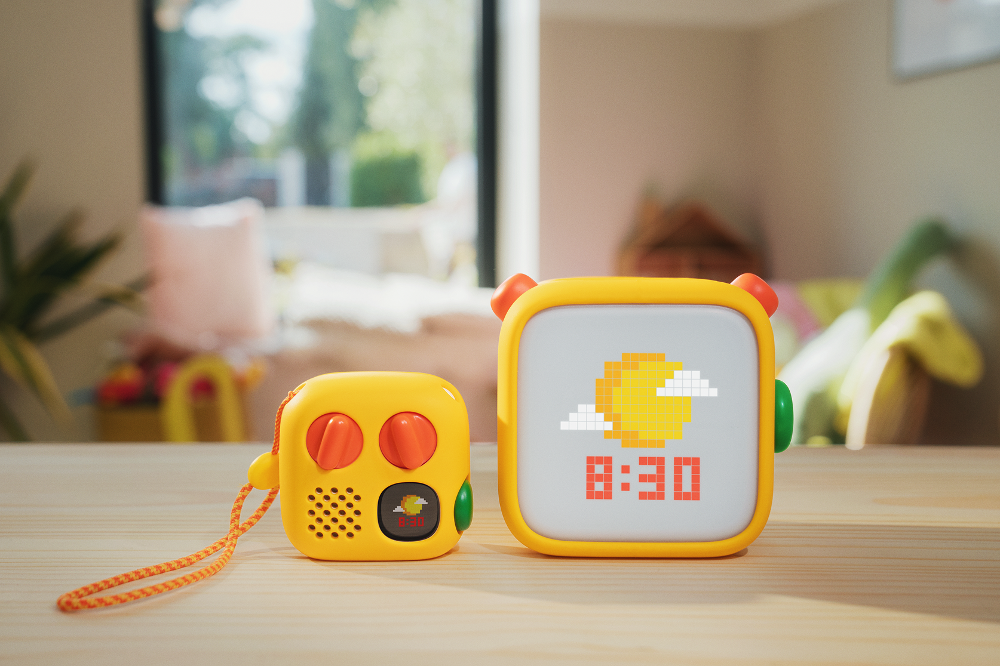
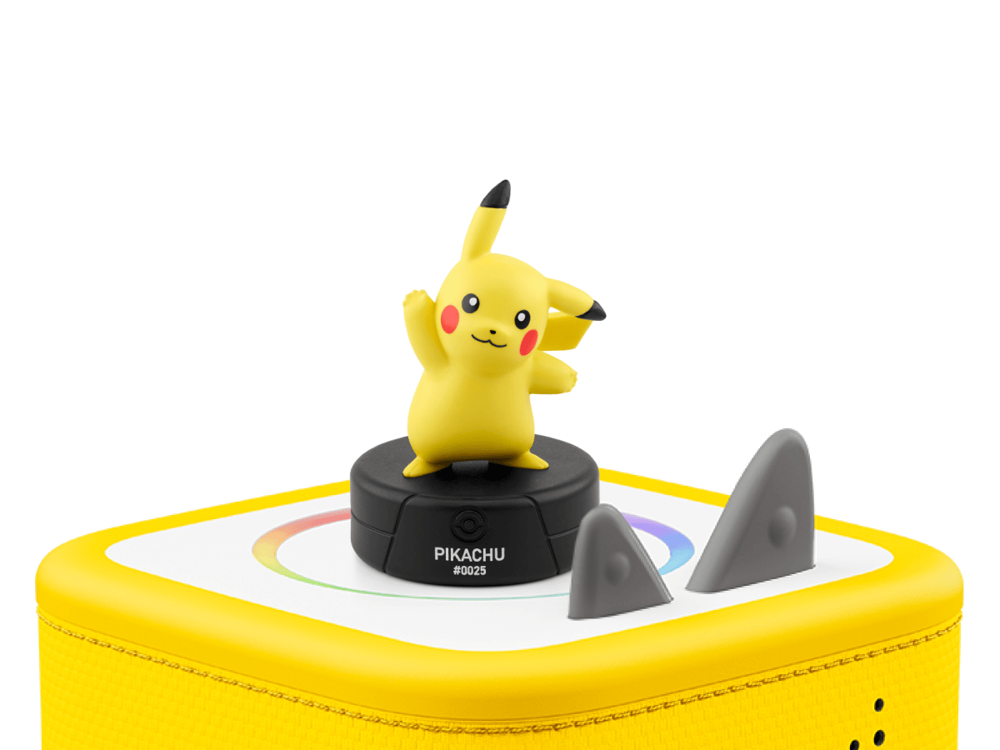
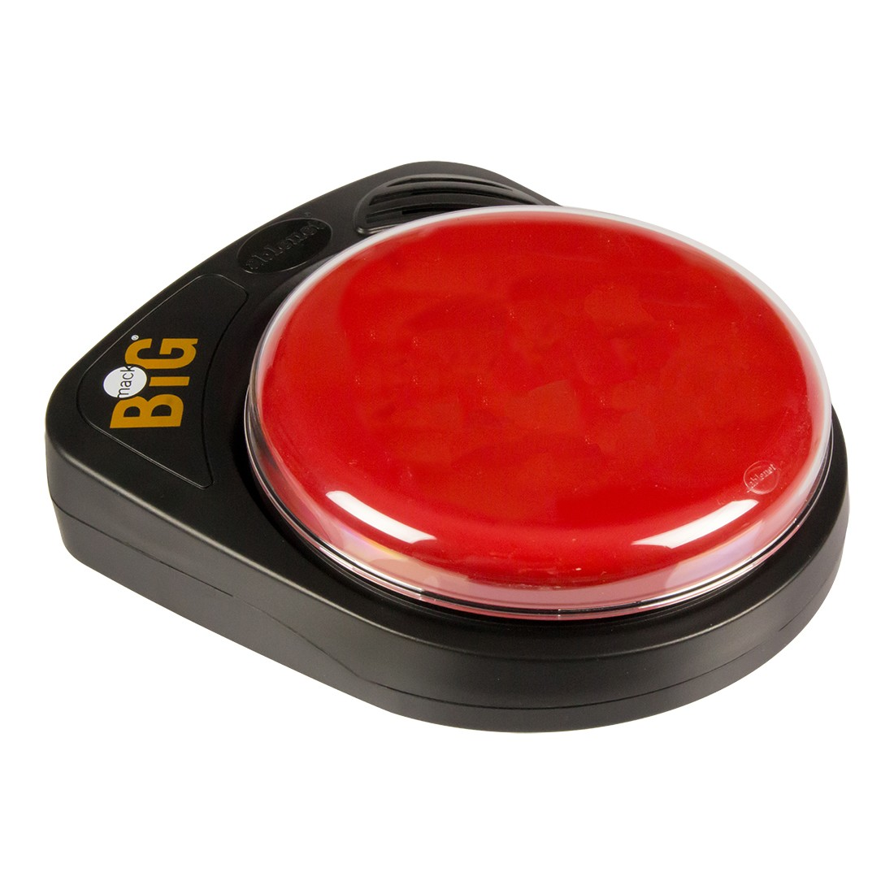
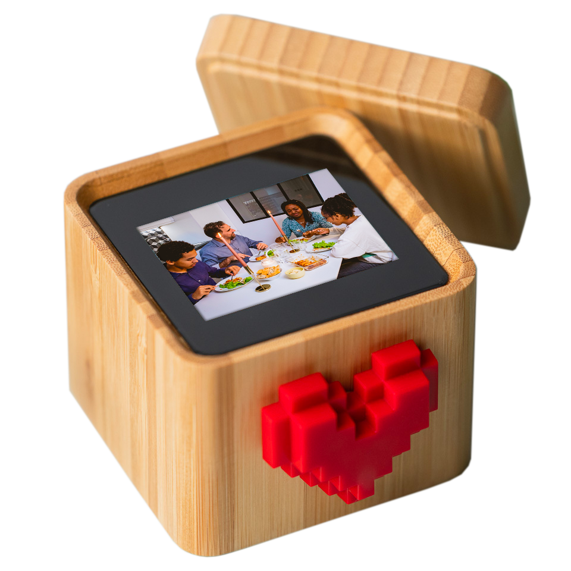
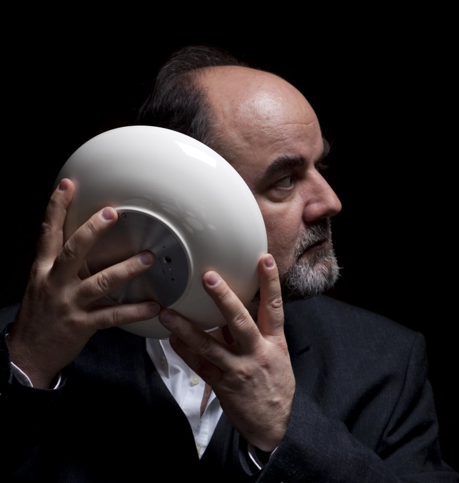
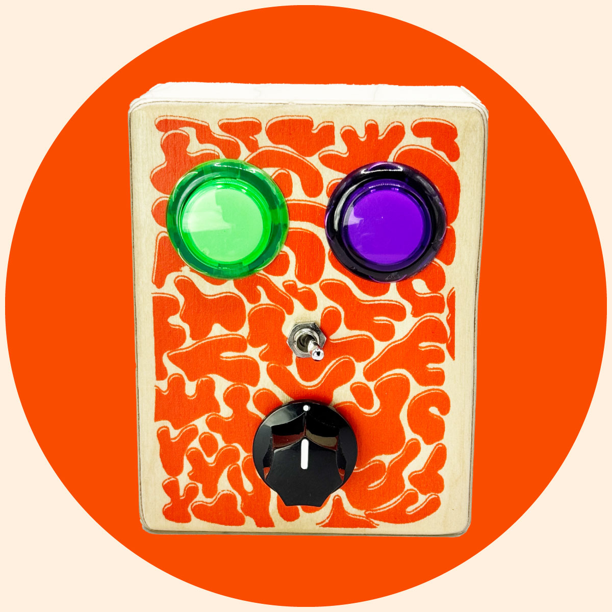
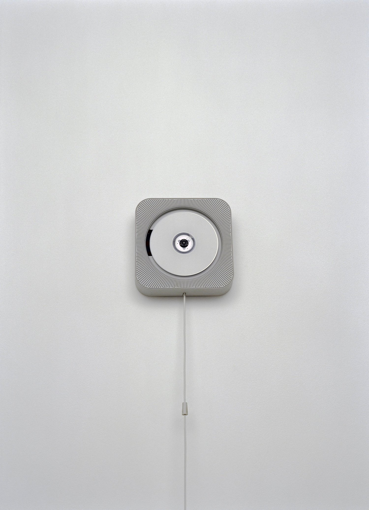
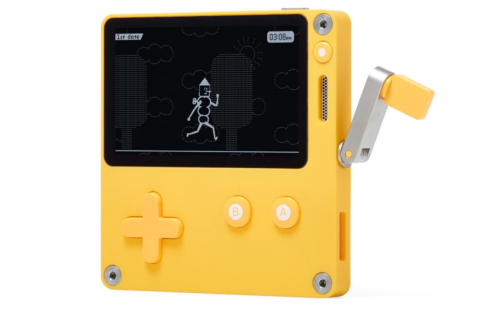

## Imágenes de referentes

Las imágenes se guardan en la carpeta `referentes_imagenes/`.

### 01. Yoto Player

*Figura 1.* Yoto Player 4th Gen y Yoto Mini 4th Gen. Imagen de prensa de Yoto.

### 02. Toniebox

*Figura 2.* Toniebox 2 con figura de Pikachu. Imagen de producto de tonies.

### 03. BIGmack

*Figura 3.* BIGmack, dispositivo de comunicación de un solo mensaje.

### 04. Lovebox

*Figura 4.* Lovebox Photo Messenger.

### 05. Whispering Table

*Figura 5.* Whispering Table, instalación de TheGreenEyl.

### 06. Under the Same Moon

*Figura 6.* Under the Same Moon, libro grabable de Hallmark.

### 07. Matriz de voz

*Figura 7.* Voice Array, instalación de Rafael Lozano-Hemmer.

### 08. I Like Big Buttons

*Figura 8.* I Like Big Buttons, grabadora de BrandNewNoise.

### 09. Wall-mounted CD Player

*Figura 9.* Reproductor de CD mural diseñado por Naoto Fukasawa para MUJI.

### 10. Playdate

*Figura 10.* Consola Playdate de Panic.
