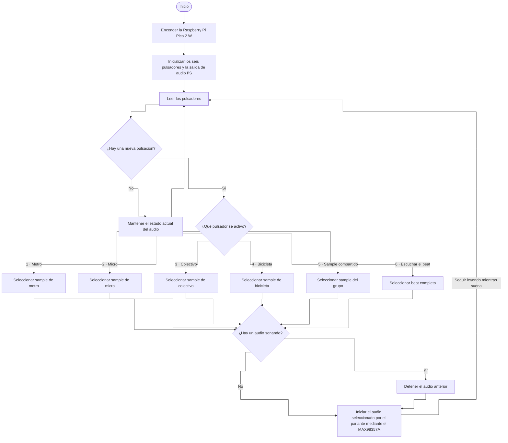

# sesion-13a

## apuntes sesión

### bill of materials (BOM)

| Componente | Cantidad | Valor unitario (CLP) | Subtotal (CLP) | Enlace |
| --- | ---: | ---: | ---: | --- |
| Raspberry Pi Pico 2 W con headers | 1 | $14.990 | $14.990 | [Raspberry Pi Chile](https://raspberrypi.cl/products/raspberry-pi-pico-2-w-con-headers) |
| Parlante de 8 Ω y 1 W | 1 | $4.290 | $4.290 | [Mechatronic Store](https://www.mechatronicstore.cl/altavoz-8-ohm-1w/) |
| Pulsador táctil | 6 | $400 | $2.400 | [AFEL](https://afel.cl/products/boton-tactil-tapa-12x12x7-3-interruptor) |
| Protoboard de 400 puntos | 1 | $1.500 | $1.500 | [AFEL](https://afel.cl/products/mini-protoboard-400-puntos) |
| Pack de 20 cables Dupont macho-macho | 1 | $1.000 | $1.000 | [AFEL](https://afel.cl/products/pack-20-cables-de-conexion-macho-macho) |
| Módulo amplificador I²S MAX98357A | 1 | $4.136 | $4.136 | [Mercado Libre Chile](https://www.mercadolibre.cl/placa-decodificadora-max98357a-i2s-modulo-amp-de-audio-clase/p/MLC2053073155) |
| Cable USB-A a micro-USB de 1 m para datos y alimentación | 1 | $790 | $790 | [Electrónica Tesla](https://etesla.cl/producto/cable-usb-a-micro-5-pin-1-metro-sin-embalaje/) |
| Potenciómetro lineal B100K para volumen | 1 opcional | $495 | $495 | [Altronics](https://altronics.cl/potenciometro-lineal-100k-b100k) |

### Diagrama de flujo

### Texto descriptivo del proyecto

#### De ida

**De ida** es un sampler para hacer música con grabaciones de nuestros recorridos desde la universidad a casa. Cada integrante elige un momento memorable de su trayecto y el quinto sample se elige en conjunto. La selección se hará después de grabar y escuchar el material.

| Sample | Integrante | Recorrido |
| --- | --- | --- |
| Metro | Fran | Líneas 1 y 5 |
| Micro | Nico | 210 y un segundo recorrido por definir |
| Colectivo | Tomaz | Cerro Navia |
| Bicicleta | Santi | Vargas Buston |
| Sample compartido | Todo el grupo | Por definir |

El prototipo tiene **cinco botones para reproducir los samples** y un sexto, **«Escuchar el beat»**, para reproducir una pieza de 15 a 20 segundos armada en el computador con las cinco grabaciones. Del Korg Volca Sample tomamos la idea de disparar muestras con botones. [Korg Volca Sample](https://www.korg.com/uk/products/dj/volca_sample/features.php)

### Fuentes

- En la Región Metropolitana, el 57,4 % declaró usar habitualmente micro o bus de lunes a viernes, el 47,8 % Metro y el 7,3 % bicicleta. [Radiografía al uso de medios de transporte de los chilenos — AIM Chile, 2024](https://aimchile.cl/radiografia-al-uso-de-medios-de-transporte-de-los-chilenos/)
- La Encuesta Origen Destino de Santiago 2012 estimó 530.000 viajes diarios realizados exclusivamente en taxi colectivo. [Resultados de la encuesta — Ministerio de Transportes y Telecomunicaciones](https://www.mtt.cl/presentamos-resultados-de-la-encuesta-origen-destino-de-santiago/)

## encargos

### David Byrne – Playing the Building

David Byrne convirtió un edificio en un instrumento. El público podía tocar un órgano antiguo que activaba mecanismos conectados a vigas y tuberías. Al apretar las teclas, distintas partes del edificio vibraban o recibían golpes y producían sonidos. [Creative Time](https://creativetime.org/projects/playing-the-building/) · [Wikipedia](https://en.wikipedia.org/wiki/Playing_the_Building)

Me llamó la atención que algo tan simple como apretar una tecla sirva para descubrir cómo suenan los materiales del lugar.

### Kelly Dobson – ScreamBody

ScreamBody es un dispositivo portátil en el que puedes gritar. Amortigua el sonido y graba el grito para que lo puedas reproducir después. [Ficha de ISEA](https://www.isea-symposium-archives.org/art-events/kelly-dobson-wearable-body-organs/) · [Video](https://www.youtube.com/watch?v=Ta7rN5TeKzw)

### Dato Musical Instruments

El Dato DUO es un instrumento electrónico pensado para tocar entre dos. Por un lado, una persona arma una secuencia de notas que se repite. Por el otro, la segunda persona modifica cómo suena esa secuencia con el sintetizador. [Dato Musical Instruments](https://dato.mu/) · [Dato DUO](https://dato.mu/duo)

Me gustó que cada lado tenga una función distinta. Así las dos personas pueden probar cambios sobre la misma melodía y escuchar al tiro lo que hace la otra, es como jugar cooperativo en un videojuego.

## lectura
