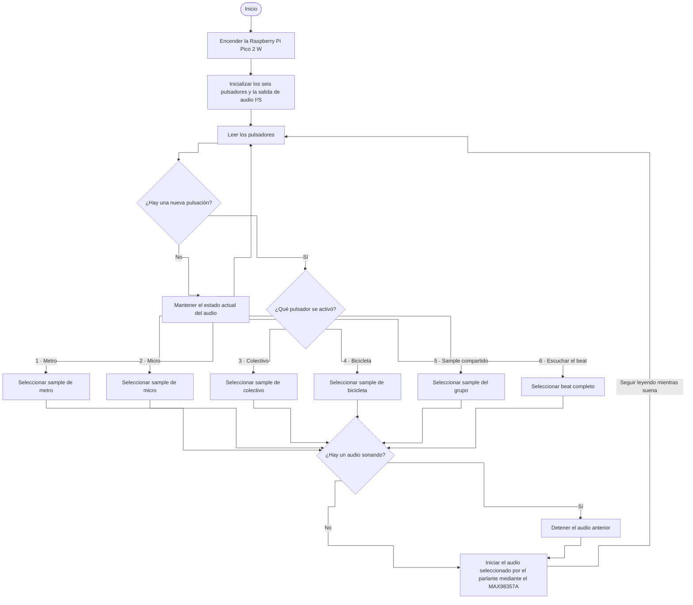

## descripción del trabajo

Recolección de sonidos de distintos recorridos en el contexto del viaje desde la universidad a la casa, usando el transporte público (esto lo podemos sustentar con alguna encuesta de transporte de santiago). Nuestro top, es (respaldado por la encuesta que encontremos):

1. Metro (Fran): Línea 1 y 5.
2. Micro (Nico): 210 y otra +
3. Colectivo (Tomaz): Cerro navia 
4. Bicicleta (Santi): Vargas Buston 

# Proyecto a manera de respuesta de nuestro concepto:

Un sampler

# Referente: 

- korg volca sample 1

---

## bill of materials

| componente | cantidad | valor unitario | link |
| --- | --- | --- | --- |
| Raspberry Pi Pico 2w | 1 | $14.990 | <https://raspberrypi.cl/products/raspberry-pi-pico-2-w-con-headers> |
| Parlante altavoz 8 Ohm 1W | 1 | $4.290 | <https://www.mechatronicstore.cl/altavoz-8-ohm-1w/> |
| Botón pulsador | - | $400 | <https://afel.cl/products/boton-tactil-tapa-12x12x7-3-interruptor> |
| Potenciómetro B100k | - | $495 | <https://altronics.cl/potenciometro-lineal-100k-b100k> |
| Protoboard 400 puntos | 1 | $1.500 | <https://afel.cl/products/mini-protoboard-400-puntos> |
| Pack 20 cables Dupont | 1 | $1.000 | <https://afel.cl/products/pack-20-cables-de-conexion-macho-macho> |

---

## Diagrama de flujo

```mermaid
flowchart TD
    subgraph CAMPO["1 · Recolección de sonidos"]
        direction TB
        Inicio(["Viaje de la universidad<br/>a la casa"])
        Inicio --> Contexto["Consultar encuestas<br/>de movilidad de Santiago"]
        Contexto --> Rutas["Asignar recorridos<br/>y responsables"]

        Rutas --> Metro["Metro · Fran<br/>Líneas 1 y 5"]
        Rutas --> Micro["Micro · Nico<br/>210 y otro<br/>por definir"]
        Rutas --> Colectivo["Colectivo · Tomaz<br/>Cerro Navia"]
        Rutas --> Bici["Bicicleta · Santi<br/>Vargas Buston"]

        Metro --> Plan["Definir tramo, sentido,<br/>horario y puntos de captura"]
        Micro --> Plan
        Colectivo --> Plan
        Bici --> Plan

        Plan --> Equipo["Revisar batería,<br/>espacio y nivel de audio"]
        Equipo --> Grabar["Grabar inicio, trayecto<br/>y llegada"]
        Grabar --> Registro["Anotar recorrido, lugar,<br/>hora y tipo de sonido"]
        Registro --> Calidad{"¿El sonido es usable<br/>y se reconoce?"}
        Calidad -->|No| Repetir["Ajustar nivel, posición<br/>o punto de captura"]
        Repetir --> Grabar
        Calidad -->|Sí| Cobertura{"¿Están cubiertos<br/>los tramos previstos?"}
        Cobertura -->|No| Plan
        Cobertura -->|Sí| Respaldo["Respaldar grabaciones<br/>y registro de campo"]
    end

    subgraph MUESTRAS["2 · Banco de muestras"]
        direction TB
        Escuchar["Escuchar y clasificar<br/>por medio y recorrido"]
        Escuchar --> Elegir["Elegir ambientes<br/>y sonidos puntuales"]
        Elegir --> Editar["Recortar, limpiar<br/>y emparejar niveles"]
        Editar --> Exportar["Exportar en el formato<br/>del reproductor"]
        Exportar --> Memoria{"¿El banco cabe en el<br/>espacio disponible?"}
        Memoria -->|No| Reducir["Reducir duración,<br/>cantidad o tamaño"]
        Reducir --> Exportar
        Memoria -->|Sí| Banco["Nombrar y ordenar<br/>las muestras del banco"]
    end

    subgraph PROTOTIPO["3 · Armado y pruebas"]
        direction TB
        Diseno["Definir controles y pines<br/>con la Pico 2 W"]
        Diseno --> Materiales{"¿Están listos los<br/>componentes y cantidades?"}
        Materiales -->|No| Completar["Cerrar la lista<br/>y completar el montaje"]
        Completar --> Materiales
        Materiales -->|Sí| Montar["Montar pulsadores y potenciómetro<br/>con protoboard y cables Dupont"]
        Montar --> Salida["Definir y probar<br/>la etapa de audio<br/>para el parlante"]
        Salida --> Firmware["Cargar el banco y programar<br/>los controles del sampler"]
        Firmware --> Pruebas["Probar cada muestra,<br/>volumen y latencia"]
        Pruebas --> Repetidas["Probar pulsaciones<br/>rápidas y simultáneas"]
        Repetidas --> Verificar{"¿Responde bien<br/>el prototipo?"}
        Verificar -->|No| Diagnostico{"¿Dónde está<br/>la falla?"}
        Diagnostico -->|Controles| Montar
        Diagnostico -->|Salida de audio| Salida
        Diagnostico -->|Programa| Firmware
        Diagnostico -->|Muestras| Editar
    end

    subgraph USO["4 · Funcionamiento del sampler"]
        direction TB
        Encender(["Encender el sampler"])
        Encender --> Cargar["Iniciar controles y audio<br/>y cargar el banco"]
        Cargar --> Disponible{"¿Está disponible<br/>el banco?"}
        Disponible -->|No| Recargar["Revisar y volver<br/>a cargar las muestras"]
        Recargar --> Cargar
        Disponible -->|Sí| Leer["Leer pulsadores<br/>y potenciómetro"]
        Leer --> Volumen["Actualizar el volumen<br/>si cambia el potenciómetro"]
        Volumen --> Pulsacion{"¿Hay una pulsación<br/>válida?"}
        Pulsacion -->|No| Leer
        Pulsacion -->|Sí| Muestra["Buscar la muestra<br/>asignada al botón"]
        Muestra --> Reproducir["Reproducir la muestra<br/>por el parlante"]
        Reproducir --> Leer
    end

    Respaldo --> Escuchar
    Banco --> Diseno
    Verificar -->|Sí| Encender
```

## Diagrama de flujo del sampler

---
El prototipo tiene **cinco botones para reproducir los samples** y un sexto, **Escuchar el beat**, para reproducir una pieza de 15 a 20 segundos armada en el computador con las cinco grabaciones. Del Korg Volca Sample tomamos la idea de disparar muestras con botones. [Korg Volca Sample](https://www.korg.com/uk/products/dj/volca_sample/features.php)

### Fuentes

- En la Región Metropolitana, el 57,4 % declaró usar habitualmente micro o bus de lunes a viernes, el 47,8 % Metro y el 7,3 % bicicleta. [Radiografía al uso de medios de transporte de los chilenos — AIM Chile, 2024](https://aimchile.cl/radiografia-al-uso-de-medios-de-transporte-de-los-chilenos/)
- La Encuesta Origen Destino de Santiago 2012 estimó 530.000 viajes diarios realizados exclusivamente en taxi colectivo. [Resultados de la encuesta — Ministerio de Transportes y Telecomunicaciones](https://www.mtt.cl/presentamos-resultados-de-la-encuesta-origen-destino-de-santiago/)
