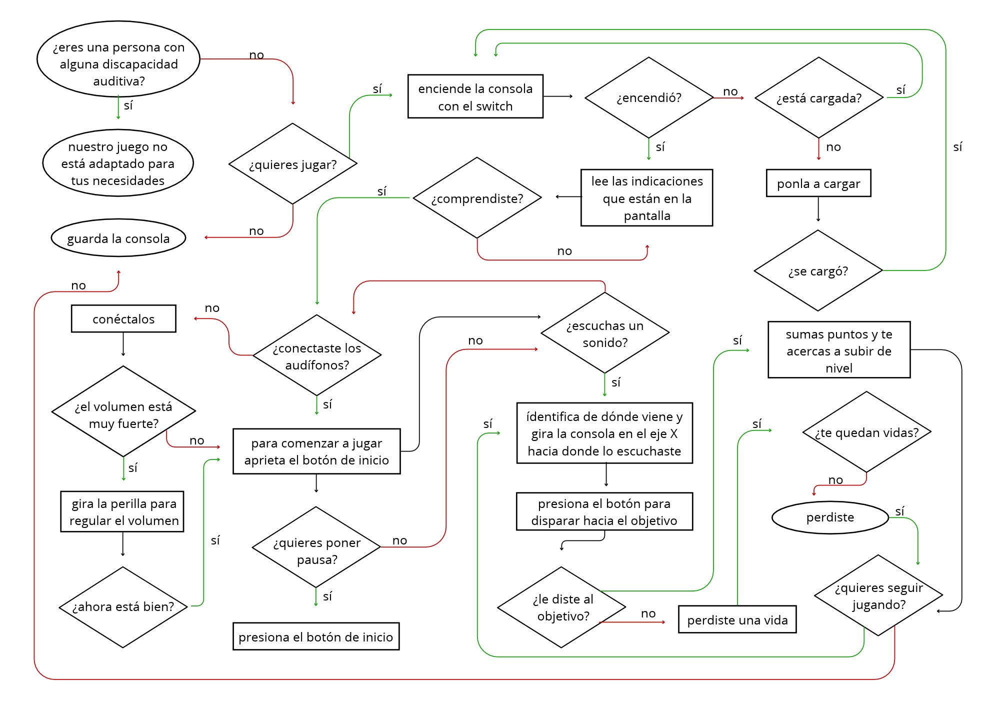
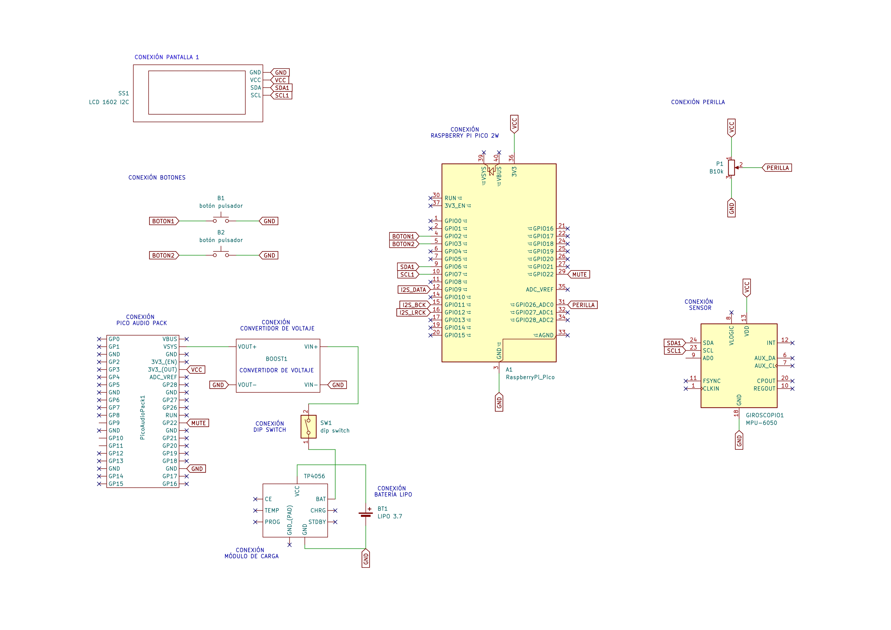

# sesion-14a

## avances proyecto 03

Con mi compañera Katalina Riquelme avanzamos el diagrama de flujo y el esquemático en KiCAD.

**Observaciones importantes:**

Decidimos partir por la pregunta sobre las capacidades auditivas de la persona, más que nada porque en esta primera instancia no queremos intentar abarcar más de lo que podemos. Sobre todo porque consideramos que si queremos incluir más usuarios tenemos que hacerlo con responsabilidad, intentando hacerlo lo mejor posible, pero para esta instancia no tenemos el tiempo suficiente para poder implementarlo.

Sin embargo, nos parece una buena continuación para más adelante.

También aclarar que hicimos el diagrama de flujo de esta forma porque nos parece que podemos ver todo de una vez, en cambio, en otros no, porque son más largos y hay que avanzar y devolverse cada vez que queremos revisar un cambio u otra vía.

**Observaciones importantes:**

El esquemático está ordenado de forma que lo podamos entender por componentes, por botones, perilla, pantalla y además todo lo que conlleva la batería y la salida de audio.

Falta la especificación de valores y link en la lista de componentes de KiCAD, porque en el BOM si están.

## encargos

## lectura

Actualmente voy en la página 72.

Citas:

 1. "Well, guess what? I'm here to tell you that your best case is also the average case." (pág, 71).

Elegí esta porque me parece chistoso el cómo parte la oración con cierto entusiasmo, casi como que hubiera descubierto algo nuevo, pero que al final rompe toda esa ilusión al volver a la idea de que al final no hay mejor caso que el promedio.

 2. "Quick sort is a tricky case." (pág. 62).

Simplemente me di cuenta apenas comencé con el libro.

PD: Creo que mi vocabulario en inglés ha crecido un poco con este libro.

PD2: Aún así, ¿Cuándo se traduce al español en automático?
