# sesion-13a

## apuntes sesión

## Inicio del Proyecto 3

Partimos la clase revisando el **calendario y las fechas que nos quedan para desarrollar el Proyecto 3**.

La idea es que el proyecto tenga más o menos dos etapas grandes:

```text
CONCEPTUALIZACIÓN
        ↓
   FABRICACIÓN
```

Primero tenemos que definir bien **qué queremos hacer, cómo debería funcionar y qué cosas necesitamos**, para después pasar a construirlo.

O sea, intentar no llegar a fabricar algo sin tener idea de qué estamos haciendo jejej.

# Brainstorm

Después hicimos un **brainstorm** de cosas que nos interesaría que tuviera el proyecto y otras que definitivamente no queremos.

La idea era empezar a poner conceptos sobre la mesa y de a poco saber lo que queríamos.

## Cosas que sí

- Botones.
- Pantalla.
- Micrófono.
- Interactivo.
- De bolsillo.
- Modelado 3D.
- Carcasa.
- Barato.
- Memoria.
- Parlante pequeño.

Estas palabras empiezan a marcar un poco **qué tipo de objeto nos imaginamos**.

Por ahora aparece la idea de algo relativamente pequeño, que se pueda tener o llevar fácilmente, que tenga interacción física y que pueda trabajar con sonido.

También nos interesa que tenga una **carcasa diseñada y modelada en 3D**, no solamente los componentes sueltos.

Y obviamente que no salga un ojo de la cara upsi.

## Cosas que no

También hicimos una lista de características que **no queremos para el proyecto**:

- Madera.
- Ensordecedor.
- Silencioso.
- Autónomo.
- Fijo.
- Cíclico.
- Sensores.
- Control de volumen.

Esta parte igual sirve porque a veces definir **lo que NO queremos hacer** ayuda mucho a achicar las posibilidades.

Por ejemplo, si no queremos que sea fijo, ya sabemos que probablemente necesitamos pensar en algo más transportable.

Si no queremos que sea ensordecedor pero tampoco silencioso, entonces el sonido tiene que estar presente, pero de una forma más controlada.

Y tampoco queremos depender de sensores para generar la interacción.

# Diagramas de flujo

Después empezamos a analizar **diagramas de flujo**.

La idea de estos diagramas es poder representar un proceso de forma visual y entender **qué ocurre primero, qué viene después y qué decisiones aparecen en el camino**.

En vez de explicar todo en un párrafo gigante, podemos ir mostrando el recorrido paso por paso.

Vimos distintos símbolos:

### Círculo

Lo usamos para representar:

```text
START / STOP
```


### Rectángulo

Representa una **operación**.

Sería algo que efectivamente ocurre dentro del proceso.

Por ejemplo:

```text
agregar ingrediente
```

o:

```text
presionar botón
```

### Triángulo

Lo anotamos para representar las **decisiones**.

Acá aparece una pregunta o condición que puede hacer que el recorrido tome distintos caminos.

Por ejemplo:

```text
¿tiene tomate?
      ↓
  sí / no
```

Entonces el diagrama no necesariamente tiene un solo recorrido recto. Dependiendo de la respuesta, puede dividirse.

# El completo como ejemplo

Para entender mejor los diagramas vimos el ejemplo de **hacer un completo**, amo los completooos.

Y WOOOW porque una pensaría:

> hacer completo = poner cosas en un pan

pero cuando empiezas a transformarlo en un diagrama aparecen demasiadas decisiones y formas distintas de entender el proceso.

Por ejemplo, primero hay que revisar:

- Qué ingredientes tenemos.
- Qué ingredientes faltan.
- Qué tipo de completo queremos hacer.
- En qué orden ponemos las cosas.
- Qué cosas necesitan preparación antes.
- Qué decisiones dependen de lo que quiera la persona.

Entonces algo que parece súper simple puede empezar a dividirse en muchas etapas.

Por ejemplo, podemos pensar el diagrama desde:

- La persona que prepara el completo.
- La persona que lo pide.
- Los ingredientes.
- El orden de preparación.

## encargos

### Fan Connect

Fan Connect sería un dispositivo para compartir música con personas que tienen gustos parecidos. la idea es que puedas elegir una canción o un pedacito de una biblioteca que ya viene cargada y mandárselo a otra persona. quien lo recibe puede escucharlo y responder con un emoji que se ve en la pantalla y tiene su propio sonido. esos emojis los diseñaríamos nosotros.

Lo que queremos probar es si mandar una canción puede ser una forma de empezar a hablar con alguien, incluso si todavía no lo conoces. es como cuando le mandas un tema a alguien porque crees que le va a gustar, o porque la canción expresa algo que te cuesta poner en palabras. acá la interacción sería con el objeto mismo, usando botones para navegar, mandar música y reaccionar.

Para mostrar el intercambio pensamos en dos dispositivos que se comuniquen por wifi. cada uno tendría una pantalla para ver las canciones, los emojis y las notificaciones, además de un parlante para escuchar los fragmentos y las reacciones.

### Nido

Nido sería un dispositivo sonoro portátil para acompañar a niños cuando se sienten solos, asustados o extrañan a alguien. tendría una biblioteca de cuentos, música y sonidos tranquilos organizada por edades, y los cuidadores podrían elegir qué contenido queda disponible. el niño podría moverse entre las categorías con botones, escoger qué escuchar y reproducirlo o pausarlo.

También tendría un micrófono para que familiares o cuidadores puedan grabar mensajes y dejarlos guardados. por ejemplo, si un niño extraña a alguien antes de dormir, podría buscar un mensaje y escuchar esa voz, o elegir un cuento si prefiere distraerse un rato. la idea es que pueda hacerlo por su cuenta con una interfaz sencilla. Además, hoy entre tanta pantalla y estimulación para los niños, esta es una alternativa más amigable con su desarrollo.

Pensamos en una carcasa redondeada que sea cómoda de agarrar. la pantalla mostraría ilustraciones, personajes y lo que se está reproduciendo, así es más fácil cachar en qué parte estás y qué audio elegiste.


### Bom de Fan Connect

Esta lista es para un dispositivo. para probar que se puedan mandar canciones y reacciones entre dos personas, necesitamos armar dos.

| componente                           | cantidad | precio unitario | proveedor          |
| ------------------------------------ | -------: | --------------: | ------------------ |
| raspi pico reutilizada               |        1 |              $0 | universidad        |
| pantalla táctil tft de 2,4″ con spi  |        1 |         $10.000 | Afel               |
| mini parlante de 3 w / 4 Ω           |        1 |          $3.000 | Afel               |
| ampli pam8403 de 2 × 3 w             |        1 |          $1.000 | Afel               |
| kit de 5 pulsadores                  |        1 |            $500 | Afel               |
| microsd de 32 gb                     |        1 |          $6.000 | por definir        |
| power bank usb-c de 5 v / 3 a        |        1 |         $15.000 | por definir        |
| cable usb-c de alimentación          |        1 |          $1.500 | por definir        |
| cable y conexión de audio de 3,5 mm  |        1 |          $1.500 | por definir        |
| cables dupont y conectores           |   1 lote |          $3.000 | Afel / estimado    |
| carcasa impresa en 3d                |        1 |          $6.000 | fabricación propia |
| total estimado por dispositivo       |          |         $47.500 |                    |
| total estimado para dos dispositivos |          |         $95.000 |                    |

La microsd serviría para guardar los audios y los recursos gráficos. los fragmentos estarían cargados de antemano y las reacciones las haríamos nosotros. queda por confirmar que las raspi disponibles tengan wifi o cómo se lo vamos a agregar, además de revisar la salida de audio y cuánto aguanta la batería.

### Bom de Nido

Para esta idea calculamos un solo dispositivo. el micrófono se suma porque acá sí queremos grabar mensajes, y la microsd serviría para guardar tanto la biblioteca de audios como las grabaciones.

| componente                          | cantidad | precio unitario | proveedor          |
| ----------------------------------- | -------: | --------------: | ------------------ |
| raspi pico reutilizada              |        1 |              $0 | universidad        |
| pantalla táctil tft de 2,4″ con spi |        1 |         $10.000 | Afel               |
| mini parlante de 3 w / 4 Ω          |        1 |          $3.000 | Afel               |
| ampli pam8403 de 2 × 3 w            |        1 |          $1.000 | Afel               |
| kit de 5 pulsadores                 |        1 |            $500 | Afel               |
| micrófono usb pequeño               |        1 |          $4.000 | por definir        |
| microsd de 32 gb                    |        1 |          $6.000 | por definir        |
| power bank usb-c de 5 v / 3 a       |        1 |         $15.000 | por definir        |
| cable usb-c de alimentación         |        1 |          $1.500 | por definir        |
| cable y conexión de audio de 3,5 mm |        1 |          $1.500 | por definir        |
| cables dupont y conectores          |   1 lote |          $2.500 | Afel / estimado    |
| carcasa impresa en 3d               |        1 |          $6.000 | fabricación propia |
| total estimado por dispositivo      |          |         $51.000 |                    |

Queda por probar si podemos grabar con el micrófono usb en la raspi que usemos y cómo vamos a mandar el audio al ampli. para la carcasa también tenemos que considerar cuánto espacio ocupan la pantalla, la raspi, el parlante y la batería.

### diagramas de flujo

- Fan Connect

```mermaid
flowchart LR

    %% =========================
    %% COLUMNA: TÚ
    %% =========================
    subgraph TU["Tú"]
        direction TB

        A["Exploras la biblioteca<br/>musical"]
        B["Eliges una canción o<br/>fragmento"]

        C["Recibes su reacción"]
        D["Descubren su afinidad<br/>musical"]

        E{"¿Siguen conversando?"}

        A --> B
        C --> D
        D --> E
    end


    %% =========================
    %% COLUMNA: DISPOSITIVO
    %% =========================
    subgraph DISP["Dispositivo"]
        direction TB

        F["Se enciende el dispositivo"]
        G["Suena sonido de bienvenida"]
        H["Se envía a otra persona"]

        F --> G
    end


    %% =========================
    %% COLUMNA: LA OTRA PERSONA
    %% =========================
    subgraph OTRA["La otra persona"]
        direction TB

        I["La otra persona lo escucha"]
        J["Responde con un emoji<br/>sonoro"]

        I --> J
    end


    %% =========================
    %% CONEXIONES ENTRE COLUMNAS
    %% =========================

    G --> A
    B --> H
    H --> I
    J --> C

    E -- "Sí" --> B


    %% =========================
    %% FINAL
    %% =========================

    FIN["Termina la interacción"]

    E -- "No" --> FIN


    %% =========================
    %% ESTILOS
    %% =========================

    style TU fill:#F0EFFF,stroke:#F0EFFF,color:#5F57B7
    style DISP fill:#F3F1EA,stroke:#F3F1EA,color:#444444
    style OTRA fill:#E4F6F1,stroke:#E4F6F1,color:#228C78

    style A fill:#FFFFFF,stroke:#8278DA,stroke-width:2px,color:#5F57B7
    style B fill:#FFFFFF,stroke:#8278DA,stroke-width:2px,color:#5F57B7
    style C fill:#FFFFFF,stroke:#8278DA,stroke-width:2px,color:#5F57B7
    style D fill:#FFFFFF,stroke:#8278DA,stroke-width:2px,color:#5F57B7
    style E fill:#FFFFFF,stroke:#8278DA,stroke-width:2px,color:#5F57B7

    style F fill:#FFFFFF,stroke:#8F8C84,stroke-width:2px,color:#444444
    style G fill:#FFFFFF,stroke:#8F8C84,stroke-width:2px,color:#444444
    style H fill:#FFFFFF,stroke:#8F8C84,stroke-width:2px,color:#444444

    style I fill:#FFFFFF,stroke:#50AD98,stroke-width:2px,color:#287E6E
    style J fill:#FFFFFF,stroke:#50AD98,stroke-width:2px,color:#287E6E

    style FIN fill:#292927,stroke:#292927,color:#FFFFFF
```



- Nido — (pegar)


## lectura

En estas páginas entendí más que nada que medir también cambia la forma en que entendemos el espacio. Me llamó la atención cómo la triangulación permite tomar algo irregular, como un terreno o una ciudad, y convertirlo en puntos y medidas que después se pueden ordenar y comparar. También aparece que ya no solo se mide el espacio, sino otras cosas como tiempo, costo o energía. Igual siento que acá se nota harto que representar algo nunca es exactamente mostrar la realidad tal cual, sino traducirla de otra forma para poder entenderla mejor.

Y aunque siento que algo he aprendido con el libro, definitivamente no es muy mi gusto jajaja, no es mucho my type y a veces me cuesta demasiado enganchar con la lectura.

“Surveying is a rectification and rationalization of irrational form.”- pág.103

“triangulated meshes were exact tabulations of inexact forms.”- pág.106
