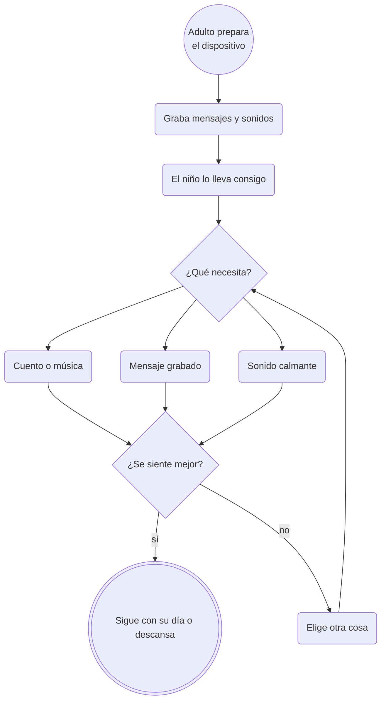

# sesion-14a

## apuntes sesión

## proyecto-03

### Descripción general

El proyecto consiste en un dispositivo sonoro pensado para acompañar a infancias de 3 a 4 años en momentos específicos del día, especialmente cuando están en su habitación, descansando o preparándose para dormir. En esta primera versión, el dispositivo permanecerá en un lugar fijo, como un velador.

El dispositivo tendrá tres botones físicos principales. Uno permitirá escuchar cuentos, otro reproducirá música y el tercero dará acceso a un mensaje grabado por la persona cuidadora. Al presionar un botón, comenzará a sonar un audio de esa categoría. En cuentos y música, una segunda pulsación del mismo botón permitirá pasar al siguiente contenido disponible.

Cada botón tendrá un personaje o icono asociado a su categoría. La pantalla podrá reforzar esa relación mostrando qué está pasando. Así, cada infante podrá asociar el botón con un símbolo y una respuesta sonora, incluso si todavía no lee.

El alcance de la primera versión será acotado: tres cuentos, cuatro piezas de música infantil y la posibilidad de grabar un mensaje. Con esta biblioteca inicial, queremos comprobar la reproducción, la navegación mediante botones, la grabación y el funcionamiento de la interacción física.

### Usuario objetivo y contexto de uso

El dispositivo está pensado para infancias de 3 a 4 años que puedan necesitar acompañamiento en momentos de soledad, miedo o incertidumbre dentro de su habitación.

La persona cuidadora podrá dejar el dispositivo preparado en el velador. Desde ahí, cada infante podrá elegir entre un cuento, música o el mensaje grabado sin tener que usar un celular ni recorrer un menú complejo.

Las categorías se diferenciarán mediante personajes, iconos y respuestas de audio. La pantalla podrá mostrar información de apoyo, pero la acción principal deberá poder entenderse a partir de los botones físicos.

Nos enfocamos en los 3 a 4 años porque en esa etapa ya aparecen habilidades que podemos aprovechar. A los 3 años, muches niñes pueden reconocer qué está pasando en una imagen. A los 4, muches pueden anticipar qué viene en un cuento conocido o inventar situaciones con personajes durante el juego. Como estas habilidades se desarrollan a ritmos distintos, queremos que la interacción se entienda mediante señales que se puedan **ver, tocar y escuchar**.

## Por qué incluimos una voz familiar

Al investigar el **apego paterno y materno**, vimos que el padre y la madre pueden ser figuras a las que les niñes recurren cuando necesitan consuelo. Ese vínculo también puede darles seguridad para jugar y explorar. Hay estudios que observaron el apego alrededor de los 3 años y encontraron relaciones con la regulación emocional y la forma de desenvolverse con sus pares a los 5. En nuestro proyecto, el mensaje también puede venir de otra figura significativa que participe en el cuidado cotidiano. 

Si une infante extraña a su papá o a alguien que le cuida, puede elegir escuchar un saludo que esa persona le dejó. **Nuestra hipótesis es que volver a oír una voz conocida puede darle una sensación de compañía en ese momento.** Las investigaciones que revisamos sobre voces grabadas se hicieron en contextos específicos, como el despertar después de una anestesia. Todavía queda por saber qué efecto tendría un mensaje así en la rutina de su habitación antes de dormir.

También revisamos el **abandono infantil** para entender mejor el alcance del proyecto. UNICEF Chile lo describe como una forma extrema de negligencia en la que faltan cuidados y protección. La investigación que revisamos muestra que la negligencia grave puede asociarse con dificultades de comunicación en la primera infancia y que un entorno de cuidado estable puede favorecer la seguridad del apego. En nuestra máquina, el punto de partida es que **ya hay una relación de cuidado** y que esa persona quiere dejarle un mensaje a cada infante para cuando la extrañe.

### Contenido y alcance inicial

La biblioteca inicial estará compuesta por:

- Tres cuentos de hasta cinco minutos cada uno.
- Cuatro piezas de música infantil de hasta un minuto cada una.
- Un mensaje de hasta un minuto, grabado por la persona cuidadora.

Para los **cuentos**, vamos a fijarnos en si se puede seguir la historia solo escuchándola. Nos interesa que se entienda quién es el personaje, qué le pasa, qué hace y cómo termina la historia. Entre los 3 y 4 años ya se empieza a deducir información que el cuento deja implícita, aunque esto varía según cada infante y el apoyo disponible durante la escucha. Por eso, al revisar cada versión, nos vamos a preguntar si la narración cuenta lo necesario para seguir la historia o si hace falta mirar el libro para entenderla. 

Para la **música**, vamos a considerar qué se puede reconocer y seguir al escucharla. Si una canción tiene letra, nos fijaremos en las palabras del estribillo y en si se entiende la acción o la idea principal. Si es instrumental, nos interesa si hay un ritmo o una melodía que vuelva a aparecer. Una canción puede ser fácil de tararear aunque parte de la letra todavía resulte difícil de comprender.

Buscaremos los cuentos y la música en bibliotecas de audio o repositorios que permitan su uso gratuito y tengan una licencia compatible con el proyecto. Para cada audio registraremos el título, la autoría o el nombre de quien lo interpreta, la fuente y el tipo de licencia.

Al principio consideramos separar los cuentos entre día y noche. Como los tres podrán usarse en cualquier momento, decidimos que la biblioteca se organizará por categorías y que su reproducción estará disponible a cualquier hora.

### Funcionamiento principal

El dispositivo quedará en un lugar fijo y estará pensado principalmente para el uso de les niñes. Sus tres botones físicos corresponderán a cuentos, música y mensajes de la persona cuidadora.

Al presionar el botón de cuentos, sonará uno de los tres cuentos disponibles. Si se vuelve a presionar el mismo botón, se pasará al siguiente. Las piezas musicales funcionarán de la misma manera, dentro de su propia categoría.

El sistema deberá permitir avanzar entre los audios y distinguir una pulsación válida, una pulsación larga y varios toques consecutivos. Para ello, registrará el estado anterior de cada botón y el tiempo transcurrido desde la última pulsación.

El tercer botón reproducirá el mensaje de la persona cuidadora. El dispositivo almacenará un solo archivo de grabación y lo reemplazará cuando se registre un mensaje nuevo. El archivo quedará en la tarjeta SD, junto con los demás audios de la biblioteca.

La pantalla acompañará la interacción mostrando la categoría seleccionada, el contenido que está sonando y estados como «Grabando», «Mensaje guardado» o «Error». Los botones permitirán navegar por los contenidos por sí solos.

### Diagrama de flujo (preliminar)

### Sistema de grabación

La persona cuidadora grabará desde un módulo separado del dispositivo principal. Este módulo incluirá un micrófono y un botón para iniciar y terminar la grabación. Se conectará mediante conectores JST.

Para grabar, la persona cuidadora mantendrá presionado el botón y lo soltará para terminar. Mientras la grabación esté activa, el LED permanecerá encendido. Al terminar, el sistema guardará el archivo y mostrará «Mensaje guardado». Si el sistema no detecta el micrófono, si falla la tarjeta SD o si el archivo no se puede guardar, la pantalla mostrará un estado de error.

Al quedar en un módulo separado, el control de grabación estará reservado para la persona cuidadora. Esto busca evitar que les niñes inicien una grabación o eliminen el mensaje por accidente.

## Personajes, colores y forma de la máquina

Queremos que cada categoría tenga su propio personaje o icono. Al investigar símbolos para infantes de 3 años, vimos que **reconocer un dibujo y saber qué hace el botón son dos cosas distintas**. Cada infante puede reconocer un libro en el botón y aprender que ese dibujo se relaciona con *escuchar un cuento* al presionarlo y oír la narración. Por eso, queremos mantener la misma relación entre el dibujo del botón, lo que aparece en pantalla y el audio que se activa. Los personajes todavía están por definir.

Los botones serán **grandes, rígidos y resistentes a golpes**. Queremos que se distingan por la forma, la posición y el símbolo. El color ayudará a ubicarlos y el relieve podría aportar una diferencia al tocarlos. La investigación muestra que en la etapa preescolar ya se pueden distinguir formas y texturas con las manos. Dentro de este rango también varían el tamaño de la mano y la fuerza que se puede ejercer. Por eso, todavía tenemos que definir cuánto medirá cada botón, qué distancia habrá entre ellos y qué tan fácil será presionarlos sin mover la máquina.

Al elegir la paleta, vamos a mirar **qué tan bien se distingue cada control de la carcasa y de los demás botones**, sobre todo con la luz que puede haber en la habitación a la hora de dormir. Los estudios sobre color muestran que les niñes pueden asociar ciertas imágenes con emociones. El efecto de un color específico de la carcasa sobre la calma queda abierto. La paleta también va a influir en cómo se percibe el objeto y sigue siendo una decisión de diseño. 

La carcasa tiene que quedar estable en el velador y proteger la pantalla, el parlante, la tarjeta SD, la batería y las conexiones. Los botones estarán integrados en la carcasa, con los cables y las piezas pequeñas fuera del alcance de les niñes durante el uso cotidiano.

### BOM

| Componente | Cantidad | Precio unitario | Proveedor |
|---|---:|---:|---|
| Raspberry Pi Pico 2 W | 1 | $0 | Universidad |
| [Pantalla TFT LCD Touch 3,5" SPI 480x320](https://afel.cl/products/3-5-inch-spi-touch-screen-module-tft-interface-480-320-with-touch) | 1 | $14.000 | Afel |
| [Mini parlante 3 W / 4 Ω](https://afel.cl/products/mini-parlante-altavoz-de-3w) | 1 | $3.000 | Afel |
| [Amplificador PAM8403 2x3 W](https://afel.cl/products/amplificador-stereo-clase-d-2x3w-pam8403) | 1 | $1.000 | Afel |
| [Botón táctil con tapa 12x12x7,3 mm](https://afel.cl/products/boton-tactil-tapa-12x12x7-3-interruptor) | 5 | $100 | Afel |
| [Módulo micrófono amplificador MAX4466](https://afel.cl/products/modulo-microfono-amplificador-max4466) | 1 | $2.990 | Afel |
| [Lector Micro SD SPI](https://afel.cl/products/lector-micro-sd) | 1 | $2.500 | Afel |
| Tarjeta microSD 4 GB | 1 | Por definir | No hay en Afel |
| [Pack de 60 cables de conexión Dupont](https://afel.cl/products/pack-60-cables-de-conexion) | 1 | $2.500 | Afel |
| [Kit de conectores JST XH2.54](https://afel.cl/products/kit-conectores-jst-xh2-54-560-piezas) | 1 | $6.000 | Afel |
| Switch para prender y apagar el dispositivo | 1 | $0 | Propio |
| LED | 2 | $0 | Propios |
| Cable USB | 1 | $0 | Propio |
| **Total sin la tarjeta SD** |  | **$32.560** |  |

- Eliminamos la batería y el power bank porque el dispositivo ya no será portátil y permanecerá instalado en un lugar fijo.
- La pantalla elegida incluye función touch, pero para el proyecto la vamos a usar como pantalla de visualización.

### Primer código (declaraciones)
[Código 1: declaraciones preliminares](https://github.com/blosssom-n/dis8645-2026-2-procesos-2/blob/main/00-proyecto-3/grupo-07/codigos/Codigo_1_2026-11-13_declaraciones_muy_preliminares/Declaraciones.cpp)

### Revisión del módulo de grabación

Como el dispositivo quedará fijo en el velador, nos queda revisar si el módulo desmontable sigue siendo la opción más cómoda. Por la diferencia de altura, la persona que graba podría necesitar acercar el micrófono sin mover todo el dispositivo.

Una opción es mantener el módulo separado y conectarlo por cable. Así, la persona cuidadora podría acercarlo para grabar y volver a dejarlo en su lugar, fuera del alcance de les niñes durante el uso cotidiano. Para el Proyecto 3, mantendremos el módulo desmontable para simular primero su funcionamiento. Retomaremos esta decisión para el examen. 

## encargos
Ensayo de mi tiempo ... lo tengo que hacer 
## lectura

En estas páginas entendí más que nada que la triangulación y las formas de medir sirven para ordenar espacios que en realidad son mucho más irregulares y complejos. Me quedó la idea de que medir no es solo registrar lo que existe, sino también una forma de interpretar, organizar y hasta transformar el espacio. También aparece cómo estas formas de representación se van conectando cada vez más con la arquitectura y con nuevas maneras de diseñar. Siento que esta parte sigue insistiendo harto en cómo las herramientas matemáticas terminan cambiando la manera en que vemos y pensamos el espacio.

“Accurate surveying was indispensable to the derivation of fortress geometry.”- pág.114

“For Fuller, triangulation was a framework for mapping and communication.”- pág.121
