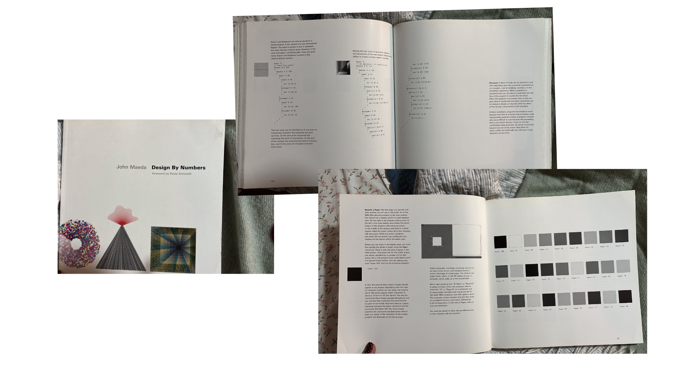

# sesion-12a
Entrega de proyecto 2 muejjeje
## lectura

Como ya terminé el libro que estaba leyendo para el taller, todavía no he pedido otro porque entre la entrega y otras cosas se me fue pasando. Por mientras, la Carlita Núñez me prestó el libro que está leyendo para que pudiera ojearlo y tener algo que revisar para la lectura del martes. El próximo martes pido otra lectura SOS!!!!!!!!

El libro es *Design By Numbers*, de John Maeda. Estuve mirando algunas páginas y encontré bastante información sobre la relación entre el diseño y la programación. Hay varias cosas que me llamaron la atención, sobre todo cómo se pueden crear composiciones visuales a partir de números, instrucciones y distintas reglas.

### Cosas que me llamaron la atención

**El color y los números (pág. 25)**

Se pueden representar los colores usando números. En estas páginas se muestran distintas tonalidades de gris, desde el negro hasta el blanco. Nunca había pensado que algo tan visual se pudiera trabajar de una forma tan matemática.

**Las instrucciones (pág. 25)**

encontré interesante que para crear algo hay que seguir ciertas instrucciones y respetar detalles que parecen mínimos, como los espacios o la forma de escribir un comando. Si algo está mal escrito, el resultado puede cambiar o simplemente no funcionar.

**La repetición (pág. 132)**

En esta página aparecen comandos que permiten repetir ciertas acciones. Me gustó esta parte porque muestra cómo, repitiendo elementos y cambiando algunos valores, se pueden ir creando distintas composiciones.

Se pueden mezclar distintas instrucciones para obtener resultados diferentes. Me parece interesante que no sea necesario hacer cada cosa desde cero, sino que se pueden ir combinando reglas y modificando pequeños detalles.

### Citas

**Página 25:**

"A new 100 percent black sheet of paper should appear in the display."

explica de forma simple cómo una instrucción puede generar algo visual.

**Página 133:**

"Questions can be nested as deeply as required, with the effect of fine-tuning a circumstance with precision."

 habla de cómo se pueden combinar distintas condiciones para conseguir un resultado más preciso.

Me pareció interesante ver el diseño desde otro lado. Normalmente uno piensa primero en las formas, los colores o cómo se va a ver algo, pero acá se muestra que también se puede llegar a un resultado visual a través de números e instrucciones. Pequeños cambios pueden generar resultados completamente distintos y en todas las posibilidades que se pueden conseguir experimentando.
