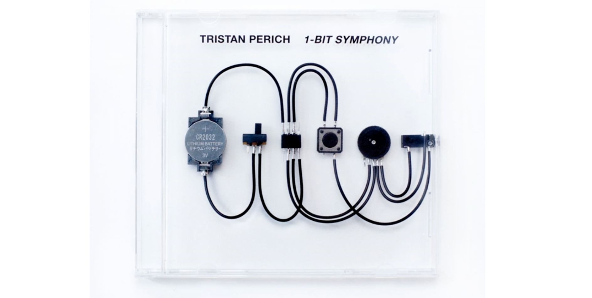
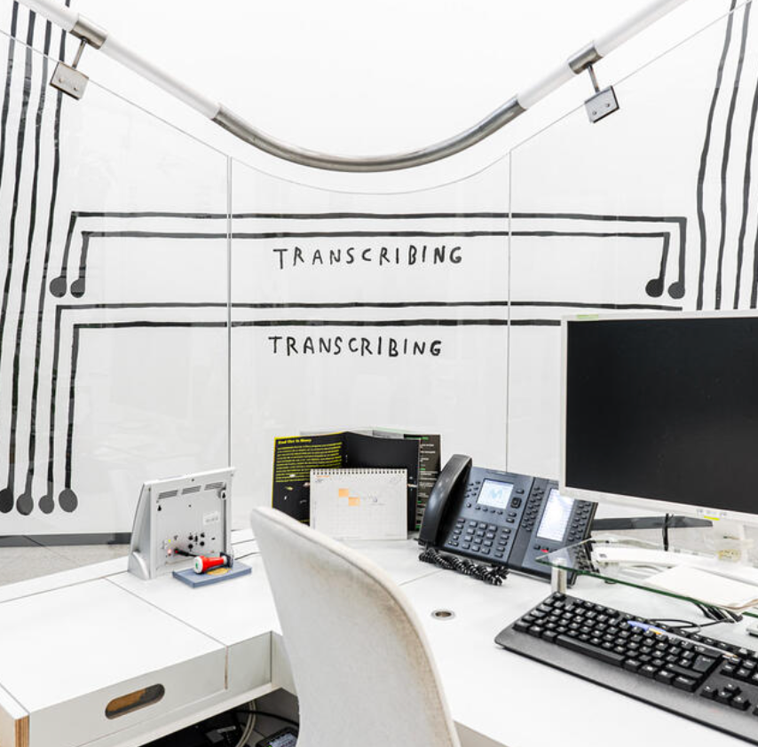
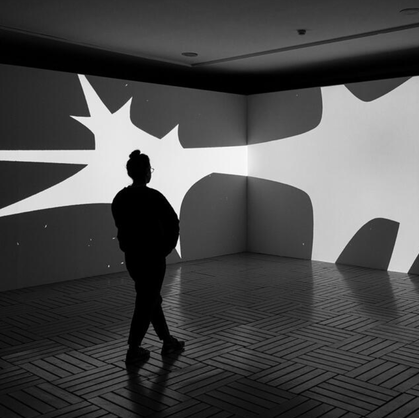
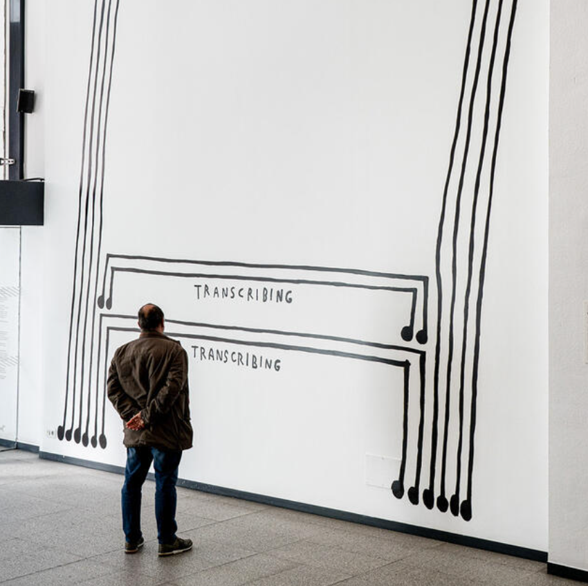

# sesion-12b
viernes 06 de noviembre
  
## apuntes sesión
- una clase es un molde
- blueprint: molde
- que también se usa para decirle a los planos
- tiene que ver con organizar
- pensamiento modular
- sistemas descentralizados
- pensamiento de planos, planificación

### escribir, tesis
- cuando se hace el argumento de una tesis hay que citarlo.
- introducir tema, el interés, argumentar según mi pensamiento o de otro (citado).
- (Bertram, 2024) `<--` cita en texto.
- final del paper viene la bibliografía:
- Bertram, Lillian-Yvonne. 2024. Output: An Anthology of Computer-Generated Text, 1953-2023. MIT Press.
- https://resonancias.uc.cl
- para facilitar las citas: https://www.zotero.org, instalar en docs.
- encontrar maneras de sistematizar, parametrizar cosas que son lateras!
- para zotero, si se pone el ISBN, se rellena los otros campos en automático.
- ordenar bibliografías en temáticas.

### proyecto-03
- desde ahora van a haber entregables por cada sesión y van a ser evaluados.
- se va a normar la salida, tiene que tener un parlante, da lo mismo la cantidad de perillas o botones, puede tener o no tener pantalla.
- tarea para el martes investigar el código del grupo 01
- protocolo de comunicación: I2s
- no usar chip 386 con la raspi
- amplificador stereo clase D 2x3w Pam8403
  
### referentes
- [Brand New Noise](https://www.brandnewnoise.com/?srsltid=AYCX9vJXphXgUea9JdXf3TJaNC43j137sj7uJQGzo7rDHST6dzvkyWBX)
- [sonic liberation devices](https://sonicliberationdevices.com/)
- [The Bleep Drum](https://bleeplabs.com/the-bleep-drum/)
- [KORG volca sample](https://www.korg.com/cl/products/dj/volca_sample/index.php)
- [amplificador MAX98357A](https://es.aliexpress.com/item/1005006823938000.html)
- [The Sonification Handbook - Hermann HuntNeuhoff](https://sonification.de/handbook/download/TheSonificationHandbook-HermannHuntNeuhoff-2011.pdf)
- [ADC para INPUTS](https://hubot.cl/producto/modulo-conversor-adc-audio-estereo-pcm1808-24-bits-96-khz-i2s/)
- [DAC para OUTPUTS](https://blog.adafruit.com/2012/09/06/mcp4725-12-bit-dac-tutorial-add-an-analog-output-to-your-microcontroller/)
- [Christine Sun Kim](https://ghebaly.com/artists/christine-sun-kim/)
- [R. Murray Schafer - Nunca vi un sonido (poema)](https://estefaniasoundscape.wordpress.com/wp-content/uploads/2017/10/nunca-vi-un-sonido_r-murray-schafer.pdf)
- Schafer, R. - El paisaje sonoro y la afinación del mundo (libro, trae el concepto de paisaje sonoro)

## encargos
- leer el texto de schafer y escribir un párrafo en la bitácora donde describan un sonido que les llame su atención. Nombrar el sonido, y elaborar como aparece, intentar describir como suena, y su relación cultural (https://estefaniasoundscape.wordpress.com/wp-content/uploads/2017/10/nunca-vi-un-sonido_r-murray-schafer.pdf)
- investigar el código del grupo 01
- revisar 1 obra de tristan perich y 1 de christine sun kim

--------

### 01. Nunca vi un sonido - R. Murray Schafer

**citas que me gustaron:**
- "Creo - un acto original que realicé en el mismo momento en que emergí en esta tierra."
- "Los dioses fructíferos existieron a partir del agua."
- "Ningún sonido puede ser repetido de manera exacta. Ni siquiera tu mismo nombre. Cada vez que se lo pronuncia es diferente. Y un sonido oído una vez no es lo mismo que un sonido oído dos veces, así como un sonido oído antes no es lo mismo que un sonido oído después."
- "Lo sonoro es activo y generativo. Los sonidos son verbos. Como toda creación, el sonido no es comparable. Por lo tanto, no puede existir una ciencia del sonido, sólo sensaciones... intuiciones... misterios..."
- "En el mundo occidental, y por algún tiempo, la vista ha visto el referente para toda experiencia sensorial."
- "Pero todos saben que no se puede pesar un susurro o contar las voces de un coro o medir la risa de un niño."
- "Estaba diciendo que todo en el mundo había sido creado por el sonido y analizado por la vista. Dios primero habló, y recién después vio que estaba bien."
- "El sonido llega a lugares que la vista no puede."
- "Algunos sonidos son tan únicos que una vez que uno los oye jamás podrá olvidarlos: el aullido de un lobo, la llamada del somorgujo, una locomotora a vapor, una ametralladora."
- "El ser humano visual tiene instrumentos para ayudar a retener las memorias visuales (pinturas, libros, fotografías). Cuál es el dispositivo para retener memorias aurales? La repetición. La repetición es el medio de la memoria para el sonido."
- "Cuando logramos liberarnos del predominio del mundo visual-analítico y lo reemplazamos por la intuición y la sensación, comenzamos a descubrir nuevamente la verdadera afinación del mundo y la exquisita armonía de todas sus voces."

**ejercicio:**

camino por la costa, guiándome por el azul, al acercarme va aumentando una estática constante, a la cual le dan vida las corrientes y el viento. en el mar, existe una especie de ruido blanco, que compila los pequeños movimientos de su inmensidad. cada vez más cerca, las olas construyen un paisaje sonoro de burbujeos y flujos acuáticos. el mar se recoge y las burbujas se acompañan, moviéndose con rapidez. luego, la ola es empujada por el viento, las burbujas explotan, arrasan con fuerza la arena y son acompañadas de un fuerte silbido con estática. es un ir y venir de este flujo que genera ritmos inconsistentes, lo único que se mantiene, es el constante sonido de fondo.

### 02. código grupo 01

### 03. obras

**Tristan Perich**

"**1-Bit Symphony** es una composición electrónica en cinco movimientos grabada en un solo microchip. Aunque se presenta en una caja de CD tradicional, 1-Bit Symphony no es una grabación en el sentido convencional; literalmente "interpreta" su música en vivo al encenderse. Un circuito electrónico completo —programado por el artista y ensamblado a mano— reproduce la música a través de una toma para auriculares integrada en la propia caja."

además, cuenta con un álbum hecho por él con la obra: [1-Bit Symphony - Movement 1](https://www.youtube.com/watch?v=1___Vy5vxmE&list=OLAK5uy_mDqHukELoBK8bNcnQVwUzvODjJ_ND5kB8&index=3)

me gusta mucho la factura y el oficio con el que está hecho el circuito, para parecer una portada de cd, y el concepto de que sea una obra tanto visual como musical. 

**Christine Sun Kim**

"Una sucesión de trampas de eco de Christine Sun Kim, artista estadounidense que reside en Berlín, se acerca a través de diversos formatos a lo que constituye el centro de su práctica artística: la notación musical, el lenguaje escrito, la infografía, la lengua de signos, el cuerpo y el despliegue estratégico del humor para poner en cuestión la política sonora y de los lenguajes."

El curador de la muestra, Cristiano Raimondi explica: “Gracias al arte de Christine Sun Kim, los espectadores pueden acceder a obras que transmutan los signos gráficos en signos musicales y reflexionan sobre la relación entre la gente que oye y la comunidad Sorda. En las obras de Christine, los gestos combinados de las manos y la velocidad del movimiento se usan para mostrar una comprensión más profunda de la experiencia Sorda. Nacida en un mundo donde la imagen fílmica va acompañada de subtítulos, Kim mira la lengua de signos estadounidense (ASL) a través de una lente musical, creando, mediante la repetición de signos gráficos y palabras, composiciones de música visual que narran la experiencia de la vida de los Sordos navegando un mundo construido por y para los que oyen”.

"La exposición está compuesta por tres obras que representan la diversidad de formatos y conceptos a los que Kim se acerca habitualmente en su trabajo: el gran mural Anotar transcribir transcribir (Notating Transcribing Transcribing), donde representa el espacio en el que dos lenguas se cruzan; el video La bandera tachonada de estrellas (The Star-Spangled Banner), que muestra la interpretación que realizó del himno nacional americano en lengua de signos americana durante la Super Bowl; y la animación digital Una sucesión de trampas de Eco (A String of Echo Traps), donde explora la noción del eco como fenómeno literal y metafórico."

[Crhistine Sun Kim. Una sucesión de trampas de eco.](https://es.artealdia.com/Noticias/CHRISTINE-SUN-KIM.-UNA-SUCESION-DE-TRAMPAS-DE-ECO)

## lectura
