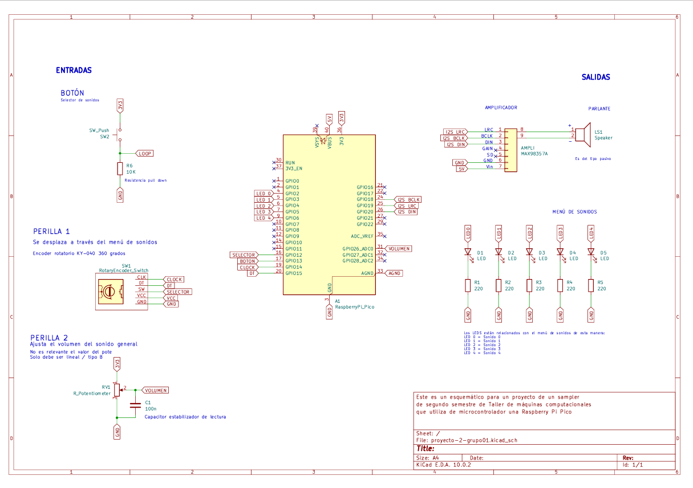
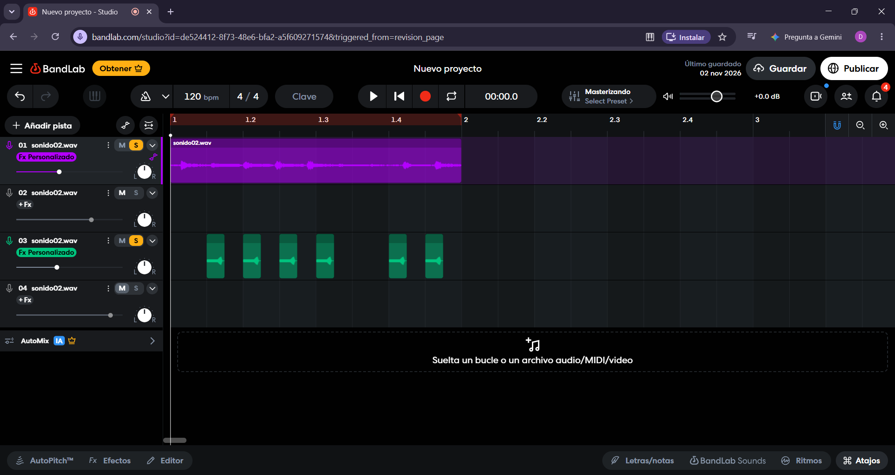

# sesion-11b

esta fue una sesión en la cuál estuvimos trabajando en el prototipo físico del **proyecto 02** y finalizando cosas de la entrega la cuál fue dada más plazo para entregar

## apuntes sesión

### esquemático

me demoré como 5 horas para hacer el esquemático porque me dio el toc con dejarlo muy ordenado xd

el feedback que se aplicó fue dejar las entradas a la izquierda, cómo el botón y las dos perillas, y son de lectura porque leen o detectan las interacciones del usuario, como el mover los valores o cambiar el estado del botón.

por lo tanto a la derecha se colocaron las salidas, como las luces, el ampli y el parlante como tal, que son los que reciben los datos y emiten un resultado con estos

### 5 sonidos

los sonidos que cargamos al proyecto fueron samples hechos por nosotras mismas, encontramos distintos sonidos que fuesen archivo de computadores de distintas décadas o más bien dicho que fuesen hechos de manera similar a como se hacían los sonidos con computadores que tuvieran ciertas especificaciones técnicas en las cuales se demostrara la evolución en el sistema del sonido/audio.

usé una web un poco cuma, pero es el mejor aliado cuándo debo hacer cosas con herramientas que ya conozco

aquí apliqué algunos efectos, aumenté pitch, la velocidad e hice recortes en los sonidos para crear nuestros propios.

aplicamos audacity también para modificar los decibeles de cada sonido y otras cositas que necesitábamos para hacer la conversión del audio a código.

## encargos

## lectura
