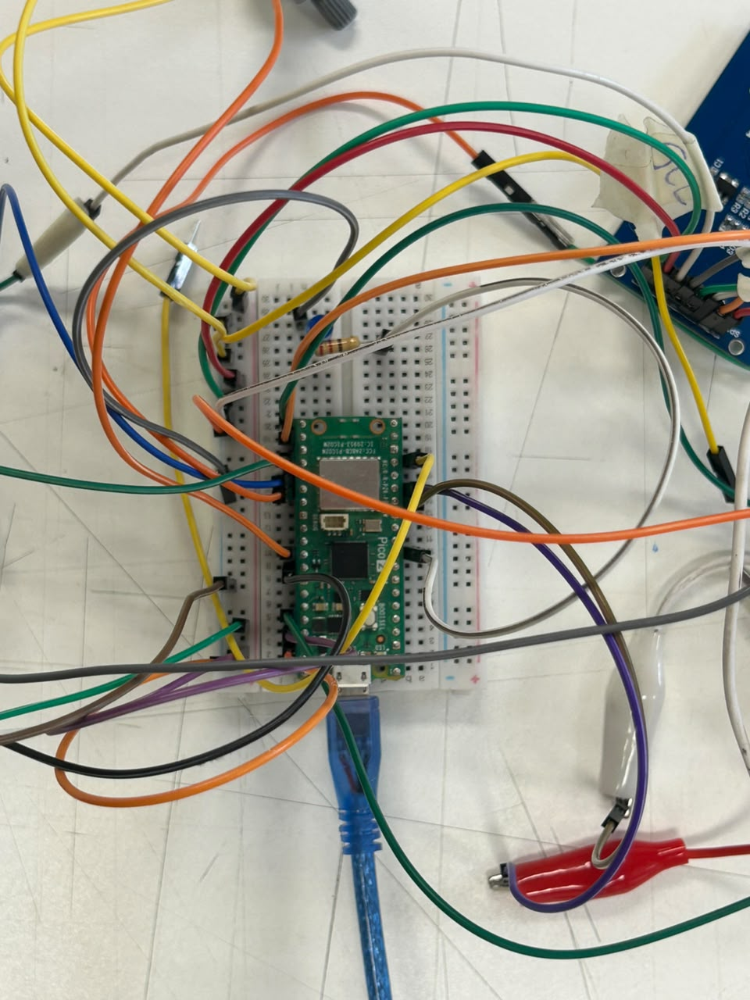
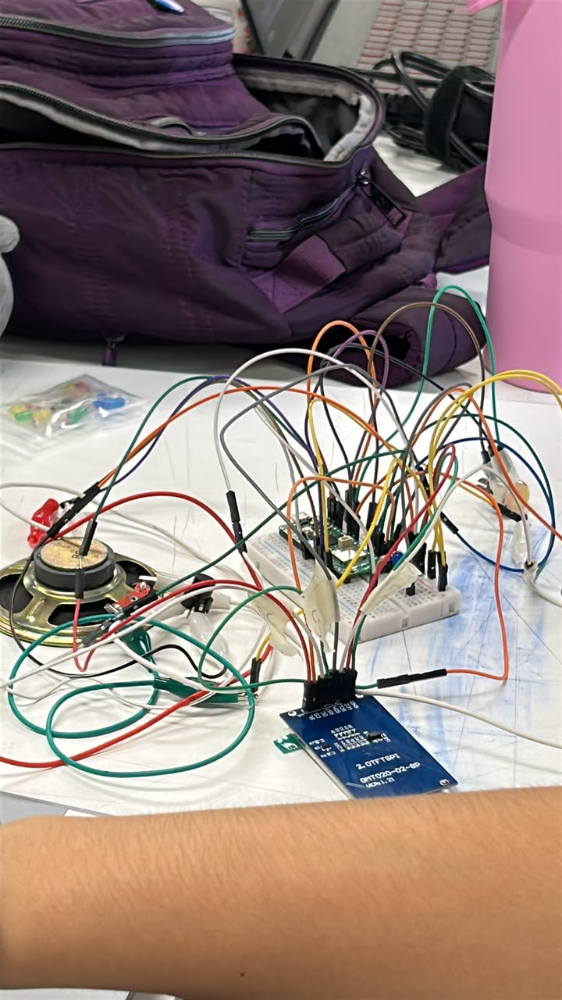

# sesion-11b

## apuntes sesión
- hoy fuimos arreglando los ultimos detalles de código y físicos de nuestro proyecto, integrando la clase ```botón``` la cual nos realizaba el grupo 02

de igual forma nos costó unir ese código, ya que teníamos uno anterior base, pero de ahí lo fuimos modificando

también realizamos las conexiones de forma física, modificando cosas, ya que las conexiones de la pantalla del wokwi no eran las mismas, porque la pantalla que teníamos no estaba para el wokwi, entonces fuimos cambiando conexiones y probando el código uno a uno mientras conectábamos todos nuestros componentes. Además ya teníamos nuestra caja impresa para llegar y encajar todo




