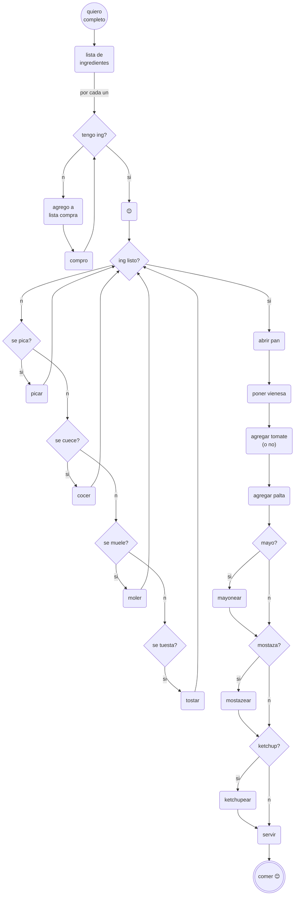

# sesion-13a

2026.11.10

## apuntes sesión

What we're aiming to achieve in the upcoming classes: this week &rarr; properly define the project, session 14a &rarr; work only on the project, session 14b &rarr; presentar el proyecto

---

Con [Isi](https://www.github.com/isiidoraadiiaz) incialmente hicimos un brainstorming de ideas para nuestro proyecto, pero después descubrimos que solo debíamos anotar características del proyecto, en vez de ideas en sí lol. Anotaré las ideas que tuvimos de todas maneras

1. **Herencia sonora**: Un dispositivo para registrar voces, anécdotas y sonidos familiares que pueden conservarse como archivo intergeneracional
1. BeReal pero grabas un sonido en vez de tomar una foto (you also can go back and listen to it)
1. **Compañero de bolsillo**: Un dispositivo sonoro portátil que acompaña a niños en momentos de soledad o incertidumbre. Reproduce cuentos y música. Permite grabar mensajes de personas significativas. Tiene sonidos personalizados para momentos difíciles.
1. **Fan Connect**: Una máquina que permite intercambiar mensajes sonoros entre fans que no se conocen. Grabas un mensaje. Otra persona recibe una señal sonora. Puede responder con su propia grabación.
1. Sampler recorder i.e. tú grabas todos los sonidos para el sampler

---

&darr; Non-negotionables for our project &darr;

SI                  | NO
---                 | ---
Botones             | Madera
Pantalla            | Ensordecedor
Micrófono           | Silencioso
Interactivo         | Autónomo
Handheld            | Fijo
Carcasa             | Cíclico
Modelado 3D         | Sensores de proximidad
Barato              | Control de volumen
Memoria             | -
Parlante pequeño    | -

---

LA DIMENSIÓN SONORA DE LA REALIDAD

- Sesión 13a (**hoy**) &rarr; bill of materials, diagrama de flujo, texto-descripción, máximos 2 propuestas
- Sesión 13b &rarr; descripción total del proyecto, prototipos, pseudocoódigo, wokwi
- Sesión 14a &rarr; ???
- Sesión 14b &rarr; entrega proyecto-03, nota por preguntas cruzadas

Tutorial para [flowcharts](https://www.visual-paradigm.com/tutorials/flowchart-tutorial/)

[Basic syntax](https://mermaid.ai/open-source/syntax/flowchart.html) de mermaid.js

Para nuestro proyecto-03, decidimos quedarnos con la idea (3) **Compañero de bolsillo** y (4) **Fan Connect**

### Referentes para el viernes

- david byrne, [playing the building](https://en.wikipedia.org/wiki/Playing_the_Building)

- kelly dobsonn, [scream body](https://www.youtube.com/watch?v=Ta7rN5TeKzw)

- [dato musical instruments](https://dato.mu/)

### Things mentioned in class

[Dewanatron](http://www.dewanatron.com/info.php?page=about)

[The Magnetic Fields](https://en.wikipedia.org/wiki/The_Magnetic_Fields)

[Summoning Salt](https://www.youtube.com/c/SummoningSalt)

[Boss Fight Books](https://bossfightbooks.com/) &larr; there's an Outer Wilds one :]

## lectura
