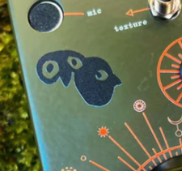
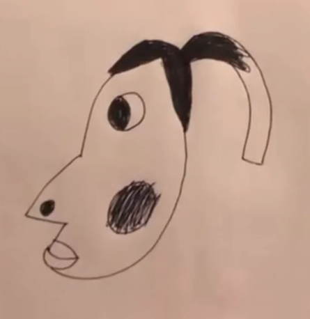

# sesion-14b

2026.11.20

## apuntes sesión

Hoy tuvimos la primera entrega del proyecto-03. Un feedback que recibimos fue que ya que los botones tardan 3 seg en registrar el input, deberíamos colocar en la pantalla (or just somewhere, really) un indicador que muestre esto para evitar creer que el dispositivo no está funcionando

Feedback dado a otro grupo que también es relevante para nosotros: agregar EVERYTHING that may be needed al Wokwi (protoboard, batería, resistencias, etc.)

---

Parte de los criterios de evaluación es hacer preguntas a otros grupos, los cuales fueron asignados por Aarón (grupo-xx le hace preguntas a grupo-xy y grupo-xz). A nosotros (grupo-07) nos asignaron grupo-04 y grupo-03

(dato irrelevante: al grupo-04 les hace preguntas los grupos 06 y 07 six sevennnnn)

### [grupo-04](https://github.com/sz-mada/dis8645-2026-2-procesos-2/tree/main/00-proyecto-3/grupo-04)

Observaciones:

I'm really looking forward to seeing this project come to fruition, la idea principal es muy interesante

Algo que me hace ruido (jaja) de este proyecto, es que como alguien que se autoproclama tone deaf, creo que tendría mucha dificultad con este juego.

Me pregunto si este grupo probó escuchar estas frecuencias? Uno *debería* ser capaz de escuchar entre 20 Hz y 20000 Hz, así que un rango de 200 Hz a 1500 Hz es audible, pero son distinguibles?

También me cabe la duda de cómo le explicarían a alguien cómo distinguir cada sonido, porque a menos que haya una opción de tutorial que diga "este sonido :speaker: significa que xyz", ¿cómo podría el jugador saber diferenciar entre "viene un asteroide, debo esquivar" vs. "hay un enemigo, debo atacar"? Just trial and error?

Me gusta mucho la manera en la que hacen los diagramas de flujo, si no fuese porque disfruto escribir los diagramas en mermaid.js, intentaría hacerlos como este grupo

"nuestro juego no está adaptado para tus necesidades" is really funny for some reason man

Los sonidos (según el Wokwi) son mucho más distinguibles de lo creí, good thing

Preguntas de otra gente:

- ¿Por qué los enemigos solo vienen de dos direcciones? ¿Por qué no de arriba y abajo también?
  - (can't remember their answer, sorry :&#8203;/)
- ¿Cómo diferencio el sonido entre un asteroide y un enemigo?
  - Trial and error básicamente

### [grupo-03](https://github.com/sz-mada/dis8645-2026-2-procesos-2/tree/main/00-proyecto-3/grupo-03)

Observaciones:

El referente de Fieldtone – Weaver Handheld se parece al meme de hyperpigmentation :sob:

ngl si bien también me gusta la premisa de este proyecto, como que no me causa nada? No hay nada que me de curiosidad como para preguntar, solamente lo pienso como wow que cool.

Actually, nevermind. Entiendo que cada perilla representa una especie (mamífero, ave, anfibio, insecto), pero ¿cómo diferencio entre norte, centro y sur? ¿Estará en la carcasa o en el desplegable?

Creo que si van por mostrar íconos de los animales en cada opción de cada perilla, de cierta manera responderían a mi pregunta

Preguntas de otra gente:

- ¿La perilla de probabilidad no es volumen, verdad?
  - Just explained how probability works
- ¿Han tenido algún problema con la Raspberry en sentido de la superposición de los sonidos?
  - No de momento. Peor de los casos, necesitan una Raspberry adicional

---

Byte es con mayúscula, bit es con minúscula
