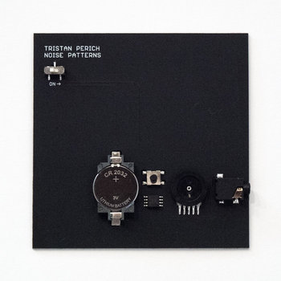

# sesion-11b

## apuntes sesión

Revisamos y hablamos de la solemne 2

### Referencias para proyecto-03

1. [Grabadora con pedales](https://www.instagram.com/p/DfaTux9HEci/)
2. [Textiles sonoros](https://www.instagram.com/p/Dc4FFKNvDS3/)
3. [Motor Drone](https://www.instagram.com/p/Dcy5DkVsHMi/)
4. [Analog Television](https://www.instagram.com/p/Db8YyPPRhcb/)
5. [Sinte + Microcontrolador](https://www.instagram.com/p/Dd_fMOKOELP/)
6. 

 

## encargos

1. Leer el texto de schafer y escribir un párrafo en la bitácora donde describan un sonido que les llame su atención. Nombrar el sonido, elaborar como aparece, intentar describir como suena y sus aspectos culturales

### Texto

- El silencio no existe

    - 

- "En acústica, la suma es igual a una diferencia."

    -

- "En una sociedad aural todos los sonidos son importantes, aún cuando   apenas se los alcance a oír casualmente."

    -

- " un hombre camina por la nieve. Se puede saber la   temperatura a partir del sonido de sus pasos. Es una forma distinta de   percibir el medio ambiente"

    -

- "Algunos sonidos son tan únicos que una vez que uno los oye jamás   podrá olvidarlos: eI aullido de un lobo..."

    -

- "EI ser humano visual tiene instrumentos para ayudar a retener las   memorias visuales (pinturas, libros, fotografias). ¿Cuál es eI   dispositivo para retener memorias aurales?   **La repetición.**"

    -

 

### Sonido:

- Nombre: Apertura de lata

- Descripción: Este sonido aumenta de forma progresiva hasta llegar a un punto máximo en el que se _"fractura"_ el material, sonando similar a gas saliendo. El sonido en general no dura más de 2 segundos. 

- Aspectos culturales: Posee una carga cultural negativa, existen 2 tipos de situaciones en las que comunmente existe este, cuando se abre una cerveza y cuando se abre una bebida azucarada

### Parte #2

- [Tristan Perich](https://www.tristanperich.com/)

    - 
    
    > En este trabajo Tristan Perich trabahó con el concepto de "_pseudoaleatoriedad_", logrando un aproximado de 16 millones de números que generan ondas sonoras
    
    >

- [Christine Sun Kim]()

    - Artista nacida sorda, busca visibilizar su experiencia al mundo, ya que constantemente se invisibiliza a la comundad sorda. Ella plantea que el texto es el primer punto de encuentro entre personas oyentes y sordas, por lo que es una manera de transmitir su sentir y como segundo punto está el uso de la lengua de señas estadounidense (ASL)
    
    - 

- [BONUS: Loud Objects - Noise Toys](https://loudobjects.bandcamp.com/album/noise-toys)

## lectura
