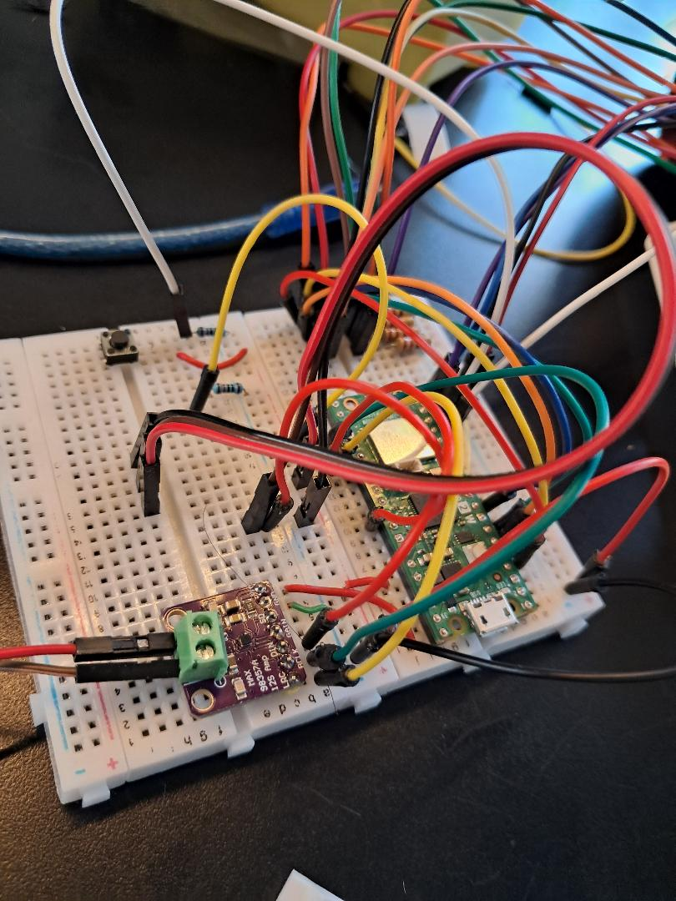
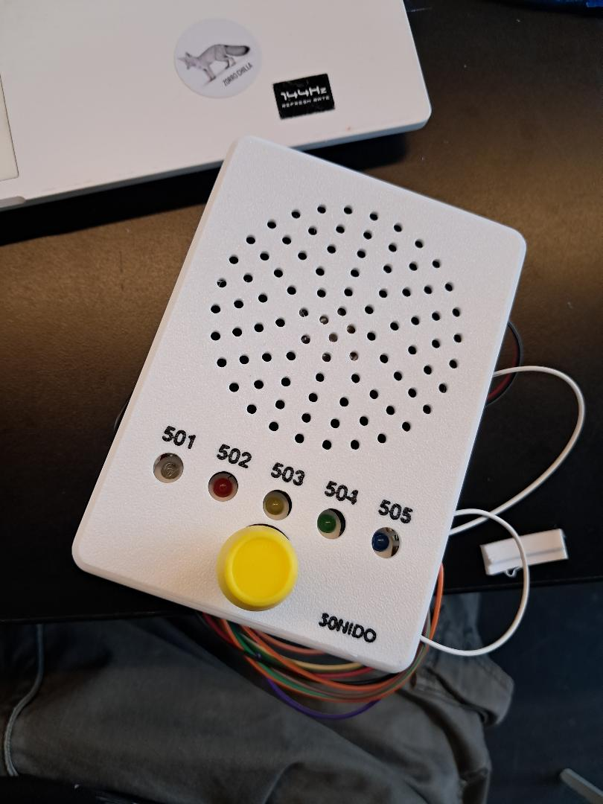
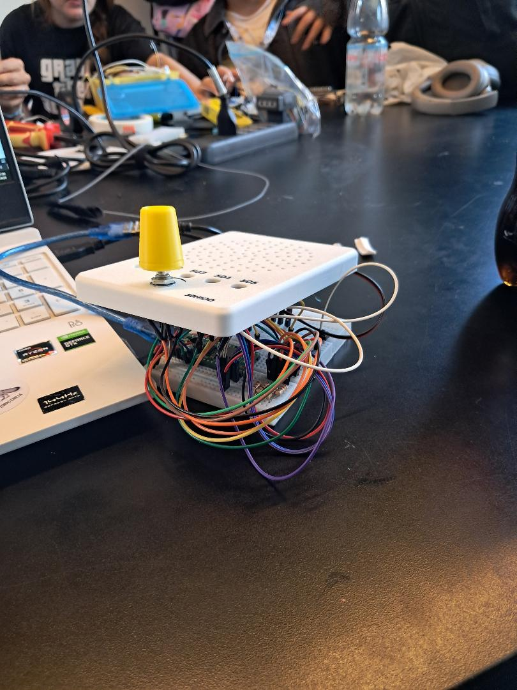

# sesion-11b

## apuntes sesión

Gracias a la extensión de plazo otorgada por los profesores utlizamos el tiempo extra para poder realizar el prototipo 100% en físico y si es posible realizar una carcasa para 50n1d0

Un elemento importante que se re-definio hoy fue eliminar la edición de sonidos dentro de la máquina, ya que es aumentar la cantidad de trabajo a realizar y tenemos el tiempo en contra

 

seudo-código
Inicia la máquina

suena sonidoPrendido.h

se define los parametros inciales de la máquina, es decir, que se enciende led 0 y sonido 0 queda pre-seleccionado

lectura inicial de volumen [potenciometro en GPIO XX]

si presiona botonLoop y se habilita el modo loop

se identifica reproduciendo el sonidoLoopActivado.h y cambiando el led encendido a parpadear

al momento de seleccionar uno de los 5 sónidos, este se reproducira en un bucle que acabará solo si es presionado el botonLoop nuevamente

Si se gira la perillaEncoder se podrá seleccionar uno de los 5 sonidos que estan asociados al igual que los leds con valores de 0 a 4, al llegar a un extremo se mueve al otro extremo como un circulo
todas las instancias de lucesita y sonido estan relacionadas directamente, es decir que led 0 y sonido 0 estan vinculados
Si se presiona botónSelector se reproduce el sonido en el que se encuentre

si se gira la perillaVolumen, el valor asociado cambiará el volumen

## encargos

## lectura
