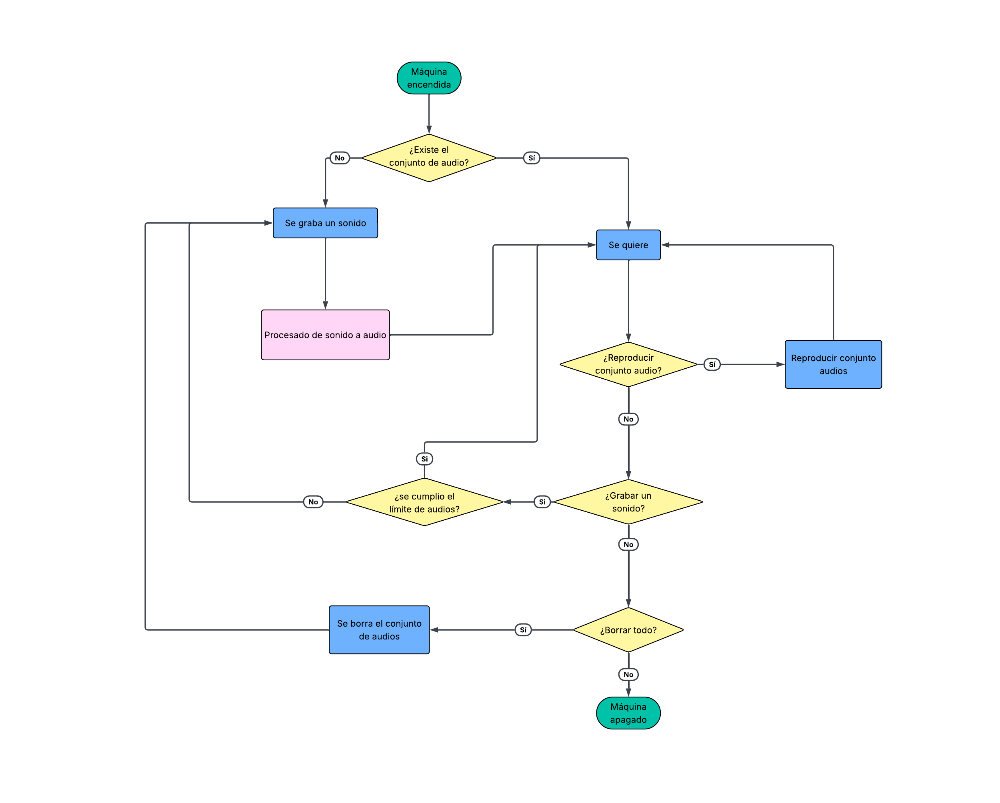

# sesion-13a

## apuntes sesión

> La idea central consta de una antítesis de _autotune_, en este, existen los errores pero no el `CTRL Z`, es por ello que cada cambió que se guarda es duradero, si se quiere descartar algo, se hace con todo el conjunto.
>
> En este sampler se ingresa, grabaciones mediante un micrófono, estas pueden ser editadas en frecuencia, velocidad, ventana de ejecución, etc. Lo importante es que cada vez que se guarda la configuración del audio elegido, este queda añadido a un **banco** de audios (que funciona mediante una tarjeta microSD), en este banco de audios, todo suena al mismo tiempo, es decir que cada grabación se superpone sobre las demás. Es relevante mencionar que estos cambios no son editables o poseen la capacidad de borrarse parcialmente, el único modo de borrar los errores, es eliminar todo
>>
>> esto fue una idea preliminar

- Punto a considerar:

	-¿Existe un botón para reproducir un audio sin poder alterarlo? similar a una previsualización

<br>



### seudocódigo

Previa:

tenemos 3 conceptos
a. sonido: Corresponde a la grabación en bruto realizada con el micrófono 

 > Es nuestro pez recién capturado

b. audio: Es el `sónido` ya _procesado_, es decir que se le aplicaron diversas modificaciones

 > Acá nuestro pez pasa a ser un pescado

c. conjuntoDeAudio: una vez que se proceso el `sonido` y se guardan los cambios, se _suma_ al resto de los audios

 > Nuestro pescado ya se cocinó, ahora ya no se puede volver a hacerlo crudo


<br>

1. Se inicia la máquina con el interruptor

```cpp

bool interruptorEncendido; // valor asociado a la lectura del switch o botón 
bool funcionamientoMaquina; // depende del interruptorEncendido
// si es true la maquina realiza sus funciones con normalidad
// si es false, la maquina debe tener un led encendido que indica que recibe corriente

if (interruptorEncendido){
funcionamientoMaquina = 1;}

```

2. Se consulta si hay "conjuntoDeAudios" 

3. ...

## encargos

## lectura

Continuando con el capitulo de la _wawa Manchester_. Entendí lo siguiente sobre el contexto en el que nació esta máquina:

Como se ha visto en todos los otros capitulos, las máquinas computacionales tienen su origen en calcular, por que la vida se basa en eso practicamente xd. Es por ello que despues de la 2da GM, el problema con las máquinas no era que fueran lentas o les faltara capacidad, era la optimización del tiempo. Por ejemplo la ENIAC debía recablearse para poder la tarea.

Desde esta base nace la necesidad de poder cambiar las funciones, tocando lo menos posible el hardware de la máquina.

En este contexto y en la Universidad de Mánchester, Frederic Calland, Tom Kilburn y Geoff Tootill desarrollaron una solución aprovechando componentes de radar sobrantes de guerra, los cuales estaban en desuso por el fin de esta, el elemento que fue la joya de la corona fue el tubo Williams-Kilburn. En esta investigación descubrieron que un tubo CRT común podía alamcenar electricidad en su pantalla durante una fracción de segundo, si se refrescaba constantemente funcionaba como una memoria electrónica
