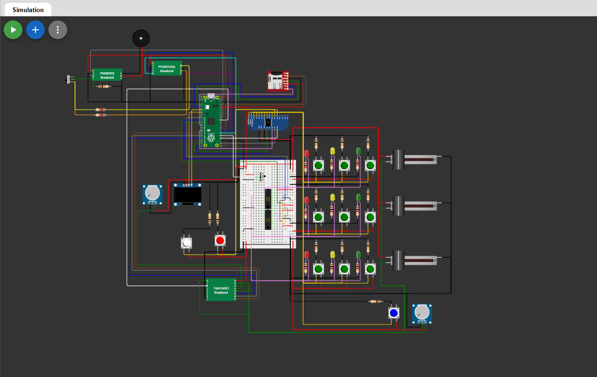
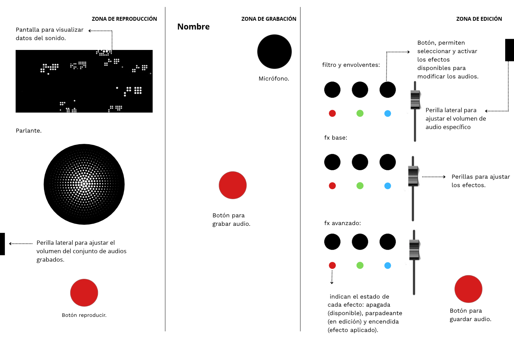

# sesion-14a

## apuntes sesión

https://wokwi.com/projects/481142445555191809

> _Finalmente tenemos una versión donde vemos conexiones y funcionamientos, por la imposibilidad de representar la lógica pensada para el sónido se utilizará el `Serial Monitor` para representar lo que ocurre en cada sección y proceso, es importante mencionar que se tuvieron que realizar algunos IC para poder representar funcionamientos, tales como el INMP441, que corresponde a un micrófono_

Ya con gran parte del proyecto definido se desarrollo un prototipo en Wokwi que nos facilite el entendimiento del funcionamiento, además de ayudar a ver detalles que no contemplamos

 

Otro punto clave fue entender como iba a desarrollarse la interfaz 

Es importante entender como el usuario interpreta las cosas que se muestran

## encargos

## lectura

Le di varias vueltas a los capítulos que he leído, la verdad es que me sigue impresionando como el 90% de los elementos electrónicos que nos rodean existen por 2 motivos, la necesidad humana de calcular operaciones de manera más eficiente y la guerra...

Esta dualidad es curiosa, porque con el pasar de los años, diversos sectores ven las guerras como simples números e ignoran a las personas que hay detrás, ya sean victimas y victimarios, pero bueno, volvamos a lo que nos convoca... Obviamente el pensamiento critico, porque algo importante de esta lectura no solo es aprender del inicio de las máquinas computaciones, si no que tambien comprender que vivieron las personas detrás de todos los avances, incluso que vivieron sus amigos y familias que apoyaron a estas personas. Ya que varios casos se lograron desarrollar únicamente por el apoyo entre personas, incluso en un capítulo se hace hincapié en esto, como a las universidades y empresas solo les interesa el dinero y la imagen pública que se logra con las buenas ideas, solo que pocas veces se busca hacer surgir estas ideas. 

Igualmente no debemos solo apoyar las ideas que tienen forma de ser el mayor descubrimiento, porque incluso el fallar es un aprendizaje, propio y para el resto, todo conocimiento es necesario y es nuestra labor como personas aportar a esta labor de aprender y cuestrionarnos nuestro mundo.

Creo que finalmente llego al fin, solo quería aprovechar la instancia de escribir cosas que estuve pensando mientras leía este libro, el que me dio dolores de cabeza por no entender el íngles en su totalidad, pero sirivio para entender varias cosas como se podran dar cuenta.

Hasta la próxima sesión...

¿O no?