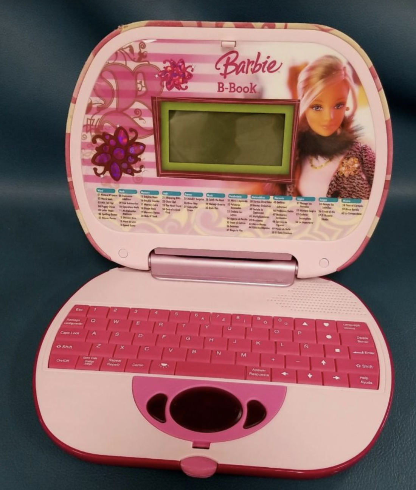
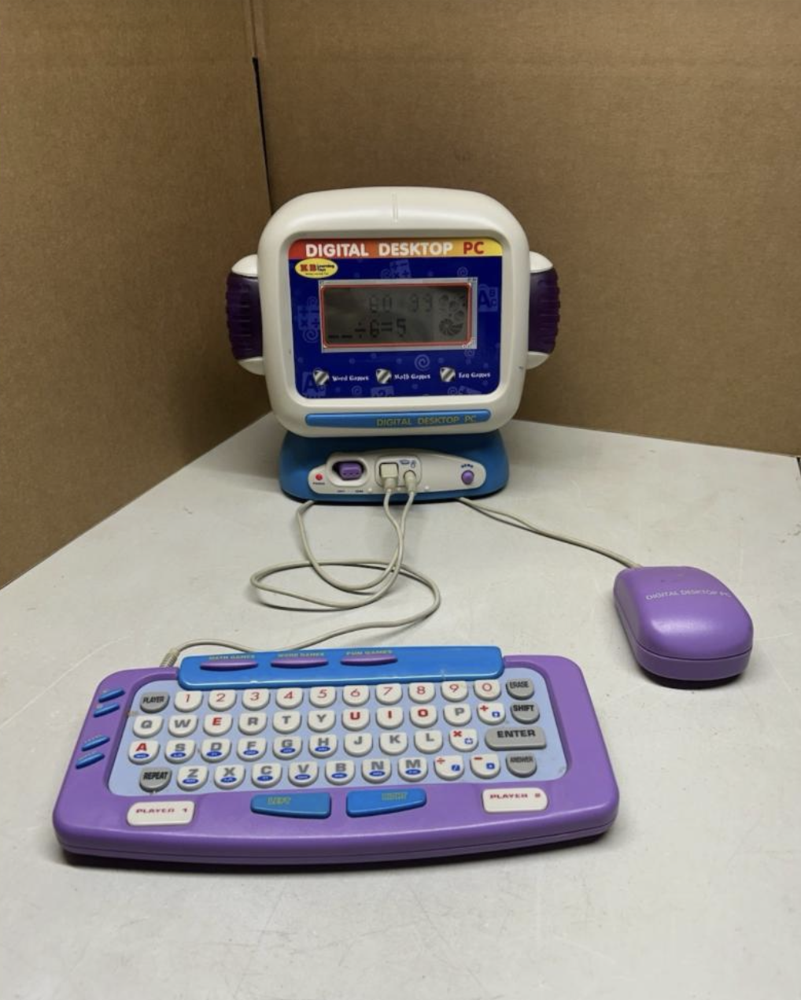

# sesion-10b

## apuntes sesión

En esta clase aún estábamos complicadas con poder desarrollar el proyecto porque teníamos muchas dudas y no nos convencía las primeras ideas que tuvimos. Hasta que con una lluvia de ideas y recordando llegamos a un proyecto que nace de recordar los primeros acercamientos que tuvimos a la tecnología durante la infancia. En esa época, muchos dispositivos utilizaban pantallas simples, botones físicos y sonidos electrónicos para crear pequeños universos interactivos.

No necesitaban tener grandes capacidades ni funciones complejas. Bastaba con presionar un botón para descubrir algo nuevo, cambiar una expresión, recibir un mensaje o comenzar un juego. A partir de esta idea, quisimos recuperar esa experiencia de exploración y descubrimiento, reinterpretándola a través de una máquina de acompañamiento emocional. La intención es que el dispositivo no sea solamente una herramienta, sino también un objeto que invite a interactuar, jugar y explorar las emociones de una manera sencilla.

### ¿En qué consiste nuestro proyecto?
"La Máquina de Emociones" es un dispositivo interactivo que permite explorar distintas experiencias a través de una pantalla OLED, dos perillas y dos botones.

Su funcionamiento se organiza en tres modos principales:
- Modo 01 — Mensajes: presenta cinco mensajes motivacionales que se pueden recorrer utilizando una perilla.
- Modo 02 — Emociones: muestra cuatro emociones representadas mediante rostros pixelados: felicidad, tristeza, enojo y calma. El usuario puede cambiar entre ellas utilizando una perilla.
- Modo 03 — Juego: incorpora un minijuego en el que un personaje debe saltar obstáculos. La dificultad cambia según la emoción seleccionada anteriormente.
La idea es que cada interacción tenga una respuesta visual y que el usuario pueda desplazarse entre distintas experiencias mediante controles físicos.

### 3. Nuestro referente: Digital Desktop PC

Nuestra principal inspiración son los computadores de juguete de los años 2000, dispositivos que imitaban la apariencia de un computador convencional, pero que adaptaban sus funciones para ofrecer experiencias más sencillas y accesibles.

Como referente principal elegimos el Digital Desktop PC de KB Learning Toys.

Nos llamó la atención cómo estos juguetes combinaban una pantalla LCD, botones físicos, un teclado y gráficos de baja resolución para crear distintas actividades de aprendizaje y entretenimiento.

El computador organizaba sus actividades en tres categorías principales:
- Word Games.
- Math Games.
- Fun Games.
Nos interesó especialmente esta organización porque permitía acceder a distintas experiencias dentro de un mismo dispositivo.

### 4. ¿Qué rescatamos del referente?

A partir del análisis del Digital Desktop PC, identificamos algunos elementos que queríamos incorporar a nuestro proyecto.

Decidimos mantener la estructura visual de un pequeño monitor y separar los controles físicos de la pantalla, utilizando el recurso del teclado como inspiración para organizar los botones y las perillas.

También quisimos conservar la idea de tener tres modos de interacción, reinterpretando las categorías originales según el objetivo de nuestra máquina: mensajes, emociones y juego.

Más que reproducir el funcionamiento del computador original, buscamos rescatar su lenguaje visual y la manera en que invitaba a explorar mediante acciones simples.

### 6. ¿Cómo funciona el computador por dentro?

Para comprender mejor nuestro referente, investigamos cómo estaban construidos estos computadores de juguete y qué componentes permitían su funcionamiento.

Identificamos tres sistemas principales:

1. Placa base central (PCB) y chip Blob

La PCB (Printed Circuit Board) es una placa electrónica que conecta y organiza los distintos componentes del dispositivo.

En algunos juguetes encontramos un componente conocido como Blob o Chip-on-Board (COB). Corresponde a un circuito integrado montado directamente sobre la placa y cubierto por una resina epoxi negra que lo protege.

Este circuito se encarga de procesar las instrucciones del dispositivo, por ejemplo:
- Interpretar las pulsaciones de los botones.
- Ejecutar los juegos y actividades programadas.
- Controlar los gráficos de la pantalla.
- Gestionar sonidos y respuestas del juguete.
  
2. Sistema de pantalla (monitor)

El computador utilizaba una pantalla LCD pasiva, ubicada dentro de una carcasa plástica que imitaba la forma de un monitor convencional.

Para transmitir la información entre la placa principal y la pantalla se utilizaban cables planos (Ribbon Cables), que permitían conectar ambos componentes mediante múltiples contactos eléctricos.

3. Conectividad y puertos

Los controles físicos necesitaban comunicarse con la placa principal para transmitir las acciones del usuario.

En este tipo de dispositivos, el teclado podía funcionar mediante una membrana con contactos conductores que detectaban las pulsaciones. Por otra parte, el mouse se conectaba mediante un puerto físico que permitía transmitir señales de movimiento y clic.

Esta investigación nos ayudó a comprender que, detrás de una interfaz aparentemente sencilla, existe un sistema electrónico que recibe información, la procesa y genera una respuesta visual o sonora.
7. Funcionamiento de nuestro sistema
Una vez definido el concepto y los elementos principales del dispositivo, comenzamos a organizar cómo funcionaría internamente nuestra máquina.

Para ello, identificamos los componentes electrónicos que utilizaríamos y las acciones que tendría que realizar cada uno.

### 5. Materialidad e interfaz

Para la construcción del dispositivo planeamos realizar una carcasa mediante impresión 3D, manteniendo las formas características de los computadores de juguete que utilizamos como referencia.

En cuanto a la interfaz, decidimos trabajar con una estética pixelada, inspirada en los gráficos de baja resolución de estos dispositivos.

La pantalla OLED monocromática nos permite representar mensajes, expresiones faciales y elementos gráficos del minijuego utilizando píxeles.

La intención es que tanto la materialidad como la interfaz refuercen la sensación de estar interactuando con un pequeño computador de juguete.

## encargos

## lectura
