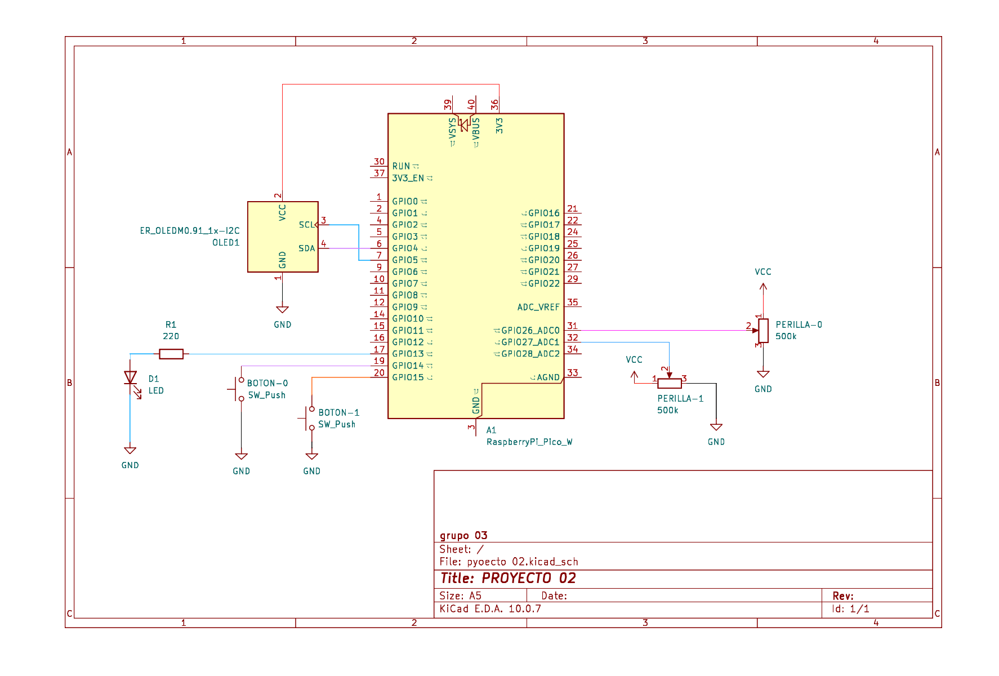
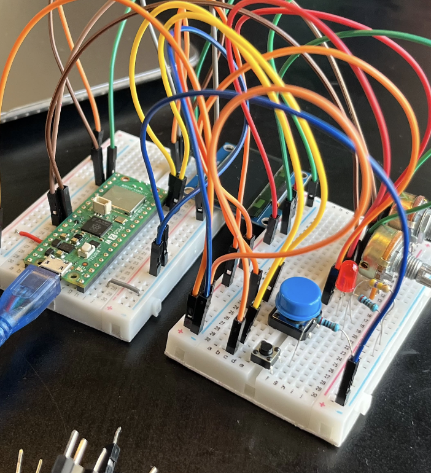
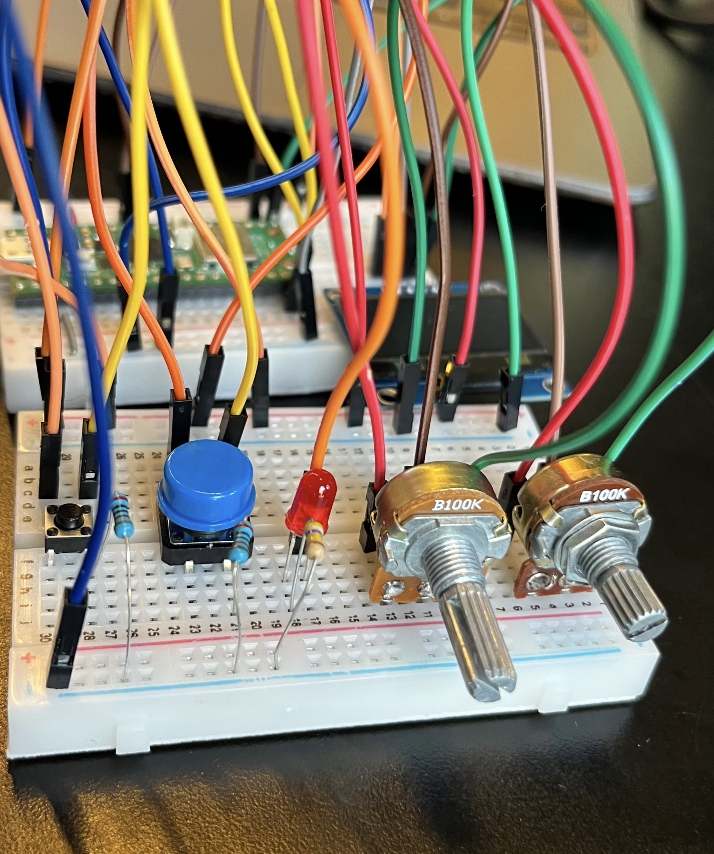
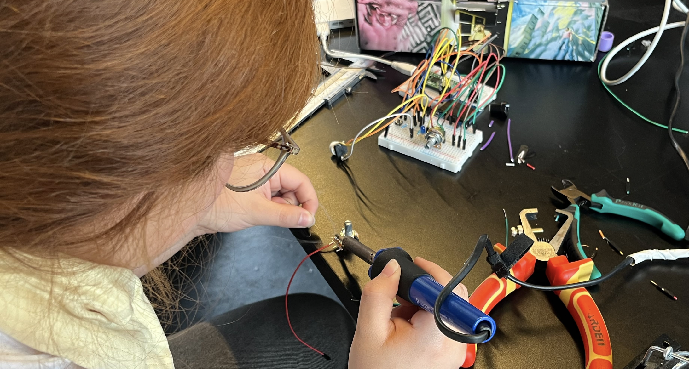
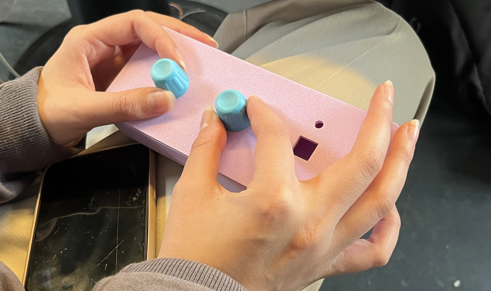
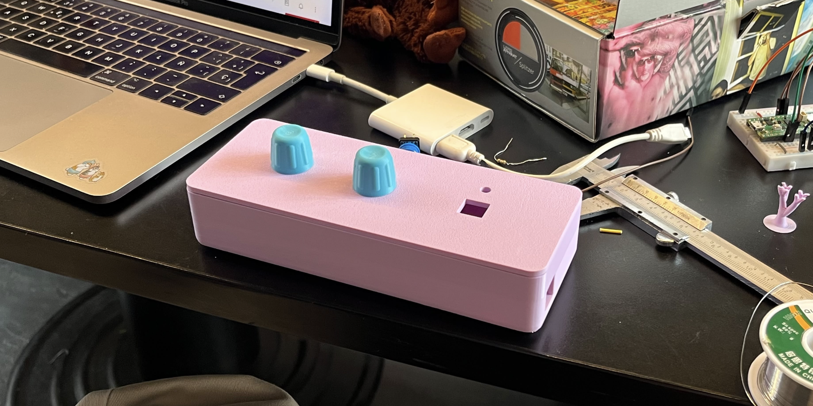
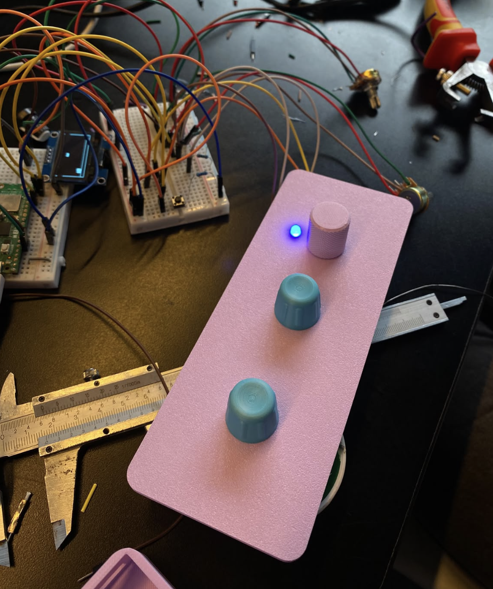

# sesion-11b

## apuntes sesión

### Desarrollo del código y pruebas del prototipo

Durante esta clase nos enfocamos en terminar las partes que aún estaban pendientes del código para poder integrar todos los componentes de la Máquina de Emociones. Ya teníamos listas las clases `Perilla.h` y `Perilla.cpp`, mientras que el Grupo 04 nos compartió los archivos `Botones.h` y `Botones.cpp`, por lo que pudimos avanzar con mayor rapidez y dividir las tareas entre todas.

\- Nos organizamos para trabajar en paralelo: Mai se encargó de las perillas, Marce de buscar y desarrollar el minijuego (`Juego.h` y `Juego.cpp`), Cata trabajó en los mensajes, emociones y rostros pixelados (`Rostros.h` y `.cpp`), mientras que yo me encargué de la pantalla, el LED y de corregir el nuevo orden de los modos en el diagrama de flujo.

Durante la semana también había avanzado el esquemático en KiCad, considerando los componentes que habíamos definido para el proyecto. 

### BOM: Lista de componentes

| **Control / Elemento** | **Componente** | **Especificación** | **Acción** |
|---|---|---|---|
| Botón de encendido/apagado | Botón pulsador | Momentáneo, conectado a GP14 | Alterna entre el estado encendido y apagado de la máquina. |
| Botón de salto | Botón pulsador | Momentáneo, conectado a GP15 | Permite ejecutar el salto del personaje durante el juego. Solo funciona en el modo 03. |
| Perilla de selección de modo | Potenciómetro | Tipo lineal, conectado a GP26. Tres rangos de selección. | Permite cambiar entre los tres modos de pantalla: Emociones, Mensajes y Juego. |
| Perilla de selección emocional | Potenciómetro | Tipo lineal, conectado a GP27. Cuatro rangos de selección. | Permite seleccionar una de las cuatro emociones disponibles. |
| Perilla de selección de mensajes | Potenciómetro | Tipo lineal, conectado a GP27. Cinco rangos de selección. | Permite navegar entre los cincos mensajes disponibles. |
| Luz indicadora | LED + resistencia 330k | LED conectado a GP13, con resistencia limitadora de corriente. | Se enciende al seleccionar el modo 03, indicando que el juego está activo. |
| Pantalla | Pantalla OLED | Controlador SSH1106, resolución 128 × 64 píxeles. | Presenta las expresiones, mensajes y elementos gráficos del juego. |
| Unidad de control | Microcontrolador | Raspberry Pi Pico 2 W, chip RP2350, 150 MHz, 520 KB RAM y 4 MB flash. | Procesa las entradas de los botones y potenciómetros, controla los modos de funcionamiento y gestiona las respuestas visuales de la pantalla y el LED. |

Algo que me preocupaba era que las partes más complejas, especialmente el juego y las emociones, no alcanzaran a estar listas. Sin embargo, logramos terminar el código y probarlo en Wokwi, donde funcionó correctamente. También avanzamos en los diagramas de flujo con ayuda de Seba, quien nos recomendó utilizar Mermaid. Esta herramienta nos permitió construir los diagramas mediante código y ahorrar bastante tiempo. Realizamos el diagrama de experiencia de usuario y los diagramas correspondientes a las dos perillas y los dos botones.

## Pruebas físicas y ajustes

Con el código funcionando en Wokwi, comenzamos a llevarlo a los componentes físicos. Armé la protoboard, pero en el primer intento no conseguimos que funcionara. Seba nos aconsejó comenzar nuevamente desde cero y me ayudó a ordenar mejor las conexiones, mientras Mai y Cata continuaban revisando el código y Marce terminaba el diseño de la carcasa para impresión 3D.

- Después de reorganizar la protoboard, conseguimos conectar los componentes al código, pero todavía teníamos problemas con la pantalla OLED. Tuvimos que realizar algunos ajustes en el código hasta conseguir que funcionara correctamente.
  
- También detectamos que las perillas eran demasiado sensibles, por lo que las reemplazamos por otros potenciómetros. El LED tampoco encendía debido a una equivocación en los pines definidos en el código, que finalmente corregimos.

Una vez solucionados estos detalles, pudimos probar el funcionamiento completo de la máquina y comprobar que los modos, las perillas, los botones, la pantalla y el LED respondían correctamente. Fue un momento importante porque conseguimos integrar todas las partes que habíamos trabajado por separado.

## Armado de la carcasa y cierre

Para finalizar, comenzamos a preparar el montaje de los componentes dentro de la carcasa. Sin embargo, tuvimos algunas complicaciones porque se nos estaba acabando el tiempo y también el filamento para la impresión 3D.

Intentamos preparar las extensiones de los componentes, soldar las conexiones y ajustarlas a la carcasa, pero algunas medidas no coincidían y ya no teníamos material suficiente para corregirlas. Por este motivo, decidimos presentar el proyecto con el modelado 3D de la carcasa, aunque nos habría encantado mostrar el prototipo completamente armado.

Reflexión: Pensé que esta etapa sería mucho más complicada, especialmente por la cantidad de código que faltaba y los problemas que podían aparecer al conectar los componentes físicos. Sin embargo, logramos resolverlos trabajando en equipo, distribuyendo las tareas y ayudándonos entre todas. Me quedé muy orgullosa de haber conseguido que el código funcionara completamente, aunque nos faltó tiempo para ver el resultado final dentro de la carcasa.

## encargos

## lectura
