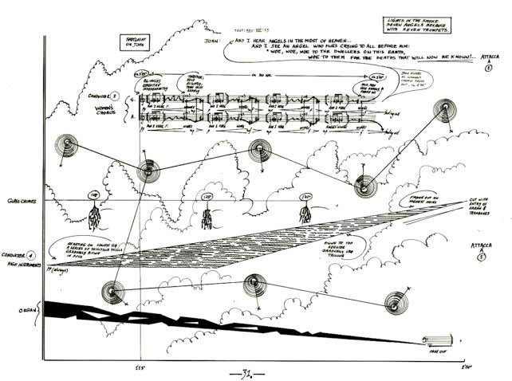
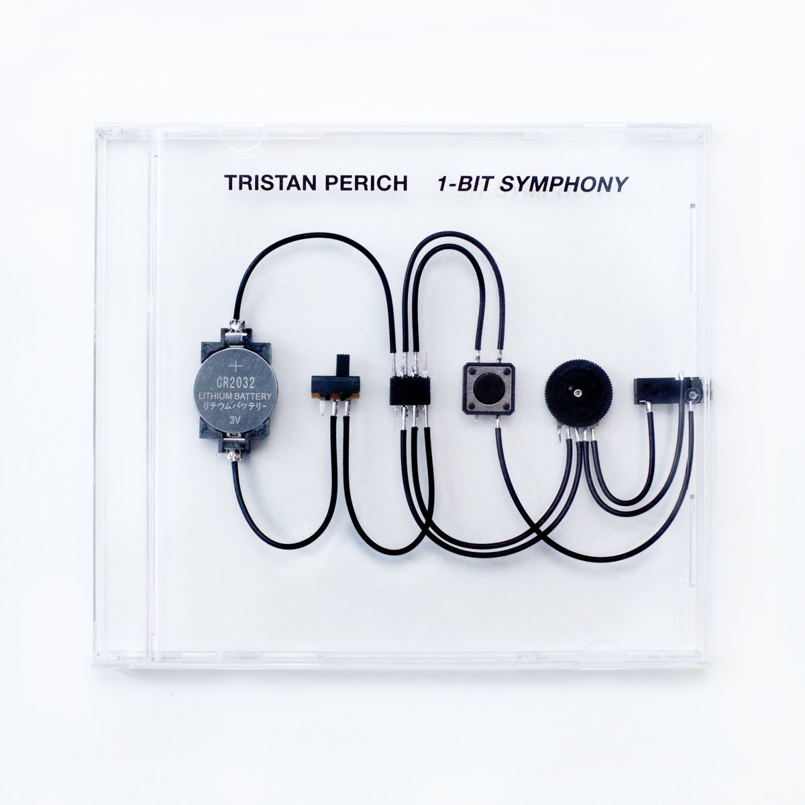
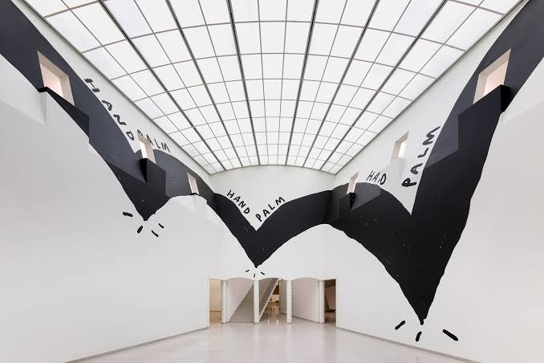

# sesion-12b

## apuntes sesión

proyecto-03

- entregables por cada sesión y van a ser evaluados
- se va a normar la salida, tiene que tener un parlante, da lo mismo la cantidad de perillas o botones, puede tener o no tener pantalla

## encargos

leer el texto de schafer y escribir un párrafo en la bitácora donde describan un sonido que les llame su atención. Nombrar el sonido, y elaborar como aparece, intentar describir como suena, y su relación cultural 
investigar el código del grupo 01
revisar 1 obra de tristan perich y 1 de christine sun kim

### 01. Nunca vi un sonido — R. Murray Schafer
Ideas principales de la lectura

Schafer propone cuestionar el predominio de la visión sobre los demás sentidos, invitándonos a prestar mayor atención a nuestra experiencia auditiva. Plantea que el sonido es algo dinámico y cambiante, que nunca se reproduce exactamente de la misma manera. También destaca su capacidad para evocar recuerdos, generar sensaciones y llegar a espacios que la percepción visual no alcanza. A diferencia de las imágenes, los sonidos son difíciles de conservar, por lo que la repetición cumple un papel importante en la construcción de la memoria auditiva.

### 02. Tristan Perich — 1-Bit Symphony (2010)

1-Bit Symphony es una composición electrónica dividida en cinco movimientos, almacenada y reproducida mediante un microchip integrado en una caja de CD. A diferencia de un disco convencional, la música no está grabada como un archivo de audio, sino que es generada en tiempo real por un circuito electrónico programado y ensamblado manualmente por el artista. Al conectar los audífonos, el dispositivo interpreta la composición y transforma las instrucciones digitales en sonido.

### Christine Sun Kim — A String of Echo Traps (2019)

A String of Echo Traps es una obra de la artista Christine Sun Kim que explora el sonido a través de recursos visuales, gráficos y lingüísticos. Mediante una animación digital, la artista trabaja con la idea del eco, tanto como fenómeno acústico como metáfora de la comunicación y la repetición. Su práctica combina elementos de notación musical, escritura, infografía y lengua de señas americana (ASL), cuestionando la manera en que la sociedad comprende y representa el sonido desde una perspectiva principalmente auditiva.

## lectura
