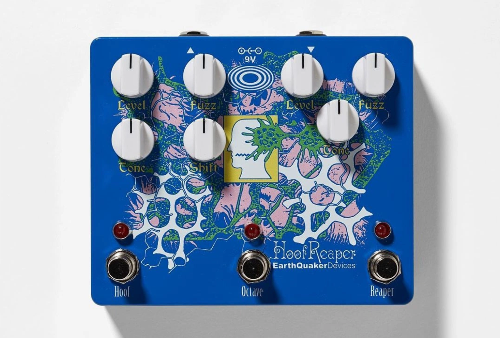
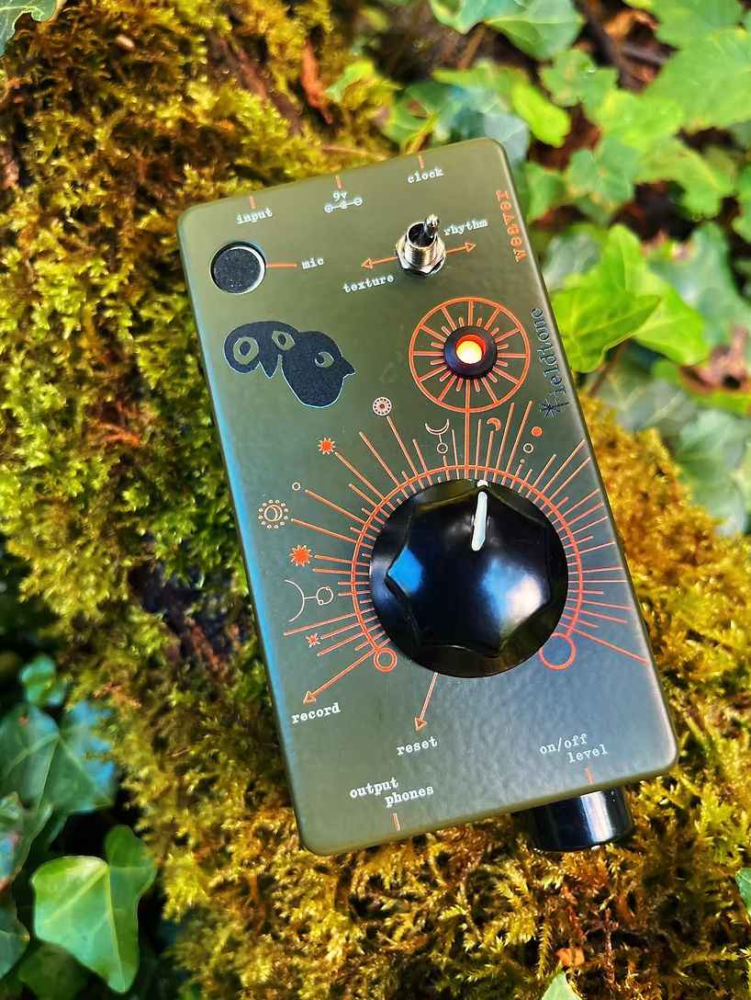
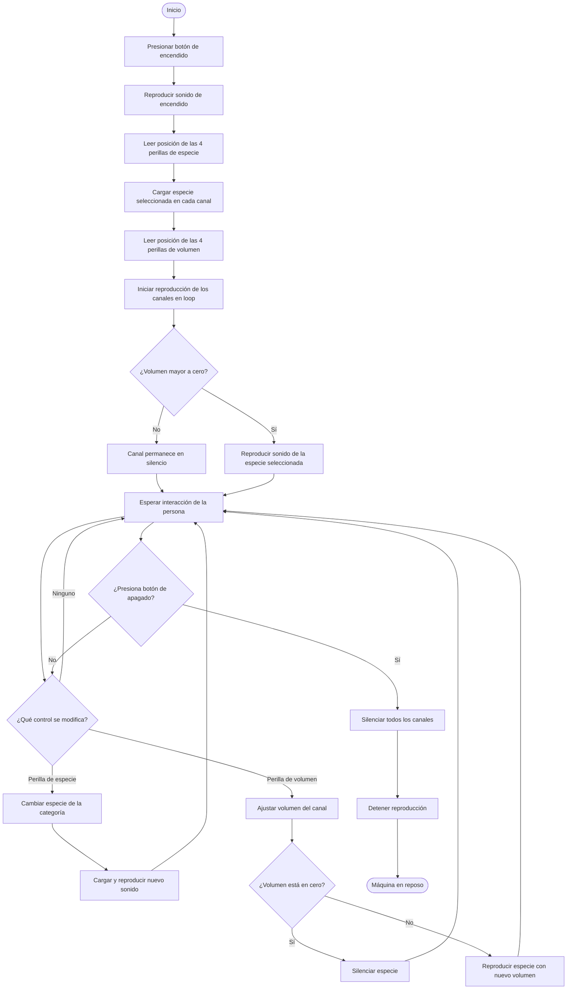

# sesion-13a

## apuntes sesión
tenemos como idea trabajar con el concepto de paisaje sonoro y ritual.

partimos pensando en la idea de hacer un hidrófono para escuchar el agua, inspirándonos en la cultura mapuche y su cosmovisión, particularmente en los aspectos ceremoniales, considerando cómo tienen figuras de protección de los elementos, a quienes se les pide permiso para acceder a ellos. 

luego de reflexionar en cuanto a esta idea, y también gracias a las correcciones de misa, llegamos a la conclusión de que es delicado utilizar conceptos de una cosmovisión que no nos pertenece, y además, el hidrófono actúa más como un sensor que una máquina. por lo que decidimos replantearnos el concepto y funcionamiento, llegando a la idea de tomar estas relaciones con la naturaleza y el entorno, a través de rituales, como inspiración.

por lo que planteamos que nuestra máquina sea un archivo de sonidos cotidianos (del día a día y de biodiversidad) de Chile, a los cuales se puedan acceder a través de la pausa y la contemplación.

hasta el momento, tenemos estos posibles sonidos:

- territorios: viento, lluvia, mar, ríos, bosques y animales.
- vida cotidiana: ferias, transporte, calles, conversaciones y oficios.
- expresiones culturales: música, celebraciones, instrumentos y encuentros comunitarios, con autorización de sus participantes.
- memorias: sonidos del hogar, cocina, juegos, relatos y recuerdos personales.

--------------

para desarrollar el proyecto, profundizamos en las posibles ideas de todos estos sonidos, y llegamos a la que es de nuestro mayor interés y que tiene más peso conceptual: concentrarnos solo en los sonidos de biodiversidad de nuestro territorio, específicamente en las que se encuentra amenazadas y cómo le podemos dar visibilidad a su sonido, existencia, y como consecuencia apelando a su cuidado, ya que no se puede cuidar lo que no se conoce.

### Ecos en extinción
"La máquina permitirá escuchar, activar, silenciar y superponer los sonidos de diferentes animales mediante controles físicos, generando composiciones sonoras que surgen de la interacción entre sus distintas voces. De esta manera, el instrumento funciona tanto como un pequeño archivo de biodiversidad sonora como una herramienta de exploración y composición colectiva."

### funcionamiento
- el instrumento permite construir un paisaje sonoro de manera progresiva.
- la experiencia puede comenzar desde el silencio, incorporando una especie a la vez hasta formar una composición colectiva.
- a medida que se activan nuevas grabaciones, aparecen diferentes ritmos, intensidades y relaciones entre sonidos.
- del mismo modo, al silenciar una especie, el paisaje se transforma. su ausencia modifica la composición, permitiendo reconocer la importancia de cada voz dentro del conjunto.
- esta interacción busca que la persona no sea únicamente una oyente, sino que participe activamente en la construcción y transformación del paisaje sonoro.

### referentes

este sintetizador nos llamó la atención por la distribución de sus controles y la posibilidad de activar y modificar distintos efectos de manera independiente. también nos interesa cómo organiza varios controles en un espacio reducido, manteniendo una relación clara entre cada elemento y su función.

nos interesa la simplicidad de su interacción y el protagonismo de la perilla central, que permite modificar el sonido mediante un movimiento continuo y como esta contiene todos los sonidos. además, nos interesa cómo la gráfica acompaña los controles, utilizando líneas y elementos visuales que ayudan a relacionar el movimiento físico con la modificación del sonido.

### bill of materials (BOM)

| N° | Componente | Descripción / Función | Cantidad |
|---:|---|---|---:|
| 1 | Multiplexor I2C | Permite conectar varios dispositivos I2C utilizando un mismo bus de comunicación. | 1 |
| 2 | Buzzer | Emite sonidos de aviso, como el sonido de encendido de la máquina. | 1 |
| 3 | MAX98357A – I2S Class-D Mono Amplifier | Amplifica la señal de audio digital I2S para reproducir sonidos mediante un parlante. | 1 |
| 4 | Potenciómetros | Permiten seleccionar especies y regular el volumen de cada canal. | 8 |
| 5 | Cables Dupont | Permiten realizar conexiones eléctricas entre componentes. | Según necesidad |
| 6 | Cables Dupont macho-hembra | Conexiones entre pines y módulos electrónicos. | Según necesidad |
| 7 | Cables Dupont hembra-hembra | Conexiones entre pines o módulos con terminales macho. | Según necesidad |
| 8 | Cables Dupont macho-macho | Conexiones en protoboard y otros puntos de conexión. | Según necesidad |
| 9 | Botón pulsador | Permite encender y apagar la máquina. | 1 |

### diagrama de flujo

## encargos

## lectura

En este capítulo, Debord explica cómo la cultura y el arte se han separado de la vida social, convirtiéndose en objetos de contemplación y consumo dentro del capitalismo.
- La cultura busca recuperar una unidad social que se ha perdido, pero para lograrlo debe superar su condición de esfera separada.
- La innovación permite transformar la cultura, mientras que la tradición mantiene las formas del pasado.
- El arte pierde su función como lenguaje común de la sociedad y se convierte en una producción individual y separada.
- Debord plantea que es necesario recuperar la comunicación colectiva a través de experiencias compartidas y no solamente mediante obras artísticas.
- El capitalismo transforma el arte del pasado en una colección de recuerdos que pueden ser exhibidos y consumidos, pero que han perdido su contexto original.

- 1. “La cultura es el lugar donde se busca la unidad perdida”.

- 2. “La afirmación independiente es el comienzo de su disolución”.
