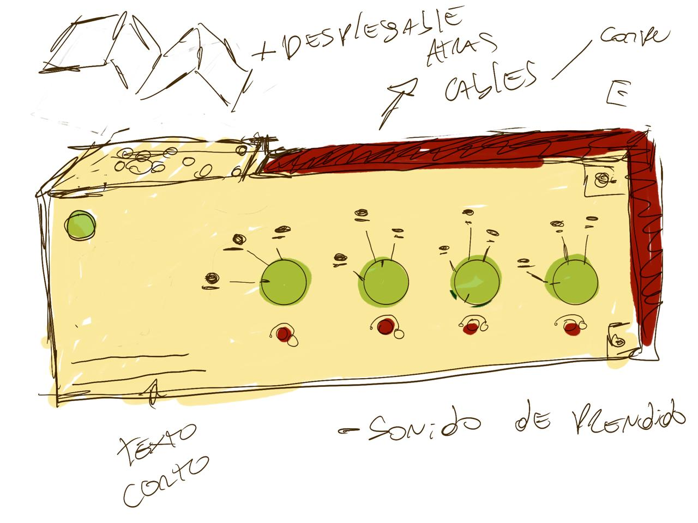
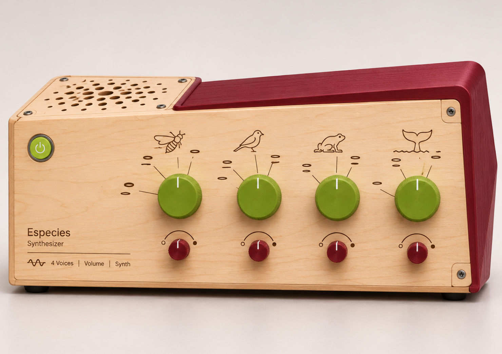
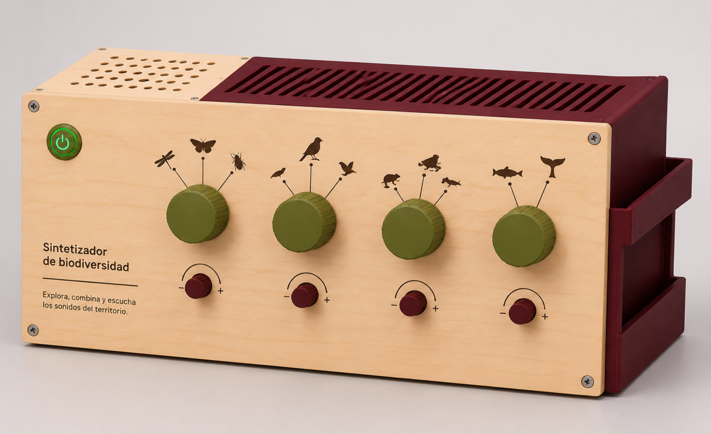
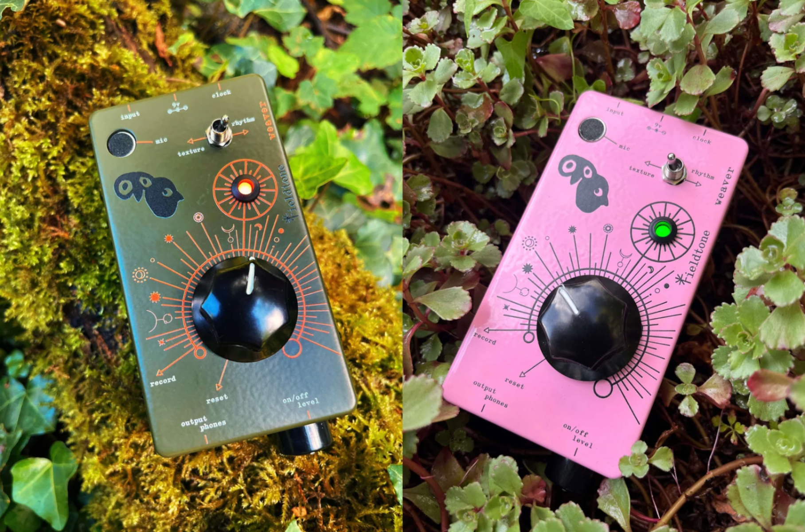
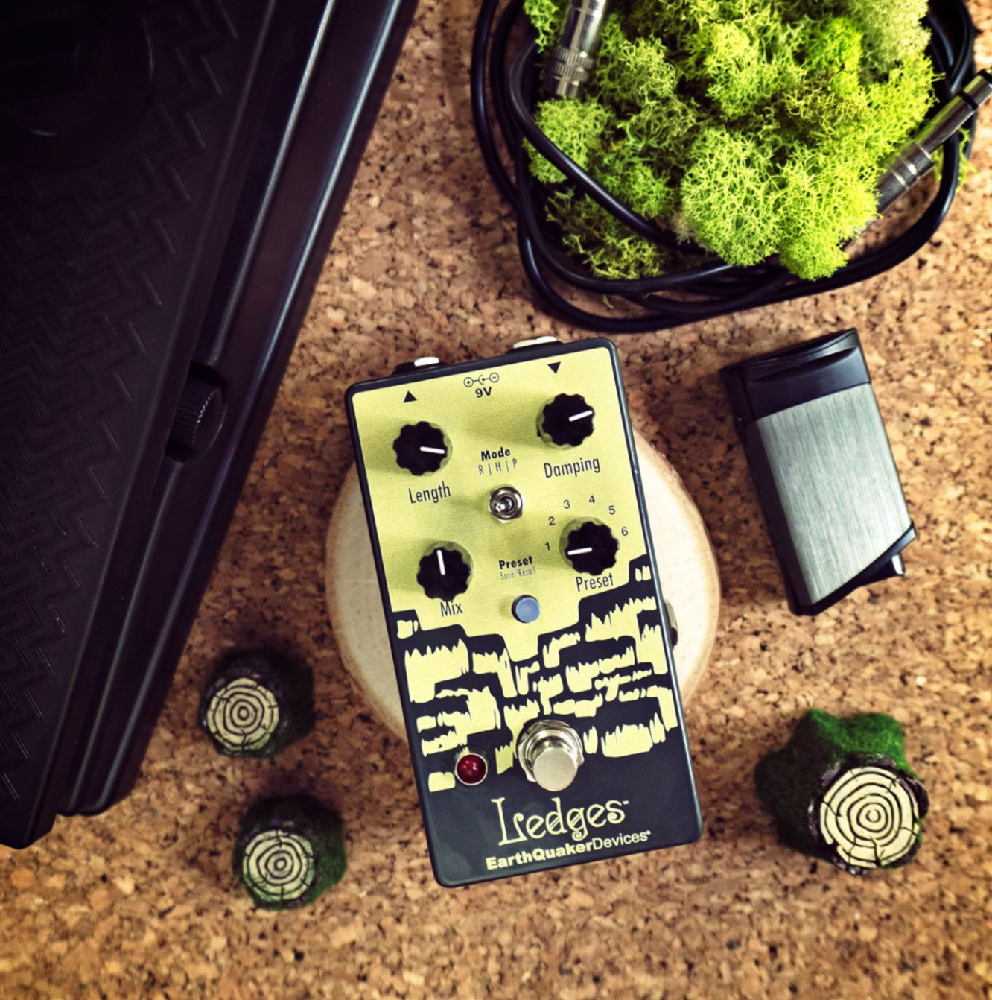
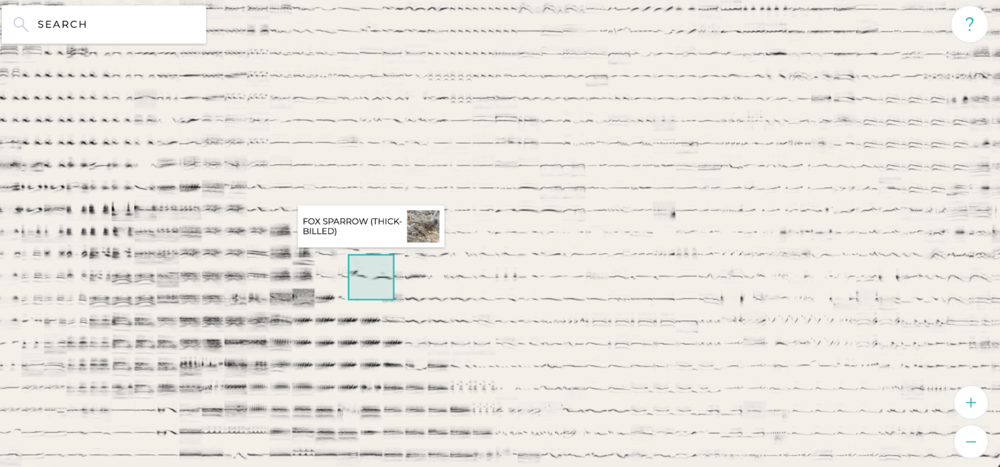

# sesion-14a

## apuntes sesión

Este día terminamos de corregir todos los aspectos técnicos de lo que necesitábamos: el bom, diagrama de flujo, pseudocodigo, prototipo en wokwi (que quedaron actualizados en las bitácoras anteriores y en [00-proyecto-3/grupo-03](https://github.com/catalinaoyanedel-01/dis8645-2026-2-procesos-2/tree/main/00-proyecto-3/grupo-03), y realización de la idea de la carcasa.

hicimos un boceto y luego la renderizamos con IA con el siguiente prompt:

> "Genera un render realista del diseño que adjunto, respetando su distribución y proporciones. Los materiales y elementos deben interpretarse de la siguiente manera: las superficies de color café claro corresponden a madera clara; las piezas burdeos, a filamento de impresión 3D; y las perillas verdes, también a filamento 3D. Los pequeños puntos burdeos corresponden a potenciómetros de menor tamaño, destinados a controlar el volumen de cada especie. Las líneas grabadas en la superficie representan las siluetas de distintas especies. En la parte superior se encuentran los orificios de salida del sonido. El botón ubicado en la esquina superior izquierda corresponde al encendido y apagado del dispositivo, mientras que en la zona inferior izquierda se incorpora una pequeña leyenda explicativa. Es importante mantener la estética, la distribución de los controles y la estructura del diseño original, sin agregar elementos que no estén contemplados."








nos dividimos las tareas para hacerlo más equitativo y ordenado. mi rol es cumplir con esto:

Yai – Hardware, KiCad y documentación
Desarrollar el esquema electrónico en KiCad.
Identificar componentes y conexiones.
Revisar requerimientos eléctricos.
Documentar conexiones de potenciómetros, botones, amplificador y Raspberry Pi.
Investigar aspectos técnicos del hardware.
Investigar referentes de instrumentos sonoros.
Organizar bibliografía y referencias en formato APA.

Entregable: esquema electrónico, documentación de hardware, investigación de referentes y documento consolidado.


## Referentes

`01. ARTISTAS Y OBRAS`
### Carlos Cabezas

Carlos Cabezas es un músico, productor y artista sonoro chileno con más de 40 años de trayectoria. Su trabajo destaca por la experimentación electrónica, el autodidactismo y el cruce entre la música, las artes visuales, el cine y el teatro. Sobre su recorrido artístico, Arteaga (2025) señala: “Desde los días fundacionales de Electrodomésticos, pasando por su carrera solista, proyectos como La Banda del Dolor, Cordillera y sus incursiones en el bolero y la experimentación sonora, su obra se ha transformado en un mapa sonoro que refleja tanto la historia personal del artista como la evolución cultural del país.” (párr. 1)

Como referentes para este proyecto, consideramos una obra de su autoría y otra en la que participó como compositor:

#### Cordillera: álbum realizado en conjunto a Ángelo Pierattini**

Respecto al enfoque conceptual de este disco, Carlos Cabezas explica:

> “Cordillera plantea un paisaje sonoro, por ejemplo, como lo dice el nombre, plantea un espacio, una sensación, un territorio. Y las sensaciones y reflexiones que pueden venir de ahí, de lo que puede ser la experiencia de vida en ese espacio.” (Arteaga, 2025, párr. 12)

Por su parte, Ángelo Pierattini complementa esta visión señalando que el álbum contiene “composiciones muy sensibles, mínimas en su vestidura, mucha atmósfera, una que lograra llevarnos a un espacio tan enigmático como la cordillera” (La Tercera, 2024, párr. 3).

De este álbum rescatamos su propuesta conceptual en torno al paisaje sonoro, ya que nos permite abordar la idea del espacio y las sensaciones propias de los distintos territorios que estamos abordando.

[Escuchar álbum](https://www.youtube.com/watch?v=GS2s04lrvJQ&list=OLAK5uy_kAeUhNzJDxWLnzSldMlwBvJNGEk6lieLc)

#### Blanco

Blanco es una obra de danza contemporánea sobre la vastedad de la naturaleza y la forma en que nos afecta y conecta, cocreada por tres figuras de las artes escénicas: Rodrigo Pérez, Andrés Poirot y Claudia Vicuña. La puesta en escena indaga en la sensación de inmensidad de un paisaje y en el silencio interior que se alcanza al contemplarlo (Centro Cultural Gabriela Mistral, s. f.).

La composición musical estuvo a cargo de Carlos Cabezas, quien construye un ambiente envolvente, cristalino y natural. Según explicó Claudia Vicuña, la obra se concibe como un paisaje en el que los elementos coexisten sin jerarquías, permitiendo que sea el propio espectador quien vincule sus componentes (Radio Universidad de Chile, 2019).

De esta propuesta rescatamos tanto la composición musical, que evoca al entorno natural, como la noción de un paisaje abierto, donde cada cada elemento pueda existir individualmente y que el usuario sea quien le da sentido a lo que escucha.

[Blanco](https://www.youtube.com/watch?v=KTKLvBF6utY)

### Felipe Otondo

Felipe Otondo es ingeniero acústico, con una maestría en Acústica en la Universidad de Aalborg (Dinamarca), y compositor: estudió composición en la Carl Nielsen Academy of Music y realizó un doctorado en composición musical en la Universidad de York. Actualmente dirige el Instituto de Acústica de la Universidad Austral de Chile y, desde 2019, lidera el proyecto Soundlapse, vinculado a un proyecto Fondecyt sobre una herramienta espacio-temporal para aplicaciones creativas y educativas de grabaciones de paisaje sonoro de humedales.

Soundlapse se organiza en tres líneas de investigación: detección de fauna, creación artística y educación ambiental. En la primera, usan inteligencia artificial para detectar de manera fidedigna las aves de Chile y generar un repositorio para escucharlas, que vincula la imagen del ave con su sonido y una breve descripción.

[Repositorio de Aves](https://www.sonidosdeaves.cl)

----

`02. CARCASA E INTERFAZ`
### Fieldtone – Weaver Handheld

Weaver Handheld es un instrumento electrónico portátil desarrollado por Fieldtone, una marca británica dedicada a la creación de dispositivos de experimentación sonora. El instrumento permite capturar, manipular y transformar sonidos mediante un micrófono incorporado, controles físicos y una interfaz que facilita la exploración de distintas posibilidades sonoras. Su diseño destaca por una carcasa compacta, una distribución sencilla de sus controles y una estética que integra elementos funcionales y visuales.

Queremos rescatar de este referente la carcasa e interfaz, para realizar gráficas en vinilo o grabado láser. Por ejemplo, con la perilla, utilizando las siluetas de las especies para indicar donde se encuentra el usuario, hacer que la interacción sea más fácil de entender y permita la exploración autónoma.



### Ledges EARTHQUAKER DEVICES

Ledges es un pedal de efectos electrónico desarrollado por la marca estadounidense EarthQuaker Devices. Se trata de un dispositivo de reverberación que permite modificar las características espaciales de un sonido mediante tres modos: Room, Hall y Plate, que generan distintos tipos de resonancia y profundidad. Cuenta con controles físicos mediante perillas para ajustar parámetros como la duración de la reverberación (Length), la intensidad del efecto (Mix) y la atenuación de frecuencias agudas (Damping). Además, incorpora un selector de modos y una perilla para guardar y recuperar hasta seis configuraciones de sonido. 

De esta propuesta rescatamos la organización de su interfaz física y la manera en que distribuye los controles para facilitar la manipulación sonora. Nos interesa especialmente la incorporación de indicadores gráficos alrededor de las perillas y selectores, que permiten comprender visualmente las distintas opciones de configuración. 



----

`03. PROYECTOS DE DISEÑO`

### Bird Sounds (2017)

Bird Sounds es un proyecto interactivo desarrollado por Manny Tan, Kyle McDonald y el equipo de Google Creative Lab, que utiliza inteligencia artificial y aprendizaje automático para organizar y visualizar miles de grabaciones de sonidos de aves. A través de una técnica llamada t-SNE, el sistema identifica similitudes entre los registros sonoros y los representa en un mapa visual, agrupando aquellos que presentan características similares. Para realizar este proceso, el sistema analiza únicamente los audios, sin recibir información previa sobre los nombres o las especies de las aves. 

Rescatamos la posibilidad de transformar una colección de registros sonoros en una experiencia interactiva. Buscamos utilizar los registros sonoros de distintas especies chilenas en peligro de extinción como una forma de acercar al usuario a la biodiversidad. 



--- 

`04. REFERENTES SONOROS`

### PercuSynth – GC Lab Chile

PercuSynth es un instrumento electrónico desarrollado por GC Lab Chile, que combina funciones de caja de ritmos, controlador MIDI y sintetizador polifónico. Su diseño permite experimentar con la creación y manipulación de sonidos mediante controles físicos y componentes electrónicos, explorando distintas posibilidades de composición sonora.

De este referente rescatamos las posibilidades de experimentación rítmica y creación de composiciones a partir de sonidos. Nos interesa explorar cómo estas herramientas pueden utilizarse para complementar los registros bioacústicos de las especies de nuestro proyecto, incorporando elementos rítmicos y sonoros que permitan enriquecer la experiencia de escucha.

[Escuchar sintetizador](https://youtube.com/shorts/DbD2s_9ED9s)

### Proto-Synth V2.0 – GC Lab Chile

Proto-Synth V2.0 es un instrumento electrónico experimental desarrollado por GC Lab Chile, orientado a la exploración y creación de sonidos mediante síntesis digital. A través de sus controles físicos, permite modificar y experimentar con diferentes parámetros sonoros, generando texturas y composiciones electrónicas.

De este referente rescatamos la experimentación con la síntesis y la manipulación de sonidos para construir ambientes y paisajes sonoros. Nos interesa explorar cómo complementar los registros originales de las especies con recursos de síntesis sonora, creando atmósferas que evoquen sus hábitats y permitan generar una experiencia de escucha más envolvente.

[Escuchar sintetizador](https://youtube.com/shorts/6owidjx-n7g)

### 4300 km – Grabaciones de campo de artistas chilenos (2017)

4300 km es una compilación sonora publicada en 2017 por Tsonami Records, sello dedicado al paisaje sonoro, la música experimental y el arte sonoro. El álbum reúne trabajos de trece artistas chilenos que utilizan grabaciones de campo realizadas en distintos territorios del país, desde el desierto de Atacama hasta la Patagonia. Entre sus registros se encuentran sonidos de humedales, ambientes naturales, agua y distintos espacios del territorio nacional. La compilación busca presentar una radiografía del paisajismo sonoro en Chile a través de grabaciones que documentan las características acústicas de cada lugar.

Rescatamos el uso de grabaciones de campo como una herramienta para registrar y dar a conocer los sonidos de los distintos territorios. Nos interesa especialmente cómo estos registros permiten acercarnos a los ambientes naturales a través de la escucha.

[4300 km: Grabaciones de campo de artistas chilenos](https://tsonamirecords.bandcamp.com/album/4300-km-grabaciones-de-campo-de-artistas-chilenos)

### Experiencia de usuario

**1.⁠ ⁠Encendido:** la persona presiona el botón ubicado en la esquina superior.

**2.⁠ ⁠Lectura de controles:** la máquina lee la posición de las cuatro perillas de selección de especies, las cuatro perillas de probabilidad y la perilla de tempo. Carga las especies indicadas por cada control.

**3.⁠ ⁠Inicio en silencio:** el paisaje sonoro comienza en silencio, con las cuatro categorías en probabilidad mínima.

**4.⁠ ⁠Activar una especie:** la persona aumenta la probabilidad de una categoría mediante su perilla correspondiente. Esto incrementa las posibilidades de que el sonido de esa especie aparezca en el paisaje sonoro.

**5.⁠ ⁠Cambiar de especie:** al girar una perilla de selección, el canal cambia a otra especie de su categoría. La nueva especie mantiene la probabilidad configurada para ese canal.

**6.⁠ ⁠Ajustar la probabilidad:** cada una de las cuatro perillas permite modificar la probabilidad de aparición de los sonidos de su categoría. De esta manera, la persona puede generar paisajes sonoros con distintas frecuencias de aparición, presencias y ausencias.

**7.⁠ ⁠Ajustar el tempo:** mediante la novena perilla, la persona modifica el tempo general de la composición, afectando el ritmo de aparición o reproducción de los sonidos.

**8.⁠ ⁠Componer:** la persona combina las distintas probabilidades y modifica el tempo general, creando diferentes paisajes sonoros mediante la presencia, ausencia y frecuencia de aparición de cada especie.

**9.⁠ ⁠Apagado:** al presionar nuevamente el botón, se detienen todos los canales de audio y la máquina queda en reposo.

```mermaid
---
config:
  theme: default
---
flowchart TB
    A(["INICIO"]) --> B["Presionar botón de encendido"]
    B --> C["Reproducir sonido de inicio"]
    C --> D["Leer los 9 potenciómetros"]
    D --> E["Cargar las 4 especies seleccionadas"]
    E --> F["Iniciar paisaje sonoro en silencio"]
    F --> G{"¿Qué control utiliza la persona?"}
    G -- Selección de especie --> H["Cambiar especie de la categoría"]
    H --> I["Cargar nuevo registro sonoro"]
    I --> J["Conservar probabilidad configurada"]
    G -- Probabilidad --> K["Modificar probabilidad de aparición"]
    K --> L{"¿Probabilidad en cero?"}
    L -- Sí --> M["No reproducir sonidos de esa categoría"]
    L -- No --> N["Actualizar frecuencia de aparición"]
    G -- Tempo general --> O["Modificar tempo de la composición"]
    O --> P["Actualizar ritmo de reproducción o aparición"]
    J --> Q["Actualizar paisaje sonoro"]
    M --> Q
    N --> Q
    P --> Q
    Q --> R{"¿Presiona botón de apagado?"}
    R -- No --> G
    R -- Sí --> S["Detener reproducción de audio"]
    S --> T["Silenciar todos los canales"]
    T --> U(["MÁQUINA EN REPOSO"])

    style A fill:#FFF9C4
    style B fill:#C8E6C9
    style C fill:#C8E6C9
    style D fill:#C8E6C9
    style E fill:#C8E6C9
    style F fill:#C8E6C9
    style G fill:#E1BEE7
    style H fill:#C8E6C9
    style I fill:#C8E6C9
    style J fill:#C8E6C9
    style K fill:#C8E6C9
    style L fill:#E1BEE7
    style M fill:#C8E6C9
    style N fill:#C8E6C9
    style O fill:#C8E6C9
    style P fill:#C8E6C9
    style Q fill:#C8E6C9
    style R fill:#E1BEE7
    style S fill:#C8E6C9
    style T fill:#C8E6C9
    style U fill:#FFF9C4
  ```

## Desarrollo técnico

### BOM

| Componente | Especificación | Cantidad | Precio (CLP) | Dónde comprar |
|---|---|---:|---:|---|
| Multiplexor I2C | Módulo Multiplexor CD74HC4067 (16 canales) | 1 | $2.000 | [Afel](https://afel.cl/products/modulo-multiplexor-cd74hc4067?_pos=1&_sid=10698f577&_ss=r) |
| Parlante | 8 Ω – 1 W | 1 | $3.290 | [Mechatronic Store](https://www.mechatronicstore.cl/altavoz-8-ohm-1w/) |
| Amplificador | MAX98357A – I2S Class-D Mono Amplifier | 1 | $1.114 | [AliExpress](https://es.aliexpress.com/item/1005007629020891.html?invitationCode=NmNJM3JLWWZZS1FMUFFMQmtCMGZzc1ViQXIxOG1yRmxHY3ZrcTc2TzFsU2VQemFTZUJrNWVWT0s1MU1hdTAyWg&srcSns=sns_Copy&spreadType=socialShare&social_params=22243417448&bizType=ProductDetail&spreadCode=NmNJM3JLWWZZS1FMUFFMQmtCMGZzc1ViQXIxOG1yRmxHY3ZrcTc2TzFsU2VQemFTZUJrNWVWT0s1MU1hdTAyWg&aff_fcid=b2fb14cd2e1c4e359da75f150cac31ce-1795048981407-09999-_mOqQo0f&tt=MG&aff_fsk=_mOqQo0f&aff_platform=default&sk=_mOqQo0f&aff_trace_key=b2fb14cd2e1c4e359da75f150cac31ce-1795048981407-09999-_mOqQo0f&shareId=22243417448&businessType=ProductDetail&platform=AE&terminal_id=a4e6610a1d834a91a02e63493c836ef4&afSmartRedirect=y) |
| Potenciómetro | B100K – 100 kΩ | 8 | $500 | [Afel](https://afel.cl/products/potenciometro-100k-ohm?_pos=7&_sid=9e0d7b4a3&_ss=r) |
| Cable Dupont | Emisor-receptor (pack 20 u.) | 1 pack | $1.000 | [Afel](https://afel.cl/products/pack-20-cables-de-conexion-macho-hembra?_pos=10&_sid=aaf1449e0&_ss=r) |
| Cable Dupont | Receptor-receptor (pack 20 u.) | 1 pack | $1.000 | [Afel](https://afel.cl/products/pack-20-cables-de-conexion-hembra-hembra?_pos=9&_sid=aaf1449e0&_ss=r) |
| Cable Dupont | Emisor-emisor (pack 20 u.) | 1 pack | $1.000 | [Afel](https://afel.cl/products/pack-20-cables-de-conexion-macho-macho?_pos=8&_sid=3f3b26861&_ss=r) |
| Botón | Táctil 12 × 12 × 7,3 mm | 1 | $100 | [Afel](https://afel.cl/products/boton-tactil-tapa-12x12x7-3-interruptor?_pos=1&_sid=699a10ff2&_ss=r) |
| Módulo micro SD | Lector de tarjeta micro SD | 1 | $2.500 | [Afel](https://afel.cl/products/lector-micro-sd?variant=45125228363928&country=CL&currency=CLP&utm_medium=product_sync&utm_source=google&utm_content=sag_organic&utm_campaign=sag_organic&utm_term=&utm_campaign=@+Smart+Shopping&utm_source=adwords&utm_medium=ppc&hsa_acc=1808722794&hsa_cam=18405560573&hsa_grp=&hsa_ad=&hsa_src=x&hsa_tgt=&hsa_kw=&hsa_mt=&hsa_net=adwords&hsa_ver=3&gad_source=1&gad_campaignid=17613659948&gbraid=0AAAAADBMsFTN_gh9R6uq0a2pF9xf_kgnV&gclid=Cj0KCQiAtvXXBhC2ARIsAJc8SUSguyj6IVfNbUJedOtDKN_4iNUrlwUZ9uejr6jYonCG1e7MDeGT9PIaAifsEALw_wcB) |
| Raspberry Pi Pico 2 W | Microcontrolador RP2350 – Wi-Fi / Bluetooth | 1 | $16.990 | [Mechatronic Store](https://www.mechatronicstore.cl/raspberry-pi-pico-2-w-raspberry-pi-rp2350-chip/?srsltid=AYCX9vLHVZO-tqr38lJI7R4GWZtZJnGg0Fjlj3rPMl8QFogm7r1N2Y4Z) |
## encargos

## lectura

Se plantea que el arte moderno buscó romper con las formas tradicionales de creación y cuestionar la sociedad y que muchas de estas expresiones terminaron siendo absorbidas por el sistema capitalista y transformadas en productos de consumo.

Explica distintas formas de superar los límites del arte: mientras el dadaísmo buscaba eliminarlo, el surrealismo intentaba integrarlo a la vida cotidiana.

También critica cómo el capitalismo convierte la cultura y el conocimiento en mercancías, haciendo que incluso las propuestas más revolucionarias pierdan su capacidad de cuestionar el sistema.

Me parece interesante cómo las propuestas que nacen para cuestionar el sistema pueden terminar convirtiéndose en parte de él. Esto me hace pensar en cómo muchas tendencias artísticas y visuales pierden su sentido inicial cuando son absorbidas por el consumo y el mercado.

1. "El dadaísmo quiso suprimir el arte sin realizarlo; el surrealismo quiso realizar el arte sin suprimirlo"

2. "La cultura es la esfera general del conocimiento y de las representaciones de lo vivido"
