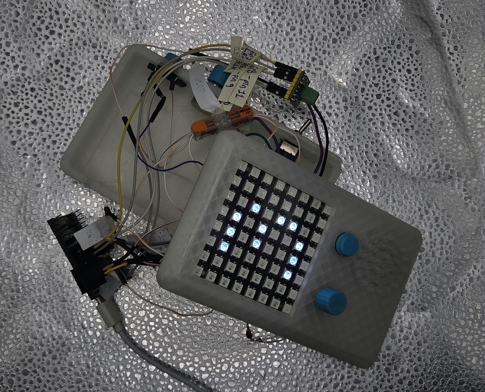
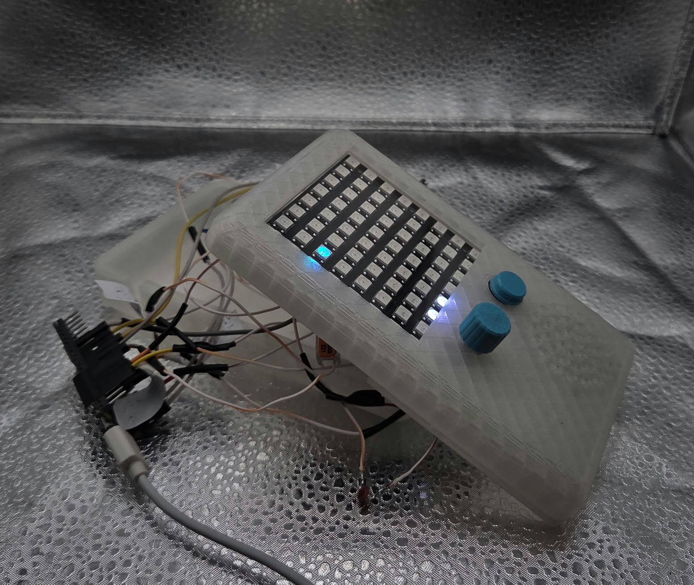
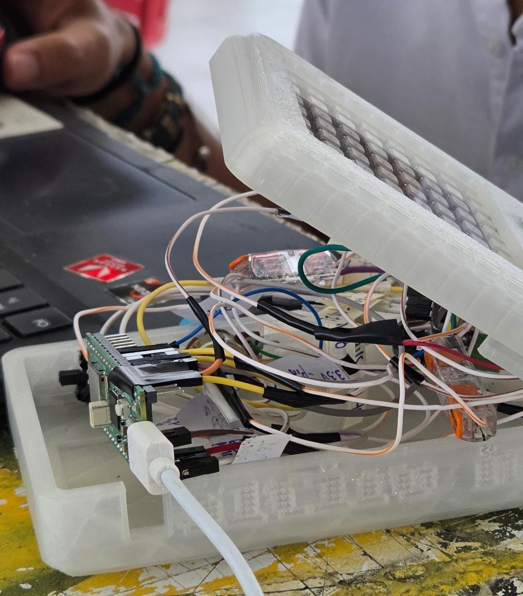
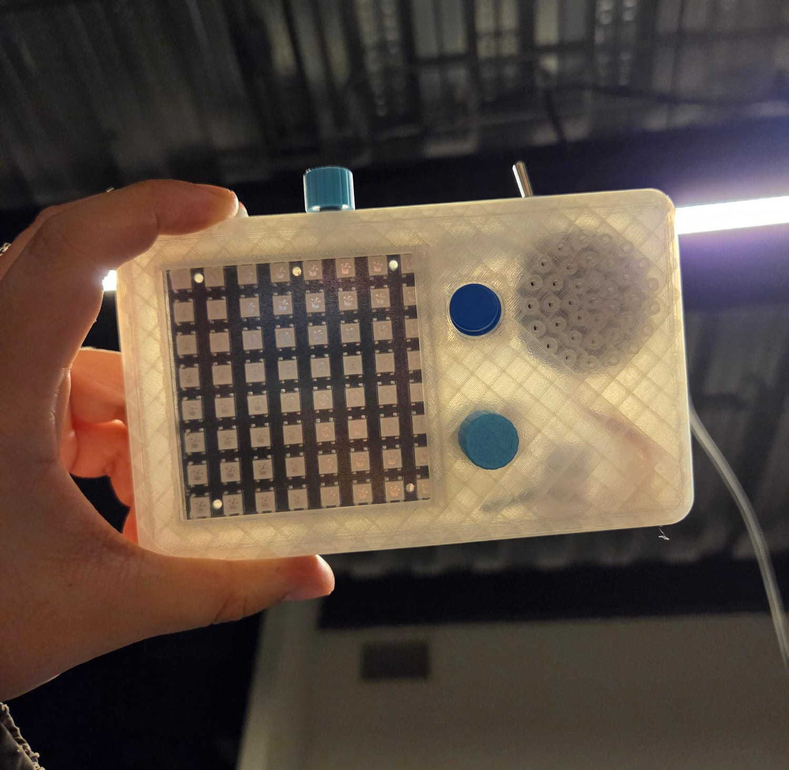
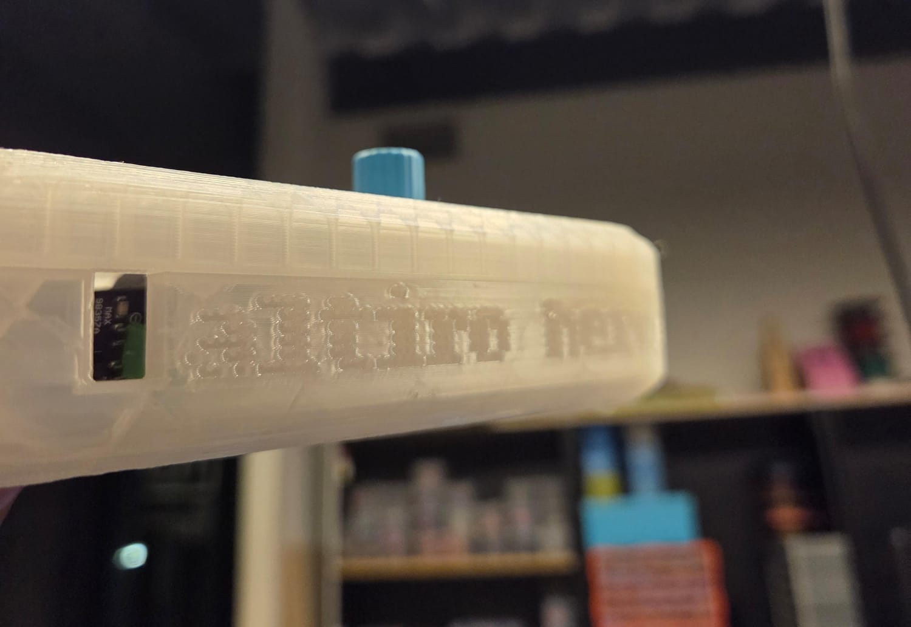

# sesion-12a

## apuntes sesión

esta sesión fue presentación de proyecto-2, por lo que no hay apuntes de materia. de igual manera, quiero poner fotos del proyecto (que no funcionó XD) el cual queremos retomar en un futuro junto a mis compañeros, ya que nos gustó la idea y la verdad lo único que nos falló fue el potenciómetro para poder viajar en el eje X:( creemos que puede ser atado por mala soldadura, o que el punto en donde se unen todas las tierras esté defectuoso... cuando tengamos tiempo y volvamos a retomar este proyecto pondré aquí los avances! (en realidad solo se podrá si es que lo logramos hacer antes de que se cierre este repo jeje)

aquí fotitos:

---

## lectura: Program Or Be Programmed: Ten Commands for a Digital Age - Douglas Rushkoff

"Friends and feeds we may have chosen arbitrarily or because we were forced to in the past son became the markers through which our programs and search engines choose what to show us next" aquí habla de que en realidad estamos bastante limitados a todo lo que se nos muestra en nuestros dispositivos, ya que nos vemos obligados a responder preguntas en las cuales nuestras respuestas servirán para definir qué es lo que veremos y qué no. por lo que entiendo, al darnos la ilusión de poder elegir nuestra respuesta se nos crea un falso sentimiento de libertad y expresión propia, pero todo esto es falso ya que nunca tuvimos realmente la libertad de elegir lo que queríamos, sino que solo nos adaptamos a las opciones que nos entrega nuestro algoritmo.

la verdad no me acompleja mucho el no tener libertad absoluta dentro del algoritmo, ya que lo que me muestra de momento es de mi agrado (demostrando que el sistema lamentablemente funciona... que horror), pero si me aterra un poco el concepto de que todo lo que tenemos actualmente cada persona en nuestro perfil (contenido de consumo audiovisual y amigos.. en realidad más enfocado a los amigos) es por decisiones forzadas que hemos tenido que tomar(? creo que es porque no me gusta el pensar que nos forzaron a hacer algo sin que estemos conscientes de lo que estamos haciendo, pero eso ya es culpa de uno mismo por no pensar bien las cosas y no estar tan educado sobre cómo funcionan los algoritmos.

"Likewise, Philip Rosedale--the quite sane founder of the virtual reality community Second Life--told me he believes that by 2020, his online world will be indistinguishable from real life" omg... que pena que ahora el juego es mayoritariamente conocido por ser un lugar en donde se refugian y comunican los pedófilos. pensándolo mejor, no me debería de dar pena ya que los fundadores del juego obviamente están al tanto de la situación debido a los reportes que se han hecho, y el que sigan funcionando los servers ya habla de que no están muy preocupados sobre el tema (lo cual es probablemente porque las mismas personas que lo usan para cosas horribles son los que dan más dinero para mantener el juego vivo lol).

> perdón por ser tan catete con el tema pero me da asco y rabia saber que se siguen manteniendo estos lugares activos a pesar de que se sabe públicamente cómo funcionan los códigos que usan entre ellos y la manera en la que se pueden identificar sin hacerlo de manera "obvia". entiendo que al bajar estos servidores no significa que dejarán de existir estas personas, pero si no les quitan sus principales lugares de acceso público no les están haciendo más fácil el compartir material de abuso? incluso si no quieren bajar el servidor, no se podría utilizar la información que hay para poder identificar a las personas que están detrás de la pantalla para poder hacer algo al respecto? sé que es complicado realizar cualquiera de estas opciones, pero no veo ningún esfuerzo por parte de la compañía para trabajar en ello lol.
