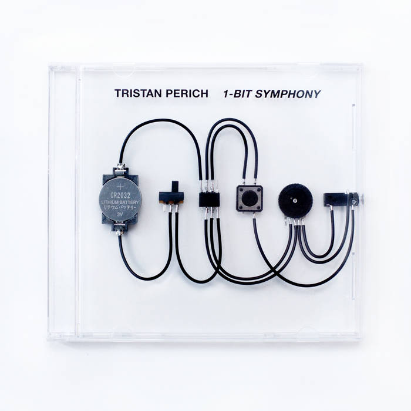
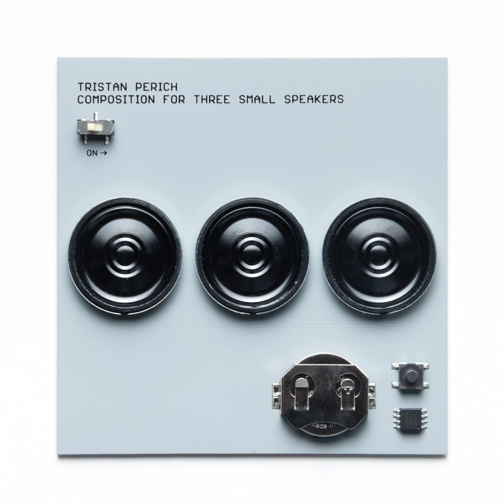
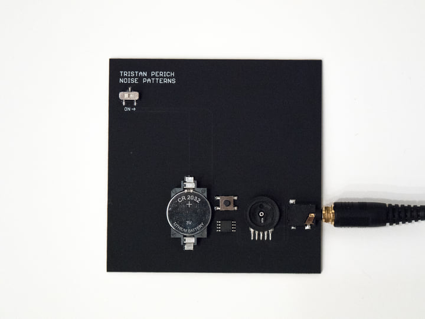
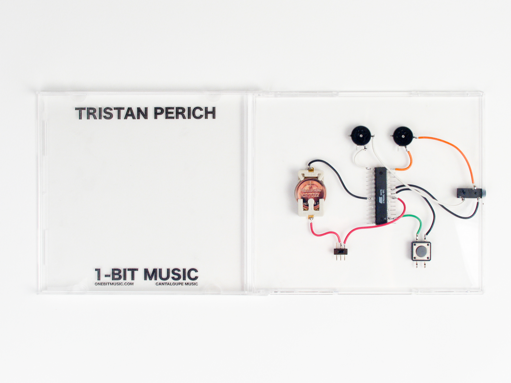
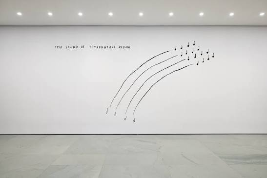

# sesion-12b

## apuntes sesión

Manuel Córdova

+ diseñador gráfico.
+ co fundador de _Comunas Unidas_.
+ autor de los libros _Modesto Estupendo (2004)_, y _Micros, el final del recorrido (2006)_.

> Comunas Unidas es un estudio de diseño con base en Santiago de Chile, el cual está activo desde 2004 (<https://diseno.udp.cl/persona/manuel-cordova-manzor/>).

### hablando de entregas de proyecto-2

+ lucha de clases, pero en el sentido de que nos costó hacer las clases LOL momazo de la sesión.
+ las clases son como los planos. el plano no es la casa, pero nos muestra la organización de ésta.
+ tenemos que aprender a citar y a hacer bibliografías... para esto se nos recomendó Zotero!! mágico, nos ayuda a citar sin tener que hacerlo a mano como los noobs.
+ (sobre citar en Zotero) el ISBN es como el RUT de los libros.

### recomendación de referentes e ideas para proyecto-3

+ Brand New Noise
+ Fruby
+ Bleep Drum
+ Pierre Schaeffer (música concreta, tratado de los objetos)

---

## encargos

1. leer el texto de Murray Schafer y escribir un párrafo en la bitácora donde describan un sonido que les llame su atención. Nombrar el sonido, elaborar como aparece, intentar describir como suena y sus aspectos culturales

### Nunca vi un sonido - Murray Schafer

+ "Todo sonido se suicida y no vuelve. Los músicos lo saben. Ninguna
frase musical puede repetirse de manera idéntica dos veces".
+ "todos los acontecimientos traumáticos conservan el sonido como su
medio expresivo: guerra, violencia, amor, locura. Sólo la enfermedad
es silenciosa y no consiente el análisis".
+ "Es una forma distinta de
percibir el medio ambiente; una en el que los sentidos no están
divididos; una que reconoce que toda la información está
interconectada".

el sonido que he elegido es el aullido de mi hermano Mailo (es un perro). este aparece seguido del sonido de la puerta abriéndose, en donde lo que se lleva la mayor atención de mi oído es el choque de las llaves. luego de las llaves, pasan unos segundos en donde pareciera existir silencio, pero si uno presta atención se puede escuchar como el Mailo abre y cierra su boca, preparándose para hablar. una vez ya hizo el movimiento con su boca unas dos o tres veces, aparece el sonido de su aullido.

el aullido parte como una vibración similar a la que hace un motor de auto al arrancar, pero ésta tiene la diferencia de que cambia entre tonos graves y agudos de la misma manera en la que sube y baja una montaña rusa. este sonido lo asocio tanto yo como mi familia al llegar a casa, o que haya llegado otro integrante de la familia al hogar (mi madre o mi hermana menor).

2. revisar 1 obra de Tristan Perich y 1 de Christine Sun Kim

### Tristan Perich

la obra _1-Bit Symphony_ de Tristan me llamó la atención desde que lo mostraron en clases debido a la carcasa que tiene!! al inicio pensé que era solo algo estético, pero al ver el siguiente video: <https://www.youtube.com/watch?v=dBUVKNqdsEo> me sorprendió bastante el darme cuenta de que este circuito realmente funcionaba.

se me hace absolutamente hermoso el hecho de que utilice como carcasa una caja para CD, ya que permite ver con perfeta claridad los componentes causantes de los sonidos que se logran emitir al momento de conectarse a este circuito. pensé que solo tenía esta obra que funcionaba de esta manera (hablando sobre carcasa), pero revisando en Google me apareció la obra _Composition for Three Small Speakers_, en donde hace lo mismo!! luego de leer me di cuenta de que también las obras _Noise Patterns_ y _1-Bit Music_ tienen la misma forma de presentarse al tener los componentes expuestos a la vista del usuario.

### Christine Sun Kim

The Sound of Temperature Rising (2019)

el concepto de esta obra nace cuando Christine estaba embarazada de su primer bebé, cuando sentía el cuerpo caliente en todo momento y no podía dormir muy bien. al mismo tiempo, estaba surgiendo Donald Trump y todo el clima político que esto conllevó, más las sequías, inundaciones, tormentas y efectos del calentamiento global.

Christine dice que sintió como si todos estos tipos distintos de aumentos de temperaturas se mezclaran, por lo que utilizó una noción musical abierta para poder capturar y mostrar lo que sentía.

en la obra mostró cuatro líneas del pentagrama en vez de las cinco habituales, esto para mostrar cómo se representarían las líneas del pentagrama en la lengua de señas americana (ASL) como si fueran cuatro dedos extendidos por la parte frontal del cuerpo.

> <https://www.moma.org/collection/works/426452>
