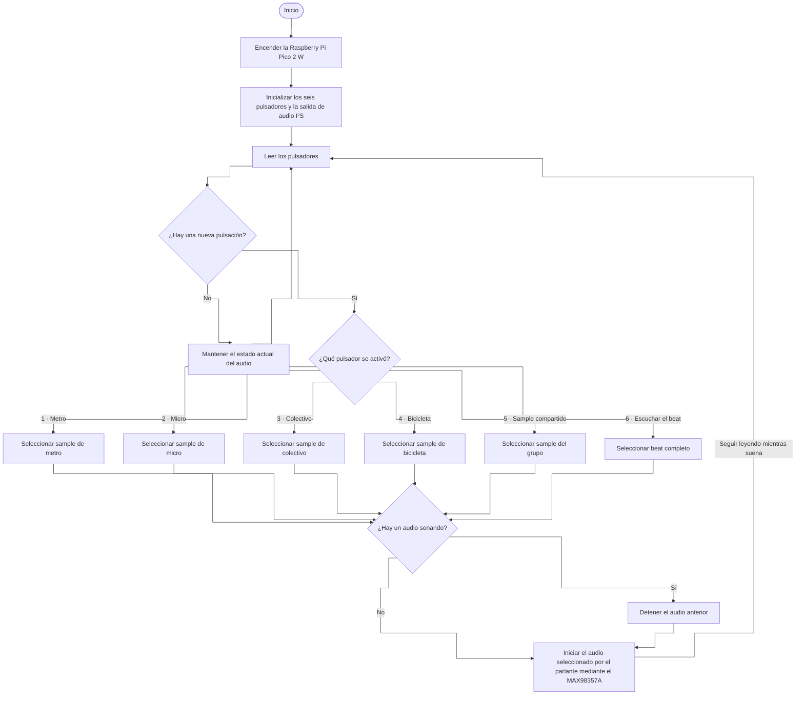

# sesion-13a

## apuntes sesión

el lenguaje no crea realidades. la realidad es lo que es, el lenguaje nos ayuda a entenderlo.

en 15b se termina la asistencia.

semana 16 es exclusivo de taller 

el pseudo pueden ser puros prints explicando que sucede

---

# avance en clases

## descripción del trabajo

Recolección de sonidos de distintos recorridos en el contexto del viaje desde la universidad a la casa, usando el transporte público (esto lo podemos sustentar con alguna encuesta de transporte de Santiago). Según AIM Chile "En la Región Metropolitana, los medios de transporte utilizados habitualmente, de lunes a viernes, son; Micros/Buses 57,4%, Metro 47,8%, Automóvil 31,5%, Caminando 28,5%.", por lo que grabaremos lo que se escucha al viajar en estos distintos contextos.

> como no tenemos auto, este será reemplazado con el colectivo.
> como vivimos todos a una distancia muy larga como para poder caminarla, la caminata será reemplazada por bicicleta.

1. Metro (Fran): Línea 1 y 5.
2. Micro (Nico): 210 y otra +
3. Colectivo (Tomaz): Cerro Navia 
4. Bicicleta (Santi): Vargas Buston 

# Referente proyecto: 

- korg volca sample 1

---

## bill of materials

| componente | cantidad | valor unitario | link |
| --- | --- | --- | --- |
| Raspberry Pi Pico 2w | 1 | $14.990 | <https://raspberrypi.cl/products/raspberry-pi-pico-2-w-con-headers> |
| Parlante altavoz 8 Ohm 1W | 1 | $4.290 | <https://www.mechatronicstore.cl/altavoz-8-ohm-1w/> |
| Botón pulsador | - | $400 | <https://afel.cl/products/boton-tactil-tapa-12x12x7-3-interruptor> |
| Potenciómetro B100k | - | $495 | <https://altronics.cl/potenciometro-lineal-100k-b100k> |
| Protoboard 400 puntos | 1 | $1.500 | <https://afel.cl/products/mini-protoboard-400-puntos> |
| Pack 20 cables Dupont | 1 | $1.000 | <https://afel.cl/products/pack-20-cables-de-conexion-macho-macho> |

---

# ver. actualizada

### bill of materials (BOM)

| Componente | Cantidad | Valor unitario | Subtotal | Link |
| --- | ---: | ---: | ---: | --- |
| Raspberry Pi Pico 2 W con headers | 1 | $14.990 | $14.990 | [Raspberry Pi Chile](https://raspberrypi.cl/products/raspberry-pi-pico-2-w-con-headers) |
| Parlante de 8 Ω y 1 W | 1 | $4.290 | $4.290 | [Mechatronic Store](https://www.mechatronicstore.cl/altavoz-8-ohm-1w/) |
| Botón pulsador | 6 | $400 | $2.400 | [AFEL](https://afel.cl/products/boton-tactil-tapa-12x12x7-3-interruptor) |
| Protoboard de 400 puntos | 1 | $1.500 | $1.500 | [AFEL](https://afel.cl/products/mini-protoboard-400-puntos) |
| Pack de 20 cables Dupont macho-macho | 1 | $1.000 | $1.000 | [AFEL](https://afel.cl/products/pack-20-cables-de-conexion-macho-macho) |
| Módulo amplificador I²S MAX98357A | 1 | $4.136 | $4.136 | [Mercado Libre Chile](https://www.mercadolibre.cl/placa-decodificadora-max98357a-i2s-modulo-amp-de-audio-clase/p/MLC2053073155) |
| Cable USB-A a micro-USB de 1 m para datos y alimentación | 1 | $790 | $790 | [Electrónica Tesla](https://etesla.cl/producto/cable-usb-a-micro-5-pin-1-metro-sin-embalaje/) |
| Potenciómetro lineal B100K para volumen | 1 opcional*** | $495 | $495 | [Altronics](https://altronics.cl/potenciometro-lineal-100k-b100k) |

### Diagrama de flujo

### Texto descriptivo del proyecto

#### De ida

**De ida** es un sampler para hacer música con grabaciones de nuestros recorridos desde la universidad a casa. Cada integrante elige un momento memorable de su trayecto y el quinto sample se elige en conjunto. La selección se hará después de grabar y escuchar el material.

| Sample | Integrante | Recorrido |
| --- | --- | --- |
| Metro | Fran | Líneas 1 y 5 |
| Micro | Nico | 210 y un segundo recorrido por definir |
| Colectivo | Tomaz | Cerro Navia |
| Bicicleta | Santi | Vargas Buston |
| Sample compartido | Todo el grupo | Por definir |

El prototipo tiene **cinco botones para reproducir los samples** y un sexto, **«Escuchar el beat»**, para reproducir una pieza de 15 a 20 segundos armada en el computador con las cinco grabaciones. Del Korg Volca Sample tomamos la idea de disparar muestras con botones. [Korg Volca Sample](https://www.korg.com/uk/products/dj/volca_sample/features.php)

### Fuentes

- En la Región Metropolitana, el 57,4 % declaró usar habitualmente micro o bus de lunes a viernes, el 47,8 % Metro y el 7,3 % bicicleta. [Radiografía al uso de medios de transporte de los chilenos — AIM Chile, 2024](https://aimchile.cl/radiografia-al-uso-de-medios-de-transporte-de-los-chilenos/)
- La Encuesta Origen Destino de Santiago 2012 estimó 530.000 viajes diarios realizados exclusivamente en taxi colectivo. [Resultados de la encuesta — Ministerio de Transportes y Telecomunicaciones](https://www.mtt.cl/presentamos-resultados-de-la-encuesta-origen-destino-de-santiago/)

+ <https://aimchile.cl/radiografia-al-uso-de-medios-de-transporte-de-los-chilenos/>

---

## lectura: Program Or Be Programmed: Ten Commands for a Digital Age - Douglas Rushkoff
